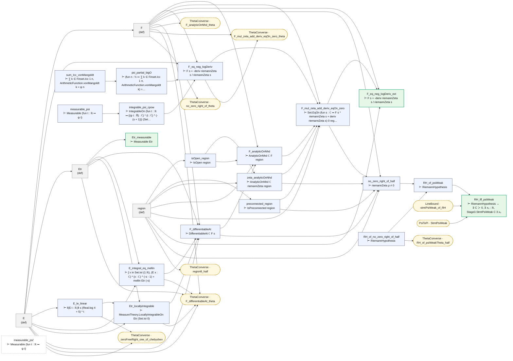

# `lean_stage3/Stage3/VonKochScaffold.lean`

**What it does** (its own header): # Von Koch converse — roadmap B1, COMPLETE (∃ C x₀, ∀ t ≥ x₀, |ψ t − t| ≤ C·√t·(log t)³) → RiemannHypothesis

**Imports:** [`LineBound`](../lean_stage3/LineBound.md).
**Imported by:** [`Stage3`](../lean_stage3/Stage3.md), [`ThetaConverse`](../lean_stage3/ThetaConverse.md).

Blue: theorem. Green: a theorem nothing else uses (an end). Dashed white: connects to nothing. Grey: definition. Red: contains `sorry`. Yellow: in another file. An arrow A → B reads "A is used by B".

## Every declaration

| declaration | proves (output) | needs (input) | why (its own docstring) | uses | used by |
|---|---|---|---|---|---|
| `VonKoch.E` def, line 31 | ℝ | x : ℝ | The error function. | — | `Stage3.F_differentiableAt_theta`, `Stage3.zeroFreeRight_one_of_chebyshev`, `VonKoch.E_integral_eq_mellin`, `VonKoch.E_le_linear`, `VonKoch.Etr`, `VonKoch.Etr_locallyIntegrable`, `VonKoch.F`, `VonKoch.F_differentiableAt`, `VonKoch.F_eq_neg_logDeriv` |
| `VonKoch.F` def, line 34 | ℂ | s : ℂ | The completed right-hand object: `s/(s−1) + s·∫₁^∞ E(x)·x^(−s−1) dx`. | `VonKoch.E` | `Stage3.F_analyticOnNhd_theta`, `Stage3.F_differentiableAt_theta`, `Stage3.F_mul_zeta_add_deriv_eqOn_zero_theta`, `Stage3.no_zero_right_of_theta`, `VonKoch.F_analyticOnNhd`, `VonKoch.F_differentiableAt`, `VonKoch.F_eq_neg_logDeriv`, `VonKoch.F_eq_neg_logDeriv_ext`, `VonKoch.F_mul_zeta_add_deriv_eqOn_zero`, `VonKoch.no_zero_right_of_half` |
| `VonKoch.Etr` def, line 38 | ℝ → ℂ | — | The truncated error, as a function on `(0,∞)`: `E` on `(1,∞)`, zero below. | `VonKoch.E` | `Stage3.F_differentiableAt_theta`, `VonKoch.E_integral_eq_mellin`, `VonKoch.Etr_locallyIntegrable`, `VonKoch.Etr_measurable`, `VonKoch.F_differentiableAt` |
| `VonKoch.measurable_psi'` theorem, line 40 | Measurable (fun t : ℝ ↦ ψ t) | — | — | — | — |
| `VonKoch.Etr_measurable` theorem, line 47 | Measurable Etr | — | — | `VonKoch.Etr` | — |
| `VonKoch.E_le_linear` theorem, line 52 | ‖(E t : ℝ)‖ ≤ (Real.log 4 + 5) * t | ht : 0 ≤ t | Crude bound, no hypothesis: `\|E t\| ≤ (log 4 + 5)·t` for `t ≥ 0`. | `VonKoch.E` | `Stage3.zeroFreeRight_one_of_chebyshev`, `VonKoch.Etr_locallyIntegrable` |
| `VonKoch.E_integral_eq_mellin` theorem, line 60 | ∫ x in Set.Ioi (1:ℝ), (E x : ℂ) * (x : ℂ) ^ (-s - 1) = mellin Etr (-s) | s : ℂ | The E-integral IS the Mellin transform of `Etr` at `-s` — as raw integrals, no convergence needed. | `VonKoch.E`, `VonKoch.Etr` | `Stage3.F_differentiableAt_theta`, `VonKoch.F_differentiableAt` |
| `VonKoch.Etr_locallyIntegrable` theorem, line 80 | MeasureTheory.LocallyIntegrableOn Etr (Set.Ioi 0) | — | `Etr` is locally integrable on `(0,∞)`. | `VonKoch.E`, `VonKoch.E_le_linear`, `VonKoch.Etr` | `Stage3.F_differentiableAt_theta`, `VonKoch.F_differentiableAt` |
| `VonKoch.F_differentiableAt` theorem, line 118 | DifferentiableAt ℂ F s | hbound : ∀ t : ℝ, x₀ ≤ t → \|ψ t - t\| ≤ C * Real.sqrt t * (Real.log t) ^ 3; hs : 1/2 &lt; s.re; hs1 : s ≠ 1 | V1 — F is differentiable on `re s &gt; 1/2`, given the von Koch bound. The hypothesis is consumed here: `E = O(t^{1/2+δ})` at infinity makes the Mellin transform of `Etr` differentiable at `-s` whenever `re s &gt; 1/2 + δ`. | `VonKoch.E`, `VonKoch.E_integral_eq_mellin`, `VonKoch.Etr`, `VonKoch.Etr_locallyIntegrable`, `VonKoch.F` | `VonKoch.F_analyticOnNhd`, `VonKoch.no_zero_right_of_half` |
| `VonKoch.sum_Icc_vonMangoldt` theorem, line 196 | ∑ k ∈ Finset.Icc 1 n, ArithmeticFunction.vonMangoldt k = ψ n | n : ℕ | The partial sums of `Λ` over `Icc 1 n` are `ψ n`. | — | `VonKoch.psi_partial_bigO` |
| `VonKoch.psi_partial_bigO` theorem, line 203 | (fun n : ℕ ↦ ∑ k ∈ Finset.Icc 1 n, ArithmeticFunction.vonMangoldt k) =O[Filter.atTop] fun n : ℕ ↦ (n : ℝ) ^ (1:ℝ) | — | ψ is O(x) unconditionally, in big-O form on ℕ. | `VonKoch.sum_Icc_vonMangoldt` | `VonKoch.F_eq_neg_logDeriv` |
| `VonKoch.measurable_psi` theorem, line 217 | Measurable (fun t : ℝ ↦ ψ t) | — | The ψ-integrand is integrable on `Ioi 1` for `re s &gt; 1`. | — | `VonKoch.integrable_psi_cpow` |
| `VonKoch.integrable_psi_cpow` theorem, line 224 | IntegrableOn (fun t : ℝ ↦ ((ψ t : ℝ) : ℂ) * (t : ℂ) ^ (-(s + 1))) (Set.Ioi (1:ℝ)) | hs : 1 &lt; s.re | — | `VonKoch.measurable_psi` | `VonKoch.F_eq_neg_logDeriv` |
| `VonKoch.F_eq_neg_logDeriv` theorem, line 262 | F s = -deriv riemannZeta s / riemannZeta s | hs : 1 &lt; s.re | V2 — the identity on `re s &gt; 1`. The Mellin–Stieltjes representation is Mathlib's `LSeries_eq_mul_integral_of_nonneg` (partial sums `O(n^1)`, from unconditional Chebyshev); `LSeries_vonMangoldt_eq_deriv_riemannZeta_div` names the left side; `integral_Ioi_cpow_of_lt` evaluates the main term. | `VonKoch.E`, `VonKoch.F`, `VonKoch.integrable_psi_cpow`, `VonKoch.psi_partial_bigO` | `Stage3.F_mul_zeta_add_deriv_eqOn_zero_theta`, `VonKoch.F_mul_zeta_add_deriv_eqOn_zero` |
| `VonKoch.region` def, line 354 | Set ℂ | — | The working region: past the critical line, minus the pole. | — | `Stage3.regionθ_half`, `VonKoch.F_analyticOnNhd`, `VonKoch.F_eq_neg_logDeriv_ext`, `VonKoch.F_mul_zeta_add_deriv_eqOn_zero`, `VonKoch.isOpen_region`, `VonKoch.no_zero_right_of_half`, `VonKoch.preconnected_region`, `VonKoch.zeta_analyticOnNhd` |
| `VonKoch.isOpen_region` theorem, line 356 | IsOpen region | — | — | `VonKoch.region` | `VonKoch.F_analyticOnNhd`, `VonKoch.zeta_analyticOnNhd` |
| `VonKoch.preconnected_region` theorem, line 363 | IsPreconnected region | — | — | `VonKoch.region` | `VonKoch.F_mul_zeta_add_deriv_eqOn_zero`, `VonKoch.no_zero_right_of_half` |
| `VonKoch.zeta_analyticOnNhd` theorem, line 416 | AnalyticOnNhd ℂ riemannZeta region | — | — | `VonKoch.isOpen_region`, `VonKoch.region` | `VonKoch.F_mul_zeta_add_deriv_eqOn_zero`, `VonKoch.no_zero_right_of_half` |
| `VonKoch.F_analyticOnNhd` theorem, line 420 | AnalyticOnNhd ℂ F region | hbound : ∀ t : ℝ, x₀ ≤ t → \|ψ t - t\| ≤ C * Real.sqrt t * (Real.log t) ^ 3 | — | `VonKoch.F`, `VonKoch.F_differentiableAt`, `VonKoch.isOpen_region`, `VonKoch.region` | `VonKoch.F_mul_zeta_add_deriv_eqOn_zero` |
| `VonKoch.F_mul_zeta_add_deriv_eqOn_zero` theorem, line 427 | Set.EqOn (fun s : ℂ ↦ F s * riemannZeta s + deriv riemannZeta s) 0 region | hbound : ∀ t : ℝ, x₀ ≤ t → \|ψ t - t\| ≤ C * Real.sqrt t * (Real.log t) ^ 3 | The load-bearing identity: `F·ζ + ζ′` vanishes on the whole region. | `VonKoch.F`, `VonKoch.F_analyticOnNhd`, `VonKoch.F_eq_neg_logDeriv`, `VonKoch.preconnected_region`, `VonKoch.region`, `VonKoch.zeta_analyticOnNhd` | `VonKoch.F_eq_neg_logDeriv_ext`, `VonKoch.no_zero_right_of_half` |
| `VonKoch.F_eq_neg_logDeriv_ext` theorem, line 445 | F s = -deriv riemannZeta s / riemannZeta s | hbound : ∀ t : ℝ, x₀ ≤ t → \|ψ t - t\| ≤ C * Real.sqrt t * (Real.log t) ^ 3; hs : 1/2 &lt; s.re; hs1 : s ≠ 1; hz : riemannZeta s ≠ 0 | V3 — agreement extends to the punctured half-plane. From `F·ζ + ζ′ ≡ 0` on the region: divide by `ζ` where it does not vanish. | `VonKoch.F`, `VonKoch.F_mul_zeta_add_deriv_eqOn_zero`, `VonKoch.region` | — |
| `VonKoch.no_zero_right_of_half` theorem, line 460 | riemannZeta ρ ≠ 0 | hbound : ∀ t : ℝ, x₀ ≤ t → \|ψ t - t\| ≤ C * Real.sqrt t * (Real.log t) ^ 3; hρ : 1/2 &lt; ρ.re; hρ1 : ρ ≠ 1 | V4 — no zeros right of the line. At a hypothetical zero `ρ`, factor `ζ = (z−ρ)^(k+1)·g` with `g ρ ≠ 0`. The identity `F·ζ + ζ′ = 0` factors as `(z−ρ)^k · [(k+1)·g + (z−ρ)·(F·g + g′)] = 0`; off `ρ` the power is nonzero, so the bracket vanishes on the punctured neighbourhood — yet it is continuous at `ρ` with value `(k+1)·g ρ ≠ 0`. (Order `⊤` would make `ζ` va… | `VonKoch.F`, `VonKoch.F_differentiableAt`, `VonKoch.F_mul_zeta_add_deriv_eqOn_zero`, `VonKoch.preconnected_region`, `VonKoch.region`, `VonKoch.zeta_analyticOnNhd` | `VonKoch.RH_of_psiWeak` |
| `VonKoch.RH_of_no_zero_right_of_half` theorem, line 550 | RiemannHypothesis | h : ∀ ρ : ℂ, 1/2 &lt; ρ.re → ρ ≠ 1 → riemannZeta ρ ≠ 0 | V5 — reflection. No zeros right of the line forces every nontrivial zero onto it: a zero at `re &lt; 1/2` inside the strip reflects through `riemannZeta_one_sub` to one at `re &gt; 1/2`. | — | `Stage3.RH_of_psiWeakTheta_half`, `VonKoch.RH_of_psiWeak` |
| `VonKoch.RH_of_psiWeak` theorem, line 632 | RiemannHypothesis | hbound : ∀ t : ℝ, x₀ ≤ t → \|ψ t - t\| ≤ C * Real.sqrt t * (Real.log t) ^ 3 | B1 — the converse, assembled from V1–V5. | `VonKoch.RH_of_no_zero_right_of_half`, `VonKoch.no_zero_right_of_half` | `VonKoch.RH_iff_psiWeak` |
| `VonKoch.RH_iff_psiWeak` theorem, line 641 | RiemannHypothesis ↔ ∃ C &gt; 0, ∃ x₀ : ℝ, Stage3.StmtPsiWeak C 3 x₀ | — | B2 — the equivalence. RH holds iff `ψ` satisfies the von Koch bound at one extra logarithm (von Koch's own exponent is `k = 2`; `k = 3` is the coarsened route's price). Forward is `RHPull.stmtPsiWeak_of_RH`; the converse is B1. | `RHPull.stmtPsiWeak_of_RH`, `Stage3.StmtPsiWeak`, `VonKoch.RH_of_psiWeak` | — |
