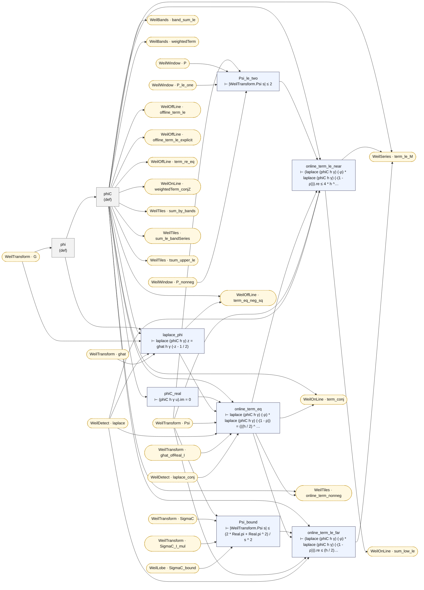

# `lean_stage3/Stage3/WeilBackground.lean`

**What it does** (its own header): WeilBackground — the window as a test function of the explicit formula, and the on-line terms of the zero side. Rung 4b, first half, of the detection ladder (units 0316–0319). 2026-09-06.

**Imports:** [`WeilDetect`](../lean_stage3/WeilDetect.md), [`WeilLobe`](../lean_stage3/WeilLobe.md).
**Imported by:** [`Stage3`](../lean_stage3/Stage3.md), [`WeilBands`](../lean_stage3/WeilBands.md), [`WeilOffLine`](../lean_stage3/WeilOffLine.md).

Blue: theorem. Green: a theorem nothing else uses (an end). Dashed white: connects to nothing. Grey: definition. Red: contains `sorry`. Yellow: in another file. An arrow A → B reads "A is used by B".

## Every declaration

| declaration | proves (output) | needs (input) | why (its own docstring) | uses | used by |
|---|---|---|---|---|---|
| `WeilBackground.phi` def, line 51 | ℝ | h γ : ℝ; u : ℝ | The window as a test function of the explicit formula: cut off to `[−h, h]`, times `e^{−u/2}`. Real-valued. | `WeilTransform.G` | `WeilBackground.laplace_phi`, `WeilBackground.phiC` |
| `WeilBackground.phiC` def, line 55 | ℝ → ℂ | h γ : ℝ | The complex-valued test function WeilDetect reads. | `WeilBackground.phi` | `WeilBackground.laplace_phi`, `WeilBackground.online_term_eq`, `WeilBackground.online_term_le_far`, `WeilBackground.online_term_le_near`, `WeilBackground.phiC_real`, `WeilBands.band_sum_le`, `WeilBands.weightedTerm`, `WeilOffLine.offline_term_le`, `WeilOffLine.offline_term_le_explicit`, `WeilOffLine.term_eq_neg_sq`, `WeilOffLine.term_re_eq`, `WeilOnLine.term_conj`, `WeilOnLine.weightedTerm_conjZ`, `WeilSeries.term_le_M`, `WeilTiles.online_term_nonneg`, `WeilTiles.sum_by_bands`, `WeilTiles.sum_le_bandSeries`, `WeilTiles.tsum_upper_le` |
| `WeilBackground.phiC_real` theorem, line 57 | (phiC h γ u).im = 0 | h γ : ℝ; u : ℝ | — | `WeilBackground.phiC` | `WeilBackground.online_term_eq` |
| `WeilBackground.laplace_phi` theorem, line 62 | laplace (phiC h γ) z = ghat h γ (-z - 1 / 2) | hh : 0 &lt; h; γ : ℝ; z : ℂ | The transform in the explicit formula's convention. `laplace φ z = ghat h γ (−z − 1/2)`. | `WeilBackground.phi`, `WeilBackground.phiC`, `WeilDetect.laplace`, `WeilTransform.G`, `WeilTransform.ghat` | `WeilBackground.online_term_eq`, `WeilOffLine.term_eq_neg_sq` |
| `WeilBackground.Psi_bound` theorem, line 85 | \|WeilTransform.Psi s\| ≤ (2 * Real.pi + Real.pi ^ 2) / s ^ 2 | hs : s ≠ 0 | `\|Ψ(s)\| ≤ (2π + π²)/s²` for `s ≠ 0`: the lobe bound at a purely imaginary argument, where `cosh(Re w) = 1` and `‖w‖ = \|s\|`. | `WeilLobe.SigmaC_bound`, `WeilTransform.Psi`, `WeilTransform.SigmaC`, `WeilTransform.SigmaC_I_mul` | `WeilBackground.online_term_le_far` |
| `WeilBackground.Psi_le_two` theorem, line 103 | \|WeilTransform.Psi s\| ≤ 2 | s : ℝ | `\|Ψ(s)\| ≤ 2`: the integrand is at most `1` in absolute value on an interval of length `2`. | `WeilTransform.Psi`, `WeilWindow.P`, `WeilWindow.P_le_one`, `WeilWindow.P_nonneg` | `WeilBackground.online_term_le_near` |
| `WeilBackground.online_term_eq` theorem, line 125 | laplace (phiC h γ) (-ρ) * laplace (phiC h γ) (-(1 - ρ)) = (((h / 2) ^ 2 * (WeilTransform.Psi (h * (ρ.im + γ)) + WeilTransform.Psi (h * (ρ.im - γ))) ^ 2 : ℝ) : ℂ) | hh : 0 &lt; h; γ : ℝ; hρ : ρ.re = 1 / 2 | On the line the term is a squared modulus: for `Re ρ = 1/2`, `laplace φ(−ρ)·laplace φ(−(1−ρ)) = (h/2)²·[Ψ(h(γ_ρ + γ)) + Ψ(h(γ_ρ − γ))]²`. | `WeilBackground.laplace_phi`, `WeilBackground.phiC`, `WeilBackground.phiC_real`, `WeilDetect.laplace`, `WeilDetect.laplace_conj`, `WeilTransform.Psi`, `WeilTransform.ghat_ofReal_I` | `WeilBackground.online_term_le_far`, `WeilBackground.online_term_le_near`, `WeilOnLine.term_conj`, `WeilTiles.online_term_nonneg` |
| `WeilBackground.online_term_le_near` theorem, line 149 | (laplace (phiC h γ) (-ρ) * laplace (phiC h γ) (-(1 - ρ))).re ≤ 4 * h ^ 2 | hh : 0 &lt; h; γ : ℝ; hρ : ρ.re = 1 / 2 | Near the carrier: the on-line term is at most `4h²` (from `\|Ψ\| ≤ 2`). | `WeilBackground.Psi_le_two`, `WeilBackground.online_term_eq`, `WeilBackground.phiC`, `WeilDetect.laplace`, `WeilTransform.Psi` | `WeilOnLine.sum_low_le`, `WeilSeries.term_le_M` |
| `WeilBackground.online_term_le_far` theorem, line 168 | (laplace (phiC h γ) (-ρ) * laplace (phiC h γ) (-(1 - ρ))).re ≤ (h / 2) ^ 2 * ((2 * Real.pi + Real.pi ^ 2) / (h * (ρ.im - γ)) ^ 2 + (2 * Real.pi + Real.pi ^ 2) / (h * (ρ.im + γ)) ^ 2) ^ 2 | hh : 0 &lt; h; γ : ℝ; hρ : ρ.re = 1 / 2; hfar : 1 ≤ \|ρ.im - γ\|; hsum : 1 ≤ ρ.im + γ | Away from the carrier: for `\|γ_ρ − γ\| ≥ 1` and `γ_ρ + γ ≥ 1`, the on-line term is at most `(h/2)²·[C/(h(γ_ρ−γ))² + C/(h(γ_ρ+γ))²]²`, `C = 2π + π²`. | `WeilBackground.Psi_bound`, `WeilBackground.online_term_eq`, `WeilBackground.phiC`, `WeilDetect.laplace`, `WeilTransform.Psi` | `WeilSeries.term_le_M` |
