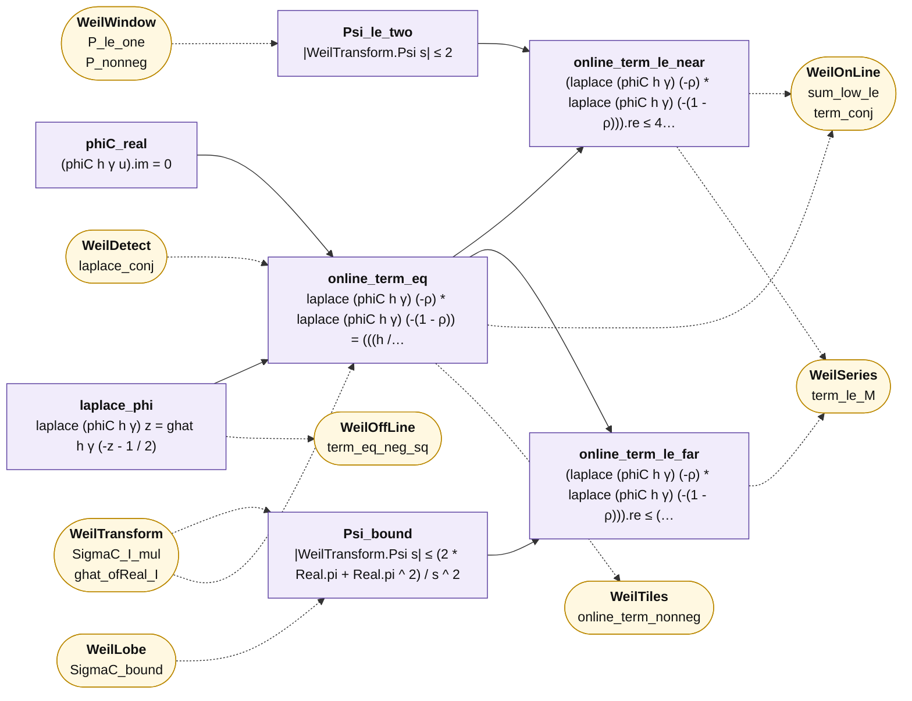

# `lean_stage3/Stage3/WeilBackground.lean`

WeilBackground — the window as a test function of the explicit formula, and the on-line terms of the zero side. Rung 4b, first half, of the detection ladder (units 0316–0319). 2026-09-06.

7 theorems, 2 definitions, 218 lines. Arrows are Lean's own record of what each proof uses.

**Imports:** [`WeilDetect`](../lean_stage3/WeilDetect.md), [`WeilLobe`](../lean_stage3/WeilLobe.md)  
**Imported by:** [`Stage3`](../lean_stage3/Stage3.md), [`WeilBands`](../lean_stage3/WeilBands.md), [`WeilOffLine`](../lean_stage3/WeilOffLine.md)

## The picture



An arrow A → B reads "A is used in the proof of B". Green: counting, integers only. Violet: shape, analysis with no ζ. Blue: reads ζ. A name ending in ■ is an end: nothing else uses it. Red: contains `sorry`. Yellow: theorems in another file, counted; a dotted arrow crosses files. Definitions are not drawn; they are listed below the diagram.

## Definitions

<a name="WeilBackground-phi"></a>
### `WeilBackground.phi`

def · line 51

The window as a test function of the explicit formula: cut off to `[−h, h]`, times `e^{−u/2}`. Real-valued.

- **Is:** `` phi (h γ : ℝ) (u : ℝ) : ℝ := Set.indicator (Set.Icc (-h) h) (fun u => G h γ u * Real.exp (-u / 2)) u ``
- **Built from:** [`WeilTransform.G`](../lean_stage3/WeilTransform.md#WeilTransform-G)
- **Used by 2:** [`WeilBackground.laplace_phi`](#WeilBackground-laplace_phi), [`WeilBackground.phiC`](#WeilBackground-phiC)

<a name="WeilBackground-phiC"></a>
### `WeilBackground.phiC`

def · line 55

The complex-valued test function WeilDetect reads.

- **Is:** `` phiC (h γ : ℝ) : ℝ → ℂ := fun u => ((phi h γ u : ℝ) : ℂ) ``
- **Built from:** [`WeilBackground.phi`](#WeilBackground-phi)
- **Used by 20:** [`WeilBackground.laplace_phi`](#WeilBackground-laplace_phi), [`WeilBackground.online_term_eq`](#WeilBackground-online_term_eq), [`WeilBackground.online_term_le_far`](#WeilBackground-online_term_le_far), [`WeilBackground.online_term_le_near`](#WeilBackground-online_term_le_near), [`WeilBackground.phiC_real`](#WeilBackground-phiC_real), [`WeilBands.band_sum_le`](../lean_stage3/WeilBands.md#WeilBands-band_sum_le), [`WeilBands.weightedTerm`](../lean_stage3/WeilBands.md#WeilBands-weightedTerm), [`WeilOffLine.offline_term_le`](../lean_stage3/WeilOffLine.md#WeilOffLine-offline_term_le), [`WeilOffLine.offline_term_le_explicit`](../lean_stage3/WeilOffLine.md#WeilOffLine-offline_term_le_explicit), [`WeilOffLine.term_eq_neg_sq`](../lean_stage3/WeilOffLine.md#WeilOffLine-term_eq_neg_sq), [`WeilOffLine.term_re_eq`](../lean_stage3/WeilOffLine.md#WeilOffLine-term_re_eq), [`WeilOnLine.sum_low_le`](../lean_stage3/WeilOnLine.md#WeilOnLine-sum_low_le), [`WeilOnLine.term_conj`](../lean_stage3/WeilOnLine.md#WeilOnLine-term_conj), [`WeilOnLine.weightedTerm_conjZ`](../lean_stage3/WeilOnLine.md#WeilOnLine-weightedTerm_conjZ), [`WeilSeries.term_le_M`](../lean_stage3/WeilSeries.md#WeilSeries-term_le_M), [`WeilTiles.online_term_nonneg`](../lean_stage3/WeilTiles.md#WeilTiles-online_term_nonneg), [`WeilTiles.sum_by_bands`](../lean_stage3/WeilTiles.md#WeilTiles-sum_by_bands), [`WeilTiles.sum_le_bandSeries`](../lean_stage3/WeilTiles.md#WeilTiles-sum_le_bandSeries), [`WeilTiles.tsum_upper_le`](../lean_stage3/WeilTiles.md#WeilTiles-tsum_upper_le), [`WeilTiles.weightedTerm_nonneg`](../lean_stage3/WeilTiles.md#WeilTiles-weightedTerm_nonneg)

## Theorems

<a name="WeilBackground-phiC_real"></a>
### `WeilBackground.phiC_real`

line 58

**Shape.** Uses real or complex analysis; nothing in it or beneath it reads ζ.

**Why.** The complex-valued test function `phiC h γ` has zero imaginary part at every `u`.

**Proves**

```lean
(phiC h γ u).im = 0
```

**Needs** (its hypotheses)

  - `` h γ : ℝ ``
  - `` u : ℝ ``

**Stated with:** [`WeilBackground.phiC`](#WeilBackground-phiC)

**Fed by:** no theorem of this repo; it stands on Mathlib and the definitions below.

**Feeds** (1 that use it)

  - [`WeilBackground.online_term_eq`](#WeilBackground-online_term_eq) — `` laplace (phiC h γ) (-ρ) * laplace (phiC h γ) (-(1 - ρ)) = (((h / 2) ^ 2 * (WeilTransform.Psi (h * (ρ.im + γ)) + WeilTransform.Psi (h * (ρ.im - γ))) ^ … ``

<a name="WeilBackground-laplace_phi"></a>
### `WeilBackground.laplace_phi`

line 63

**Shape.** Uses real or complex analysis; nothing in it or beneath it reads ζ.

**Why.** The transform in the explicit formula's convention. `laplace φ z = ghat h γ (−z − 1/2)`.

**Proves**

```lean
laplace (phiC h γ) z = ghat h γ (-z - 1 / 2)
```

**Needs** (its hypotheses)

  - `` hh : 0 < h ``
  - `` γ : ℝ ``
  - `` z : ℂ ``

**Stated with:** [`WeilBackground.phiC`](#WeilBackground-phiC), [`WeilDetect.laplace`](../lean_stage3/WeilDetect.md#WeilDetect-laplace), [`WeilTransform.ghat`](../lean_stage3/WeilTransform.md#WeilTransform-ghat)

**Fed by:** no theorem of this repo; it stands on Mathlib and the definitions below.

**Definitions its proof touches:** [`WeilBackground.phi`](#WeilBackground-phi), [`WeilTransform.G`](../lean_stage3/WeilTransform.md#WeilTransform-G)

**Feeds** (2 that use it)

  - [`WeilBackground.online_term_eq`](#WeilBackground-online_term_eq) — `` laplace (phiC h γ) (-ρ) * laplace (phiC h γ) (-(1 - ρ)) = (((h / 2) ^ 2 * (WeilTransform.Psi (h * (ρ.im + γ)) + WeilTransform.Psi (h * (ρ.im - γ))) ^ … ``
  - [`WeilOffLine.term_eq_neg_sq`](../lean_stage3/WeilOffLine.md#WeilOffLine-term_eq_neg_sq) (WeilOffLine) — `` laplace (phiC h γ) (-ρ) * laplace (phiC h γ) (-(1 - ρ)) = -(ghat h γ (ρ - 1 / 2)) ^ 2 ``

<a name="WeilBackground-Psi_bound"></a>
### `WeilBackground.Psi_bound`

line 86

**Shape.** Uses real or complex analysis; nothing in it or beneath it reads ζ.

**Why.** `|Ψ(s)| ≤ (2π + π²)/s²` for `s ≠ 0`: the lobe bound at a purely imaginary argument, where `cosh(Re w) = 1` and `‖w‖ = |s|`.

**Proves**

```lean
|WeilTransform.Psi s| ≤ (2 * Real.pi + Real.pi ^ 2) / s ^ 2
```

**Needs** (its hypotheses)

  - `` hs : s ≠ 0 ``

**Stated with:** [`WeilTransform.Psi`](../lean_stage3/WeilTransform.md#WeilTransform-Psi)

**Fed by** (2 theorems its proof uses)

  - [`WeilLobe.SigmaC_bound`](../lean_stage3/WeilLobe.md#WeilLobe-SigmaC_bound) (WeilLobe) — `` ‖SigmaC w‖ ≤ (2 * Real.pi + Real.pi ^ 2) * Real.cosh w.re / ‖w‖ ^ 2 ``
  - [`WeilTransform.SigmaC_I_mul`](../lean_stage3/WeilTransform.md#WeilTransform-SigmaC_I_mul) (WeilTransform) — `` SigmaC (Complex.I * (s : ℂ)) = Complex.I * (Psi s : ℂ) ``

**Definitions its proof touches:** [`WeilTransform.SigmaC`](../lean_stage3/WeilTransform.md#WeilTransform-SigmaC)

**Feeds** (1 that use it)

  - [`WeilBackground.online_term_le_far`](#WeilBackground-online_term_le_far) — `` (laplace (phiC h γ) (-ρ) * laplace (phiC h γ) (-(1 - ρ))).re ≤ (h / 2) ^ 2 * ((2 * Real.pi + Real.pi ^ 2) / (h * (ρ.im - γ)) ^ 2 + (2 * Real.pi + Real… ``

<a name="WeilBackground-Psi_le_two"></a>
### `WeilBackground.Psi_le_two`

line 104

**Shape.** Uses real or complex analysis; nothing in it or beneath it reads ζ.

**Why.** `|Ψ(s)| ≤ 2`: the integrand is at most `1` in absolute value on an interval of length `2`.

**Proves**

```lean
|WeilTransform.Psi s| ≤ 2
```

**Needs** (its hypotheses)

  - `` s : ℝ ``

**Stated with:** [`WeilTransform.Psi`](../lean_stage3/WeilTransform.md#WeilTransform-Psi)

**Fed by** (2 theorems its proof uses)

  - [`WeilWindow.P_le_one`](../lean_stage3/WeilWindow.md#WeilWindow-P_le_one) (WeilWindow) — `` P x ≤ 1 ``
  - [`WeilWindow.P_nonneg`](../lean_stage3/WeilWindow.md#WeilWindow-P_nonneg) (WeilWindow) — `` 0 ≤ P x ``

**Definitions its proof touches:** [`WeilWindow.P`](../lean_stage3/WeilWindow.md#WeilWindow-P)

**Feeds** (1 that use it)

  - [`WeilBackground.online_term_le_near`](#WeilBackground-online_term_le_near) — `` (laplace (phiC h γ) (-ρ) * laplace (phiC h γ) (-(1 - ρ))).re ≤ 4 * h ^ 2 ``

<a name="WeilBackground-online_term_eq"></a>
### `WeilBackground.online_term_eq`

line 126

**Shape.** Uses real or complex analysis; nothing in it or beneath it reads ζ.

**Why.** On the line the term is a squared modulus: for `Re ρ = 1/2`, `laplace φ(−ρ)·laplace φ(−(1−ρ)) = (h/2)²·[Ψ(h(γ_ρ + γ)) + Ψ(h(γ_ρ − γ))]²`.

**Proves**

```lean
laplace (phiC h γ) (-ρ) * laplace (phiC h γ) (-(1 - ρ)) = (((h / 2) ^ 2 * (WeilTransform.Psi (h * (ρ.im + γ)) + WeilTransform.Psi (h * (ρ.im - γ))) ^ 2 : ℝ) : ℂ)
```

**Needs** (its hypotheses)

  - `` hh : 0 < h ``
  - `` γ : ℝ ``
  - `` hρ : ρ.re = 1 / 2 ``

**Stated with:** [`WeilBackground.phiC`](#WeilBackground-phiC), [`WeilDetect.laplace`](../lean_stage3/WeilDetect.md#WeilDetect-laplace), [`WeilTransform.Psi`](../lean_stage3/WeilTransform.md#WeilTransform-Psi)

**Fed by** (4 theorems its proof uses)

  - [`WeilBackground.laplace_phi`](#WeilBackground-laplace_phi) — `` laplace (phiC h γ) z = ghat h γ (-z - 1 / 2) ``
  - [`WeilBackground.phiC_real`](#WeilBackground-phiC_real) — `` (phiC h γ u).im = 0 ``
  - [`WeilDetect.laplace_conj`](../lean_stage3/WeilDetect.md#WeilDetect-laplace_conj) (WeilDetect) — `` laplace G ((starRingEnd ℂ) z) = (starRingEnd ℂ) (laplace G z) ``
  - [`WeilTransform.ghat_ofReal_I`](../lean_stage3/WeilTransform.md#WeilTransform-ghat_ofReal_I) (WeilTransform) — `` ghat h γ (Complex.I * (t : ℂ)) = Complex.I * ((h : ℂ) / 2) * ((Psi (h * (t + γ)) : ℂ) + (Psi (h * (t - γ)) : ℂ)) ``

**Definitions its proof touches:** [`WeilTransform.ghat`](../lean_stage3/WeilTransform.md#WeilTransform-ghat)

**Feeds** (4 that use it)

  - [`WeilBackground.online_term_le_far`](#WeilBackground-online_term_le_far) — `` (laplace (phiC h γ) (-ρ) * laplace (phiC h γ) (-(1 - ρ))).re ≤ (h / 2) ^ 2 * ((2 * Real.pi + Real.pi ^ 2) / (h * (ρ.im - γ)) ^ 2 + (2 * Real.pi + Real… ``
  - [`WeilBackground.online_term_le_near`](#WeilBackground-online_term_le_near) — `` (laplace (phiC h γ) (-ρ) * laplace (phiC h γ) (-(1 - ρ))).re ≤ 4 * h ^ 2 ``
  - [`WeilOnLine.term_conj`](../lean_stage3/WeilOnLine.md#WeilOnLine-term_conj) (WeilOnLine) — `` (laplace (phiC h γ) (-(starRingEnd ℂ) ρ) * laplace (phiC h γ) (-(1 - (starRingEnd ℂ) ρ))).re = (laplace (phiC h γ) (-ρ) * laplace (phiC h γ) (-(1 - ρ)… ``
  - [`WeilTiles.online_term_nonneg`](../lean_stage3/WeilTiles.md#WeilTiles-online_term_nonneg) (WeilTiles) — `` 0 ≤ (laplace (phiC h γ) (-ρ) * laplace (phiC h γ) (-(1 - ρ))).re ``

<a name="WeilBackground-online_term_le_near"></a>
### `WeilBackground.online_term_le_near`

line 150

**Shape.** Uses real or complex analysis; nothing in it or beneath it reads ζ.

**Why.** Near the carrier: the on-line term is at most `4h²` (from `|Ψ| ≤ 2`).

**Proves**

```lean
(laplace (phiC h γ) (-ρ) * laplace (phiC h γ) (-(1 - ρ))).re ≤ 4 * h ^ 2
```

**Needs** (its hypotheses)

  - `` hh : 0 < h ``
  - `` γ : ℝ ``
  - `` hρ : ρ.re = 1 / 2 ``

**Stated with:** [`WeilBackground.phiC`](#WeilBackground-phiC), [`WeilDetect.laplace`](../lean_stage3/WeilDetect.md#WeilDetect-laplace)

**Fed by** (2 theorems its proof uses)

  - [`WeilBackground.Psi_le_two`](#WeilBackground-Psi_le_two) — `` |WeilTransform.Psi s| ≤ 2 ``
  - [`WeilBackground.online_term_eq`](#WeilBackground-online_term_eq) — `` laplace (phiC h γ) (-ρ) * laplace (phiC h γ) (-(1 - ρ)) = (((h / 2) ^ 2 * (WeilTransform.Psi (h * (ρ.im + γ)) + WeilTransform.Psi (h * (ρ.im - γ))) ^ … ``

**Definitions its proof touches:** [`WeilTransform.Psi`](../lean_stage3/WeilTransform.md#WeilTransform-Psi)

**Feeds** (2 that use it)

  - [`WeilOnLine.sum_low_le`](../lean_stage3/WeilOnLine.md#WeilOnLine-sum_low_le) (WeilOnLine) — `` ∑ ρ ∈ S, weightedTerm h γ ρ ≤ 4 * h ^ 2 * lowCount ``
  - [`WeilSeries.term_le_M`](../lean_stage3/WeilSeries.md#WeilSeries-term_le_M) (WeilSeries) — `` (laplace (phiC h γ) (-(ρ : ℂ)) * laplace (phiC h γ) (-(1 - (ρ : ℂ)))).re ≤ M h γ (idx (ρ : ℂ).im) ``

<a name="WeilBackground-online_term_le_far"></a>
### `WeilBackground.online_term_le_far`

line 169

**Shape.** Uses real or complex analysis; nothing in it or beneath it reads ζ.

**Why.** Away from the carrier: for `|γ_ρ − γ| ≥ 1` and `γ_ρ + γ ≥ 1`, the on-line term is at most `(h/2)²·[C/(h(γ_ρ−γ))² + C/(h(γ_ρ+γ))²]²`, `C = 2π + π²`.

**Proves**

```lean
(laplace (phiC h γ) (-ρ) * laplace (phiC h γ) (-(1 - ρ))).re ≤ (h / 2) ^ 2 * ((2 * Real.pi + Real.pi ^ 2) / (h * (ρ.im - γ)) ^ 2 + (2 * Real.pi + Real.pi ^ 2) / (h * (ρ.im + γ)) ^ 2) ^ 2
```

**Needs** (its hypotheses)

  - `` hh : 0 < h ``
  - `` γ : ℝ ``
  - `` hρ : ρ.re = 1 / 2 ``
  - `` hfar : 1 ≤ |ρ.im - γ| ``
  - `` hsum : 1 ≤ ρ.im + γ ``

**Stated with:** [`WeilBackground.phiC`](#WeilBackground-phiC), [`WeilDetect.laplace`](../lean_stage3/WeilDetect.md#WeilDetect-laplace)

**Fed by** (2 theorems its proof uses)

  - [`WeilBackground.Psi_bound`](#WeilBackground-Psi_bound) — `` |WeilTransform.Psi s| ≤ (2 * Real.pi + Real.pi ^ 2) / s ^ 2 ``
  - [`WeilBackground.online_term_eq`](#WeilBackground-online_term_eq) — `` laplace (phiC h γ) (-ρ) * laplace (phiC h γ) (-(1 - ρ)) = (((h / 2) ^ 2 * (WeilTransform.Psi (h * (ρ.im + γ)) + WeilTransform.Psi (h * (ρ.im - γ))) ^ … ``

**Definitions its proof touches:** [`WeilTransform.Psi`](../lean_stage3/WeilTransform.md#WeilTransform-Psi)

**Feeds** (1 that use it)

  - [`WeilSeries.term_le_M`](../lean_stage3/WeilSeries.md#WeilSeries-term_le_M) (WeilSeries) — `` (laplace (phiC h γ) (-(ρ : ℂ)) * laplace (phiC h γ) (-(1 - (ρ : ℂ)))).re ≤ M h γ (idx (ρ : ℂ).im) ``

