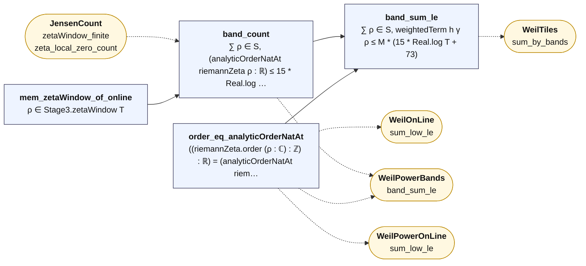

# `lean_stage3/Stage3/WeilBands.lean`

WeilBands — the on-line zeros counted by band. Rung 4b, second half, slice A of the detection ladder (units 0316–0320). 2026-09-06.

4 theorems, 1 definition, 147 lines. Arrows are Lean's own record of what each proof uses.

**Imports:** [`JensenCount`](../lean_stage3/JensenCount.md), [`WeilBackground`](../lean_stage3/WeilBackground.md)  
**Imported by:** [`Stage3`](../lean_stage3/Stage3.md), [`WeilTiles`](../lean_stage3/WeilTiles.md)

## The picture



An arrow A → B reads "A is used in the proof of B". Blue: theorem. Green: a theorem nothing else uses (an end). Dashed: connects to nothing. Red: contains `sorry`. Yellow: theorems in another file, counted; a dotted arrow crosses files. Definitions are not drawn; they are listed below the diagram.

## Definitions

<a name="WeilBands-weightedTerm"></a>
### `WeilBands.weightedTerm`

def · line 85

The on-line term with its multiplicity, as WeilDetect's sum weights it.

- **Is:** `` weightedTerm (h γ : ℝ) (ρ : Kadiri.NontrivialZeros) : ℝ := (laplace (phiC h γ) (-(ρ : ℂ)) * laplace (phiC h γ) (-(1 - (ρ : ℂ)))).re * ((riemannZeta.order (ρ : ℂ) : ℤ) : ℝ) ``
- **Built from:** [`WeilBackground.phiC`](../lean_stage3/WeilBackground.md#WeilBackground-phiC), [`WeilDetect.laplace`](../lean_stage3/WeilDetect.md#WeilDetect-laplace)
- **Used by 15:** [`WeilBands.band_sum_le`](#WeilBands-band_sum_le), [`WeilOnLine.sum_low_le`](../lean_stage3/WeilOnLine.md#WeilOnLine-sum_low_le), [`WeilOnLine.sum_lower_le`](../lean_stage3/WeilOnLine.md#WeilOnLine-sum_lower_le), [`WeilOnLine.sum_onLine_le`](../lean_stage3/WeilOnLine.md#WeilOnLine-sum_onLine_le), [`WeilOnLine.sum_onLine_subtype_le`](../lean_stage3/WeilOnLine.md#WeilOnLine-sum_onLine_subtype_le), [`WeilOnLine.sum_upper_le`](../lean_stage3/WeilOnLine.md#WeilOnLine-sum_upper_le), [`WeilOnLine.summable_onLine`](../lean_stage3/WeilOnLine.md#WeilOnLine-summable_onLine), [`WeilOnLine.tsum_onLine_le`](../lean_stage3/WeilOnLine.md#WeilOnLine-tsum_onLine_le), [`WeilOnLine.weightedTerm_conjZ`](../lean_stage3/WeilOnLine.md#WeilOnLine-weightedTerm_conjZ), [`WeilSeries.tsum_upper_le_explicit`](../lean_stage3/WeilSeries.md#WeilSeries-tsum_upper_le_explicit), [`WeilSeries.tsum_upper_le_explicit'`](../lean_stage3/WeilSeries.md#WeilSeries-tsum_upper_le_explicit-), [`WeilTiles.sum_by_bands`](../lean_stage3/WeilTiles.md#WeilTiles-sum_by_bands), [`WeilTiles.sum_le_bandSeries`](../lean_stage3/WeilTiles.md#WeilTiles-sum_le_bandSeries), [`WeilTiles.tsum_upper_le`](../lean_stage3/WeilTiles.md#WeilTiles-tsum_upper_le), [`WeilTiles.weightedTerm_nonneg`](../lean_stage3/WeilTiles.md#WeilTiles-weightedTerm_nonneg)

## Theorems

<a name="WeilBands-order_eq_analyticOrderNatAt"></a>
### `WeilBands.order_eq_analyticOrderNatAt`

line 43

**Why.** Upstream's multiplicity is the analytic order, at every nontrivial zero.

**Proves**

```lean
((riemannZeta.order (ρ : ℂ) : ℤ) : ℝ) = (analyticOrderNatAt riemannZeta (ρ : ℂ) : ℝ)
```

**Needs** (its hypotheses)

  - `` ρ : Kadiri.NontrivialZeros ``

**Fed by:** no theorem of this repo; it stands on Mathlib.

**Feeds** (4 that use it)

  - [`WeilBands.band_sum_le`](#WeilBands-band_sum_le) — `` ∑ ρ ∈ S, weightedTerm h γ ρ ≤ M * (15 * Real.log T + 73) ``
  - [`WeilOnLine.sum_low_le`](../lean_stage3/WeilOnLine.md#WeilOnLine-sum_low_le) (WeilOnLine) — `` ∑ ρ ∈ S, weightedTerm h γ ρ ≤ 4 * h ^ 2 * lowCount ``
  - [`WeilPowerBands.band_sum_le`](../lean_stage3/WeilPowerBands.md#WeilPowerBands-band_sum_le) (WeilPowerBands) — `` ∑ ρ ∈ S, weightedTermW h γ m ρ ≤ M * (15 * Real.log T + 73) ``
  - [`WeilPowerOnLine.sum_low_le`](../lean_stage3/WeilPowerOnLine.md#WeilPowerOnLine-sum_low_le) (WeilPowerOnLine) — `` ∑ ρ ∈ S, weightedTermW h γ m ρ ≤ 4 * h ^ 2 * lowCount ``

<a name="WeilBands-mem_zetaWindow_of_online"></a>
### `WeilBands.mem_zetaWindow_of_online`

line 55

**Why.** An on-line zero within `9/10` of height `T` lies in the count's window.

**Proves**

```lean
ρ ∈ Stage3.zetaWindow T
```

**Needs** (its hypotheses)

  - `` hz : riemannZeta ρ = 0 ``
  - `` hre : ρ.re = 1 / 2 ``
  - `` him : |ρ.im - T| ≤ 9 / 10 ``

**Stated with:** [`Stage3.zetaWindow`](../lean_stage3/JensenCount.md#Stage3-zetaWindow)

**Fed by:** no theorem of this repo; it stands on Mathlib and the definitions below.

**Feeds** (1 that use it)

  - [`WeilBands.band_count`](#WeilBands-band_count) — `` ∑ ρ ∈ S, (analyticOrderNatAt riemannZeta ρ : ℝ) ≤ 15 * Real.log T + 73 ``

<a name="WeilBands-band_count"></a>
### `WeilBands.band_count`

line 71

**Why.** Band count. A finite set of on-line zeros within `9/10` of a height `T ≥ 2` has total analytic multiplicity at most `15·log T + 73`.

**Proves**

```lean
∑ ρ ∈ S, (analyticOrderNatAt riemannZeta ρ : ℝ) ≤ 15 * Real.log T + 73
```

**Needs** (its hypotheses)

  - `` hT : 2 ≤ T ``
  - `` S : Finset ℂ ``
  - `` hS : ∀ ρ ∈ S, riemannZeta ρ = 0 ∧ ρ.re = 1 / 2 ∧ |ρ.im - T| ≤ 9 / 10 ``

**Fed by** (3 theorems its proof uses)

  - [`Stage3.zetaWindow_finite`](../lean_stage3/JensenCount.md#Stage3-zetaWindow_finite) (JensenCount) — `` (zetaWindow T).Finite ``
  - [`Stage3.zeta_local_zero_count`](../lean_stage3/JensenCount.md#Stage3-zeta_local_zero_count) (JensenCount) — `` ∑ ρ ∈ (zetaWindow_finite hT).toFinset, (analyticOrderNatAt ζ ρ : ℝ) ≤ 15 * Real.log T + 73 ``
  - [`WeilBands.mem_zetaWindow_of_online`](#WeilBands-mem_zetaWindow_of_online) — `` ρ ∈ Stage3.zetaWindow T ``

**Definitions its proof touches:** [`Stage3.zetaWindow`](../lean_stage3/JensenCount.md#Stage3-zetaWindow)

**Feeds** (2 that use it)

  - [`WeilBands.band_sum_le`](#WeilBands-band_sum_le) — `` ∑ ρ ∈ S, weightedTerm h γ ρ ≤ M * (15 * Real.log T + 73) ``
  - [`WeilPowerBands.band_sum_le`](../lean_stage3/WeilPowerBands.md#WeilPowerBands-band_sum_le) (WeilPowerBands) — `` ∑ ρ ∈ S, weightedTermW h γ m ρ ≤ M * (15 * Real.log T + 73) ``

<a name="WeilBands-band_sum_le"></a>
### `WeilBands.band_sum_le`

line 92

**Why.** Band sum. Over a finite set of on-line zeros within `9/10` of `T ≥ 2`, if every term is at most `M ≥ 0`, the weighted sum is at most `M·(15·log T + 73)`.

**Proves**

```lean
∑ ρ ∈ S, weightedTerm h γ ρ ≤ M * (15 * Real.log T + 73)
```

**Needs** (its hypotheses)

  - `` hT : 2 ≤ T ``
  - `` S : Finset Kadiri.NontrivialZeros ``
  - `` hS : ∀ ρ ∈ S, (ρ : ℂ).re = 1 / 2 ∧ |(ρ : ℂ).im - T| ≤ 9 / 10 ``
  - `` hM0 : 0 ≤ M ``
  - `` hM : ∀ ρ ∈ S, (laplace (phiC h γ) (-(ρ : ℂ)) * laplace (phiC h γ) (-(1 - (ρ : ℂ)))).re ≤ M ``

**Stated with:** [`WeilBackground.phiC`](../lean_stage3/WeilBackground.md#WeilBackground-phiC), [`WeilBands.weightedTerm`](#WeilBands-weightedTerm), [`WeilDetect.laplace`](../lean_stage3/WeilDetect.md#WeilDetect-laplace)

**Fed by** (2 theorems its proof uses)

  - [`WeilBands.band_count`](#WeilBands-band_count) — `` ∑ ρ ∈ S, (analyticOrderNatAt riemannZeta ρ : ℝ) ≤ 15 * Real.log T + 73 ``
  - [`WeilBands.order_eq_analyticOrderNatAt`](#WeilBands-order_eq_analyticOrderNatAt) — `` ((riemannZeta.order (ρ : ℂ) : ℤ) : ℝ) = (analyticOrderNatAt riemannZeta (ρ : ℂ) : ℝ) ``

**Feeds** (1 that use it)

  - [`WeilTiles.sum_by_bands`](../lean_stage3/WeilTiles.md#WeilTiles-sum_by_bands) (WeilTiles) — `` ∑ ρ ∈ S, weightedTerm h γ ρ ≤ ∑ k ∈ S.image (fun ρ : Kadiri.NontrivialZeros => idx (ρ : ℂ).im), M k * (15 * Real.log (centre k) + 73) ``

