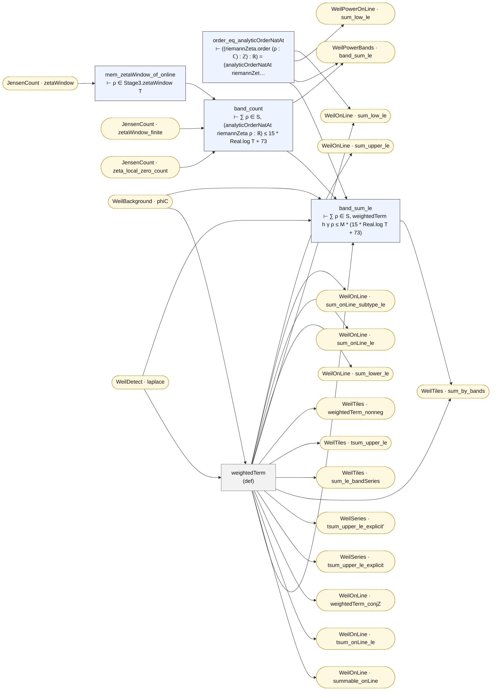

# `lean_stage3/Stage3/WeilBands.lean`

**What it does** (its own header): WeilBands — the on-line zeros counted by band. Rung 4b, second half, slice A of the detection ladder (units 0316–0320). 2026-09-06.

**Imports:** [`JensenCount`](../lean_stage3/JensenCount.md), [`WeilBackground`](../lean_stage3/WeilBackground.md).
**Imported by:** [`Stage3`](../lean_stage3/Stage3.md), [`WeilTiles`](../lean_stage3/WeilTiles.md).

Blue: theorem. Green: a theorem nothing else uses (an end). Dashed white: connects to nothing. Grey: definition. Red: contains `sorry`. Yellow: in another file. An arrow A → B reads "A is used by B".

## Every declaration

| declaration | proves (output) | needs (input) | why (its own docstring) | uses | used by |
|---|---|---|---|---|---|
| `WeilBands.order_eq_analyticOrderNatAt` theorem, line 43 | ((riemannZeta.order (ρ : ℂ) : ℤ) : ℝ) = (analyticOrderNatAt riemannZeta (ρ : ℂ) : ℝ) | ρ : Kadiri.NontrivialZeros | Upstream's multiplicity is the analytic order, at every nontrivial zero. | — | `WeilBands.band_sum_le`, `WeilOnLine.sum_low_le`, `WeilPowerBands.band_sum_le`, `WeilPowerOnLine.sum_low_le` |
| `WeilBands.mem_zetaWindow_of_online` theorem, line 55 | ρ ∈ Stage3.zetaWindow T | hz : riemannZeta ρ = 0; hre : ρ.re = 1 / 2; him : \|ρ.im - T\| ≤ 9 / 10 | An on-line zero within `9/10` of height `T` lies in the count's window. | `Stage3.zetaWindow` | `WeilBands.band_count` |
| `WeilBands.band_count` theorem, line 71 | ∑ ρ ∈ S, (analyticOrderNatAt riemannZeta ρ : ℝ) ≤ 15 * Real.log T + 73 | hT : 2 ≤ T; S : Finset ℂ; hS : ∀ ρ ∈ S, riemannZeta ρ = 0 ∧ ρ.re = 1 / 2 ∧ \|ρ.im - T\| ≤ 9 / 10 | Band count. A finite set of on-line zeros within `9/10` of a height `T ≥ 2` has total analytic multiplicity at most `15·log T + 73`. | `Stage3.zetaWindow_finite`, `Stage3.zeta_local_zero_count`, `WeilBands.mem_zetaWindow_of_online` | `WeilBands.band_sum_le`, `WeilPowerBands.band_sum_le` |
| `WeilBands.weightedTerm` def, line 85 | ℝ | h γ : ℝ; ρ : Kadiri.NontrivialZeros | The on-line term with its multiplicity, as WeilDetect's sum weights it. | `WeilBackground.phiC`, `WeilDetect.laplace` | `WeilBands.band_sum_le`, `WeilOnLine.sum_low_le`, `WeilOnLine.sum_lower_le`, `WeilOnLine.sum_onLine_le`, `WeilOnLine.sum_onLine_subtype_le`, `WeilOnLine.sum_upper_le`, `WeilOnLine.summable_onLine`, `WeilOnLine.tsum_onLine_le`, `WeilOnLine.weightedTerm_conjZ`, `WeilSeries.tsum_upper_le_explicit`, `WeilSeries.tsum_upper_le_explicit'`, `WeilTiles.sum_by_bands`, `WeilTiles.sum_le_bandSeries`, `WeilTiles.tsum_upper_le`, `WeilTiles.weightedTerm_nonneg` |
| `WeilBands.band_sum_le` theorem, line 92 | ∑ ρ ∈ S, weightedTerm h γ ρ ≤ M * (15 * Real.log T + 73) | hT : 2 ≤ T; S : Finset Kadiri.NontrivialZeros; hS : ∀ ρ ∈ S, (ρ : ℂ).re = 1 / 2 ∧ \|(ρ : ℂ).im - T\| ≤ 9 / 10; hM0 : 0 ≤ M; hM : ∀ ρ ∈ S, (laplace (phiC h γ) (-(ρ : ℂ)) * laplace (phiC h γ) (-(1 - (ρ : ℂ)))).re ≤ M | Band sum. Over a finite set of on-line zeros within `9/10` of `T ≥ 2`, if every term is at most `M ≥ 0`, the weighted sum is at most `M·(15·log T + 73)`. | `WeilBackground.phiC`, `WeilBands.band_count`, `WeilBands.order_eq_analyticOrderNatAt`, `WeilBands.weightedTerm`, `WeilDetect.laplace` | `WeilTiles.sum_by_bands` |
