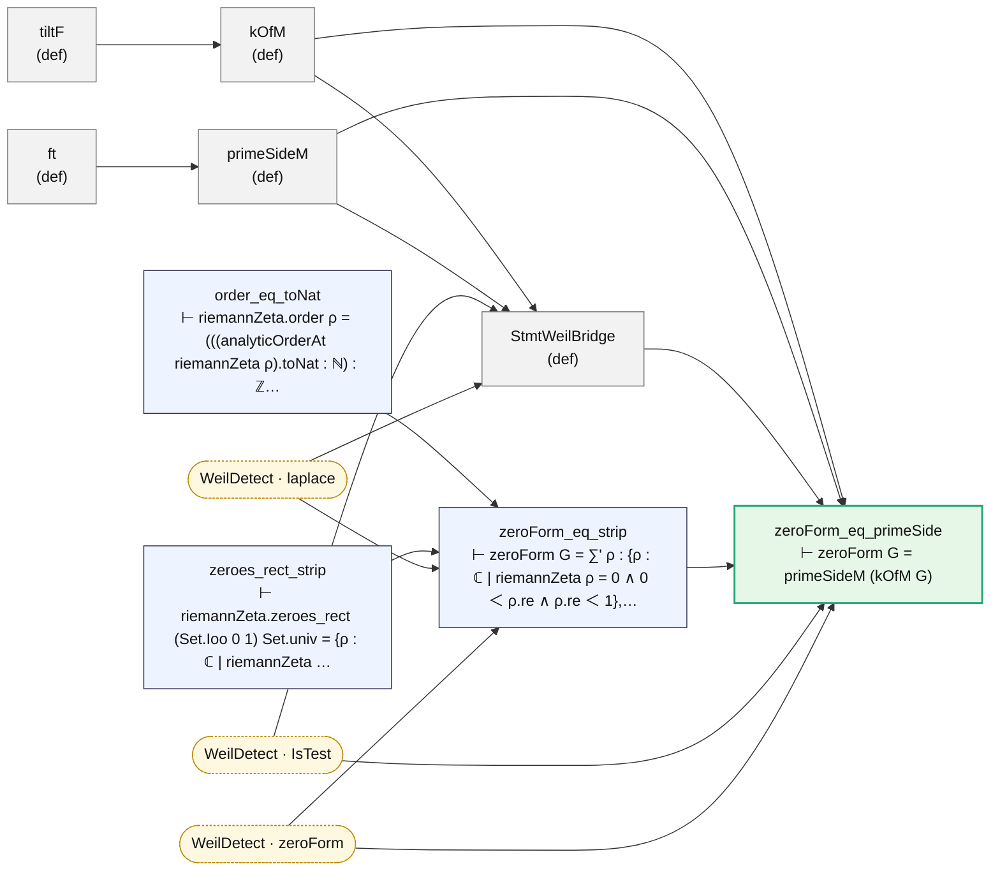

# `lean_stage3/Stage3/WeilBridgeLeaf.lean`

**What it does** (its own header): WeilBridgeLeaf — the zero-set lemma and the bridge leaf: `zeroForm` gets a prime side. Block 1 of `lean_stage3/design/bridge.md`. 2026-11-22.

**Imports:** [`WeilDetect`](../lean_stage3/WeilDetect.md).
**Imported by:** [`Stage3`](../lean_stage3/Stage3.md).

Blue: theorem. Green: a theorem nothing else uses (an end). Dashed white: connects to nothing. Grey: definition. Red: contains `sorry`. Yellow: in another file. An arrow A → B reads "A is used by B".

## Every declaration

| declaration | proves (output) | needs (input) | why (its own docstring) | uses | used by |
|---|---|---|---|---|---|
| `WeilBridgeLeaf.tiltF` def, line 44 | ℝ → ℂ | G : ℝ → ℂ | `F(u) = G(u)·e^{u/2}`: the test function in zeta23's centred variable. | — | `WeilBridgeLeaf.kOfM` |
| `WeilBridgeLeaf.ft` def, line 47 | ℂ | k : ℝ → ℂ; z : ℂ | The transform `∫ k(u) e^{izu} du`; zeta23's `paperFT`. | — | `WeilBridgeLeaf.primeSideM` |
| `WeilBridgeLeaf.kOfM` def, line 51 | ℝ → ℂ | G : ℝ → ℂ | `k = F ⋆ F̃` in Mathlib's convolution; zeta23's `weilTest` at `F = tiltF G`. | `WeilBridgeLeaf.tiltF` | `WeilBridgeLeaf.StmtWeilBridge`, `WeilBridgeLeaf.zeroForm_eq_primeSide` |
| `WeilBridgeLeaf.primeSideM` def, line 56 | ℂ | k : ℝ → ℂ | The prime side: the pole terms, minus the prime sum, plus the archimedean integral. | `WeilBridgeLeaf.ft` | `WeilBridgeLeaf.StmtWeilBridge`, `WeilBridgeLeaf.zeroForm_eq_primeSide` |
| `WeilBridgeLeaf.StmtWeilBridge` def, line 64 | Prop | — | The bridge, as a statement. | `WeilBridgeLeaf.kOfM`, `WeilBridgeLeaf.primeSideM`, `WeilDetect.IsTest`, `WeilDetect.laplace` | `WeilBridgeLeaf.zeroForm_eq_primeSide` |
| `WeilBridgeLeaf.order_eq_toNat` theorem, line 75 | riemannZeta.order ρ = (((analyticOrderAt riemannZeta ρ).toNat : ℕ) : ℤ) | hρ : ρ ≠ 1 | Upstream's order at a point other than the pole is the analytic order. | — | `WeilBridgeLeaf.zeroForm_eq_strip` |
| `WeilBridgeLeaf.zeroes_rect_strip` theorem, line 87 | riemannZeta.zeroes_rect (Set.Ioo 0 1) Set.univ = {ρ : ℂ \| riemannZeta ρ = 0 ∧ 0 &lt; ρ.re ∧ ρ.re &lt; 1} | — | Upstream's rectangle over `(0, 1)` is the strip set. | — | `WeilBridgeLeaf.zeroForm_eq_strip` |
| `WeilBridgeLeaf.zeroForm_eq_strip` theorem, line 96 | zeroForm G = ∑' ρ : {ρ : ℂ \| riemannZeta ρ = 0 ∧ 0 &lt; ρ.re ∧ ρ.re &lt; 1}, (((analyticOrderAt riemannZeta (ρ : ℂ)).toNat : ℕ) : ℂ) * (laplace G (-(ρ : ℂ)) * laplace G (-(1 - (ρ : ℂ)))) | G : ℝ → ℂ | The zero-set lemma. `zeroForm` over Mathlib's zero set and analytic order. | `WeilBridgeLeaf.order_eq_toNat`, `WeilBridgeLeaf.zeroes_rect_strip`, `WeilDetect.laplace`, `WeilDetect.zeroForm` | `WeilBridgeLeaf.zeroForm_eq_primeSide` |
| `WeilBridgeLeaf.zeroForm_eq_primeSide` theorem, line 117 | zeroForm G = primeSideM (kOfM G) | h : StmtWeilBridge; hG : IsTest L G | The prime side of Weil's form. | `WeilBridgeLeaf.StmtWeilBridge`, `WeilBridgeLeaf.kOfM`, `WeilBridgeLeaf.primeSideM`, `WeilBridgeLeaf.zeroForm_eq_strip`, `WeilDetect.IsTest`, `WeilDetect.zeroForm` | — |
