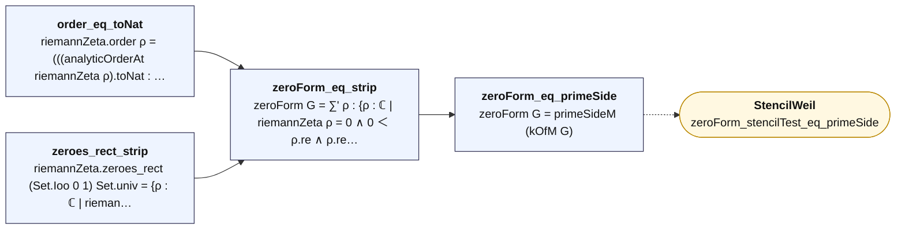

# `lean_stage3/Stage3/WeilBridgeLeaf.lean`

WeilBridgeLeaf — the zero-set lemma and the bridge leaf: `zeroForm` gets a prime side. Block 1 of `lean_stage3/design/bridge.md`. 2026-11-22.

4 theorems, 5 definitions, 141 lines. Arrows are Lean's own record of what each proof uses.

**Imports:** [`WeilDetect`](../lean_stage3/WeilDetect.md)  
**Imported by:** [`Stage3`](../lean_stage3/Stage3.md), [`StencilWeil`](../lean_stage3/StencilWeil.md)

## The picture



An arrow A → B reads "A is used in the proof of B". Green: counting, integers only. Violet: shape, analysis with no ζ. Blue: reads ζ. A name ending in ■ is an end: nothing else uses it. Red: contains `sorry`. Yellow: theorems in another file, counted; a dotted arrow crosses files. Definitions are not drawn; they are listed below the diagram.

## Definitions

<a name="WeilBridgeLeaf-tiltF"></a>
### `WeilBridgeLeaf.tiltF`

def · line 44

`F(u) = G(u)·e^{u/2}`: the test function in zeta23's centred variable.

- **Is:** `` tiltF (G : ℝ → ℂ) : ℝ → ℂ := fun u => G u * ((Real.exp (u / 2) : ℝ) : ℂ) ``
- **Used by 1:** [`WeilBridgeLeaf.kOfM`](#WeilBridgeLeaf-kOfM)

<a name="WeilBridgeLeaf-ft"></a>
### `WeilBridgeLeaf.ft`

def · line 47

The transform `∫ k(u) e^{izu} du`; zeta23's `paperFT`.

- **Is:** `` ft (k : ℝ → ℂ) (z : ℂ) : ℂ := ∫ u : ℝ, k u * Complex.exp (Complex.I * z * (u : ℂ)) ``
- **Used by 1:** [`WeilBridgeLeaf.primeSideM`](#WeilBridgeLeaf-primeSideM)

<a name="WeilBridgeLeaf-kOfM"></a>
### `WeilBridgeLeaf.kOfM`

def · line 51

`k = F ⋆ F̃` in Mathlib's convolution; zeta23's `weilTest` at `F = tiltF G`.

- **Is:** `` kOfM (G : ℝ → ℂ) : ℝ → ℂ := MeasureTheory.convolution (tiltF G) (fun u => (starRingEnd ℂ) (tiltF G (-u))) (ContinuousLinearMap.mul ℝ ℂ) MeasureTheory.volume ``
- **Built from:** [`WeilBridgeLeaf.tiltF`](#WeilBridgeLeaf-tiltF)
- **Used by 3:** [`StencilWeil.zeroForm_stencilTest_eq_primeSide`](../lean_stage3/StencilWeil.md#StencilWeil-zeroForm_stencilTest_eq_primeSide), [`WeilBridgeLeaf.StmtWeilBridge`](#WeilBridgeLeaf-StmtWeilBridge), [`WeilBridgeLeaf.zeroForm_eq_primeSide`](#WeilBridgeLeaf-zeroForm_eq_primeSide)

<a name="WeilBridgeLeaf-primeSideM"></a>
### `WeilBridgeLeaf.primeSideM`

def · line 56

The prime side: the pole terms, minus the prime sum, plus the archimedean integral.

- **Is:** `` primeSideM (k : ℝ → ℂ) : ℂ := ft k (Complex.I / 2) + ft k (-Complex.I / 2) - ∑' n : ℕ, ((ArithmeticFunction.vonMangoldt n / Real.sqrt n : ℝ) : ℂ) * (k (Real.log n) + k (-Real.log n)) + (1 / (2 * Real.pi) : ℂ) * ∫ r : ℝ, ft k r * (((logDeriv Complex.Gamma (1 / 4 + Complex.I * r / 2)).re - Real.log Real.pi : ℝ) : ℂ) ``
- **Built from:** [`WeilBridgeLeaf.ft`](#WeilBridgeLeaf-ft)
- **Used by 3:** [`StencilWeil.zeroForm_stencilTest_eq_primeSide`](../lean_stage3/StencilWeil.md#StencilWeil-zeroForm_stencilTest_eq_primeSide), [`WeilBridgeLeaf.StmtWeilBridge`](#WeilBridgeLeaf-StmtWeilBridge), [`WeilBridgeLeaf.zeroForm_eq_primeSide`](#WeilBridgeLeaf-zeroForm_eq_primeSide)

<a name="WeilBridgeLeaf-StmtWeilBridge"></a>
### `WeilBridgeLeaf.StmtWeilBridge`

def · line 64

The bridge, as a statement.

- **Is:** `` StmtWeilBridge : Prop := ∀ (L : ℝ) (G : ℝ → ℂ), IsTest L G → Summable (fun ρ : {ρ : ℂ | riemannZeta ρ = 0 ∧ 0 < ρ.re ∧ ρ.re < 1} => (((analyticOrderAt riemannZeta (ρ : ℂ)).toNat : ℕ) : ℂ) * (laplace G (-(ρ : ℂ)) * laplace G (-(1 - (ρ : ℂ))))) ∧ ∑' ρ : {ρ : ℂ | riemannZeta ρ = 0 ∧ 0 < ρ.re ∧ ρ.re < 1}, (((analyticOrderAt riemannZeta (ρ : ℂ)).toNat : ℕ) : ℂ) * (laplace G (-(ρ : ℂ)) * laplace G (-(1 - (ρ : ℂ)))) = prime… ``
- **Built from:** [`WeilBridgeLeaf.kOfM`](#WeilBridgeLeaf-kOfM), [`WeilBridgeLeaf.primeSideM`](#WeilBridgeLeaf-primeSideM), [`WeilDetect.IsTest`](../lean_stage3/WeilDetect.md#WeilDetect-IsTest), [`WeilDetect.laplace`](../lean_stage3/WeilDetect.md#WeilDetect-laplace)
- **Used by 2:** [`StencilWeil.zeroForm_stencilTest_eq_primeSide`](../lean_stage3/StencilWeil.md#StencilWeil-zeroForm_stencilTest_eq_primeSide), [`WeilBridgeLeaf.zeroForm_eq_primeSide`](#WeilBridgeLeaf-zeroForm_eq_primeSide)

## Theorems

<a name="WeilBridgeLeaf-order_eq_toNat"></a>
### `WeilBridgeLeaf.order_eq_toNat`

line 75

**Reads ζ.** It, or something it rests on, uses the zeta function, its zeros or the Riemann hypothesis.

**Why.** Upstream's order at a point other than the pole is the analytic order.

**Proves**

```lean
riemannZeta.order ρ = (((analyticOrderAt riemannZeta ρ).toNat : ℕ) : ℤ)
```

**Needs** (its hypotheses)

  - `` hρ : ρ ≠ 1 ``

**Fed by:** no theorem of this repo; it stands on Mathlib.

**Feeds** (1 that use it)

  - [`WeilBridgeLeaf.zeroForm_eq_strip`](#WeilBridgeLeaf-zeroForm_eq_strip) — `` zeroForm G = ∑' ρ : {ρ : ℂ | riemannZeta ρ = 0 ∧ 0 < ρ.re ∧ ρ.re < 1}, (((analyticOrderAt riemannZeta (ρ : ℂ)).toNat : ℕ) : ℂ) * (laplace G (-(ρ : ℂ))… ``

<a name="WeilBridgeLeaf-zeroes_rect_strip"></a>
### `WeilBridgeLeaf.zeroes_rect_strip`

line 87

**Reads ζ.** It, or something it rests on, uses the zeta function, its zeros or the Riemann hypothesis.

**Why.** Upstream's rectangle over `(0, 1)` is the strip set.

**Proves**

```lean
riemannZeta.zeroes_rect (Set.Ioo 0 1) Set.univ = {ρ : ℂ | riemannZeta ρ = 0 ∧ 0 < ρ.re ∧ ρ.re < 1}
```

**Fed by:** no theorem of this repo; it stands on Mathlib.

**Feeds** (1 that use it)

  - [`WeilBridgeLeaf.zeroForm_eq_strip`](#WeilBridgeLeaf-zeroForm_eq_strip) — `` zeroForm G = ∑' ρ : {ρ : ℂ | riemannZeta ρ = 0 ∧ 0 < ρ.re ∧ ρ.re < 1}, (((analyticOrderAt riemannZeta (ρ : ℂ)).toNat : ℕ) : ℂ) * (laplace G (-(ρ : ℂ))… ``

<a name="WeilBridgeLeaf-zeroForm_eq_strip"></a>
### `WeilBridgeLeaf.zeroForm_eq_strip`

line 96

**Reads ζ.** It, or something it rests on, uses the zeta function, its zeros or the Riemann hypothesis.

**Why.** The zero-set lemma. `zeroForm` over Mathlib's zero set and analytic order.

**Proves**

```lean
zeroForm G = ∑' ρ : {ρ : ℂ | riemannZeta ρ = 0 ∧ 0 < ρ.re ∧ ρ.re < 1}, (((analyticOrderAt riemannZeta (ρ : ℂ)).toNat : ℕ) : ℂ) * (laplace G (-(ρ : ℂ)) * laplace G (-(1 - (ρ : ℂ))))
```

**Needs** (its hypotheses)

  - `` G : ℝ → ℂ ``

**Stated with:** [`WeilDetect.laplace`](../lean_stage3/WeilDetect.md#WeilDetect-laplace), [`WeilDetect.zeroForm`](../lean_stage3/WeilDetect.md#WeilDetect-zeroForm)

**Fed by** (2 theorems its proof uses)

  - [`WeilBridgeLeaf.order_eq_toNat`](#WeilBridgeLeaf-order_eq_toNat) — `` riemannZeta.order ρ = (((analyticOrderAt riemannZeta ρ).toNat : ℕ) : ℤ) ``
  - [`WeilBridgeLeaf.zeroes_rect_strip`](#WeilBridgeLeaf-zeroes_rect_strip) — `` riemannZeta.zeroes_rect (Set.Ioo 0 1) Set.univ = {ρ : ℂ | riemannZeta ρ = 0 ∧ 0 < ρ.re ∧ ρ.re < 1} ``

**Feeds** (1 that use it)

  - [`WeilBridgeLeaf.zeroForm_eq_primeSide`](#WeilBridgeLeaf-zeroForm_eq_primeSide) — `` zeroForm G = primeSideM (kOfM G) ``

<a name="WeilBridgeLeaf-zeroForm_eq_primeSide"></a>
### `WeilBridgeLeaf.zeroForm_eq_primeSide`

line 117

**Reads ζ.** It, or something it rests on, uses the zeta function, its zeros or the Riemann hypothesis.

**Why.** The prime side of Weil's form.

**Proves**

```lean
zeroForm G = primeSideM (kOfM G)
```

**Needs** (its hypotheses)

  - `` h : StmtWeilBridge ``
  - `` hG : IsTest L G ``

**Stated with:** [`WeilBridgeLeaf.StmtWeilBridge`](#WeilBridgeLeaf-StmtWeilBridge), [`WeilBridgeLeaf.kOfM`](#WeilBridgeLeaf-kOfM), [`WeilBridgeLeaf.primeSideM`](#WeilBridgeLeaf-primeSideM), [`WeilDetect.IsTest`](../lean_stage3/WeilDetect.md#WeilDetect-IsTest), [`WeilDetect.zeroForm`](../lean_stage3/WeilDetect.md#WeilDetect-zeroForm)

**Fed by** (1 theorem its proof uses)

  - [`WeilBridgeLeaf.zeroForm_eq_strip`](#WeilBridgeLeaf-zeroForm_eq_strip) — `` zeroForm G = ∑' ρ : {ρ : ℂ | riemannZeta ρ = 0 ∧ 0 < ρ.re ∧ ρ.re < 1}, (((analyticOrderAt riemannZeta (ρ : ℂ)).toNat : ℕ) : ℂ) * (laplace G (-(ρ : ℂ))… ``

**Definitions its proof touches:** [`WeilDetect.laplace`](../lean_stage3/WeilDetect.md#WeilDetect-laplace)

**Feeds** (1 that use it)

  - [`StencilWeil.zeroForm_stencilTest_eq_primeSide`](../lean_stage3/StencilWeil.md#StencilWeil-zeroForm_stencilTest_eq_primeSide) (StencilWeil) — `` zeroForm (stencilTest d φ) = WeilBridgeLeaf.primeSideM (WeilBridgeLeaf.kOfM (stencilTest d φ)) ``

