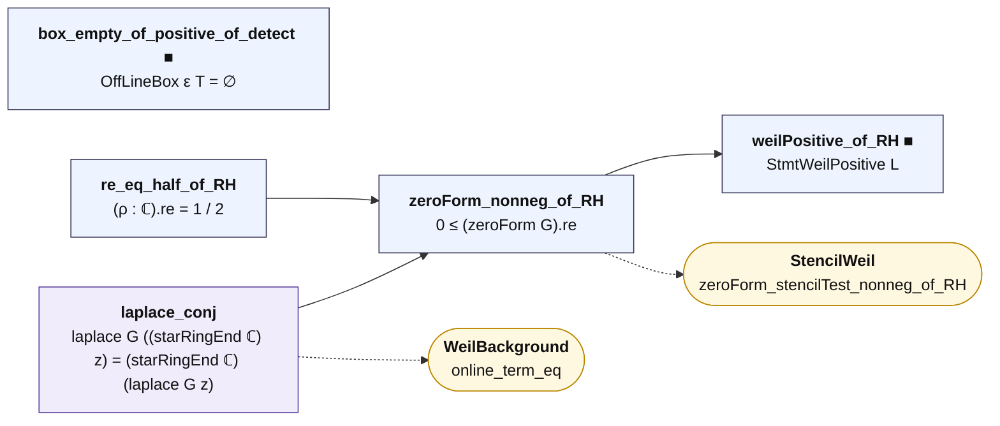

# `lean_stage3/Stage3/WeilDetect.lean`

WeilDetect — the zero side of Weil's form on bounded support, and the bounded-height detection statement. 2026-09-06, the first attempt at entry 297's rung-to-strip arrow, in the shape entry 303 §(d) drafted and did not add.

5 theorems, 6 definitions, 173 lines. Arrows are Lean's own record of what each proof uses.

**Imports:** nothing in this tree  
**Imported by:** [`Stage3`](../lean_stage3/Stage3.md), [`BoxFinite`](../lean_stage3/BoxFinite.md), [`WeilBackground`](../lean_stage3/WeilBackground.md), [`WeilBridgeLeaf`](../lean_stage3/WeilBridgeLeaf.md), [`WeilPowerAssembly`](../lean_stage3/WeilPowerAssembly.md), [`WeilPowerBackground`](../lean_stage3/WeilPowerBackground.md)

## The picture



An arrow A → B reads "A is used in the proof of B". Green: counting, integers only. Violet: shape, analysis with no ζ. Blue: reads ζ. A name ending in ■ is an end: nothing else uses it. Red: contains `sorry`. Yellow: theorems in another file, counted; a dotted arrow crosses files. Definitions are not drawn; they are listed below the diagram.

## Definitions

<a name="WeilDetect-laplace"></a>
### `WeilDetect.laplace`

def · line 64

The two-sided Laplace transform, `∫ G(u) e^{−zu} du`.

- **Is:** `` laplace (G : ℝ → ℂ) (z : ℂ) : ℂ := ∫ u : ℝ, G u * Complex.exp (-(z * (u : ℂ))) ``
- **Used by 39:** [`StencilWeil.laplace_shift`](../lean_stage3/StencilWeil.md#StencilWeil-laplace_shift), [`StencilWeil.laplace_stencilTest`](../lean_stage3/StencilWeil.md#StencilWeil-laplace_stencilTest), [`StencilWeil.zeroForm_stencilTest`](../lean_stage3/StencilWeil.md#StencilWeil-zeroForm_stencilTest), [`WeilBackground.laplace_phi`](../lean_stage3/WeilBackground.md#WeilBackground-laplace_phi), [`WeilBackground.online_term_eq`](../lean_stage3/WeilBackground.md#WeilBackground-online_term_eq), [`WeilBackground.online_term_le_far`](../lean_stage3/WeilBackground.md#WeilBackground-online_term_le_far), [`WeilBackground.online_term_le_near`](../lean_stage3/WeilBackground.md#WeilBackground-online_term_le_near), [`WeilBands.band_sum_le`](../lean_stage3/WeilBands.md#WeilBands-band_sum_le), [`WeilBands.weightedTerm`](../lean_stage3/WeilBands.md#WeilBands-weightedTerm), [`WeilBridgeLeaf.StmtWeilBridge`](../lean_stage3/WeilBridgeLeaf.md#WeilBridgeLeaf-StmtWeilBridge), [`WeilBridgeLeaf.zeroForm_eq_primeSide`](../lean_stage3/WeilBridgeLeaf.md#WeilBridgeLeaf-zeroForm_eq_primeSide), [`WeilBridgeLeaf.zeroForm_eq_strip`](../lean_stage3/WeilBridgeLeaf.md#WeilBridgeLeaf-zeroForm_eq_strip), [`WeilDetect.laplace_conj`](#WeilDetect-laplace_conj), [`WeilDetect.zeroForm`](#WeilDetect-zeroForm), [`WeilDetect.zeroForm_nonneg_of_RH`](#WeilDetect-zeroForm_nonneg_of_RH), [`WeilOffLine.offline_term_le`](../lean_stage3/WeilOffLine.md#WeilOffLine-offline_term_le), [`WeilOffLine.offline_term_le_explicit`](../lean_stage3/WeilOffLine.md#WeilOffLine-offline_term_le_explicit), [`WeilOffLine.term_eq_neg_sq`](../lean_stage3/WeilOffLine.md#WeilOffLine-term_eq_neg_sq), [`WeilOffLine.term_re_eq`](../lean_stage3/WeilOffLine.md#WeilOffLine-term_re_eq), [`WeilOnLine.sum_low_le`](../lean_stage3/WeilOnLine.md#WeilOnLine-sum_low_le), [`WeilOnLine.term_conj`](../lean_stage3/WeilOnLine.md#WeilOnLine-term_conj), [`WeilOnLine.weightedTerm_conjZ`](../lean_stage3/WeilOnLine.md#WeilOnLine-weightedTerm_conjZ), [`WeilPowerBackground.laplace_phiW`](../lean_stage3/WeilPowerBackground.md#WeilPowerBackground-laplace_phiW), [`WeilPowerBackground.online_term_eq`](../lean_stage3/WeilPowerBackground.md#WeilPowerBackground-online_term_eq), [`WeilPowerBackground.online_term_le_far`](../lean_stage3/WeilPowerBackground.md#WeilPowerBackground-online_term_le_far), [`WeilPowerBackground.online_term_le_near`](../lean_stage3/WeilPowerBackground.md#WeilPowerBackground-online_term_le_near), [`WeilPowerBackground.online_term_nonneg`](../lean_stage3/WeilPowerBackground.md#WeilPowerBackground-online_term_nonneg), [`WeilPowerBackground.term_eq_neg_sq`](../lean_stage3/WeilPowerBackground.md#WeilPowerBackground-term_eq_neg_sq), [`WeilPowerBackground.term_re_eq`](../lean_stage3/WeilPowerBackground.md#WeilPowerBackground-term_re_eq), [`WeilPowerBands.termW`](../lean_stage3/WeilPowerBands.md#WeilPowerBands-termW), [`WeilPowerBands.term_le_M`](../lean_stage3/WeilPowerBands.md#WeilPowerBands-term_le_M), [`WeilPowerBridge.term_eq_sidebands`](../lean_stage3/WeilPowerBridge.md#WeilPowerBridge-term_eq_sidebands), [`WeilPowerOnLine.term_conj`](../lean_stage3/WeilPowerOnLine.md#WeilPowerOnLine-term_conj), [`WeilSeries.term_le_M`](../lean_stage3/WeilSeries.md#WeilSeries-term_le_M), [`WeilTiles.online_term_nonneg`](../lean_stage3/WeilTiles.md#WeilTiles-online_term_nonneg), [`WeilTiles.sum_by_bands`](../lean_stage3/WeilTiles.md#WeilTiles-sum_by_bands), [`WeilTiles.sum_le_bandSeries`](../lean_stage3/WeilTiles.md#WeilTiles-sum_le_bandSeries), [`WeilTiles.tsum_upper_le`](../lean_stage3/WeilTiles.md#WeilTiles-tsum_upper_le), [`WeilTiles.weightedTerm_nonneg`](../lean_stage3/WeilTiles.md#WeilTiles-weightedTerm_nonneg)

<a name="WeilDetect-zeroForm"></a>
### `WeilDetect.zeroForm`

def · line 69

The zero side of Weil's form at `G`: `Σ_ρ Ĝ(−ρ)·Ĝ(−(1−ρ))·ord(ρ)` over the nontrivial zeros, with multiplicity (`riemannZeta.zeroes_sum`).

- **Is:** `` zeroForm (G : ℝ → ℂ) : ℂ := riemannZeta.zeroes_sum (Set.Ioo 0 1) (Set.univ : Set ℝ) (fun ρ ↦ laplace G (-ρ) * laplace G (-(1 - ρ))) ``
- **Built from:** [`WeilDetect.laplace`](#WeilDetect-laplace)
- **Used by 10:** [`StencilWeil.zeroForm_stencilTest`](../lean_stage3/StencilWeil.md#StencilWeil-zeroForm_stencilTest), [`StencilWeil.zeroForm_stencilTest_eq_primeSide`](../lean_stage3/StencilWeil.md#StencilWeil-zeroForm_stencilTest_eq_primeSide), [`StencilWeil.zeroForm_stencilTest_nonneg_of_RH`](../lean_stage3/StencilWeil.md#StencilWeil-zeroForm_stencilTest_nonneg_of_RH), [`WeilBridgeLeaf.zeroForm_eq_primeSide`](../lean_stage3/WeilBridgeLeaf.md#WeilBridgeLeaf-zeroForm_eq_primeSide), [`WeilBridgeLeaf.zeroForm_eq_strip`](../lean_stage3/WeilBridgeLeaf.md#WeilBridgeLeaf-zeroForm_eq_strip), [`WeilDetect.StmtDetect`](#WeilDetect-StmtDetect), [`WeilDetect.StmtWeilPositive`](#WeilDetect-StmtWeilPositive), [`WeilDetect.box_empty_of_positive_of_detect`](#WeilDetect-box_empty_of_positive_of_detect), [`WeilDetect.zeroForm_nonneg_of_RH`](#WeilDetect-zeroForm_nonneg_of_RH), [`WeilPowerAssembly.StmtDetectGap`](../lean_stage3/WeilPowerAssembly.md#WeilPowerAssembly-StmtDetectGap)

<a name="WeilDetect-IsTest"></a>
### `WeilDetect.IsTest`

def · line 75

The test-function class at support `L`: real-valued, `C²`, compactly supported inside `[−L/2, L/2]`.

- **Is:** `` IsTest (L : ℝ) (G : ℝ → ℂ) : Prop := (∀ u, (G u).im = 0) ∧ ContDiff ℝ 1 G ∧ HasCompactSupport G ∧ tsupport G ⊆ Set.Icc (-L / 2) (L / 2) ``
- **Used by 15:** [`StencilWeil.integrable_shift_term`](../lean_stage3/StencilWeil.md#StencilWeil-integrable_shift_term), [`StencilWeil.isTest_stencilTest`](../lean_stage3/StencilWeil.md#StencilWeil-isTest_stencilTest), [`StencilWeil.laplace_stencilTest`](../lean_stage3/StencilWeil.md#StencilWeil-laplace_stencilTest), [`StencilWeil.stencilTest_zero_outside`](../lean_stage3/StencilWeil.md#StencilWeil-stencilTest_zero_outside), [`StencilWeil.zeroForm_stencilTest`](../lean_stage3/StencilWeil.md#StencilWeil-zeroForm_stencilTest), [`StencilWeil.zeroForm_stencilTest_eq_primeSide`](../lean_stage3/StencilWeil.md#StencilWeil-zeroForm_stencilTest_eq_primeSide), [`StencilWeil.zeroForm_stencilTest_nonneg_of_RH`](../lean_stage3/StencilWeil.md#StencilWeil-zeroForm_stencilTest_nonneg_of_RH), [`WeilBridgeLeaf.StmtWeilBridge`](../lean_stage3/WeilBridgeLeaf.md#WeilBridgeLeaf-StmtWeilBridge), [`WeilBridgeLeaf.zeroForm_eq_primeSide`](../lean_stage3/WeilBridgeLeaf.md#WeilBridgeLeaf-zeroForm_eq_primeSide), [`WeilDetect.StmtDetect`](#WeilDetect-StmtDetect), [`WeilDetect.StmtWeilPositive`](#WeilDetect-StmtWeilPositive), [`WeilDetect.box_empty_of_positive_of_detect`](#WeilDetect-box_empty_of_positive_of_detect), [`WeilDetect.weilPositive_of_RH`](#WeilDetect-weilPositive_of_RH), [`WeilPowerAssembly.StmtDetectGap`](../lean_stage3/WeilPowerAssembly.md#WeilPowerAssembly-StmtDetectGap), [`WeilPowerAssembly.isTest_phiWC`](../lean_stage3/WeilPowerAssembly.md#WeilPowerAssembly-isTest_phiWC)

<a name="WeilDetect-StmtWeilPositive"></a>
### `WeilDetect.StmtWeilPositive`

def · line 80

Weil positivity on support `L`, zero side.

- **Is:** `` StmtWeilPositive (L : ℝ) : Prop := ∀ G : ℝ → ℂ, IsTest L G → 0 ≤ (zeroForm G).re ``
- **Built from:** [`WeilDetect.IsTest`](#WeilDetect-IsTest), [`WeilDetect.zeroForm`](#WeilDetect-zeroForm)
- **Used by 2:** [`WeilDetect.box_empty_of_positive_of_detect`](#WeilDetect-box_empty_of_positive_of_detect), [`WeilDetect.weilPositive_of_RH`](#WeilDetect-weilPositive_of_RH)

<a name="WeilDetect-OffLineBox"></a>
### `WeilDetect.OffLineBox`

def · line 84

The off-line box: zeros with `Re ρ ≥ 1/2 + ε` and `|Im ρ| ≤ T`.

- **Is:** `` OffLineBox (ε T : ℝ) : Set ℂ := riemannZeta.zeroes_rect (Set.Icc (1 / 2 + ε) 1) (Set.Icc (-T) T) ``
- **Used by 7:** [`Stage3.offLineBox_finite`](../lean_stage3/BoxFinite.md#Stage3-offLineBox_finite), [`WeilDetect.StmtDetect`](#WeilDetect-StmtDetect), [`WeilDetect.box_empty_of_positive_of_detect`](#WeilDetect-box_empty_of_positive_of_detect), [`WeilPowerAssembly.StmtDetectGap`](../lean_stage3/WeilPowerAssembly.md#WeilPowerAssembly-StmtDetectGap), [`WeilPowerAssembly.far_large_le`](../lean_stage3/WeilPowerAssembly.md#WeilPowerAssembly-far_large_le), [`WeilPowerAssembly.far_moderate_le`](../lean_stage3/WeilPowerAssembly.md#WeilPowerAssembly-far_moderate_le), [`WeilPowerAssembly.near_nonneg`](../lean_stage3/WeilPowerAssembly.md#WeilPowerAssembly-near_nonneg)

<a name="WeilDetect-StmtDetect"></a>
### `WeilDetect.StmtDetect`

def · line 90

The bounded-height detection statement: a zero in the box forces the zero side negative at some test function of support `L`. The theorem to be earned is `∀ ε > 0, ∀ T, StmtDetect ε T (L ε T)` with `L` explicit.

- **Is:** `` StmtDetect (ε T L : ℝ) : Prop := (OffLineBox ε T).Nonempty → ∃ G : ℝ → ℂ, IsTest L G ∧ (zeroForm G).re < 0 ``
- **Built from:** [`WeilDetect.IsTest`](#WeilDetect-IsTest), [`WeilDetect.OffLineBox`](#WeilDetect-OffLineBox), [`WeilDetect.zeroForm`](#WeilDetect-zeroForm)
- **Used by 1:** [`WeilDetect.box_empty_of_positive_of_detect`](#WeilDetect-box_empty_of_positive_of_detect)

## Theorems

<a name="WeilDetect-box_empty_of_positive_of_detect"></a>
### `WeilDetect.box_empty_of_positive_of_detect`

line 95

**Reads ζ.** It, or something it rests on, uses the zeta function, its zeros or the Riemann hypothesis.

**Why.** The arrow. Detection plus positivity on the same support empties the box.

**Proves**

```lean
OffLineBox ε T = ∅
```

**Needs** (its hypotheses)

  - `` hD : StmtDetect ε T L ``
  - `` hP : StmtWeilPositive L ``

**Stated with:** [`WeilDetect.OffLineBox`](#WeilDetect-OffLineBox), [`WeilDetect.StmtDetect`](#WeilDetect-StmtDetect), [`WeilDetect.StmtWeilPositive`](#WeilDetect-StmtWeilPositive)

**Fed by:** no theorem of this repo; it stands on Mathlib and the definitions below.

**Definitions its proof touches:** [`WeilDetect.IsTest`](#WeilDetect-IsTest), [`WeilDetect.zeroForm`](#WeilDetect-zeroForm)

**Feeds:** nothing. It is an end.

<a name="WeilDetect-laplace_conj"></a>
### `WeilDetect.laplace_conj`

line 103

**Shape.** Uses real or complex analysis; nothing in it or beneath it reads ζ.

**Why.** For real-valued `G`, the transform commutes with conjugation.

**Proves**

```lean
laplace G ((starRingEnd ℂ) z) = (starRingEnd ℂ) (laplace G z)
```

**Needs** (its hypotheses)

  - `` G : ℝ → ℂ ``
  - `` hG : ∀ u, (G u).im = 0 ``
  - `` z : ℂ ``

**Stated with:** [`WeilDetect.laplace`](#WeilDetect-laplace)

**Fed by:** no theorem of this repo; it stands on Mathlib and the definitions below.

**Feeds** (2 that use it)

  - [`WeilBackground.online_term_eq`](../lean_stage3/WeilBackground.md#WeilBackground-online_term_eq) (WeilBackground) — `` laplace (phiC h γ) (-ρ) * laplace (phiC h γ) (-(1 - ρ)) = (((h / 2) ^ 2 * (WeilTransform.Psi (h * (ρ.im + γ)) + WeilTransform.Psi (h * (ρ.im - γ))) ^ … ``
  - [`WeilDetect.zeroForm_nonneg_of_RH`](#WeilDetect-zeroForm_nonneg_of_RH) — `` 0 ≤ (zeroForm G).re ``

<a name="WeilDetect-re_eq_half_of_RH"></a>
### `WeilDetect.re_eq_half_of_RH`

line 115

**Reads ζ.** It, or something it rests on, uses the zeta function, its zeros or the Riemann hypothesis.

**Why.** Under RH a nontrivial zero has real part `1/2`.

**Proves**

```lean
(ρ : ℂ).re = 1 / 2
```

**Needs** (its hypotheses)

  - `` hRH : RiemannHypothesis ``
  - `` ρ : riemannZeta.zeroes_rect (Set.Ioo 0 1) (Set.univ : Set ℝ) ``

**Fed by:** no theorem of this repo; it stands on Mathlib.

**Feeds** (1 that use it)

  - [`WeilDetect.zeroForm_nonneg_of_RH`](#WeilDetect-zeroForm_nonneg_of_RH) — `` 0 ≤ (zeroForm G).re ``

<a name="WeilDetect-zeroForm_nonneg_of_RH"></a>
### `WeilDetect.zeroForm_nonneg_of_RH`

line 130

**Reads ζ.** It, or something it rests on, uses the zeta function, its zeros or the Riemann hypothesis.

**Why.** RH ⇒ positivity on every support (the easy half of Weil's criterion, zero side). Each term is `|Ĝ(−ρ)|²·ord ρ` with `ord ρ ≥ 1`.

**Proves**

```lean
0 ≤ (zeroForm G).re
```

**Needs** (its hypotheses)

  - `` hRH : RiemannHypothesis ``
  - `` hG : ∀ u, (G u).im = 0 ``

**Stated with:** [`WeilDetect.zeroForm`](#WeilDetect-zeroForm)

**Fed by** (2 theorems its proof uses)

  - [`WeilDetect.laplace_conj`](#WeilDetect-laplace_conj) — `` laplace G ((starRingEnd ℂ) z) = (starRingEnd ℂ) (laplace G z) ``
  - [`WeilDetect.re_eq_half_of_RH`](#WeilDetect-re_eq_half_of_RH) — `` (ρ : ℂ).re = 1 / 2 ``

**Definitions its proof touches:** [`WeilDetect.laplace`](#WeilDetect-laplace)

**Feeds** (2 that use it)

  - [`StencilWeil.zeroForm_stencilTest_nonneg_of_RH`](../lean_stage3/StencilWeil.md#StencilWeil-zeroForm_stencilTest_nonneg_of_RH) (StencilWeil) — `` 0 ≤ (zeroForm (stencilTest d φ)).re ``
  - [`WeilDetect.weilPositive_of_RH`](#WeilDetect-weilPositive_of_RH) — `` StmtWeilPositive L ``

<a name="WeilDetect-weilPositive_of_RH"></a>
### `WeilDetect.weilPositive_of_RH`

line 153

**Reads ζ.** It, or something it rests on, uses the zeta function, its zeros or the Riemann hypothesis.

**Why.** Under the Riemann hypothesis, Weil positivity on the zero side, `StmtWeilPositive L`, holds for every support `L`.

**Proves**

```lean
StmtWeilPositive L
```

**Needs** (its hypotheses)

  - `` hRH : RiemannHypothesis ``
  - `` L : ℝ ``

**Stated with:** [`WeilDetect.StmtWeilPositive`](#WeilDetect-StmtWeilPositive)

**Fed by** (1 theorem its proof uses)

  - [`WeilDetect.zeroForm_nonneg_of_RH`](#WeilDetect-zeroForm_nonneg_of_RH) — `` 0 ≤ (zeroForm G).re ``

**Definitions its proof touches:** [`WeilDetect.IsTest`](#WeilDetect-IsTest)

**Feeds:** nothing. It is an end.

