# `lean_stage3/Stage3/WeilDetect.lean`

**What it does** (its own header): WeilDetect — the zero side of Weil's form on bounded support, and the bounded-height detection statement. 2026-09-06, the first attempt at entry 297's rung-to-strip arrow, in the shape entry 303 §(d) drafted and did not add.

**Imports:** nothing in this tree.
**Imported by:** [`Stage3`](../lean_stage3/Stage3.md), [`BoxFinite`](../lean_stage3/BoxFinite.md), [`WeilBackground`](../lean_stage3/WeilBackground.md), [`WeilBridgeLeaf`](../lean_stage3/WeilBridgeLeaf.md), [`WeilPowerAssembly`](../lean_stage3/WeilPowerAssembly.md), [`WeilPowerBackground`](../lean_stage3/WeilPowerBackground.md).

```mermaid
flowchart LR
  n0["laplace<br/>(def)"]:::dfn
  n1["zeroForm<br/>(def)"]:::dfn
  n2["IsTest<br/>(def)"]:::dfn
  n3["StmtWeilPositive<br/>(def)"]:::dfn
  n4["OffLineBox<br/>(def)"]:::dfn
  n5["StmtDetect<br/>(def)"]:::dfn
  n6["box_empty_of_positive_of_detect<br/>⊢ OffLineBox ε T = ∅"]:::end_
  n7["laplace_conj<br/>⊢ laplace G ((starRingEnd ℂ) z) = (starRingEnd ℂ) (laplace G z)"]:::thm
  n8["re_eq_half_of_RH<br/>⊢ (ρ : ℂ).re = 1 / 2"]:::thm
  n9["zeroForm_nonneg_of_RH<br/>⊢ 0 ≤ (zeroForm G).re"]:::thm
  n10["weilPositive_of_RH<br/>⊢ StmtWeilPositive L"]:::end_
  x0(["BoxFinite · offLineBox_finite"]):::ext
  x1(["WeilBackground · laplace_phi"]):::ext
  x2(["WeilBackground · online_term_eq"]):::ext
  x3(["WeilBackground · online_term_le_far"]):::ext
  x4(["WeilBackground · online_term_le_near"]):::ext
  x5(["WeilBands · band_sum_le"]):::ext
  x6(["WeilBands · weightedTerm"]):::ext
  x7(["WeilBridgeLeaf · StmtWeilBridge"]):::ext
  x8(["WeilBridgeLeaf · zeroForm_eq_primeSide"]):::ext
  x9(["WeilBridgeLeaf · zeroForm_eq_strip"]):::ext
  x10(["WeilOffLine · offline_term_le"]):::ext
  x11(["WeilOffLine · offline_term_le_explicit"]):::ext
  x12(["WeilOffLine · term_eq_neg_sq"]):::ext
  x13(["WeilOffLine · term_re_eq"]):::ext
  x14(["WeilOnLine · term_conj"]):::ext
  x15(["WeilOnLine · weightedTerm_conjZ"]):::ext
  x16(["WeilPowerAssembly · far_large_le"]):::ext
  x17(["WeilPowerAssembly · far_moderate_le"]):::ext
  x18(["WeilPowerAssembly · near_nonneg"]):::ext
  x19(["WeilPowerBackground · laplace_phiW"]):::ext
  x20(["WeilPowerBackground · online_term_eq"]):::ext
  x21(["WeilPowerBackground · online_term_le_far"]):::ext
  x22(["WeilPowerBackground · online_term_le_near"]):::ext
  x23(["WeilPowerBackground · online_term_nonneg"]):::ext
  x24(["WeilPowerBackground · term_eq_neg_sq"]):::ext
  x25(["WeilPowerBackground · term_re_eq"]):::ext
  x26(["WeilPowerBands · termW"]):::ext
  x27(["WeilSeries · term_le_M"]):::ext
  x28(["WeilTiles · online_term_nonneg"]):::ext
  x29(["WeilTiles · sum_by_bands"]):::ext
  x30(["WeilTiles · sum_le_bandSeries"]):::ext
  x31(["WeilTiles · tsum_upper_le"]):::ext
  n0 --> n1
  n0 --> n7
  n0 --> n9
  n0 --> x1
  n0 --> x10
  n0 --> x11
  n0 --> x12
  n0 --> x13
  n0 --> x14
  n0 --> x15
  n0 --> x19
  n0 --> x2
  n0 --> x20
  n0 --> x21
  n0 --> x22
  n0 --> x23
  n0 --> x24
  n0 --> x25
  n0 --> x26
  n0 --> x27
  n0 --> x28
  n0 --> x29
  n0 --> x3
  n0 --> x30
  n0 --> x31
  n0 --> x4
  n0 --> x5
  n0 --> x6
  n0 --> x7
  n0 --> x9
  n1 --> n3
  n1 --> n5
  n1 --> n9
  n1 --> x8
  n1 --> x9
  n2 --> n3
  n2 --> n5
  n2 --> x7
  n2 --> x8
  n3 --> n10
  n3 --> n6
  n4 --> n5
  n4 --> n6
  n4 --> x0
  n4 --> x16
  n4 --> x17
  n4 --> x18
  n5 --> n6
  n7 --> n9
  n7 --> x2
  n8 --> n9
  n9 --> n10
  classDef thm fill:#eef4ff,stroke:#335,color:#111
  classDef dfn fill:#f2f2f2,stroke:#777,color:#111
  classDef end_ fill:#e7f7e7,stroke:#2a7,color:#111,stroke-width:2px
  classDef lone fill:#fff,stroke:#999,color:#111,stroke-dasharray:4 3
  classDef bad fill:#ffe5e5,stroke:#c22,color:#111,stroke-width:2px
  classDef ext fill:#fff8e1,stroke:#b80,color:#111,stroke-dasharray:2 2
```

Blue: theorem. Green: a theorem nothing else uses (an end). Dashed white: connects to nothing. Grey: definition. Red: contains `sorry`. Yellow: in another file. An arrow A → B reads "A is used by B".

## Every declaration

| declaration | proves (output) | needs (input) | why (its own docstring) | uses | used by |
|---|---|---|---|---|---|
| `WeilDetect.laplace` def, line 64 | ℂ | G : ℝ → ℂ; z : ℂ | The two-sided Laplace transform, `∫ G(u) e^{−zu} du`. | — | `WeilBackground.laplace_phi`, `WeilBackground.online_term_eq`, `WeilBackground.online_term_le_far`, `WeilBackground.online_term_le_near`, `WeilBands.band_sum_le`, `WeilBands.weightedTerm`, `WeilBridgeLeaf.StmtWeilBridge`, `WeilBridgeLeaf.zeroForm_eq_strip`, `WeilDetect.laplace_conj`, `WeilDetect.zeroForm`, `WeilDetect.zeroForm_nonneg_of_RH`, `WeilOffLine.offline_term_le`, `WeilOffLine.offline_term_le_explicit`, `WeilOffLine.term_eq_neg_sq`, `WeilOffLine.term_re_eq`, `WeilOnLine.term_conj`, `WeilOnLine.weightedTerm_conjZ`, `WeilPowerBackground.laplace_phiW`, `WeilPowerBackground.online_term_eq`, `WeilPowerBackground.online_term_le_far`, `WeilPowerBackground.online_term_le_near`, `WeilPowerBackground.online_term_nonneg`, `WeilPowerBackground.term_eq_neg_sq`, `WeilPowerBackground.term_re_eq`, `WeilPowerBands.termW`, `WeilSeries.term_le_M`, `WeilTiles.online_term_nonneg`, `WeilTiles.sum_by_bands`, `WeilTiles.sum_le_bandSeries`, `WeilTiles.tsum_upper_le` |
| `WeilDetect.zeroForm` def, line 69 | ℂ | G : ℝ → ℂ | The zero side of Weil's form at `G`: `Σ_ρ Ĝ(−ρ)·Ĝ(−(1−ρ))·ord(ρ)` over the nontrivial zeros, with multiplicity (`riemannZeta.zeroes_sum`). | `WeilDetect.laplace` | `WeilBridgeLeaf.zeroForm_eq_primeSide`, `WeilBridgeLeaf.zeroForm_eq_strip`, `WeilDetect.StmtDetect`, `WeilDetect.StmtWeilPositive`, `WeilDetect.zeroForm_nonneg_of_RH` |
| `WeilDetect.IsTest` def, line 75 | Prop | L : ℝ; G : ℝ → ℂ | The test-function class at support `L`: real-valued, `C²`, compactly supported inside `[−L/2, L/2]`. | — | `WeilBridgeLeaf.StmtWeilBridge`, `WeilBridgeLeaf.zeroForm_eq_primeSide`, `WeilDetect.StmtDetect`, `WeilDetect.StmtWeilPositive` |
| `WeilDetect.StmtWeilPositive` def, line 80 | Prop | L : ℝ | Weil positivity on support `L`, zero side. | `WeilDetect.IsTest`, `WeilDetect.zeroForm` | `WeilDetect.box_empty_of_positive_of_detect`, `WeilDetect.weilPositive_of_RH` |
| `WeilDetect.OffLineBox` def, line 84 | Set ℂ | ε T : ℝ | The off-line box: zeros with `Re ρ ≥ 1/2 + ε` and `\|Im ρ\| ≤ T`. | — | `Stage3.offLineBox_finite`, `WeilDetect.StmtDetect`, `WeilDetect.box_empty_of_positive_of_detect`, `WeilPowerAssembly.far_large_le`, `WeilPowerAssembly.far_moderate_le`, `WeilPowerAssembly.near_nonneg` |
| `WeilDetect.StmtDetect` def, line 90 | Prop | ε T L : ℝ | The bounded-height detection statement: a zero in the box forces the zero side negative at some test function of support `L`. The theorem to be earned is `∀ ε &gt; 0, ∀ T, StmtDetect ε T (L ε T)` with `L` explicit. | `WeilDetect.IsTest`, `WeilDetect.OffLineBox`, `WeilDetect.zeroForm` | `WeilDetect.box_empty_of_positive_of_detect` |
| `WeilDetect.box_empty_of_positive_of_detect` theorem, line 95 | OffLineBox ε T = ∅ | hD : StmtDetect ε T L; hP : StmtWeilPositive L | The arrow. Detection plus positivity on the same support empties the box. | `WeilDetect.OffLineBox`, `WeilDetect.StmtDetect`, `WeilDetect.StmtWeilPositive` | — |
| `WeilDetect.laplace_conj` theorem, line 103 | laplace G ((starRingEnd ℂ) z) = (starRingEnd ℂ) (laplace G z) | G : ℝ → ℂ; hG : ∀ u, (G u).im = 0; z : ℂ | For real-valued `G`, the transform commutes with conjugation. | `WeilDetect.laplace` | `WeilBackground.online_term_eq`, `WeilDetect.zeroForm_nonneg_of_RH` |
| `WeilDetect.re_eq_half_of_RH` theorem, line 115 | (ρ : ℂ).re = 1 / 2 | hRH : RiemannHypothesis; ρ : riemannZeta.zeroes_rect (Set.Ioo 0 1) (Set.univ : Set ℝ) | Under RH a nontrivial zero has real part `1/2`. | — | `WeilDetect.zeroForm_nonneg_of_RH` |
| `WeilDetect.zeroForm_nonneg_of_RH` theorem, line 130 | 0 ≤ (zeroForm G).re | hRH : RiemannHypothesis; hG : ∀ u, (G u).im = 0 | RH ⇒ positivity on every support (the easy half of Weil's criterion, zero side). Each term is `\|Ĝ(−ρ)\|²·ord ρ` with `ord ρ ≥ 1`. | `WeilDetect.laplace`, `WeilDetect.laplace_conj`, `WeilDetect.re_eq_half_of_RH`, `WeilDetect.zeroForm` | `WeilDetect.weilPositive_of_RH` |
| `WeilDetect.weilPositive_of_RH` theorem, line 151 | StmtWeilPositive L | hRH : RiemannHypothesis; L : ℝ | — | `WeilDetect.StmtWeilPositive`, `WeilDetect.zeroForm_nonneg_of_RH` | — |
