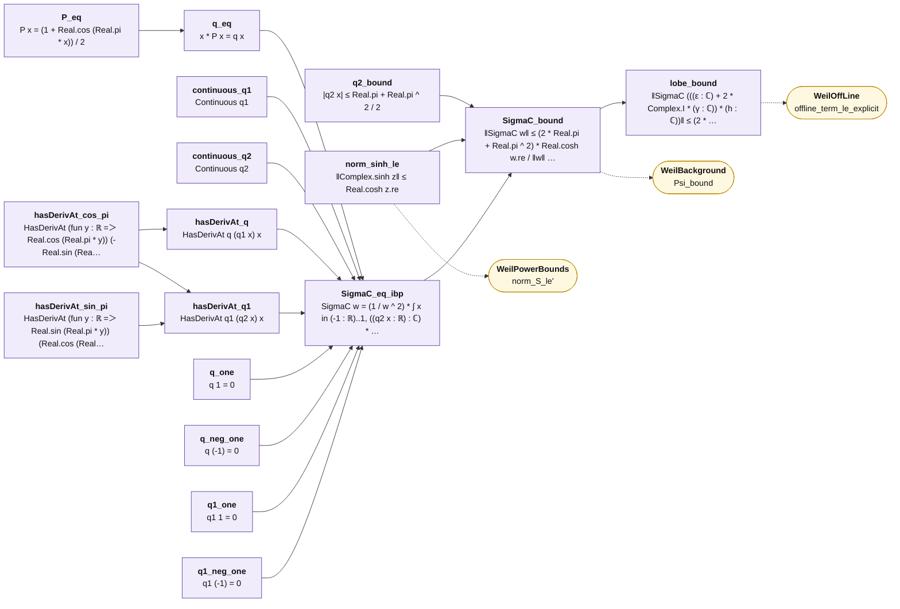

# `lean_stage3/Stage3/WeilLobe.lean`

WeilLobe — the 2γ lobe bounded above. Rung 4a of the detection ladder (units 0316–0318). 2026-09-06.

17 theorems, 3 definitions, 256 lines. Arrows are Lean's own record of what each proof uses.

**Imports:** [`WeilTransform`](../lean_stage3/WeilTransform.md)  
**Imported by:** [`Stage3`](../lean_stage3/Stage3.md), [`WeilBackground`](../lean_stage3/WeilBackground.md), [`WeilPower`](../lean_stage3/WeilPower.md)

## The picture



An arrow A → B reads "A is used in the proof of B". Green: counting, integers only. Violet: shape, analysis with no ζ. Blue: reads ζ. A name ending in ■ is an end: nothing else uses it. Red: contains `sorry`. Yellow: theorems in another file, counted; a dotted arrow crosses files. Definitions are not drawn; they are listed below the diagram.

## Definitions

<a name="WeilLobe-q"></a>
### `WeilLobe.q`

def · line 50

The envelope `q(x) = x·P(x)` in half-angle form.

- **Is:** `` q (x : ℝ) : ℝ := x * (1 + Real.cos (Real.pi * x)) / 2 ``
- **Used by 5:** [`WeilLobe.SigmaC_eq_ibp`](#WeilLobe-SigmaC_eq_ibp), [`WeilLobe.hasDerivAt_q`](#WeilLobe-hasDerivAt_q), [`WeilLobe.q_eq`](#WeilLobe-q_eq), [`WeilLobe.q_neg_one`](#WeilLobe-q_neg_one), [`WeilLobe.q_one`](#WeilLobe-q_one)

<a name="WeilLobe-q1"></a>
### `WeilLobe.q1`

def · line 53

`q'`.

- **Is:** `` q1 (x : ℝ) : ℝ := 1 / 2 + Real.cos (Real.pi * x) / 2 - Real.pi * x / 2 * Real.sin (Real.pi * x) ``
- **Used by 6:** [`WeilLobe.SigmaC_eq_ibp`](#WeilLobe-SigmaC_eq_ibp), [`WeilLobe.continuous_q1`](#WeilLobe-continuous_q1), [`WeilLobe.hasDerivAt_q`](#WeilLobe-hasDerivAt_q), [`WeilLobe.hasDerivAt_q1`](#WeilLobe-hasDerivAt_q1), [`WeilLobe.q1_neg_one`](#WeilLobe-q1_neg_one), [`WeilLobe.q1_one`](#WeilLobe-q1_one)

<a name="WeilLobe-q2"></a>
### `WeilLobe.q2`

def · line 56

`q''`.

- **Is:** `` q2 (x : ℝ) : ℝ := -Real.pi * Real.sin (Real.pi * x) - Real.pi ^ 2 * x / 2 * Real.cos (Real.pi * x) ``
- **Used by 5:** [`WeilLobe.SigmaC_bound`](#WeilLobe-SigmaC_bound), [`WeilLobe.SigmaC_eq_ibp`](#WeilLobe-SigmaC_eq_ibp), [`WeilLobe.continuous_q2`](#WeilLobe-continuous_q2), [`WeilLobe.hasDerivAt_q1`](#WeilLobe-hasDerivAt_q1), [`WeilLobe.q2_bound`](#WeilLobe-q2_bound)

## Theorems

<a name="WeilLobe-P_eq"></a>
### `WeilLobe.P_eq`

line 43

**Shape.** Uses real or complex analysis; nothing in it or beneath it reads ζ.

**Why.** The half-angle form of the window.

**Proves**

```lean
P x = (1 + Real.cos (Real.pi * x)) / 2
```

**Needs** (its hypotheses)

  - `` x : ℝ ``

**Stated with:** [`WeilWindow.P`](../lean_stage3/WeilWindow.md#WeilWindow-P)

**Fed by:** no theorem of this repo; it stands on Mathlib and the definitions below.

**Feeds** (1 that use it)

  - [`WeilLobe.q_eq`](#WeilLobe-q_eq) — `` x * P x = q x ``

<a name="WeilLobe-q_eq"></a>
### `WeilLobe.q_eq`

line 58

**Shape.** Uses real or complex analysis; nothing in it or beneath it reads ζ.

**Proves**

```lean
x * P x = q x
```

**Needs** (its hypotheses)

  - `` x : ℝ ``

**Stated with:** [`WeilLobe.q`](#WeilLobe-q), [`WeilWindow.P`](../lean_stage3/WeilWindow.md#WeilWindow-P)

**Fed by** (1 theorem its proof uses)

  - [`WeilLobe.P_eq`](#WeilLobe-P_eq) — `` P x = (1 + Real.cos (Real.pi * x)) / 2 ``

**Feeds** (1 that use it)

  - [`WeilLobe.SigmaC_eq_ibp`](#WeilLobe-SigmaC_eq_ibp) — `` SigmaC w = (1 / w ^ 2) * ∫ x in (-1 : ℝ)..1, ((q2 x : ℝ) : ℂ) * Complex.sinh (w * (x : ℂ)) ``

<a name="WeilLobe-hasDerivAt_cos_pi"></a>
### `WeilLobe.hasDerivAt_cos_pi`

line 61

**Shape.** Uses real or complex analysis; nothing in it or beneath it reads ζ.

**Proves**

```lean
HasDerivAt (fun y : ℝ => Real.cos (Real.pi * y)) (-Real.sin (Real.pi * x) * Real.pi) x
```

**Needs** (its hypotheses)

  - `` x : ℝ ``

**Fed by:** no theorem of this repo; it stands on Mathlib.

**Feeds** (2 that use it)

  - [`WeilLobe.hasDerivAt_q`](#WeilLobe-hasDerivAt_q) — `` HasDerivAt q (q1 x) x ``
  - [`WeilLobe.hasDerivAt_q1`](#WeilLobe-hasDerivAt_q1) — `` HasDerivAt q1 (q2 x) x ``

<a name="WeilLobe-hasDerivAt_sin_pi"></a>
### `WeilLobe.hasDerivAt_sin_pi`

line 66

**Shape.** Uses real or complex analysis; nothing in it or beneath it reads ζ.

**Proves**

```lean
HasDerivAt (fun y : ℝ => Real.sin (Real.pi * y)) (Real.cos (Real.pi * x) * Real.pi) x
```

**Needs** (its hypotheses)

  - `` x : ℝ ``

**Fed by:** no theorem of this repo; it stands on Mathlib.

**Feeds** (1 that use it)

  - [`WeilLobe.hasDerivAt_q1`](#WeilLobe-hasDerivAt_q1) — `` HasDerivAt q1 (q2 x) x ``

<a name="WeilLobe-hasDerivAt_q"></a>
### `WeilLobe.hasDerivAt_q`

line 71

**Shape.** Uses real or complex analysis; nothing in it or beneath it reads ζ.

**Proves**

```lean
HasDerivAt q (q1 x) x
```

**Needs** (its hypotheses)

  - `` x : ℝ ``

**Stated with:** [`WeilLobe.q`](#WeilLobe-q), [`WeilLobe.q1`](#WeilLobe-q1)

**Fed by** (1 theorem its proof uses)

  - [`WeilLobe.hasDerivAt_cos_pi`](#WeilLobe-hasDerivAt_cos_pi) — `` HasDerivAt (fun y : ℝ => Real.cos (Real.pi * y)) (-Real.sin (Real.pi * x) * Real.pi) x ``

**Feeds** (1 that use it)

  - [`WeilLobe.SigmaC_eq_ibp`](#WeilLobe-SigmaC_eq_ibp) — `` SigmaC w = (1 / w ^ 2) * ∫ x in (-1 : ℝ)..1, ((q2 x : ℝ) : ℂ) * Complex.sinh (w * (x : ℂ)) ``

<a name="WeilLobe-hasDerivAt_q1"></a>
### `WeilLobe.hasDerivAt_q1`

line 77

**Shape.** Uses real or complex analysis; nothing in it or beneath it reads ζ.

**Proves**

```lean
HasDerivAt q1 (q2 x) x
```

**Needs** (its hypotheses)

  - `` x : ℝ ``

**Stated with:** [`WeilLobe.q1`](#WeilLobe-q1), [`WeilLobe.q2`](#WeilLobe-q2)

**Fed by** (2 theorems its proof uses)

  - [`WeilLobe.hasDerivAt_cos_pi`](#WeilLobe-hasDerivAt_cos_pi) — `` HasDerivAt (fun y : ℝ => Real.cos (Real.pi * y)) (-Real.sin (Real.pi * x) * Real.pi) x ``
  - [`WeilLobe.hasDerivAt_sin_pi`](#WeilLobe-hasDerivAt_sin_pi) — `` HasDerivAt (fun y : ℝ => Real.sin (Real.pi * y)) (Real.cos (Real.pi * x) * Real.pi) x ``

**Feeds** (1 that use it)

  - [`WeilLobe.SigmaC_eq_ibp`](#WeilLobe-SigmaC_eq_ibp) — `` SigmaC w = (1 / w ^ 2) * ∫ x in (-1 : ℝ)..1, ((q2 x : ℝ) : ℂ) * Complex.sinh (w * (x : ℂ)) ``

<a name="WeilLobe-q_one"></a>
### `WeilLobe.q_one`

line 86

**Shape.** Uses real or complex analysis; nothing in it or beneath it reads ζ.

**Proves**

```lean
q 1 = 0
```

**Stated with:** [`WeilLobe.q`](#WeilLobe-q)

**Fed by:** no theorem of this repo; it stands on Mathlib and the definitions below.

**Feeds** (1 that use it)

  - [`WeilLobe.SigmaC_eq_ibp`](#WeilLobe-SigmaC_eq_ibp) — `` SigmaC w = (1 / w ^ 2) * ∫ x in (-1 : ℝ)..1, ((q2 x : ℝ) : ℂ) * Complex.sinh (w * (x : ℂ)) ``

<a name="WeilLobe-q_neg_one"></a>
### `WeilLobe.q_neg_one`

line 89

**Shape.** Uses real or complex analysis; nothing in it or beneath it reads ζ.

**Proves**

```lean
q (-1) = 0
```

**Stated with:** [`WeilLobe.q`](#WeilLobe-q)

**Fed by:** no theorem of this repo; it stands on Mathlib and the definitions below.

**Feeds** (1 that use it)

  - [`WeilLobe.SigmaC_eq_ibp`](#WeilLobe-SigmaC_eq_ibp) — `` SigmaC w = (1 / w ^ 2) * ∫ x in (-1 : ℝ)..1, ((q2 x : ℝ) : ℂ) * Complex.sinh (w * (x : ℂ)) ``

<a name="WeilLobe-q1_one"></a>
### `WeilLobe.q1_one`

line 92

**Shape.** Uses real or complex analysis; nothing in it or beneath it reads ζ.

**Proves**

```lean
q1 1 = 0
```

**Stated with:** [`WeilLobe.q1`](#WeilLobe-q1)

**Fed by:** no theorem of this repo; it stands on Mathlib and the definitions below.

**Feeds** (1 that use it)

  - [`WeilLobe.SigmaC_eq_ibp`](#WeilLobe-SigmaC_eq_ibp) — `` SigmaC w = (1 / w ^ 2) * ∫ x in (-1 : ℝ)..1, ((q2 x : ℝ) : ℂ) * Complex.sinh (w * (x : ℂ)) ``

<a name="WeilLobe-q1_neg_one"></a>
### `WeilLobe.q1_neg_one`

line 95

**Shape.** Uses real or complex analysis; nothing in it or beneath it reads ζ.

**Proves**

```lean
q1 (-1) = 0
```

**Stated with:** [`WeilLobe.q1`](#WeilLobe-q1)

**Fed by:** no theorem of this repo; it stands on Mathlib and the definitions below.

**Feeds** (1 that use it)

  - [`WeilLobe.SigmaC_eq_ibp`](#WeilLobe-SigmaC_eq_ibp) — `` SigmaC w = (1 / w ^ 2) * ∫ x in (-1 : ℝ)..1, ((q2 x : ℝ) : ℂ) * Complex.sinh (w * (x : ℂ)) ``

<a name="WeilLobe-continuous_q1"></a>
### `WeilLobe.continuous_q1`

line 99

**Shape.** Uses real or complex analysis; nothing in it or beneath it reads ζ.

**Proves**

```lean
Continuous q1
```

**Stated with:** [`WeilLobe.q1`](#WeilLobe-q1)

**Fed by:** no theorem of this repo; it stands on Mathlib and the definitions below.

**Feeds** (1 that use it)

  - [`WeilLobe.SigmaC_eq_ibp`](#WeilLobe-SigmaC_eq_ibp) — `` SigmaC w = (1 / w ^ 2) * ∫ x in (-1 : ℝ)..1, ((q2 x : ℝ) : ℂ) * Complex.sinh (w * (x : ℂ)) ``

<a name="WeilLobe-continuous_q2"></a>
### `WeilLobe.continuous_q2`

line 103

**Shape.** Uses real or complex analysis; nothing in it or beneath it reads ζ.

**Proves**

```lean
Continuous q2
```

**Stated with:** [`WeilLobe.q2`](#WeilLobe-q2)

**Fed by:** no theorem of this repo; it stands on Mathlib and the definitions below.

**Feeds** (1 that use it)

  - [`WeilLobe.SigmaC_eq_ibp`](#WeilLobe-SigmaC_eq_ibp) — `` SigmaC w = (1 / w ^ 2) * ∫ x in (-1 : ℝ)..1, ((q2 x : ℝ) : ℂ) * Complex.sinh (w * (x : ℂ)) ``

<a name="WeilLobe-q2_bound"></a>
### `WeilLobe.q2_bound`

line 107

**Shape.** Uses real or complex analysis; nothing in it or beneath it reads ζ.

**Why.** `|q''(x)| ≤ π + π²/2` on `[−1, 1]`.

**Proves**

```lean
|q2 x| ≤ Real.pi + Real.pi ^ 2 / 2
```

**Needs** (its hypotheses)

  - `` hx : |x| ≤ 1 ``

**Stated with:** [`WeilLobe.q2`](#WeilLobe-q2)

**Fed by:** no theorem of this repo; it stands on Mathlib and the definitions below.

**Feeds** (1 that use it)

  - [`WeilLobe.SigmaC_bound`](#WeilLobe-SigmaC_bound) — `` ‖SigmaC w‖ ≤ (2 * Real.pi + Real.pi ^ 2) * Real.cosh w.re / ‖w‖ ^ 2 ``

<a name="WeilLobe-norm_sinh_le"></a>
### `WeilLobe.norm_sinh_le`

line 126

**Shape.** Uses real or complex analysis; nothing in it or beneath it reads ζ.

**Why.** `‖sinh z‖ ≤ cosh(Re z)`.

**Proves**

```lean
‖Complex.sinh z‖ ≤ Real.cosh z.re
```

**Needs** (its hypotheses)

  - `` z : ℂ ``

**Fed by:** no theorem of this repo; it stands on Mathlib.

**Feeds** (2 that use it)

  - [`WeilLobe.SigmaC_bound`](#WeilLobe-SigmaC_bound) — `` ‖SigmaC w‖ ≤ (2 * Real.pi + Real.pi ^ 2) * Real.cosh w.re / ‖w‖ ^ 2 ``
  - [`WeilPowerBounds.norm_S_le'`](../lean_stage3/WeilPowerBounds.md#WeilPowerBounds-norm_S_le-) (WeilPowerBounds) — `` ‖S m w‖ ≤ cS m * Real.cosh w.re / ‖QS m w‖ ``

<a name="WeilLobe-SigmaC_eq_ibp"></a>
### `WeilLobe.SigmaC_eq_ibp`

line 136

**Shape.** Uses real or complex analysis; nothing in it or beneath it reads ζ.

**Why.** Integration by parts, twice: `Σc(w) = w⁻²·∫ q''·sinh(w·)`.

**Proves**

```lean
SigmaC w = (1 / w ^ 2) * ∫ x in (-1 : ℝ)..1, ((q2 x : ℝ) : ℂ) * Complex.sinh (w * (x : ℂ))
```

**Needs** (its hypotheses)

  - `` w : ℂ ``
  - `` hw : w ≠ 0 ``

**Stated with:** [`WeilLobe.q2`](#WeilLobe-q2), [`WeilTransform.SigmaC`](../lean_stage3/WeilTransform.md#WeilTransform-SigmaC)

**Fed by** (9 theorems its proof uses)

  - [`WeilLobe.continuous_q1`](#WeilLobe-continuous_q1) — `` Continuous q1 ``
  - [`WeilLobe.continuous_q2`](#WeilLobe-continuous_q2) — `` Continuous q2 ``
  - [`WeilLobe.hasDerivAt_q`](#WeilLobe-hasDerivAt_q) — `` HasDerivAt q (q1 x) x ``
  - [`WeilLobe.hasDerivAt_q1`](#WeilLobe-hasDerivAt_q1) — `` HasDerivAt q1 (q2 x) x ``
  - [`WeilLobe.q1_neg_one`](#WeilLobe-q1_neg_one) — `` q1 (-1) = 0 ``
  - [`WeilLobe.q1_one`](#WeilLobe-q1_one) — `` q1 1 = 0 ``
  - [`WeilLobe.q_eq`](#WeilLobe-q_eq) — `` x * P x = q x ``
  - [`WeilLobe.q_neg_one`](#WeilLobe-q_neg_one) — `` q (-1) = 0 ``
  - [`WeilLobe.q_one`](#WeilLobe-q_one) — `` q 1 = 0 ``

**Definitions its proof touches:** [`WeilLobe.q`](#WeilLobe-q), [`WeilLobe.q1`](#WeilLobe-q1), [`WeilWindow.P`](../lean_stage3/WeilWindow.md#WeilWindow-P)

**Feeds** (1 that use it)

  - [`WeilLobe.SigmaC_bound`](#WeilLobe-SigmaC_bound) — `` ‖SigmaC w‖ ≤ (2 * Real.pi + Real.pi ^ 2) * Real.cosh w.re / ‖w‖ ^ 2 ``

<a name="WeilLobe-SigmaC_bound"></a>
### `WeilLobe.SigmaC_bound`

line 187

**Shape.** Uses real or complex analysis; nothing in it or beneath it reads ζ.

**Why.** (†) `‖Σc(w)‖ ≤ (2π + π²)·cosh(Re w)/‖w‖²`.

**Proves**

```lean
‖SigmaC w‖ ≤ (2 * Real.pi + Real.pi ^ 2) * Real.cosh w.re / ‖w‖ ^ 2
```

**Needs** (its hypotheses)

  - `` w : ℂ ``
  - `` hw : w ≠ 0 ``

**Stated with:** [`WeilTransform.SigmaC`](../lean_stage3/WeilTransform.md#WeilTransform-SigmaC)

**Fed by** (3 theorems its proof uses)

  - [`WeilLobe.SigmaC_eq_ibp`](#WeilLobe-SigmaC_eq_ibp) — `` SigmaC w = (1 / w ^ 2) * ∫ x in (-1 : ℝ)..1, ((q2 x : ℝ) : ℂ) * Complex.sinh (w * (x : ℂ)) ``
  - [`WeilLobe.norm_sinh_le`](#WeilLobe-norm_sinh_le) — `` ‖Complex.sinh z‖ ≤ Real.cosh z.re ``
  - [`WeilLobe.q2_bound`](#WeilLobe-q2_bound) — `` |q2 x| ≤ Real.pi + Real.pi ^ 2 / 2 ``

**Definitions its proof touches:** [`WeilLobe.q2`](#WeilLobe-q2)

**Feeds** (2 that use it)

  - [`WeilBackground.Psi_bound`](../lean_stage3/WeilBackground.md#WeilBackground-Psi_bound) (WeilBackground) — `` |WeilTransform.Psi s| ≤ (2 * Real.pi + Real.pi ^ 2) / s ^ 2 ``
  - [`WeilLobe.lobe_bound`](#WeilLobe-lobe_bound) — `` ‖SigmaC (((ε : ℂ) + 2 * Complex.I * (γ : ℂ)) * (h : ℂ))‖ ≤ (2 * Real.pi + Real.pi ^ 2) * Real.cosh (ε * h) / (2 * γ * h) ^ 2 ``

<a name="WeilLobe-lobe_bound"></a>
### `WeilLobe.lobe_bound`

line 219

**Shape.** Uses real or complex analysis; nothing in it or beneath it reads ζ.

**Why.** The lobe at the off-line point: for `h, γ > 0`, `‖Σc((ε + 2iγ)h)‖ ≤ (2π + π²)·cosh(εh)/(2γh)²`.

**Proves**

```lean
‖SigmaC (((ε : ℂ) + 2 * Complex.I * (γ : ℂ)) * (h : ℂ))‖ ≤ (2 * Real.pi + Real.pi ^ 2) * Real.cosh (ε * h) / (2 * γ * h) ^ 2
```

**Needs** (its hypotheses)

  - `` hh : 0 < h ``
  - `` hγ : 0 < γ ``
  - `` ε : ℝ ``

**Stated with:** [`WeilTransform.SigmaC`](../lean_stage3/WeilTransform.md#WeilTransform-SigmaC)

**Fed by** (1 theorem its proof uses)

  - [`WeilLobe.SigmaC_bound`](#WeilLobe-SigmaC_bound) — `` ‖SigmaC w‖ ≤ (2 * Real.pi + Real.pi ^ 2) * Real.cosh w.re / ‖w‖ ^ 2 ``

**Feeds** (1 that use it)

  - [`WeilOffLine.offline_term_le_explicit`](../lean_stage3/WeilOffLine.md#WeilOffLine-offline_term_le_explicit) (WeilOffLine) — `` (laplace (phiC h γ) (-offPt ε γ) * laplace (phiC h γ) (-(1 - offPt ε γ))).re ≤ -((h / 2) ^ 2 * (WeilWindow.Sigma (ε * h) * (WeilWindow.Sigma (ε * h) -… ``

