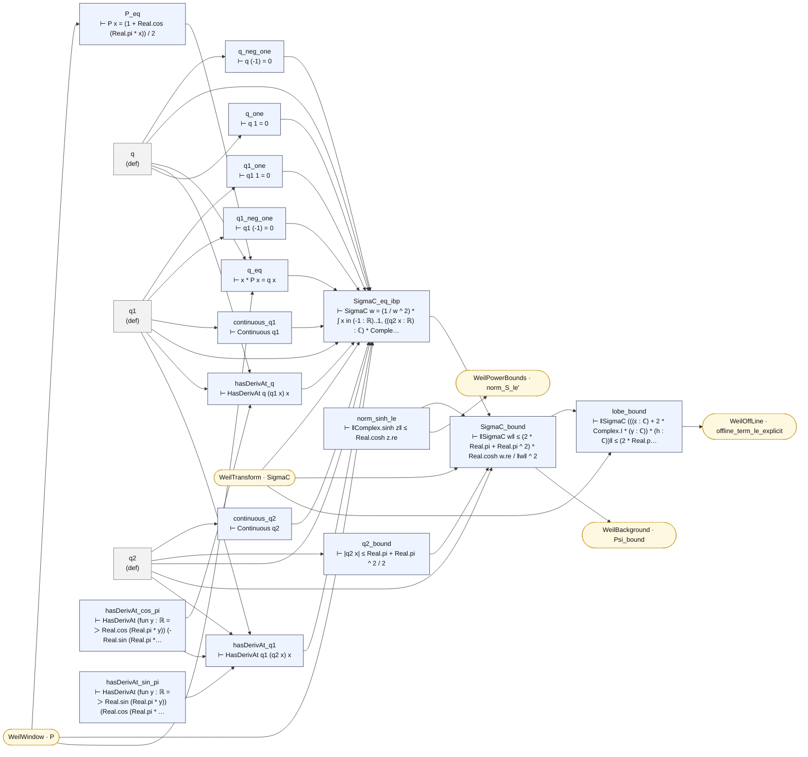

# `lean_stage3/Stage3/WeilLobe.lean`

**What it does** (its own header): WeilLobe — the 2γ lobe bounded above. Rung 4a of the detection ladder (units 0316–0318). 2026-09-06.

**Imports:** [`WeilTransform`](../lean_stage3/WeilTransform.md).
**Imported by:** [`Stage3`](../lean_stage3/Stage3.md), [`WeilBackground`](../lean_stage3/WeilBackground.md), [`WeilPower`](../lean_stage3/WeilPower.md).

Blue: theorem. Green: a theorem nothing else uses (an end). Dashed white: connects to nothing. Grey: definition. Red: contains `sorry`. Yellow: in another file. An arrow A → B reads "A is used by B".

## Every declaration

| declaration | proves (output) | needs (input) | why (its own docstring) | uses | used by |
|---|---|---|---|---|---|
| `WeilLobe.P_eq` theorem, line 43 | P x = (1 + Real.cos (Real.pi * x)) / 2 | x : ℝ | The half-angle form of the window. | `WeilWindow.P` | `WeilLobe.q_eq` |
| `WeilLobe.q` def, line 50 | ℝ | x : ℝ | The envelope `q(x) = x·P(x)` in half-angle form. | — | `WeilLobe.SigmaC_eq_ibp`, `WeilLobe.hasDerivAt_q`, `WeilLobe.q_eq`, `WeilLobe.q_neg_one`, `WeilLobe.q_one` |
| `WeilLobe.q1` def, line 53 | ℝ | x : ℝ | `q'`. | — | `WeilLobe.SigmaC_eq_ibp`, `WeilLobe.continuous_q1`, `WeilLobe.hasDerivAt_q`, `WeilLobe.hasDerivAt_q1`, `WeilLobe.q1_neg_one`, `WeilLobe.q1_one` |
| `WeilLobe.q2` def, line 56 | ℝ | x : ℝ | `q''`. | — | `WeilLobe.SigmaC_bound`, `WeilLobe.SigmaC_eq_ibp`, `WeilLobe.continuous_q2`, `WeilLobe.hasDerivAt_q1`, `WeilLobe.q2_bound` |
| `WeilLobe.q_eq` theorem, line 58 | x * P x = q x | x : ℝ | — | `WeilLobe.P_eq`, `WeilLobe.q`, `WeilWindow.P` | `WeilLobe.SigmaC_eq_ibp` |
| `WeilLobe.hasDerivAt_cos_pi` theorem, line 61 | HasDerivAt (fun y : ℝ =&gt; Real.cos (Real.pi * y)) (-Real.sin (Real.pi * x) * Real.pi) x | x : ℝ | — | — | `WeilLobe.hasDerivAt_q`, `WeilLobe.hasDerivAt_q1` |
| `WeilLobe.hasDerivAt_sin_pi` theorem, line 66 | HasDerivAt (fun y : ℝ =&gt; Real.sin (Real.pi * y)) (Real.cos (Real.pi * x) * Real.pi) x | x : ℝ | — | — | `WeilLobe.hasDerivAt_q1` |
| `WeilLobe.hasDerivAt_q` theorem, line 71 | HasDerivAt q (q1 x) x | x : ℝ | — | `WeilLobe.hasDerivAt_cos_pi`, `WeilLobe.q`, `WeilLobe.q1` | `WeilLobe.SigmaC_eq_ibp` |
| `WeilLobe.hasDerivAt_q1` theorem, line 77 | HasDerivAt q1 (q2 x) x | x : ℝ | — | `WeilLobe.hasDerivAt_cos_pi`, `WeilLobe.hasDerivAt_sin_pi`, `WeilLobe.q1`, `WeilLobe.q2` | `WeilLobe.SigmaC_eq_ibp` |
| `WeilLobe.q_one` theorem, line 86 | q 1 = 0 | — | — | `WeilLobe.q` | `WeilLobe.SigmaC_eq_ibp` |
| `WeilLobe.q_neg_one` theorem, line 89 | q (-1) = 0 | — | — | `WeilLobe.q` | `WeilLobe.SigmaC_eq_ibp` |
| `WeilLobe.q1_one` theorem, line 92 | q1 1 = 0 | — | — | `WeilLobe.q1` | `WeilLobe.SigmaC_eq_ibp` |
| `WeilLobe.q1_neg_one` theorem, line 95 | q1 (-1) = 0 | — | — | `WeilLobe.q1` | `WeilLobe.SigmaC_eq_ibp` |
| `WeilLobe.continuous_q1` theorem, line 99 | Continuous q1 | — | — | `WeilLobe.q1` | `WeilLobe.SigmaC_eq_ibp` |
| `WeilLobe.continuous_q2` theorem, line 103 | Continuous q2 | — | — | `WeilLobe.q2` | `WeilLobe.SigmaC_eq_ibp` |
| `WeilLobe.q2_bound` theorem, line 107 | \|q2 x\| ≤ Real.pi + Real.pi ^ 2 / 2 | hx : \|x\| ≤ 1 | `\|q''(x)\| ≤ π + π²/2` on `[−1, 1]`. | `WeilLobe.q2` | `WeilLobe.SigmaC_bound` |
| `WeilLobe.norm_sinh_le` theorem, line 126 | ‖Complex.sinh z‖ ≤ Real.cosh z.re | z : ℂ | `‖sinh z‖ ≤ cosh(Re z)`. | — | `WeilLobe.SigmaC_bound`, `WeilPowerBounds.norm_S_le'` |
| `WeilLobe.SigmaC_eq_ibp` theorem, line 136 | SigmaC w = (1 / w ^ 2) * ∫ x in (-1 : ℝ)..1, ((q2 x : ℝ) : ℂ) * Complex.sinh (w * (x : ℂ)) | w : ℂ; hw : w ≠ 0 | Integration by parts, twice: `Σc(w) = w⁻²·∫ q''·sinh(w·)`. | `WeilLobe.continuous_q1`, `WeilLobe.continuous_q2`, `WeilLobe.hasDerivAt_q`, `WeilLobe.hasDerivAt_q1`, `WeilLobe.q`, `WeilLobe.q1`, `WeilLobe.q1_neg_one`, `WeilLobe.q1_one`, `WeilLobe.q2`, `WeilLobe.q_eq`, `WeilLobe.q_neg_one`, `WeilLobe.q_one`, `WeilTransform.SigmaC`, `WeilWindow.P` | `WeilLobe.SigmaC_bound` |
| `WeilLobe.SigmaC_bound` theorem, line 187 | ‖SigmaC w‖ ≤ (2 * Real.pi + Real.pi ^ 2) * Real.cosh w.re / ‖w‖ ^ 2 | w : ℂ; hw : w ≠ 0 | (†) `‖Σc(w)‖ ≤ (2π + π²)·cosh(Re w)/‖w‖²`. | `WeilLobe.SigmaC_eq_ibp`, `WeilLobe.norm_sinh_le`, `WeilLobe.q2`, `WeilLobe.q2_bound`, `WeilTransform.SigmaC` | `WeilBackground.Psi_bound`, `WeilLobe.lobe_bound` |
| `WeilLobe.lobe_bound` theorem, line 219 | ‖SigmaC (((ε : ℂ) + 2 * Complex.I * (γ : ℂ)) * (h : ℂ))‖ ≤ (2 * Real.pi + Real.pi ^ 2) * Real.cosh (ε * h) / (2 * γ * h) ^ 2 | hh : 0 &lt; h; hγ : 0 &lt; γ; ε : ℝ | The lobe at the off-line point: for `h, γ &gt; 0`, `‖Σc((ε + 2iγ)h)‖ ≤ (2π + π²)·cosh(εh)/(2γh)²`. | `WeilLobe.SigmaC_bound`, `WeilTransform.SigmaC` | `WeilOffLine.offline_term_le_explicit` |
