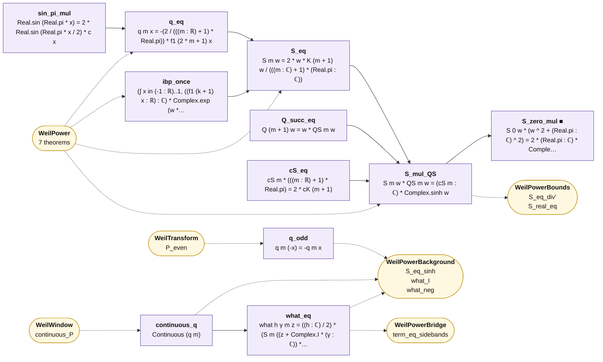

# `lean_stage3/Stage3/WeilOddPower.lean`

WeilOddPower — the odd envelope `sin(πx)·P(x)^m` and its transform in closed form; the switched window and its transform. Rung 5, third slice. 2026-09-06.

11 theorems, 6 definitions, 250 lines. Arrows are Lean's own record of what each proof uses.

**Imports:** [`WeilPower`](../lean_stage3/WeilPower.md)  
**Imported by:** [`Stage3`](../lean_stage3/Stage3.md), [`WeilPowerBounds`](../lean_stage3/WeilPowerBounds.md)

## The picture



An arrow A → B reads "A is used in the proof of B". Green: counting, integers only. Violet: shape, analysis with no ζ. Blue: reads ζ. A name ending in ■ is an end: nothing else uses it. Red: contains `sorry`. Yellow: theorems in another file, counted; a dotted arrow crosses files. Definitions are not drawn; they are listed below the diagram.

## Definitions

<a name="WeilOddPower-q"></a>
### `WeilOddPower.q`

def · line 46

The odd envelope `sin(πx)·P(x)^m`.

- **Is:** `` q (m : ℕ) (x : ℝ) : ℝ := Real.sin (Real.pi * x) * P x ^ m ``
- **Built from:** [`WeilWindow.P`](../lean_stage3/WeilWindow.md#WeilWindow-P)
- **Used by 15:** [`WeilOddPower.S`](#WeilOddPower-S), [`WeilOddPower.S_eq`](#WeilOddPower-S_eq), [`WeilOddPower.W`](#WeilOddPower-W), [`WeilOddPower.continuous_q`](#WeilOddPower-continuous_q), [`WeilOddPower.q_eq`](#WeilOddPower-q_eq), [`WeilOddPower.q_odd`](#WeilOddPower-q_odd), [`WeilOddPower.what_eq`](#WeilOddPower-what_eq), [`WeilPowerAssembly.phiW_contDiff_one`](../lean_stage3/WeilPowerAssembly.md#WeilPowerAssembly-phiW_contDiff_one), [`WeilPowerBackground.PsiW`](../lean_stage3/WeilPowerBackground.md#WeilPowerBackground-PsiW), [`WeilPowerBackground.PsiW_le_two`](../lean_stage3/WeilPowerBackground.md#WeilPowerBackground-PsiW_le_two), [`WeilPowerBackground.S_I_mul`](../lean_stage3/WeilPowerBackground.md#WeilPowerBackground-S_I_mul), [`WeilPowerBackground.S_eq_sinh`](../lean_stage3/WeilPowerBackground.md#WeilPowerBackground-S_eq_sinh), [`WeilPowerBackground.S_neg`](../lean_stage3/WeilPowerBackground.md#WeilPowerBackground-S_neg), [`WeilPowerBackground.abs_q_le_one`](../lean_stage3/WeilPowerBackground.md#WeilPowerBackground-abs_q_le_one), [`WeilPowerOnLine.PsiW_neg`](../lean_stage3/WeilPowerOnLine.md#WeilPowerOnLine-PsiW_neg)

<a name="WeilOddPower-S"></a>
### `WeilOddPower.S`

def · line 80

The odd envelope's transform, `∫₋₁¹ q m x · e^{wx} dx`.

- **Is:** `` S (m : ℕ) (w : ℂ) : ℂ := ∫ x in (-1 : ℝ)..1, ((q m x : ℝ) : ℂ) * Complex.exp (w * (x : ℂ)) ``
- **Built from:** [`WeilOddPower.q`](#WeilOddPower-q)
- **Used by 39:** [`WeilOddPower.S_eq`](#WeilOddPower-S_eq), [`WeilOddPower.S_mul_QS`](#WeilOddPower-S_mul_QS), [`WeilOddPower.S_zero_mul`](#WeilOddPower-S_zero_mul), [`WeilOddPower.what_eq`](#WeilOddPower-what_eq), [`WeilPowerAssembly.target_lower`](../lean_stage3/WeilPowerAssembly.md#WeilPowerAssembly-target_lower), [`WeilPowerBackground.PsiW_le_far`](../lean_stage3/WeilPowerBackground.md#WeilPowerBackground-PsiW_le_far), [`WeilPowerBackground.S_I_mul`](../lean_stage3/WeilPowerBackground.md#WeilPowerBackground-S_I_mul), [`WeilPowerBackground.S_eq_sinh`](../lean_stage3/WeilPowerBackground.md#WeilPowerBackground-S_eq_sinh), [`WeilPowerBackground.S_neg`](../lean_stage3/WeilPowerBackground.md#WeilPowerBackground-S_neg), [`WeilPowerBackground.what_I`](../lean_stage3/WeilPowerBackground.md#WeilPowerBackground-what_I), [`WeilPowerBackground.what_neg`](../lean_stage3/WeilPowerBackground.md#WeilPowerBackground-what_neg), [`WeilPowerBounds.S_eq_div`](../lean_stage3/WeilPowerBounds.md#WeilPowerBounds-S_eq_div), [`WeilPowerBounds.S_eq_div'`](../lean_stage3/WeilPowerBounds.md#WeilPowerBounds-S_eq_div-), [`WeilPowerBounds.S_real_eq`](../lean_stage3/WeilPowerBounds.md#WeilPowerBounds-S_real_eq), [`WeilPowerBounds.S_real_ge`](../lean_stage3/WeilPowerBounds.md#WeilPowerBounds-S_real_ge), [`WeilPowerBounds.norm_S_le`](../lean_stage3/WeilPowerBounds.md#WeilPowerBounds-norm_S_le), [`WeilPowerBounds.norm_S_le'`](../lean_stage3/WeilPowerBounds.md#WeilPowerBounds-norm_S_le-), [`WeilPowerBounds.norm_S_le_far`](../lean_stage3/WeilPowerBounds.md#WeilPowerBounds-norm_S_le_far), [`WeilPowerBridge.far_sideband_le`](../lean_stage3/WeilPowerBridge.md#WeilPowerBridge-far_sideband_le), [`WeilPowerBridge.term_eq_sidebands`](../lean_stage3/WeilPowerBridge.md#WeilPowerBridge-term_eq_sidebands), [`WeilPowerBridge.term_le_at_zero`](../lean_stage3/WeilPowerBridge.md#WeilPowerBridge-term_le_at_zero), [`WeilPowerBridge.term_le_sidebands`](../lean_stage3/WeilPowerBridge.md#WeilPowerBridge-term_le_sidebands), [`WeilPowerCompare.S_real_ge_low`](../lean_stage3/WeilPowerCompare.md#WeilPowerCompare-S_real_ge_low), [`WeilPowerCompare.S_real_pos`](../lean_stage3/WeilPowerCompare.md#WeilPowerCompare-S_real_pos), [`WeilPowerCompare.compare_le`](../lean_stage3/WeilPowerCompare.md#WeilPowerCompare-compare_le), [`WeilPowerCompare.compare_suppressed`](../lean_stage3/WeilPowerCompare.md#WeilPowerCompare-compare_suppressed), [`WeilPowerCompare.norm_S_le_gauss`](../lean_stage3/WeilPowerCompare.md#WeilPowerCompare-norm_S_le_gauss), [`WeilPowerGauss.S_real_ge_gauss`](../lean_stage3/WeilPowerGauss.md#WeilPowerGauss-S_real_ge_gauss), [`WeilPowerGauss.norm_S_le_gauss_neg`](../lean_stage3/WeilPowerGauss.md#WeilPowerGauss-norm_S_le_gauss_neg), [`WeilPowerGauss.norm_S_le_gauss_pos`](../lean_stage3/WeilPowerGauss.md#WeilPowerGauss-norm_S_le_gauss_pos), [`WeilPowerGauss.tendsto_S`](../lean_stage3/WeilPowerGauss.md#WeilPowerGauss-tendsto_S), [`WeilPowerPhase.norm_S_sub_le`](../lean_stage3/WeilPowerPhase.md#WeilPowerPhase-norm_S_sub_le), [`WeilPowerPhase.re_S_sq_ge`](../lean_stage3/WeilPowerPhase.md#WeilPowerPhase-re_S_sq_ge), [`WeilPowerPhase.re_sq_ge`](../lean_stage3/WeilPowerPhase.md#WeilPowerPhase-re_sq_ge), [`WeilPowerSharp.S_real_ge_sharp`](../lean_stage3/WeilPowerSharp.md#WeilPowerSharp-S_real_ge_sharp), [`WeilPowerSharp.compare_sharp`](../lean_stage3/WeilPowerSharp.md#WeilPowerSharp-compare_sharp), [`WeilPowerSharp.norm_S_le_c_neg`](../lean_stage3/WeilPowerSharp.md#WeilPowerSharp-norm_S_le_c_neg), [`WeilPowerSharp.norm_S_le_c_pos`](../lean_stage3/WeilPowerSharp.md#WeilPowerSharp-norm_S_le_c_pos), [`WeilPowerTail.norm_S_le_tail`](../lean_stage3/WeilPowerTail.md#WeilPowerTail-norm_S_le_tail)

<a name="WeilOddPower-QS"></a>
### `WeilOddPower.QS`

def · line 135

`∏_{j=1}^{m+1}(w² + π²j²)`: the odd transform's denominator.

- **Is:** `` QS (m : ℕ) (w : ℂ) : ℂ := ∏ j ∈ Finset.range (m + 1), (w ^ 2 + (Real.pi : ℂ) ^ 2 * ((j : ℂ) + 1) ^ 2) ``
- **Used by 33:** [`WeilOddPower.Q_succ_eq`](#WeilOddPower-Q_succ_eq), [`WeilOddPower.S_mul_QS`](#WeilOddPower-S_mul_QS), [`WeilOddPower.S_zero_mul`](#WeilOddPower-S_zero_mul), [`WeilPowerAssembly.target_lower`](../lean_stage3/WeilPowerAssembly.md#WeilPowerAssembly-target_lower), [`WeilPowerBounds.QS_factor`](../lean_stage3/WeilPowerBounds.md#WeilPowerBounds-QS_factor), [`WeilPowerBounds.QS_ne_zero`](../lean_stage3/WeilPowerBounds.md#WeilPowerBounds-QS_ne_zero), [`WeilPowerBounds.QS_ofReal`](../lean_stage3/WeilPowerBounds.md#WeilPowerBounds-QS_ofReal), [`WeilPowerBounds.S_eq_div`](../lean_stage3/WeilPowerBounds.md#WeilPowerBounds-S_eq_div), [`WeilPowerBounds.S_eq_div'`](../lean_stage3/WeilPowerBounds.md#WeilPowerBounds-S_eq_div-), [`WeilPowerBounds.S_real_eq`](../lean_stage3/WeilPowerBounds.md#WeilPowerBounds-S_real_eq), [`WeilPowerBounds.norm_QS_ge`](../lean_stage3/WeilPowerBounds.md#WeilPowerBounds-norm_QS_ge), [`WeilPowerBounds.norm_QS_ge_far`](../lean_stage3/WeilPowerBounds.md#WeilPowerBounds-norm_QS_ge_far), [`WeilPowerBounds.norm_S_le`](../lean_stage3/WeilPowerBounds.md#WeilPowerBounds-norm_S_le), [`WeilPowerBounds.norm_S_le'`](../lean_stage3/WeilPowerBounds.md#WeilPowerBounds-norm_S_le-), [`WeilPowerBounds.norm_S_le_far`](../lean_stage3/WeilPowerBounds.md#WeilPowerBounds-norm_S_le_far), [`WeilPowerBridge.term_le_at_zero`](../lean_stage3/WeilPowerBridge.md#WeilPowerBridge-term_le_at_zero), [`WeilPowerCompare.QS_ne_zero_wOf`](../lean_stage3/WeilPowerCompare.md#WeilPowerCompare-QS_ne_zero_wOf), [`WeilPowerCompare.compare_le`](../lean_stage3/WeilPowerCompare.md#WeilPowerCompare-compare_le), [`WeilPowerCompare.compare_suppressed`](../lean_stage3/WeilPowerCompare.md#WeilPowerCompare-compare_suppressed), [`WeilPowerCompare.norm_S_le_gauss`](../lean_stage3/WeilPowerCompare.md#WeilPowerCompare-norm_S_le_gauss), [`WeilPowerGauss.QS_eq_D_mul`](../lean_stage3/WeilPowerGauss.md#WeilPowerGauss-QS_eq_D_mul), [`WeilPowerGauss.S_real_ge_gauss`](../lean_stage3/WeilPowerGauss.md#WeilPowerGauss-S_real_ge_gauss), [`WeilPowerGauss.norm_S_le_gauss_neg`](../lean_stage3/WeilPowerGauss.md#WeilPowerGauss-norm_S_le_gauss_neg), [`WeilPowerGauss.norm_S_le_gauss_pos`](../lean_stage3/WeilPowerGauss.md#WeilPowerGauss-norm_S_le_gauss_pos), [`WeilPowerGauss.tendsto_S`](../lean_stage3/WeilPowerGauss.md#WeilPowerGauss-tendsto_S), [`WeilPowerPhase.norm_S_sub_le`](../lean_stage3/WeilPowerPhase.md#WeilPowerPhase-norm_S_sub_le), [`WeilPowerPhase.re_S_sq_ge`](../lean_stage3/WeilPowerPhase.md#WeilPowerPhase-re_S_sq_ge), [`WeilPowerPhase.re_sq_ge`](../lean_stage3/WeilPowerPhase.md#WeilPowerPhase-re_sq_ge), [`WeilPowerSharp.S_real_ge_sharp`](../lean_stage3/WeilPowerSharp.md#WeilPowerSharp-S_real_ge_sharp), [`WeilPowerSharp.compare_sharp`](../lean_stage3/WeilPowerSharp.md#WeilPowerSharp-compare_sharp), [`WeilPowerSharp.norm_S_le_c_neg`](../lean_stage3/WeilPowerSharp.md#WeilPowerSharp-norm_S_le_c_neg), [`WeilPowerSharp.norm_S_le_c_pos`](../lean_stage3/WeilPowerSharp.md#WeilPowerSharp-norm_S_le_c_pos), [`WeilPowerTail.norm_S_le_tail`](../lean_stage3/WeilPowerTail.md#WeilPowerTail-norm_S_le_tail)

<a name="WeilOddPower-cS"></a>
### `WeilOddPower.cS`

def · line 139

`2·π^{2m+1}·(2m+1)!/4^m`: the odd transform's constant.

- **Is:** `` cS (m : ℕ) : ℝ := 2 * Real.pi ^ (2 * m + 1) * ((2 * m + 1).factorial : ℝ) / 4 ^ m ``
- **Used by 39:** [`WeilOddPower.S_mul_QS`](#WeilOddPower-S_mul_QS), [`WeilOddPower.S_zero_mul`](#WeilOddPower-S_zero_mul), [`WeilOddPower.cS_eq`](#WeilOddPower-cS_eq), [`WeilPowerAssembly.target_lower`](../lean_stage3/WeilPowerAssembly.md#WeilPowerAssembly-target_lower), [`WeilPowerBackground.PsiW_le_far`](../lean_stage3/WeilPowerBackground.md#WeilPowerBackground-PsiW_le_far), [`WeilPowerBackground.online_term_le_far`](../lean_stage3/WeilPowerBackground.md#WeilPowerBackground-online_term_le_far), [`WeilPowerBands.cFarM`](../lean_stage3/WeilPowerBands.md#WeilPowerBands-cFarM), [`WeilPowerBands.cFarM_le`](../lean_stage3/WeilPowerBands.md#WeilPowerBands-cFarM_le), [`WeilPowerBands.cFarM_nonneg`](../lean_stage3/WeilPowerBands.md#WeilPowerBands-cFarM_nonneg), [`WeilPowerBands.cS_le`](../lean_stage3/WeilPowerBands.md#WeilPowerBands-cS_le), [`WeilPowerBands.term_le_M`](../lean_stage3/WeilPowerBands.md#WeilPowerBands-term_le_M), [`WeilPowerBounds.S_eq_div`](../lean_stage3/WeilPowerBounds.md#WeilPowerBounds-S_eq_div), [`WeilPowerBounds.S_eq_div'`](../lean_stage3/WeilPowerBounds.md#WeilPowerBounds-S_eq_div-), [`WeilPowerBounds.S_real_eq`](../lean_stage3/WeilPowerBounds.md#WeilPowerBounds-S_real_eq), [`WeilPowerBounds.S_real_ge`](../lean_stage3/WeilPowerBounds.md#WeilPowerBounds-S_real_ge), [`WeilPowerBounds.cS_pos`](../lean_stage3/WeilPowerBounds.md#WeilPowerBounds-cS_pos), [`WeilPowerBounds.norm_S_le`](../lean_stage3/WeilPowerBounds.md#WeilPowerBounds-norm_S_le), [`WeilPowerBounds.norm_S_le'`](../lean_stage3/WeilPowerBounds.md#WeilPowerBounds-norm_S_le-), [`WeilPowerBounds.norm_S_le_far`](../lean_stage3/WeilPowerBounds.md#WeilPowerBounds-norm_S_le_far), [`WeilPowerBridge.far_sideband_le`](../lean_stage3/WeilPowerBridge.md#WeilPowerBridge-far_sideband_le), [`WeilPowerBridge.term_le_at_zero`](../lean_stage3/WeilPowerBridge.md#WeilPowerBridge-term_le_at_zero), [`WeilPowerGauss.S_real_ge_gauss`](../lean_stage3/WeilPowerGauss.md#WeilPowerGauss-S_real_ge_gauss), [`WeilPowerGauss.cprime_eq`](../lean_stage3/WeilPowerGauss.md#WeilPowerGauss-cprime_eq), [`WeilPowerGauss.cprime_ge`](../lean_stage3/WeilPowerGauss.md#WeilPowerGauss-cprime_ge), [`WeilPowerGauss.cprime_le`](../lean_stage3/WeilPowerGauss.md#WeilPowerGauss-cprime_le), [`WeilPowerGauss.cprime_pos`](../lean_stage3/WeilPowerGauss.md#WeilPowerGauss-cprime_pos), [`WeilPowerGauss.norm_S_le_gauss_neg`](../lean_stage3/WeilPowerGauss.md#WeilPowerGauss-norm_S_le_gauss_neg), [`WeilPowerGauss.norm_S_le_gauss_pos`](../lean_stage3/WeilPowerGauss.md#WeilPowerGauss-norm_S_le_gauss_pos), [`WeilPowerGauss.tendsto_S`](../lean_stage3/WeilPowerGauss.md#WeilPowerGauss-tendsto_S), [`WeilPowerPhase.norm_A_sq`](../lean_stage3/WeilPowerPhase.md#WeilPowerPhase-norm_A_sq), [`WeilPowerPhase.norm_S_sub_le`](../lean_stage3/WeilPowerPhase.md#WeilPowerPhase-norm_S_sub_le), [`WeilPowerPhase.re_A_sq`](../lean_stage3/WeilPowerPhase.md#WeilPowerPhase-re_A_sq), [`WeilPowerPhase.re_S_sq_ge`](../lean_stage3/WeilPowerPhase.md#WeilPowerPhase-re_S_sq_ge), [`WeilPowerPhase.re_sq_ge`](../lean_stage3/WeilPowerPhase.md#WeilPowerPhase-re_sq_ge), [`WeilPowerSharp.S_real_ge_sharp`](../lean_stage3/WeilPowerSharp.md#WeilPowerSharp-S_real_ge_sharp), [`WeilPowerSharp.compare_sharp`](../lean_stage3/WeilPowerSharp.md#WeilPowerSharp-compare_sharp), [`WeilPowerSharp.norm_S_le_c_neg`](../lean_stage3/WeilPowerSharp.md#WeilPowerSharp-norm_S_le_c_neg), [`WeilPowerSharp.norm_S_le_c_pos`](../lean_stage3/WeilPowerSharp.md#WeilPowerSharp-norm_S_le_c_pos), [`WeilPowerTail.norm_S_le_tail`](../lean_stage3/WeilPowerTail.md#WeilPowerTail-norm_S_le_tail)

<a name="WeilOddPower-W"></a>
### `WeilOddPower.W`

def · line 182

The switched window: `sin(πu/h)·P(u/h)^m·cos(γu)`, read on `[−h, h]`.

- **Is:** `` W (h γ : ℝ) (m : ℕ) (u : ℝ) : ℝ := q m (u / h) * Real.cos (γ * u) ``
- **Built from:** [`WeilOddPower.q`](#WeilOddPower-q)
- **Used by 6:** [`WeilOddPower.what`](#WeilOddPower-what), [`WeilOddPower.what_eq`](#WeilOddPower-what_eq), [`WeilPowerAssembly.isTest_phiWC`](../lean_stage3/WeilPowerAssembly.md#WeilPowerAssembly-isTest_phiWC), [`WeilPowerAssembly.phiW_contDiff_one`](../lean_stage3/WeilPowerAssembly.md#WeilPowerAssembly-phiW_contDiff_one), [`WeilPowerBackground.laplace_phiW`](../lean_stage3/WeilPowerBackground.md#WeilPowerBackground-laplace_phiW), [`WeilPowerBackground.phiW`](../lean_stage3/WeilPowerBackground.md#WeilPowerBackground-phiW)

<a name="WeilOddPower-what"></a>
### `WeilOddPower.what`

def · line 185

Its transform, `∫₋ₕʰ W(u)·e^{zu} du`.

- **Is:** `` what (h γ : ℝ) (m : ℕ) (z : ℂ) : ℂ := ∫ u in (-h)..h, ((W h γ m u : ℝ) : ℂ) * Complex.exp (z * (u : ℂ)) ``
- **Built from:** [`WeilOddPower.W`](#WeilOddPower-W)
- **Used by 8:** [`WeilOddPower.what_eq`](#WeilOddPower-what_eq), [`WeilPowerBackground.laplace_phiW`](../lean_stage3/WeilPowerBackground.md#WeilPowerBackground-laplace_phiW), [`WeilPowerBackground.online_term_eq`](../lean_stage3/WeilPowerBackground.md#WeilPowerBackground-online_term_eq), [`WeilPowerBackground.term_eq_neg_sq`](../lean_stage3/WeilPowerBackground.md#WeilPowerBackground-term_eq_neg_sq), [`WeilPowerBackground.term_re_eq`](../lean_stage3/WeilPowerBackground.md#WeilPowerBackground-term_re_eq), [`WeilPowerBackground.what_I`](../lean_stage3/WeilPowerBackground.md#WeilPowerBackground-what_I), [`WeilPowerBackground.what_neg`](../lean_stage3/WeilPowerBackground.md#WeilPowerBackground-what_neg), [`WeilPowerBridge.term_eq_sidebands`](../lean_stage3/WeilPowerBridge.md#WeilPowerBridge-term_eq_sidebands)

## Theorems

<a name="WeilOddPower-q_odd"></a>
### `WeilOddPower.q_odd`

line 49

**Shape.** Uses real or complex analysis; nothing in it or beneath it reads ζ.

**Why.** The envelope `q m` is odd: `q m (-x) = -q m x`.

**Proves**

```lean
q m (-x) = -q m x
```

**Needs** (its hypotheses)

  - `` m : ℕ ``
  - `` x : ℝ ``

**Stated with:** [`WeilOddPower.q`](#WeilOddPower-q)

**Fed by** (1 theorem its proof uses)

  - [`WeilTransform.P_even`](../lean_stage3/WeilTransform.md#WeilTransform-P_even) (WeilTransform) — `` P (-x) = P x ``

**Definitions its proof touches:** [`WeilWindow.P`](../lean_stage3/WeilWindow.md#WeilWindow-P)

**Feeds** (1 that use it)

  - [`WeilPowerBackground.S_eq_sinh`](../lean_stage3/WeilPowerBackground.md#WeilPowerBackground-S_eq_sinh) (WeilPowerBackground) — `` S m w = ∫ x in (-1 : ℝ)..1, ((q m x : ℝ) : ℂ) * Complex.sinh (w * (x : ℂ)) ``

<a name="WeilOddPower-continuous_q"></a>
### `WeilOddPower.continuous_q`

line 55

**Shape.** Uses real or complex analysis; nothing in it or beneath it reads ζ.

**Why.** Helper: the odd envelope `q m` is continuous.

**Proves**

```lean
Continuous (q m)
```

**Needs** (its hypotheses)

  - `` m : ℕ ``

**Stated with:** [`WeilOddPower.q`](#WeilOddPower-q)

**Fed by** (1 theorem its proof uses)

  - [`WeilWindow.continuous_P`](../lean_stage3/WeilWindow.md#WeilWindow-continuous_P) (WeilWindow) — `` Continuous P ``

**Definitions its proof touches:** [`WeilWindow.P`](../lean_stage3/WeilWindow.md#WeilWindow-P)

**Feeds** (2 that use it)

  - [`WeilOddPower.what_eq`](#WeilOddPower-what_eq) — `` what h γ m z = ((h : ℂ) / 2) * (S m ((z + Complex.I * (γ : ℂ)) * (h : ℂ)) + S m ((z - Complex.I * (γ : ℂ)) * (h : ℂ))) ``
  - [`WeilPowerBackground.S_eq_sinh`](../lean_stage3/WeilPowerBackground.md#WeilPowerBackground-S_eq_sinh) (WeilPowerBackground) — `` S m w = ∫ x in (-1 : ℝ)..1, ((q m x : ℝ) : ℂ) * Complex.sinh (w * (x : ℂ)) ``

<a name="WeilOddPower-sin_pi_mul"></a>
### `WeilOddPower.sin_pi_mul`

line 62

**Shape.** Uses real or complex analysis; nothing in it or beneath it reads ζ.

**Why.** `sin(πx) = 2·sin(πx/2)·c(x)`.

**Proves**

```lean
Real.sin (Real.pi * x) = 2 * Real.sin (Real.pi * x / 2) * c x
```

**Needs** (its hypotheses)

  - `` x : ℝ ``

**Stated with:** [`WeilPower.c`](../lean_stage3/WeilPower.md#WeilPower-c)

**Fed by:** no theorem of this repo; it stands on Mathlib and the definitions below.

**Feeds** (1 that use it)

  - [`WeilOddPower.q_eq`](#WeilOddPower-q_eq) — `` q m x = -(2 / (((m : ℝ) + 1) * Real.pi)) * f1 (2 * m + 1) x ``

<a name="WeilOddPower-q_eq"></a>
### `WeilOddPower.q_eq`

line 70

**Shape.** Uses real or complex analysis; nothing in it or beneath it reads ζ.

**Why.** The odd envelope is an exact derivative: `q m = −(2/((m+1)π))·f1 (2m+1)`, where `f1 (2m+1)` is the derivative of `c^{2m+2}`.

**Proves**

```lean
q m x = -(2 / (((m : ℝ) + 1) * Real.pi)) * f1 (2 * m + 1) x
```

**Needs** (its hypotheses)

  - `` m : ℕ ``
  - `` x : ℝ ``

**Stated with:** [`WeilOddPower.q`](#WeilOddPower-q), [`WeilPower.f1`](../lean_stage3/WeilPower.md#WeilPower-f1)

**Fed by** (2 theorems its proof uses)

  - [`WeilOddPower.sin_pi_mul`](#WeilOddPower-sin_pi_mul) — `` Real.sin (Real.pi * x) = 2 * Real.sin (Real.pi * x / 2) * c x ``
  - [`WeilPower.P_pow`](../lean_stage3/WeilPower.md#WeilPower-P_pow) (WeilPower) — `` P x ^ m = c x ^ (2 * m) ``

**Definitions its proof touches:** [`WeilPower.c`](../lean_stage3/WeilPower.md#WeilPower-c), [`WeilWindow.P`](../lean_stage3/WeilWindow.md#WeilWindow-P)

**Feeds** (1 that use it)

  - [`WeilOddPower.S_eq`](#WeilOddPower-S_eq) — `` S m w = 2 * w * K (m + 1) w / (((m : ℂ) + 1) * (Real.pi : ℂ)) ``

<a name="WeilOddPower-ibp_once"></a>
### `WeilOddPower.ibp_once`

line 84

**Shape.** Uses real or complex analysis; nothing in it or beneath it reads ζ.

**Why.** One integration by parts: `∫ f1 (k+1) · E = −w·∫ c^{k+2} · E`.

**Proves**

```lean
(∫ x in (-1 : ℝ)..1, ((f1 (k + 1) x : ℝ) : ℂ) * Complex.exp (w * (x : ℂ))) = -(w * ∫ x in (-1 : ℝ)..1, ((c x ^ (k + 2) : ℝ) : ℂ) * Complex.exp (w * (x : ℂ)))
```

**Needs** (its hypotheses)

  - `` k : ℕ ``
  - `` w : ℂ ``

**Stated with:** [`WeilPower.c`](../lean_stage3/WeilPower.md#WeilPower-c), [`WeilPower.f1`](../lean_stage3/WeilPower.md#WeilPower-f1)

**Fed by** (5 theorems its proof uses)

  - [`WeilPower.c_pow_neg_one`](../lean_stage3/WeilPower.md#WeilPower-c_pow_neg_one) (WeilPower) — `` c (-1) ^ n = 0 ``
  - [`WeilPower.c_pow_one`](../lean_stage3/WeilPower.md#WeilPower-c_pow_one) (WeilPower) — `` c 1 ^ n = 0 ``
  - [`WeilPower.continuous_f1`](../lean_stage3/WeilPower.md#WeilPower-continuous_f1) (WeilPower) — `` Continuous (f1 k) ``
  - [`WeilPower.hasDerivAt_E`](../lean_stage3/WeilPower.md#WeilPower-hasDerivAt_E) (WeilPower) — `` HasDerivAt (fun y : ℝ => Complex.exp (w * (y : ℂ))) (w * Complex.exp (w * (x : ℂ))) x ``
  - [`WeilPower.hasDerivAt_f`](../lean_stage3/WeilPower.md#WeilPower-hasDerivAt_f) (WeilPower) — `` HasDerivAt (fun y : ℝ => c y ^ (k + 1)) (f1 k x) x ``

**Feeds** (1 that use it)

  - [`WeilOddPower.S_eq`](#WeilOddPower-S_eq) — `` S m w = 2 * w * K (m + 1) w / (((m : ℂ) + 1) * (Real.pi : ℂ)) ``

<a name="WeilOddPower-S_eq"></a>
### `WeilOddPower.S_eq`

line 111

**Shape.** Uses real or complex analysis; nothing in it or beneath it reads ζ.

**Why.** The odd transform through the even one. `S m w = 2w·K (m+1) w/((m+1)π)`.

**Proves**

```lean
S m w = 2 * w * K (m + 1) w / (((m : ℂ) + 1) * (Real.pi : ℂ))
```

**Needs** (its hypotheses)

  - `` m : ℕ ``
  - `` w : ℂ ``

**Stated with:** [`WeilOddPower.S`](#WeilOddPower-S), [`WeilPower.K`](../lean_stage3/WeilPower.md#WeilPower-K)

**Fed by** (3 theorems its proof uses)

  - [`WeilOddPower.ibp_once`](#WeilOddPower-ibp_once) — `` (∫ x in (-1 : ℝ)..1, ((f1 (k + 1) x : ℝ) : ℂ) * Complex.exp (w * (x : ℂ))) = -(w * ∫ x in (-1 : ℝ)..1, ((c x ^ (k + 2) : ℝ) : ℂ) * Complex.exp (w * (x… ``
  - [`WeilOddPower.q_eq`](#WeilOddPower-q_eq) — `` q m x = -(2 / (((m : ℝ) + 1) * Real.pi)) * f1 (2 * m + 1) x ``
  - [`WeilPower.P_pow`](../lean_stage3/WeilPower.md#WeilPower-P_pow) (WeilPower) — `` P x ^ m = c x ^ (2 * m) ``

**Definitions its proof touches:** [`WeilOddPower.q`](#WeilOddPower-q), [`WeilPower.c`](../lean_stage3/WeilPower.md#WeilPower-c), [`WeilPower.f1`](../lean_stage3/WeilPower.md#WeilPower-f1), [`WeilWindow.P`](../lean_stage3/WeilWindow.md#WeilWindow-P)

**Feeds** (1 that use it)

  - [`WeilOddPower.S_mul_QS`](#WeilOddPower-S_mul_QS) — `` S m w * QS m w = (cS m : ℂ) * Complex.sinh w ``

<a name="WeilOddPower-Q_succ_eq"></a>
### `WeilOddPower.Q_succ_eq`

line 143

**Shape.** Uses real or complex analysis; nothing in it or beneath it reads ζ.

**Why.** The even transform's denominator at `m+1` is `w` times the odd transform's denominator: `Q (m+1) w = w · QS m w`.

**Proves**

```lean
Q (m + 1) w = w * QS m w
```

**Needs** (its hypotheses)

  - `` m : ℕ ``
  - `` w : ℂ ``

**Stated with:** [`WeilOddPower.QS`](#WeilOddPower-QS), [`WeilPower.Q`](../lean_stage3/WeilPower.md#WeilPower-Q)

**Fed by:** no theorem of this repo; it stands on Mathlib and the definitions below.

**Feeds** (1 that use it)

  - [`WeilOddPower.S_mul_QS`](#WeilOddPower-S_mul_QS) — `` S m w * QS m w = (cS m : ℂ) * Complex.sinh w ``

<a name="WeilOddPower-cS_eq"></a>
### `WeilOddPower.cS_eq`

line 147

**Shape.** Uses real or complex analysis; nothing in it or beneath it reads ζ.

**Why.** The odd transform's constant against the even one's: `cS m · (m+1)π = 2 · cK (m+1)`.

**Proves**

```lean
cS m * (((m : ℝ) + 1) * Real.pi) = 2 * cK (m + 1)
```

**Needs** (its hypotheses)

  - `` m : ℕ ``

**Stated with:** [`WeilOddPower.cS`](#WeilOddPower-cS), [`WeilPower.cK`](../lean_stage3/WeilPower.md#WeilPower-cK)

**Fed by:** no theorem of this repo; it stands on Mathlib and the definitions below.

**Feeds** (1 that use it)

  - [`WeilOddPower.S_mul_QS`](#WeilOddPower-S_mul_QS) — `` S m w * QS m w = (cS m : ℂ) * Complex.sinh w ``

<a name="WeilOddPower-S_mul_QS"></a>
### `WeilOddPower.S_mul_QS`

line 159

**Shape.** Uses real or complex analysis; nothing in it or beneath it reads ζ.

**Why.** The closed form, multiplied out. `S m w · ∏_{j=1}^{m+1}(w² + π²j²) = 2·π^{2m+1}·(2m+1)!/4^m · sinh w`.

**Proves**

```lean
S m w * QS m w = (cS m : ℂ) * Complex.sinh w
```

**Needs** (its hypotheses)

  - `` m : ℕ ``
  - `` w : ℂ ``

**Stated with:** [`WeilOddPower.QS`](#WeilOddPower-QS), [`WeilOddPower.S`](#WeilOddPower-S), [`WeilOddPower.cS`](#WeilOddPower-cS)

**Fed by** (4 theorems its proof uses)

  - [`WeilOddPower.Q_succ_eq`](#WeilOddPower-Q_succ_eq) — `` Q (m + 1) w = w * QS m w ``
  - [`WeilOddPower.S_eq`](#WeilOddPower-S_eq) — `` S m w = 2 * w * K (m + 1) w / (((m : ℂ) + 1) * (Real.pi : ℂ)) ``
  - [`WeilOddPower.cS_eq`](#WeilOddPower-cS_eq) — `` cS m * (((m : ℝ) + 1) * Real.pi) = 2 * cK (m + 1) ``
  - [`WeilPower.K_mul_Q`](../lean_stage3/WeilPower.md#WeilPower-K_mul_Q) (WeilPower) — `` K m w * Q m w = (cK m : ℂ) * Complex.sinh w ``

**Definitions its proof touches:** [`WeilPower.K`](../lean_stage3/WeilPower.md#WeilPower-K), [`WeilPower.Q`](../lean_stage3/WeilPower.md#WeilPower-Q), [`WeilPower.cK`](../lean_stage3/WeilPower.md#WeilPower-cK)

**Feeds** (3 that use it)

  - [`WeilOddPower.S_zero_mul`](#WeilOddPower-S_zero_mul) — `` S 0 w * (w ^ 2 + (Real.pi : ℂ) ^ 2) = 2 * (Real.pi : ℂ) * Complex.sinh w ``
  - [`WeilPowerBounds.S_eq_div'`](../lean_stage3/WeilPowerBounds.md#WeilPowerBounds-S_eq_div-) (WeilPowerBounds) — `` S m w = (cS m : ℂ) * Complex.sinh w / QS m w ``
  - [`WeilPowerBounds.S_real_eq`](../lean_stage3/WeilPowerBounds.md#WeilPowerBounds-S_real_eq) (WeilPowerBounds) — `` S m (s : ℂ) = ((cS m * Real.sinh s / Ps m s : ℝ) : ℂ) ``

<a name="WeilOddPower-S_zero_mul"></a>
### `WeilOddPower.S_zero_mul`

line 171

**Shape.** Uses real or complex analysis; nothing in it or beneath it reads ζ.

**Why.** At `m = 0`: `S 0 w · (w² + π²) = 2π·sinh w`, the elementary integral of `sin(πx)e^{wx}`.

**Proves**

```lean
S 0 w * (w ^ 2 + (Real.pi : ℂ) ^ 2) = 2 * (Real.pi : ℂ) * Complex.sinh w
```

**Needs** (its hypotheses)

  - `` w : ℂ ``

**Stated with:** [`WeilOddPower.S`](#WeilOddPower-S)

**Fed by** (1 theorem its proof uses)

  - [`WeilOddPower.S_mul_QS`](#WeilOddPower-S_mul_QS) — `` S m w * QS m w = (cS m : ℂ) * Complex.sinh w ``

**Definitions its proof touches:** [`WeilOddPower.QS`](#WeilOddPower-QS), [`WeilOddPower.cS`](#WeilOddPower-cS)

**Feeds:** nothing. It is an end.

<a name="WeilOddPower-what_eq"></a>
### `WeilOddPower.what_eq`

line 190

**Shape.** Uses real or complex analysis; nothing in it or beneath it reads ζ.

**Why.** The window's transform in closed form. `what h γ m z = (h/2)·[S m ((z + iγ)h) + S m ((z − iγ)h)]`.

**Proves**

```lean
what h γ m z = ((h : ℂ) / 2) * (S m ((z + Complex.I * (γ : ℂ)) * (h : ℂ)) + S m ((z - Complex.I * (γ : ℂ)) * (h : ℂ)))
```

**Needs** (its hypotheses)

  - `` hh : 0 < h ``
  - `` γ : ℝ ``
  - `` m : ℕ ``
  - `` z : ℂ ``

**Stated with:** [`WeilOddPower.S`](#WeilOddPower-S), [`WeilOddPower.what`](#WeilOddPower-what)

**Fed by** (1 theorem its proof uses)

  - [`WeilOddPower.continuous_q`](#WeilOddPower-continuous_q) — `` Continuous (q m) ``

**Definitions its proof touches:** [`WeilOddPower.W`](#WeilOddPower-W), [`WeilOddPower.q`](#WeilOddPower-q)

**Feeds** (3 that use it)

  - [`WeilPowerBackground.what_I`](../lean_stage3/WeilPowerBackground.md#WeilPowerBackground-what_I) (WeilPowerBackground) — `` what h γ m (Complex.I * (t : ℂ)) = Complex.I * ((h : ℂ) / 2) * ((PsiW m (h * (t + γ)) : ℂ) + (PsiW m (h * (t - γ)) : ℂ)) ``
  - [`WeilPowerBackground.what_neg`](../lean_stage3/WeilPowerBackground.md#WeilPowerBackground-what_neg) (WeilPowerBackground) — `` what h γ m (-z) = -what h γ m z ``
  - [`WeilPowerBridge.term_eq_sidebands`](../lean_stage3/WeilPowerBridge.md#WeilPowerBridge-term_eq_sidebands) (WeilPowerBridge) — `` WeilPowerBands.termW h γ m ρ = -((h / 2) ^ 2 * (((S m (wm h γ ρ)) ^ 2).re + 2 * (S m (wp h γ ρ) * S m (wm h γ ρ)).re + ((S m (wp h γ ρ)) ^ 2).re)) ``

