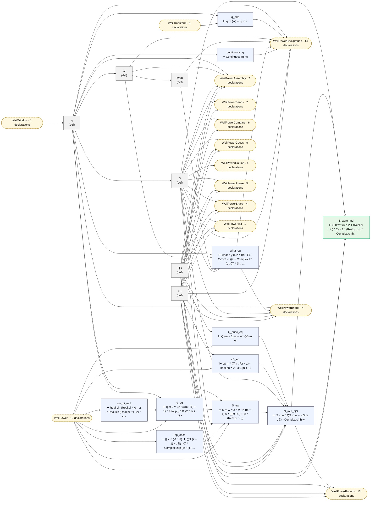

# `lean_stage3/Stage3/WeilOddPower.lean`

**What it does** (its own header): WeilOddPower — the odd envelope `sin(πx)·P(x)^m` and its transform in closed form; the switched window and its transform. Rung 5, third slice. 2026-09-06.

**Imports:** [`WeilPower`](../lean_stage3/WeilPower.md).
**Imported by:** [`Stage3`](../lean_stage3/Stage3.md), [`WeilPowerBounds`](../lean_stage3/WeilPowerBounds.md).

Blue: theorem. Green: a theorem nothing else uses (an end). Dashed white: connects to nothing. Grey: definition. Red: contains `sorry`. Yellow: in another file. An arrow A → B reads "A is used by B".

## Every declaration

| declaration | proves (output) | needs (input) | why (its own docstring) | uses | used by |
|---|---|---|---|---|---|
| `WeilOddPower.q` def, line 46 | ℝ | m : ℕ; x : ℝ | The odd envelope `sin(πx)·P(x)^m`. | `WeilWindow.P` | `WeilOddPower.S`, `WeilOddPower.S_eq`, `WeilOddPower.W`, `WeilOddPower.continuous_q`, `WeilOddPower.q_eq`, `WeilOddPower.q_odd`, `WeilOddPower.what_eq`, `WeilPowerAssembly.phiW_contDiff_one`, `WeilPowerBackground.PsiW`, `WeilPowerBackground.PsiW_le_two`, `WeilPowerBackground.S_eq_sinh`, `WeilPowerBackground.abs_q_le_one`, `WeilPowerBridge.term_le_at_zero` |
| `WeilOddPower.q_odd` theorem, line 48 | q m (-x) = -q m x | m : ℕ; x : ℝ | — | `WeilOddPower.q`, `WeilTransform.P_even` | `WeilPowerBackground.S_eq_sinh` |
| `WeilOddPower.continuous_q` theorem, line 53 | Continuous (q m) | m : ℕ | — | `WeilOddPower.q` | `WeilPowerBackground.S_eq_sinh` |
| `WeilOddPower.sin_pi_mul` theorem, line 60 | Real.sin (Real.pi * x) = 2 * Real.sin (Real.pi * x / 2) * c x | x : ℝ | `sin(πx) = 2·sin(πx/2)·c(x)`. | `WeilPower.c` | `WeilOddPower.q_eq` |
| `WeilOddPower.q_eq` theorem, line 68 | q m x = -(2 / (((m : ℝ) + 1) * Real.pi)) * f1 (2 * m + 1) x | m : ℕ; x : ℝ | The odd envelope is an exact derivative: `q m = −(2/((m+1)π))·f1 (2m+1)`, where `f1 (2m+1)` is the derivative of `c^{2m+2}`. | `WeilOddPower.q`, `WeilOddPower.sin_pi_mul`, `WeilPower.P_pow`, `WeilPower.f1` | `WeilOddPower.S_eq` |
| `WeilOddPower.S` def, line 78 | ℂ | m : ℕ; w : ℂ | The odd envelope's transform, `∫₋₁¹ q m x · e^{wx} dx`. | `WeilOddPower.q` | `WeilOddPower.S_eq`, `WeilOddPower.S_mul_QS`, `WeilOddPower.S_zero_mul`, `WeilOddPower.what_eq`, `WeilPowerAssembly.target_lower`, `WeilPowerBackground.S_I_mul`, `WeilPowerBackground.S_eq_sinh`, `WeilPowerBackground.S_neg`, `WeilPowerBands.band_sum_le`, `WeilPowerBands.sum_by_bands`, `WeilPowerBands.sum_le_bandSeries`, `WeilPowerBounds.S_eq_div`, `WeilPowerBounds.S_eq_div'`, `WeilPowerBounds.S_real_eq`, `WeilPowerBounds.S_real_ge`, `WeilPowerBounds.norm_S_le`, `WeilPowerBounds.norm_S_le'`, `WeilPowerBounds.norm_S_le_far`, `WeilPowerBridge.far_sideband_le`, `WeilPowerBridge.term_eq_sidebands`, `WeilPowerBridge.term_le_at_zero`, `WeilPowerBridge.term_le_sidebands`, `WeilPowerCompare.S_real_ge_low`, `WeilPowerCompare.S_real_pos`, `WeilPowerCompare.compare_le`, `WeilPowerCompare.compare_suppressed`, `WeilPowerCompare.norm_S_le_gauss`, `WeilPowerGauss.S_real_ge_gauss`, `WeilPowerGauss.norm_S_le_gauss_neg`, `WeilPowerGauss.norm_S_le_gauss_pos` … |
| `WeilOddPower.ibp_once` theorem, line 82 | (∫ x in (-1 : ℝ)..1, ((f1 (k + 1) x : ℝ) : ℂ) * Complex.exp (w * (x : ℂ))) = -(w * ∫ x in (-1 : ℝ)..1, ((c x ^ (k + 2) : ℝ) : ℂ) * Complex.exp (w * (x : ℂ))) | k : ℕ; w : ℂ | One integration by parts: `∫ f1 (k+1) · E = −w·∫ c^{k+2} · E`. | `WeilPower.c`, `WeilPower.c_pow_neg_one`, `WeilPower.c_pow_one`, `WeilPower.continuous_f1`, `WeilPower.f1`, `WeilPower.hasDerivAt_E`, `WeilPower.hasDerivAt_f` | `WeilOddPower.S_eq` |
| `WeilOddPower.S_eq` theorem, line 109 | S m w = 2 * w * K (m + 1) w / (((m : ℂ) + 1) * (Real.pi : ℂ)) | m : ℕ; w : ℂ | The odd transform through the even one. `S m w = 2w·K (m+1) w/((m+1)π)`. | `WeilOddPower.S`, `WeilOddPower.ibp_once`, `WeilOddPower.q`, `WeilOddPower.q_eq`, `WeilPower.K`, `WeilPower.P_pow`, `WeilPower.c`, `WeilPower.f1` | `WeilOddPower.S_mul_QS` |
| `WeilOddPower.QS` def, line 133 | ℂ | m : ℕ; w : ℂ | `∏_{j=1}^{m+1}(w² + π²j²)`: the odd transform's denominator. | — | `WeilOddPower.Q_succ_eq`, `WeilOddPower.S_mul_QS`, `WeilOddPower.S_zero_mul`, `WeilPowerAssembly.target_lower`, `WeilPowerBounds.QS_factor`, `WeilPowerBounds.QS_ne_zero`, `WeilPowerBounds.QS_ofReal`, `WeilPowerBounds.S_eq_div`, `WeilPowerBounds.S_eq_div'`, `WeilPowerBounds.norm_QS_ge`, `WeilPowerBounds.norm_QS_ge_far`, `WeilPowerBounds.norm_S_le`, `WeilPowerBounds.norm_S_le'`, `WeilPowerBounds.norm_S_le_far`, `WeilPowerBridge.term_le_at_zero`, `WeilPowerCompare.QS_ne_zero_wOf`, `WeilPowerCompare.compare_le`, `WeilPowerCompare.compare_suppressed`, `WeilPowerCompare.norm_S_le_gauss`, `WeilPowerGauss.QS_eq_D_mul`, `WeilPowerGauss.S_real_ge_gauss`, `WeilPowerGauss.norm_S_le_gauss_neg`, `WeilPowerGauss.norm_S_le_gauss_pos`, `WeilPowerGauss.tendsto_S`, `WeilPowerPhase.norm_S_sub_le`, `WeilPowerPhase.re_S_sq_ge`, `WeilPowerPhase.re_sq_ge`, `WeilPowerSharp.S_real_ge_sharp`, `WeilPowerSharp.compare_sharp`, `WeilPowerSharp.norm_S_le_c_neg` … |
| `WeilOddPower.cS` def, line 137 | ℝ | m : ℕ | `2·π^{2m+1}·(2m+1)!/4^m`: the odd transform's constant. | — | `WeilOddPower.S_mul_QS`, `WeilOddPower.S_zero_mul`, `WeilOddPower.cS_eq`, `WeilPowerAssembly.target_lower`, `WeilPowerBackground.PsiW_le_far`, `WeilPowerBackground.online_term_le_far`, `WeilPowerBands.cFarM`, `WeilPowerBands.cFarM_le`, `WeilPowerBands.cS_le`, `WeilPowerBands.term_le_M`, `WeilPowerBounds.S_eq_div`, `WeilPowerBounds.S_eq_div'`, `WeilPowerBounds.S_real_eq`, `WeilPowerBounds.S_real_ge`, `WeilPowerBounds.cS_pos`, `WeilPowerBounds.norm_S_le`, `WeilPowerBounds.norm_S_le'`, `WeilPowerBounds.norm_S_le_far`, `WeilPowerBridge.far_sideband_le`, `WeilPowerBridge.term_le_at_zero`, `WeilPowerGauss.S_real_ge_gauss`, `WeilPowerGauss.cprime_eq`, `WeilPowerGauss.cprime_ge`, `WeilPowerGauss.cprime_le`, `WeilPowerGauss.cprime_pos`, `WeilPowerGauss.norm_S_le_gauss_neg`, `WeilPowerGauss.norm_S_le_gauss_pos`, `WeilPowerGauss.tendsto_S`, `WeilPowerPhase.norm_A_sq`, `WeilPowerPhase.norm_S_sub_le` … |
| `WeilOddPower.Q_succ_eq` theorem, line 139 | Q (m + 1) w = w * QS m w | m : ℕ; w : ℂ | — | `WeilOddPower.QS`, `WeilPower.Q` | `WeilOddPower.S_mul_QS` |
| `WeilOddPower.cS_eq` theorem, line 142 | cS m * (((m : ℝ) + 1) * Real.pi) = 2 * cK (m + 1) | m : ℕ | — | `WeilOddPower.cS`, `WeilPower.cK` | `WeilOddPower.S_mul_QS` |
| `WeilOddPower.S_mul_QS` theorem, line 154 | S m w * QS m w = (cS m : ℂ) * Complex.sinh w | m : ℕ; w : ℂ | The closed form, multiplied out. `S m w · ∏_{j=1}^{m+1}(w² + π²j²) = 2·π^{2m+1}·(2m+1)!/4^m · sinh w`. | `WeilOddPower.QS`, `WeilOddPower.Q_succ_eq`, `WeilOddPower.S`, `WeilOddPower.S_eq`, `WeilOddPower.cS`, `WeilOddPower.cS_eq`, `WeilPower.K_mul_Q`, `WeilPower.cK` | `WeilOddPower.S_zero_mul`, `WeilPowerBounds.S_eq_div'`, `WeilPowerBounds.S_real_eq` |
| `WeilOddPower.S_zero_mul` theorem, line 166 | S 0 w * (w ^ 2 + (Real.pi : ℂ) ^ 2) = 2 * (Real.pi : ℂ) * Complex.sinh w | w : ℂ | At `m = 0`: `S 0 w · (w² + π²) = 2π·sinh w`, the elementary integral of `sin(πx)e^{wx}`. | `WeilOddPower.QS`, `WeilOddPower.S`, `WeilOddPower.S_mul_QS`, `WeilOddPower.cS` | — |
| `WeilOddPower.W` def, line 177 | ℝ | h γ : ℝ; m : ℕ; u : ℝ | The switched window: `sin(πu/h)·P(u/h)^m·cos(γu)`, read on `[−h, h]`. | `WeilOddPower.q` | `WeilOddPower.what`, `WeilOddPower.what_eq`, `WeilPowerAssembly.phiW_contDiff_one`, `WeilPowerBackground.laplace_phiW`, `WeilPowerBackground.phiW` |
| `WeilOddPower.what` def, line 180 | ℂ | h γ : ℝ; m : ℕ; z : ℂ | Its transform, `∫₋ₕʰ W(u)·e^{zu} du`. | `WeilOddPower.W` | `WeilOddPower.what_eq`, `WeilPowerBackground.laplace_phiW`, `WeilPowerBackground.term_eq_neg_sq`, `WeilPowerBackground.term_re_eq`, `WeilPowerBackground.what_I`, `WeilPowerBackground.what_neg` |
| `WeilOddPower.what_eq` theorem, line 185 | what h γ m z = ((h : ℂ) / 2) * (S m ((z + Complex.I * (γ : ℂ)) * (h : ℂ)) + S m ((z - Complex.I * (γ : ℂ)) * (h : ℂ))) | hh : 0 &lt; h; γ : ℝ; m : ℕ; z : ℂ | The window's transform in closed form. `what h γ m z = (h/2)·[S m ((z + iγ)h) + S m ((z − iγ)h)]`. | `WeilOddPower.S`, `WeilOddPower.W`, `WeilOddPower.q`, `WeilOddPower.what` | `WeilPowerBackground.what_I`, `WeilPowerBackground.what_neg`, `WeilPowerBridge.term_eq_sidebands` |
