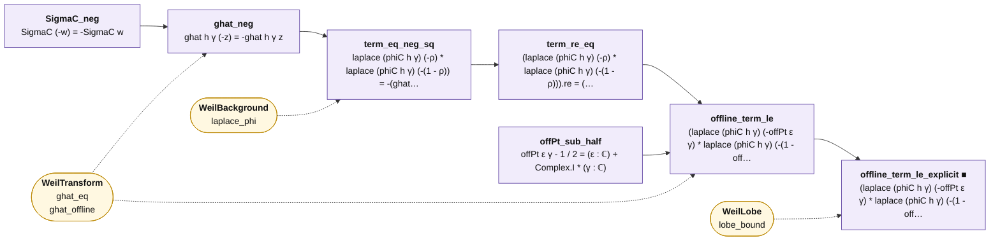

# `lean_stage3/Stage3/WeilOffLine.lean`

WeilOffLine — every term of the zero form is minus a square, and the sign of an off-line zero's own term. Rung 5, first slice of the detection ladder (units 0316–0325). 2026-09-06.

7 theorems, 1 definition, 152 lines. Arrows are Lean's own record of what each proof uses.

**Imports:** [`WeilBackground`](../lean_stage3/WeilBackground.md)  
**Imported by:** [`Stage3`](../lean_stage3/Stage3.md)

## The picture



An arrow A → B reads "A is used in the proof of B". Green: counting, integers only. Violet: shape, analysis with no ζ. Blue: reads ζ. A name ending in ■ is an end: nothing else uses it. Red: contains `sorry`. Yellow: theorems in another file, counted; a dotted arrow crosses files. Definitions are not drawn; they are listed below the diagram.

## Definitions

<a name="WeilOffLine-offPt"></a>
### `WeilOffLine.offPt`

def · line 80

The off-line point the tuned window reads: `ρ = 1/2 + ε + iγ`.

- **Is:** `` offPt (ε γ : ℝ) : ℂ := 1 / 2 + (ε : ℂ) + Complex.I * (γ : ℂ) ``
- **Used by 3:** [`WeilOffLine.offPt_sub_half`](#WeilOffLine-offPt_sub_half), [`WeilOffLine.offline_term_le`](#WeilOffLine-offline_term_le), [`WeilOffLine.offline_term_le_explicit`](#WeilOffLine-offline_term_le_explicit)

## Theorems

<a name="WeilOffLine-SigmaC_neg"></a>
### `WeilOffLine.SigmaC_neg`

line 44

**Shape.** Uses real or complex analysis; nothing in it or beneath it reads ζ.

**Why.** `Σc` is odd: `sinh` is odd.

**Proves**

```lean
SigmaC (-w) = -SigmaC w
```

**Needs** (its hypotheses)

  - `` w : ℂ ``

**Stated with:** [`WeilTransform.SigmaC`](../lean_stage3/WeilTransform.md#WeilTransform-SigmaC)

**Fed by:** no theorem of this repo; it stands on Mathlib and the definitions below.

**Definitions its proof touches:** [`WeilWindow.P`](../lean_stage3/WeilWindow.md#WeilWindow-P)

**Feeds** (1 that use it)

  - [`WeilOffLine.ghat_neg`](#WeilOffLine-ghat_neg) — `` ghat h γ (-z) = -ghat h γ z ``

<a name="WeilOffLine-ghat_neg"></a>
### `WeilOffLine.ghat_neg`

line 53

**Shape.** Uses real or complex analysis; nothing in it or beneath it reads ζ.

**Why.** The window's transform is odd.

**Proves**

```lean
ghat h γ (-z) = -ghat h γ z
```

**Needs** (its hypotheses)

  - `` hh : 0 < h ``
  - `` γ : ℝ ``
  - `` z : ℂ ``

**Stated with:** [`WeilTransform.ghat`](../lean_stage3/WeilTransform.md#WeilTransform-ghat)

**Fed by** (2 theorems its proof uses)

  - [`WeilOffLine.SigmaC_neg`](#WeilOffLine-SigmaC_neg) — `` SigmaC (-w) = -SigmaC w ``
  - [`WeilTransform.ghat_eq`](../lean_stage3/WeilTransform.md#WeilTransform-ghat_eq) (WeilTransform) — `` ghat h γ z = ((h : ℂ) / 2) * (SigmaC ((z + Complex.I * (γ : ℂ)) * (h : ℂ)) + SigmaC ((z - Complex.I * (γ : ℂ)) * (h : ℂ))) ``

**Definitions its proof touches:** [`WeilTransform.SigmaC`](../lean_stage3/WeilTransform.md#WeilTransform-SigmaC)

**Feeds** (1 that use it)

  - [`WeilOffLine.term_eq_neg_sq`](#WeilOffLine-term_eq_neg_sq) — `` laplace (phiC h γ) (-ρ) * laplace (phiC h γ) (-(1 - ρ)) = -(ghat h γ (ρ - 1 / 2)) ^ 2 ``

<a name="WeilOffLine-term_eq_neg_sq"></a>
### `WeilOffLine.term_eq_neg_sq`

line 64

**Shape.** Uses real or complex analysis; nothing in it or beneath it reads ζ.

**Why.** Every term is minus a square. For any `ρ`, `laplace φ(−ρ)·laplace φ(−(1−ρ)) = −ghat h γ (ρ − 1/2)²`.

**Proves**

```lean
laplace (phiC h γ) (-ρ) * laplace (phiC h γ) (-(1 - ρ)) = -(ghat h γ (ρ - 1 / 2)) ^ 2
```

**Needs** (its hypotheses)

  - `` hh : 0 < h ``
  - `` γ : ℝ ``
  - `` ρ : ℂ ``

**Stated with:** [`WeilBackground.phiC`](../lean_stage3/WeilBackground.md#WeilBackground-phiC), [`WeilDetect.laplace`](../lean_stage3/WeilDetect.md#WeilDetect-laplace), [`WeilTransform.ghat`](../lean_stage3/WeilTransform.md#WeilTransform-ghat)

**Fed by** (2 theorems its proof uses)

  - [`WeilBackground.laplace_phi`](../lean_stage3/WeilBackground.md#WeilBackground-laplace_phi) (WeilBackground) — `` laplace (phiC h γ) z = ghat h γ (-z - 1 / 2) ``
  - [`WeilOffLine.ghat_neg`](#WeilOffLine-ghat_neg) — `` ghat h γ (-z) = -ghat h γ z ``

**Feeds** (1 that use it)

  - [`WeilOffLine.term_re_eq`](#WeilOffLine-term_re_eq) — `` (laplace (phiC h γ) (-ρ) * laplace (phiC h γ) (-(1 - ρ))).re = (ghat h γ (ρ - 1 / 2)).im ^ 2 - (ghat h γ (ρ - 1 / 2)).re ^ 2 ``

<a name="WeilOffLine-term_re_eq"></a>
### `WeilOffLine.term_re_eq`

line 73

**Shape.** Uses real or complex analysis; nothing in it or beneath it reads ζ.

**Why.** The real part of a term is `(Im g)² − (Re g)²` at `g = ghat h γ (ρ − 1/2)`.

**Proves**

```lean
(laplace (phiC h γ) (-ρ) * laplace (phiC h γ) (-(1 - ρ))).re = (ghat h γ (ρ - 1 / 2)).im ^ 2 - (ghat h γ (ρ - 1 / 2)).re ^ 2
```

**Needs** (its hypotheses)

  - `` hh : 0 < h ``
  - `` γ : ℝ ``
  - `` ρ : ℂ ``

**Stated with:** [`WeilBackground.phiC`](../lean_stage3/WeilBackground.md#WeilBackground-phiC), [`WeilDetect.laplace`](../lean_stage3/WeilDetect.md#WeilDetect-laplace), [`WeilTransform.ghat`](../lean_stage3/WeilTransform.md#WeilTransform-ghat)

**Fed by** (1 theorem its proof uses)

  - [`WeilOffLine.term_eq_neg_sq`](#WeilOffLine-term_eq_neg_sq) — `` laplace (phiC h γ) (-ρ) * laplace (phiC h γ) (-(1 - ρ)) = -(ghat h γ (ρ - 1 / 2)) ^ 2 ``

**Feeds** (1 that use it)

  - [`WeilOffLine.offline_term_le`](#WeilOffLine-offline_term_le) — `` (laplace (phiC h γ) (-offPt ε γ) * laplace (phiC h γ) (-(1 - offPt ε γ))).re ≤ -((h / 2) ^ 2 * (WeilWindow.Sigma (ε * h) * (WeilWindow.Sigma (ε * h) -… ``

<a name="WeilOffLine-offPt_sub_half"></a>
### `WeilOffLine.offPt_sub_half`

line 82

**Shape.** Uses real or complex analysis; nothing in it or beneath it reads ζ.

**Proves**

```lean
offPt ε γ - 1 / 2 = (ε : ℂ) + Complex.I * (γ : ℂ)
```

**Needs** (its hypotheses)

  - `` ε γ : ℝ ``

**Stated with:** [`WeilOffLine.offPt`](#WeilOffLine-offPt)

**Fed by:** no theorem of this repo; it stands on Mathlib and the definitions below.

**Feeds** (1 that use it)

  - [`WeilOffLine.offline_term_le`](#WeilOffLine-offline_term_le) — `` (laplace (phiC h γ) (-offPt ε γ) * laplace (phiC h γ) (-(1 - offPt ε γ))).re ≤ -((h / 2) ^ 2 * (WeilWindow.Sigma (ε * h) * (WeilWindow.Sigma (ε * h) -… ``

<a name="WeilOffLine-offline_term_le"></a>
### `WeilOffLine.offline_term_le`

line 88

**Shape.** Uses real or complex analysis; nothing in it or beneath it reads ζ.

**Why.** The off-line term is negative. With `g = (h/2)[lobe + Σ(εh)]` and the lobe at most the main term in norm, `term.re ≤ −(h/2)²·Σ(εh)·(Σ(εh) − 2‖lobe‖)`.

**Proves**

```lean
(laplace (phiC h γ) (-offPt ε γ) * laplace (phiC h γ) (-(1 - offPt ε γ))).re ≤ -((h / 2) ^ 2 * (WeilWindow.Sigma (ε * h) * (WeilWindow.Sigma (ε * h) - 2 * ‖SigmaC (((ε : ℂ) + 2 * Complex.I * (γ : ℂ)) * (h : ℂ))‖)))
```

**Needs** (its hypotheses)

  - `` hh : 0 < h ``
  - `` hs : ‖SigmaC (((ε : ℂ) + 2 * Complex.I * (γ : ℂ)) * (h : ℂ))‖ ≤ WeilWindow.Sigma (ε * h) ``

**Stated with:** [`WeilBackground.phiC`](../lean_stage3/WeilBackground.md#WeilBackground-phiC), [`WeilDetect.laplace`](../lean_stage3/WeilDetect.md#WeilDetect-laplace), [`WeilOffLine.offPt`](#WeilOffLine-offPt), [`WeilTransform.SigmaC`](../lean_stage3/WeilTransform.md#WeilTransform-SigmaC), [`WeilWindow.Sigma`](../lean_stage3/WeilWindow.md#WeilWindow-Sigma)

**Fed by** (3 theorems its proof uses)

  - [`WeilOffLine.offPt_sub_half`](#WeilOffLine-offPt_sub_half) — `` offPt ε γ - 1 / 2 = (ε : ℂ) + Complex.I * (γ : ℂ) ``
  - [`WeilOffLine.term_re_eq`](#WeilOffLine-term_re_eq) — `` (laplace (phiC h γ) (-ρ) * laplace (phiC h γ) (-(1 - ρ))).re = (ghat h γ (ρ - 1 / 2)).im ^ 2 - (ghat h γ (ρ - 1 / 2)).re ^ 2 ``
  - [`WeilTransform.ghat_offline`](../lean_stage3/WeilTransform.md#WeilTransform-ghat_offline) (WeilTransform) — `` ghat h γ ((ε : ℂ) + Complex.I * (γ : ℂ)) = ((h : ℂ) / 2) * (SigmaC (((ε : ℂ) + 2 * Complex.I * (γ : ℂ)) * (h : ℂ)) + (WeilWindow.Sigma (ε * h) : ℂ)) ``

**Definitions its proof touches:** [`WeilTransform.ghat`](../lean_stage3/WeilTransform.md#WeilTransform-ghat)

**Feeds** (1 that use it)

  - [`WeilOffLine.offline_term_le_explicit`](#WeilOffLine-offline_term_le_explicit) — `` (laplace (phiC h γ) (-offPt ε γ) * laplace (phiC h γ) (-(1 - offPt ε γ))).re ≤ -((h / 2) ^ 2 * (WeilWindow.Sigma (ε * h) * (WeilWindow.Sigma (ε * h) -… ``

<a name="WeilOffLine-offline_term_le_explicit"></a>
### `WeilOffLine.offline_term_le_explicit`

line 119

**Shape.** Uses real or complex analysis; nothing in it or beneath it reads ζ.

**Why.** The same with unit 0319's lobe bound in place of the lobe: for `γ > 0`, if `(2π + π²)·cosh(εh)/(2γh)² ≤ Σ(εh)` then `term.re ≤ −(h/2)²·Σ(εh)·(Σ(εh) − 2(2π + π²)·cosh(εh)/(2γh)²)`.

**Proves**

```lean
(laplace (phiC h γ) (-offPt ε γ) * laplace (phiC h γ) (-(1 - offPt ε γ))).re ≤ -((h / 2) ^ 2 * (WeilWindow.Sigma (ε * h) * (WeilWindow.Sigma (ε * h) - 2 * ((2 * Real.pi + Real.pi ^ 2) * Real.cosh (ε * h) / (2 * γ * h) ^ 2))))
```

**Needs** (its hypotheses)

  - `` hh : 0 < h ``
  - `` hγ : 0 < γ ``
  - `` hs : (2 * Real.pi + Real.pi ^ 2) * Real.cosh (ε * h) / (2 * γ * h) ^ 2 ≤ WeilWindow.Sigma (ε * h) ``

**Stated with:** [`WeilBackground.phiC`](../lean_stage3/WeilBackground.md#WeilBackground-phiC), [`WeilDetect.laplace`](../lean_stage3/WeilDetect.md#WeilDetect-laplace), [`WeilOffLine.offPt`](#WeilOffLine-offPt), [`WeilWindow.Sigma`](../lean_stage3/WeilWindow.md#WeilWindow-Sigma)

**Fed by** (2 theorems its proof uses)

  - [`WeilLobe.lobe_bound`](../lean_stage3/WeilLobe.md#WeilLobe-lobe_bound) (WeilLobe) — `` ‖SigmaC (((ε : ℂ) + 2 * Complex.I * (γ : ℂ)) * (h : ℂ))‖ ≤ (2 * Real.pi + Real.pi ^ 2) * Real.cosh (ε * h) / (2 * γ * h) ^ 2 ``
  - [`WeilOffLine.offline_term_le`](#WeilOffLine-offline_term_le) — `` (laplace (phiC h γ) (-offPt ε γ) * laplace (phiC h γ) (-(1 - offPt ε γ))).re ≤ -((h / 2) ^ 2 * (WeilWindow.Sigma (ε * h) * (WeilWindow.Sigma (ε * h) -… ``

**Definitions its proof touches:** [`WeilTransform.SigmaC`](../lean_stage3/WeilTransform.md#WeilTransform-SigmaC)

**Feeds:** nothing. It is an end.

