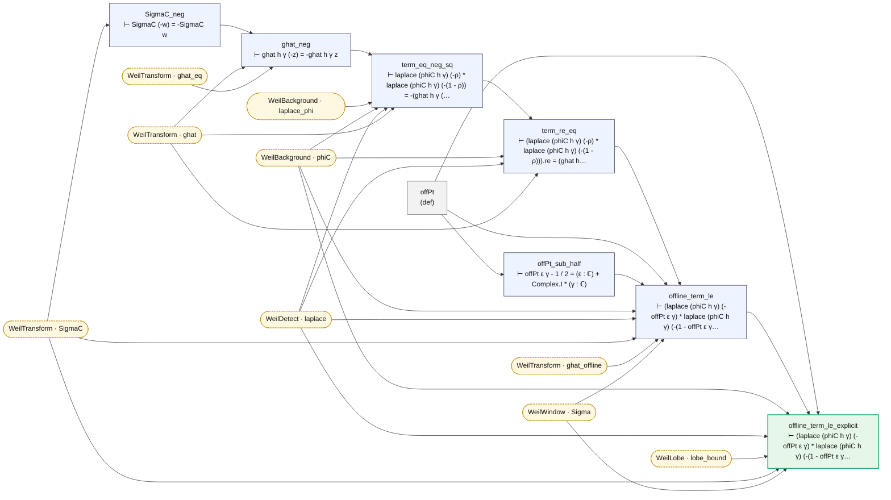

# `lean_stage3/Stage3/WeilOffLine.lean`

**What it does** (its own header): WeilOffLine — every term of the zero form is minus a square, and the sign of an off-line zero's own term. Rung 5, first slice of the detection ladder (units 0316–0325). 2026-09-06.

**Imports:** [`WeilBackground`](../lean_stage3/WeilBackground.md).
**Imported by:** [`Stage3`](../lean_stage3/Stage3.md).

Blue: theorem. Green: a theorem nothing else uses (an end). Dashed white: connects to nothing. Grey: definition. Red: contains `sorry`. Yellow: in another file. An arrow A → B reads "A is used by B".

## Every declaration

| declaration | proves (output) | needs (input) | why (its own docstring) | uses | used by |
|---|---|---|---|---|---|
| `WeilOffLine.SigmaC_neg` theorem, line 44 | SigmaC (-w) = -SigmaC w | w : ℂ | `Σc` is odd: `sinh` is odd. | `WeilTransform.SigmaC` | `WeilOffLine.ghat_neg` |
| `WeilOffLine.ghat_neg` theorem, line 53 | ghat h γ (-z) = -ghat h γ z | hh : 0 &lt; h; γ : ℝ; z : ℂ | The window's transform is odd. | `WeilOffLine.SigmaC_neg`, `WeilTransform.ghat`, `WeilTransform.ghat_eq` | `WeilOffLine.term_eq_neg_sq` |
| `WeilOffLine.term_eq_neg_sq` theorem, line 64 | laplace (phiC h γ) (-ρ) * laplace (phiC h γ) (-(1 - ρ)) = -(ghat h γ (ρ - 1 / 2)) ^ 2 | hh : 0 &lt; h; γ : ℝ; ρ : ℂ | Every term is minus a square. For any `ρ`, `laplace φ(−ρ)·laplace φ(−(1−ρ)) = −ghat h γ (ρ − 1/2)²`. | `WeilBackground.laplace_phi`, `WeilBackground.phiC`, `WeilDetect.laplace`, `WeilOffLine.ghat_neg`, `WeilTransform.ghat` | `WeilOffLine.term_re_eq` |
| `WeilOffLine.term_re_eq` theorem, line 73 | (laplace (phiC h γ) (-ρ) * laplace (phiC h γ) (-(1 - ρ))).re = (ghat h γ (ρ - 1 / 2)).im ^ 2 - (ghat h γ (ρ - 1 / 2)).re ^ 2 | hh : 0 &lt; h; γ : ℝ; ρ : ℂ | The real part of a term is `(Im g)² − (Re g)²` at `g = ghat h γ (ρ − 1/2)`. | `WeilBackground.phiC`, `WeilDetect.laplace`, `WeilOffLine.term_eq_neg_sq`, `WeilTransform.ghat` | `WeilOffLine.offline_term_le` |
| `WeilOffLine.offPt` def, line 80 | ℂ | ε γ : ℝ | The off-line point the tuned window reads: `ρ = 1/2 + ε + iγ`. | — | `WeilOffLine.offPt_sub_half`, `WeilOffLine.offline_term_le`, `WeilOffLine.offline_term_le_explicit` |
| `WeilOffLine.offPt_sub_half` theorem, line 82 | offPt ε γ - 1 / 2 = (ε : ℂ) + Complex.I * (γ : ℂ) | ε γ : ℝ | — | `WeilOffLine.offPt` | `WeilOffLine.offline_term_le` |
| `WeilOffLine.offline_term_le` theorem, line 88 | (laplace (phiC h γ) (-offPt ε γ) * laplace (phiC h γ) (-(1 - offPt ε γ))).re ≤ -((h / 2) ^ 2 * (WeilWindow.Sigma (ε * h) * (WeilWindow.Sigma (ε * h) - 2 * ‖SigmaC (((ε : ℂ) + 2 * Complex.I * (γ : ℂ)) * (h : ℂ))‖))) | hh : 0 &lt; h; hs : ‖SigmaC (((ε : ℂ) + 2 * Complex.I * (γ : ℂ)) * (h : ℂ))‖ ≤ WeilWindow.Sigma (ε * h) | The off-line term is negative. With `g = (h/2)[lobe + Σ(εh)]` and the lobe at most the main term in norm, `term.re ≤ −(h/2)²·Σ(εh)·(Σ(εh) − 2‖lobe‖)`. | `WeilBackground.phiC`, `WeilDetect.laplace`, `WeilOffLine.offPt`, `WeilOffLine.offPt_sub_half`, `WeilOffLine.term_re_eq`, `WeilTransform.SigmaC`, `WeilTransform.ghat_offline`, `WeilWindow.Sigma` | `WeilOffLine.offline_term_le_explicit` |
| `WeilOffLine.offline_term_le_explicit` theorem, line 119 | (laplace (phiC h γ) (-offPt ε γ) * laplace (phiC h γ) (-(1 - offPt ε γ))).re ≤ -((h / 2) ^ 2 * (WeilWindow.Sigma (ε * h) * (WeilWindow.Sigma (ε * h) - 2 * ((2 * Real.pi + Real.pi ^ 2) * Real.cosh (ε * h) / (2 * γ * h) ^ 2)))) | hh : 0 &lt; h; hγ : 0 &lt; γ; hs : (2 * Real.pi + Real.pi ^ 2) * Real.cosh (ε * h) / (2 * γ * h) ^ 2 ≤ WeilWindow.Sigma (ε * h) | The same with unit 0319's lobe bound in place of the lobe: for `γ &gt; 0`, if `(2π + π²)·cosh(εh)/(2γh)² ≤ Σ(εh)` then `term.re ≤ −(h/2)²·Σ(εh)·(Σ(εh) − 2(2π + π²)·cosh(εh)/(2γh)²)`. | `WeilBackground.phiC`, `WeilDetect.laplace`, `WeilLobe.lobe_bound`, `WeilOffLine.offPt`, `WeilOffLine.offline_term_le`, `WeilTransform.SigmaC`, `WeilWindow.Sigma` | — |
