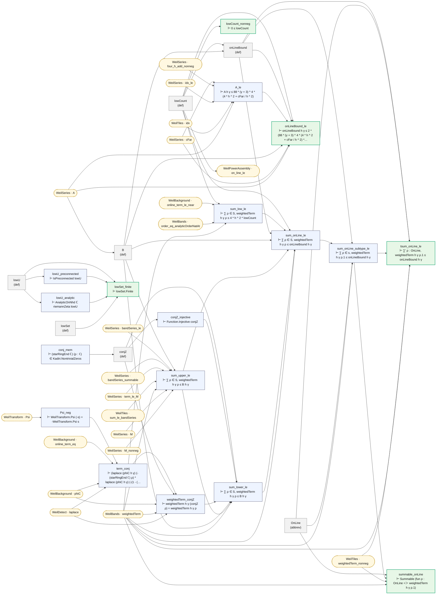

# `lean_stage3/Stage3/WeilOnLine.lean`

**What it does** (its own header): WeilOnLine — the on-line background, all heights. Rung 4b, second half, slice B3 of the detection ladder (units 0316–0323). 2026-09-06.

**Imports:** [`WeilSeries`](../lean_stage3/WeilSeries.md).
**Imported by:** [`Stage3`](../lean_stage3/Stage3.md), [`WeilPowerOnLine`](../lean_stage3/WeilPowerOnLine.md).

Blue: theorem. Green: a theorem nothing else uses (an end). Dashed white: connects to nothing. Grey: definition. Red: contains `sorry`. Yellow: in another file. An arrow A → B reads "A is used by B".

## Every declaration

| declaration | proves (output) | needs (input) | why (its own docstring) | uses | used by |
|---|---|---|---|---|---|
| `WeilOnLine.Psi_neg` theorem, line 50 | WeilTransform.Psi (-s) = -WeilTransform.Psi s | s : ℝ | `Ψ` is odd. | `WeilTransform.Psi` | `WeilOnLine.term_conj` |
| `WeilOnLine.term_conj` theorem, line 58 | (laplace (phiC h γ) (-(starRingEnd ℂ) ρ) * laplace (phiC h γ) (-(1 - (starRingEnd ℂ) ρ))).re = (laplace (phiC h γ) (-ρ) * laplace (phiC h γ) (-(1 - ρ))).re | hh : 0 &lt; h; γ : ℝ; hρ : ρ.re = 1 / 2 | The on-line term is invariant under conjugation of the zero. | `WeilBackground.online_term_eq`, `WeilBackground.phiC`, `WeilDetect.laplace`, `WeilOnLine.Psi_neg` | `WeilOnLine.weightedTerm_conjZ` |
| `WeilOnLine.conj_mem` theorem, line 71 | (starRingEnd ℂ) (ρ : ℂ) ∈ Kadiri.NontrivialZeros | ρ : Kadiri.NontrivialZeros | Conjugates of nontrivial zeros are nontrivial zeros. | — | `WeilOnLine.conjZ` |
| `WeilOnLine.conjZ` def, line 81 | Kadiri.NontrivialZeros | ρ : Kadiri.NontrivialZeros | The conjugate, as a nontrivial zero. | `WeilOnLine.conj_mem` | `WeilOnLine.conjZ_injective`, `WeilOnLine.sum_lower_le`, `WeilOnLine.weightedTerm_conjZ` |
| `WeilOnLine.conjZ_injective` theorem, line 84 | Function.Injective conjZ | — | — | `WeilOnLine.conjZ` | `WeilOnLine.sum_lower_le` |
| `WeilOnLine.weightedTerm_conjZ` theorem, line 89 | weightedTerm h γ (conjZ ρ) = weightedTerm h γ ρ | hh : 0 &lt; h; γ : ℝ; ρ : Kadiri.NontrivialZeros; hρ : (ρ : ℂ).re = 1 / 2 | — | `WeilBackground.phiC`, `WeilBands.weightedTerm`, `WeilDetect.laplace`, `WeilOnLine.conjZ`, `WeilOnLine.term_conj` | `WeilOnLine.sum_lower_le` |
| `WeilOnLine.B` def, line 103 | ℝ | h γ : ℝ | One side's bound: `A h γ · π²/6`. | `WeilSeries.A` | `WeilOnLine.onLineBound`, `WeilOnLine.onLineBound_le`, `WeilOnLine.sum_lower_le`, `WeilOnLine.sum_onLine_le`, `WeilOnLine.sum_upper_le` |
| `WeilOnLine.sum_upper_le` theorem, line 106 | ∑ ρ ∈ S, weightedTerm h γ ρ ≤ B h γ | hh : 0 &lt; h; hγ : 11 / 10 ≤ γ; S : Finset Kadiri.NontrivialZeros; hS : ∀ ρ ∈ S, (ρ : ℂ).re = 1 / 2 ∧ 11 / 10 ≤ (ρ : ℂ).im | Finite on-line sums of height `≥ 11/10`. | `WeilBands.weightedTerm`, `WeilOnLine.B`, `WeilSeries.M`, `WeilSeries.M_nonneg`, `WeilSeries.bandSeries_le`, `WeilSeries.bandSeries_summable`, `WeilSeries.term_le_M`, `WeilTiles.sum_le_bandSeries` | `WeilOnLine.sum_lower_le`, `WeilOnLine.sum_onLine_le` |
| `WeilOnLine.sum_lower_le` theorem, line 118 | ∑ ρ ∈ S, weightedTerm h γ ρ ≤ B h γ | hh : 0 &lt; h; hγ : 11 / 10 ≤ γ; S : Finset Kadiri.NontrivialZeros; hS : ∀ ρ ∈ S, (ρ : ℂ).re = 1 / 2 ∧ (ρ : ℂ).im ≤ -(11 / 10) | Negative heights. Finite on-line sums of height `≤ −11/10`, by conjugation onto the upper range. | `WeilBands.weightedTerm`, `WeilOnLine.B`, `WeilOnLine.conjZ`, `WeilOnLine.conjZ_injective`, `WeilOnLine.sum_upper_le`, `WeilOnLine.weightedTerm_conjZ` | `WeilOnLine.sum_onLine_le` |
| `WeilOnLine.lowSet` def, line 141 | Set ℂ | — | The on-line zeros of height `\|t\| ≤ 11/10`, as points. | — | `WeilOnLine.lowSet_finite` |
| `WeilOnLine.lowU` def, line 144 | Set ℂ | — | The half-plane `Re z &lt; 3/4`: open, convex, pole-free. | — | `WeilOnLine.lowSet_finite`, `WeilOnLine.lowU_analytic`, `WeilOnLine.lowU_preconnected` |
| `WeilOnLine.lowU_preconnected` theorem, line 146 | IsPreconnected lowU | — | — | `WeilOnLine.lowU` | `WeilOnLine.lowSet_finite` |
| `WeilOnLine.lowU_analytic` theorem, line 149 | AnalyticOnNhd ℂ riemannZeta lowU | — | — | `WeilOnLine.lowU` | `WeilOnLine.lowSet_finite` |
| `WeilOnLine.lowSet_finite` theorem, line 158 | lowSet.Finite | — | The low band is finite. | `WeilOnLine.lowSet`, `WeilOnLine.lowU`, `WeilOnLine.lowU_analytic`, `WeilOnLine.lowU_preconnected` | — |
| `WeilOnLine.lowCount` def, line 187 | ℝ | — | The low count. Total multiplicity of the on-line zeros of height `\|t\| ≤ 11/10`. Carried by name. | — | `WeilOnLine.lowCount_nonneg`, `WeilOnLine.onLineBound`, `WeilOnLine.onLineBound_le`, `WeilOnLine.sum_low_le`, `WeilOnLine.sum_onLine_le`, `WeilPowerAssembly.on_line_le` |
| `WeilOnLine.lowCount_nonneg` theorem, line 189 | 0 ≤ lowCount | — | — | `WeilOnLine.lowCount` | — |
| `WeilOnLine.sum_low_le` theorem, line 193 | ∑ ρ ∈ S, weightedTerm h γ ρ ≤ 4 * h ^ 2 * lowCount | hh : 0 &lt; h; S : Finset Kadiri.NontrivialZeros; hS : ∀ ρ ∈ S, (ρ : ℂ).re = 1 / 2 ∧ \|(ρ : ℂ).im\| ≤ 11 / 10 | The low band. Finite on-line sums of height `\|t\| ≤ 11/10`. | `WeilBackground.online_term_le_near`, `WeilBands.order_eq_analyticOrderNatAt`, `WeilBands.weightedTerm`, `WeilOnLine.lowCount` | `WeilOnLine.sum_onLine_le` |
| `WeilOnLine.onLineBound` def, line 225 | ℝ | h γ : ℝ | The on-line background bound: `2·B h γ + 4h²·lowCount`. | `WeilOnLine.B`, `WeilOnLine.lowCount` | `WeilOnLine.onLineBound_le`, `WeilOnLine.sum_onLine_le`, `WeilOnLine.sum_onLine_subtype_le`, `WeilOnLine.tsum_onLine_le` |
| `WeilOnLine.sum_onLine_le` theorem, line 228 | ∑ ρ ∈ S, weightedTerm h γ ρ ≤ onLineBound h γ | hh : 0 &lt; h; hγ : 11 / 10 ≤ γ; S : Finset Kadiri.NontrivialZeros; hS : ∀ ρ ∈ S, (ρ : ℂ).re = 1 / 2 | All heights. Any finite on-line sum is at most `onLineBound`. | `WeilBands.weightedTerm`, `WeilOnLine.B`, `WeilOnLine.lowCount`, `WeilOnLine.onLineBound`, `WeilOnLine.sum_low_le`, `WeilOnLine.sum_lower_le`, `WeilOnLine.sum_upper_le` | `WeilOnLine.sum_onLine_subtype_le` |
| `WeilOnLine.OnLine` abbrev, line 263 | Type | — | On-line zeros. | — | `WeilOnLine.sum_onLine_subtype_le`, `WeilOnLine.summable_onLine`, `WeilOnLine.tsum_onLine_le` |
| `WeilOnLine.sum_onLine_subtype_le` theorem, line 265 | ∑ ρ ∈ s, weightedTerm h γ ρ.1 ≤ onLineBound h γ | hh : 0 &lt; h; hγ : 11 / 10 ≤ γ; s : Finset OnLine | — | `WeilBands.weightedTerm`, `WeilOnLine.OnLine`, `WeilOnLine.onLineBound`, `WeilOnLine.sum_onLine_le` | `WeilOnLine.summable_onLine`, `WeilOnLine.tsum_onLine_le` |
| `WeilOnLine.tsum_onLine_le` theorem, line 278 | ∑' ρ : OnLine, weightedTerm h γ ρ.1 ≤ onLineBound h γ | hh : 0 &lt; h; hγ : 11 / 10 ≤ γ | The on-line background. For `h &gt; 0` and `γ ≥ 11/10`, the full weighted sum over all on-line zeros is at most `onLineBound h γ`. | `WeilBands.weightedTerm`, `WeilOnLine.OnLine`, `WeilOnLine.onLineBound`, `WeilOnLine.sum_onLine_subtype_le`, `WeilTiles.weightedTerm_nonneg` | — |
| `WeilOnLine.summable_onLine` theorem, line 286 | Summable (fun ρ : OnLine =&gt; weightedTerm h γ ρ.1) | hh : 0 &lt; h; hγ : 11 / 10 ≤ γ | The on-line series is summable. | `WeilBands.weightedTerm`, `WeilOnLine.OnLine`, `WeilOnLine.sum_onLine_subtype_le`, `WeilTiles.weightedTerm_nonneg` | — |
| `WeilOnLine.A_le` theorem, line 293 | A h γ ≤ 88 * (γ + 3) ^ 4 * (4 * h ^ 2 + cFar / h ^ 2) | hγ : 11 / 10 ≤ γ | — | `WeilSeries.A`, `WeilSeries.cFar`, `WeilSeries.four_h_add_nonneg`, `WeilSeries.idx_le`, `WeilTiles.idx` | `WeilOnLine.onLineBound_le` |
| `WeilOnLine.onLineBound_le` theorem, line 304 | onLineBound h γ ≤ 2 * (88 * (γ + 3) ^ 4 * (4 * h ^ 2 + cFar / h ^ 2) * (Real.pi ^ 2 / 6)) + 4 * h ^ 2 * lowCount | hγ : 11 / 10 ≤ γ | The on-line background, in `γ` and `h` alone. | `WeilOnLine.A_le`, `WeilOnLine.B`, `WeilOnLine.lowCount`, `WeilOnLine.onLineBound`, `WeilSeries.A`, `WeilSeries.cFar` | — |
