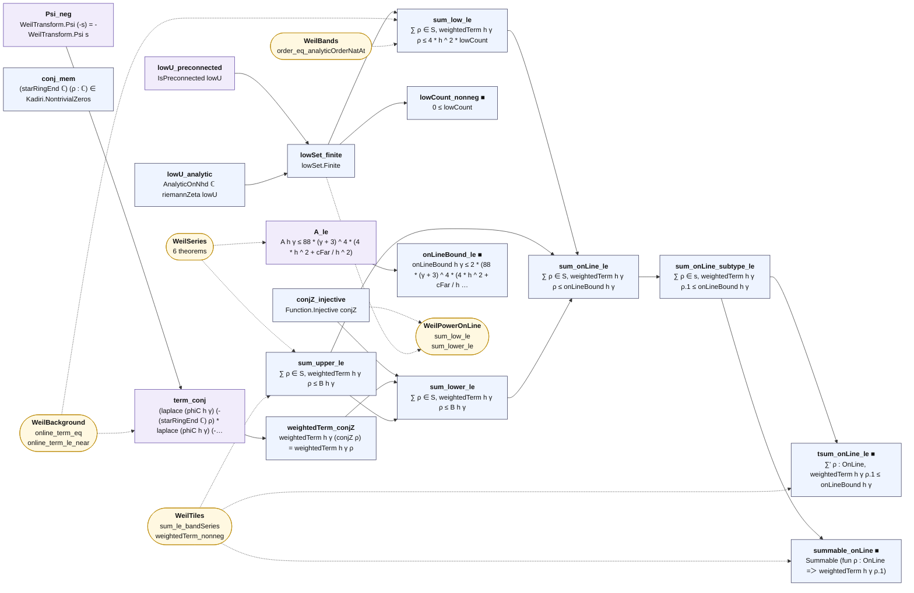

# `lean_stage3/Stage3/WeilOnLine.lean`

WeilOnLine — the on-line background, all heights. Rung 4b, second half, slice B3 of the detection ladder (units 0316–0323). 2026-09-06.

18 theorems, 7 definitions, 330 lines. Arrows are Lean's own record of what each proof uses.

**Imports:** [`WeilSeries`](../lean_stage3/WeilSeries.md)  
**Imported by:** [`Stage3`](../lean_stage3/Stage3.md), [`WeilPowerOnLine`](../lean_stage3/WeilPowerOnLine.md)

## The picture



An arrow A → B reads "A is used in the proof of B". Green: counting, integers only. Violet: shape, analysis with no ζ. Blue: reads ζ. A name ending in ■ is an end: nothing else uses it. Red: contains `sorry`. Yellow: theorems in another file, counted; a dotted arrow crosses files. Definitions are not drawn; they are listed below the diagram.

## Definitions

<a name="WeilOnLine-conjZ"></a>
### `WeilOnLine.conjZ`

def · line 81

The conjugate, as a nontrivial zero.

- **Is:** `` conjZ (ρ : Kadiri.NontrivialZeros) : Kadiri.NontrivialZeros := ⟨(starRingEnd ℂ) (ρ : ℂ), conj_mem ρ⟩ ``
- **Built from:** [`WeilOnLine.conj_mem`](#WeilOnLine-conj_mem)
- **Used by 5:** [`WeilOnLine.conjZ_injective`](#WeilOnLine-conjZ_injective), [`WeilOnLine.sum_lower_le`](#WeilOnLine-sum_lower_le), [`WeilOnLine.weightedTerm_conjZ`](#WeilOnLine-weightedTerm_conjZ), [`WeilPowerOnLine.sum_lower_le`](../lean_stage3/WeilPowerOnLine.md#WeilPowerOnLine-sum_lower_le), [`WeilPowerOnLine.weightedTermW_conjZ`](../lean_stage3/WeilPowerOnLine.md#WeilPowerOnLine-weightedTermW_conjZ)

<a name="WeilOnLine-B"></a>
### `WeilOnLine.B`

def · line 103

One side's bound: `A h γ · π²/6`.

- **Is:** `` B (h γ : ℝ) : ℝ := A h γ * (Real.pi ^ 2 / 6) ``
- **Built from:** [`WeilSeries.A`](../lean_stage3/WeilSeries.md#WeilSeries-A)
- **Used by 5:** [`WeilOnLine.onLineBound`](#WeilOnLine-onLineBound), [`WeilOnLine.onLineBound_le`](#WeilOnLine-onLineBound_le), [`WeilOnLine.sum_lower_le`](#WeilOnLine-sum_lower_le), [`WeilOnLine.sum_onLine_le`](#WeilOnLine-sum_onLine_le), [`WeilOnLine.sum_upper_le`](#WeilOnLine-sum_upper_le)

<a name="WeilOnLine-lowSet"></a>
### `WeilOnLine.lowSet`

def · line 141

The on-line zeros of height `|t| ≤ 11/10`, as points.

- **Is:** `` lowSet : Set ℂ := {ρ : ℂ | riemannZeta ρ = 0 ∧ ρ.re = 1 / 2 ∧ |ρ.im| ≤ 11 / 10} ``
- **Used by 5:** [`WeilOnLine.lowCount`](#WeilOnLine-lowCount), [`WeilOnLine.lowCount_nonneg`](#WeilOnLine-lowCount_nonneg), [`WeilOnLine.lowSet_finite`](#WeilOnLine-lowSet_finite), [`WeilOnLine.sum_low_le`](#WeilOnLine-sum_low_le), [`WeilPowerOnLine.sum_low_le`](../lean_stage3/WeilPowerOnLine.md#WeilPowerOnLine-sum_low_le)

<a name="WeilOnLine-lowU"></a>
### `WeilOnLine.lowU`

def · line 144

The half-plane `Re z < 3/4`: open, convex, pole-free.

- **Is:** `` lowU : Set ℂ := {z : ℂ | z.re < 3 / 4} ``
- **Used by 3:** [`WeilOnLine.lowSet_finite`](#WeilOnLine-lowSet_finite), [`WeilOnLine.lowU_analytic`](#WeilOnLine-lowU_analytic), [`WeilOnLine.lowU_preconnected`](#WeilOnLine-lowU_preconnected)

<a name="WeilOnLine-lowCount"></a>
### `WeilOnLine.lowCount`

def · line 187

The low count. Total multiplicity of the on-line zeros of height `|t| ≤ 11/10`. Carried by name.

- **Is:** `` lowCount : ℝ := ∑ ρ ∈ lowSet_finite.toFinset, (analyticOrderNatAt riemannZeta ρ : ℝ) ``
- **Built from:** [`WeilOnLine.lowSet`](#WeilOnLine-lowSet), [`WeilOnLine.lowSet_finite`](#WeilOnLine-lowSet_finite)
- **Used by 10:** [`WeilOnLine.lowCount_nonneg`](#WeilOnLine-lowCount_nonneg), [`WeilOnLine.onLineBound`](#WeilOnLine-onLineBound), [`WeilOnLine.onLineBound_le`](#WeilOnLine-onLineBound_le), [`WeilOnLine.sum_low_le`](#WeilOnLine-sum_low_le), [`WeilOnLine.sum_onLine_le`](#WeilOnLine-sum_onLine_le), [`WeilPowerAssembly.on_line_le`](../lean_stage3/WeilPowerAssembly.md#WeilPowerAssembly-on_line_le), [`WeilPowerOnLine.onLineBound`](../lean_stage3/WeilPowerOnLine.md#WeilPowerOnLine-onLineBound), [`WeilPowerOnLine.onLineBound_le`](../lean_stage3/WeilPowerOnLine.md#WeilPowerOnLine-onLineBound_le), [`WeilPowerOnLine.sum_low_le`](../lean_stage3/WeilPowerOnLine.md#WeilPowerOnLine-sum_low_le), [`WeilPowerOnLine.sum_onLine_le`](../lean_stage3/WeilPowerOnLine.md#WeilPowerOnLine-sum_onLine_le)

<a name="WeilOnLine-onLineBound"></a>
### `WeilOnLine.onLineBound`

def · line 225

The on-line background bound: `2·B h γ + 4h²·lowCount`.

- **Is:** `` onLineBound (h γ : ℝ) : ℝ := 2 * B h γ + 4 * h ^ 2 * lowCount ``
- **Built from:** [`WeilOnLine.B`](#WeilOnLine-B), [`WeilOnLine.lowCount`](#WeilOnLine-lowCount)
- **Used by 5:** [`WeilOnLine.onLineBound_le`](#WeilOnLine-onLineBound_le), [`WeilOnLine.sum_onLine_le`](#WeilOnLine-sum_onLine_le), [`WeilOnLine.sum_onLine_subtype_le`](#WeilOnLine-sum_onLine_subtype_le), [`WeilOnLine.summable_onLine`](#WeilOnLine-summable_onLine), [`WeilOnLine.tsum_onLine_le`](#WeilOnLine-tsum_onLine_le)

<a name="WeilOnLine-OnLine"></a>
### `WeilOnLine.OnLine`

abbrev · line 263

On-line zeros.

- **Is:** `` OnLine : Type := {ρ : Kadiri.NontrivialZeros // (ρ : ℂ).re = 1 / 2} ``
- **Used by 6:** [`WeilOnLine.sum_onLine_subtype_le`](#WeilOnLine-sum_onLine_subtype_le), [`WeilOnLine.summable_onLine`](#WeilOnLine-summable_onLine), [`WeilOnLine.tsum_onLine_le`](#WeilOnLine-tsum_onLine_le), [`WeilPowerOnLine.sum_onLine_subtype_le`](../lean_stage3/WeilPowerOnLine.md#WeilPowerOnLine-sum_onLine_subtype_le), [`WeilPowerOnLine.summable_onLine`](../lean_stage3/WeilPowerOnLine.md#WeilPowerOnLine-summable_onLine), [`WeilPowerOnLine.tsum_onLine_le`](../lean_stage3/WeilPowerOnLine.md#WeilPowerOnLine-tsum_onLine_le)

## Theorems

<a name="WeilOnLine-Psi_neg"></a>
### `WeilOnLine.Psi_neg`

line 50

**Shape.** Uses real or complex analysis; nothing in it or beneath it reads ζ.

**Why.** `Ψ` is odd.

**Proves**

```lean
WeilTransform.Psi (-s) = -WeilTransform.Psi s
```

**Needs** (its hypotheses)

  - `` s : ℝ ``

**Stated with:** [`WeilTransform.Psi`](../lean_stage3/WeilTransform.md#WeilTransform-Psi)

**Fed by:** no theorem of this repo; it stands on Mathlib and the definitions below.

**Definitions its proof touches:** [`WeilWindow.P`](../lean_stage3/WeilWindow.md#WeilWindow-P)

**Feeds** (1 that use it)

  - [`WeilOnLine.term_conj`](#WeilOnLine-term_conj) — `` (laplace (phiC h γ) (-(starRingEnd ℂ) ρ) * laplace (phiC h γ) (-(1 - (starRingEnd ℂ) ρ))).re = (laplace (phiC h γ) (-ρ) * laplace (phiC h γ) (-(1 - ρ)… ``

<a name="WeilOnLine-term_conj"></a>
### `WeilOnLine.term_conj`

line 58

**Shape.** Uses real or complex analysis; nothing in it or beneath it reads ζ.

**Why.** The on-line term is invariant under conjugation of the zero.

**Proves**

```lean
(laplace (phiC h γ) (-(starRingEnd ℂ) ρ) * laplace (phiC h γ) (-(1 - (starRingEnd ℂ) ρ))).re = (laplace (phiC h γ) (-ρ) * laplace (phiC h γ) (-(1 - ρ))).re
```

**Needs** (its hypotheses)

  - `` hh : 0 < h ``
  - `` γ : ℝ ``
  - `` hρ : ρ.re = 1 / 2 ``

**Stated with:** [`WeilBackground.phiC`](../lean_stage3/WeilBackground.md#WeilBackground-phiC), [`WeilDetect.laplace`](../lean_stage3/WeilDetect.md#WeilDetect-laplace)

**Fed by** (2 theorems its proof uses)

  - [`WeilBackground.online_term_eq`](../lean_stage3/WeilBackground.md#WeilBackground-online_term_eq) (WeilBackground) — `` laplace (phiC h γ) (-ρ) * laplace (phiC h γ) (-(1 - ρ)) = (((h / 2) ^ 2 * (WeilTransform.Psi (h * (ρ.im + γ)) + WeilTransform.Psi (h * (ρ.im - γ))) ^ … ``
  - [`WeilOnLine.Psi_neg`](#WeilOnLine-Psi_neg) — `` WeilTransform.Psi (-s) = -WeilTransform.Psi s ``

**Definitions its proof touches:** [`WeilTransform.Psi`](../lean_stage3/WeilTransform.md#WeilTransform-Psi)

**Feeds** (1 that use it)

  - [`WeilOnLine.weightedTerm_conjZ`](#WeilOnLine-weightedTerm_conjZ) — `` weightedTerm h γ (conjZ ρ) = weightedTerm h γ ρ ``

<a name="WeilOnLine-conj_mem"></a>
### `WeilOnLine.conj_mem`

line 71

**Reads ζ.** It, or something it rests on, uses the zeta function, its zeros or the Riemann hypothesis.

**Why.** Conjugates of nontrivial zeros are nontrivial zeros.

**Proves**

```lean
(starRingEnd ℂ) (ρ : ℂ) ∈ Kadiri.NontrivialZeros
```

**Needs** (its hypotheses)

  - `` ρ : Kadiri.NontrivialZeros ``

**Fed by:** no theorem of this repo; it stands on Mathlib.

**Feeds** (1 that use it)

  - [`WeilOnLine.conjZ`](#WeilOnLine-conjZ) — def

<a name="WeilOnLine-conjZ_injective"></a>
### `WeilOnLine.conjZ_injective`

line 84

**Reads ζ.** It, or something it rests on, uses the zeta function, its zeros or the Riemann hypothesis.

**Proves**

```lean
Function.Injective conjZ
```

**Stated with:** [`WeilOnLine.conjZ`](#WeilOnLine-conjZ)

**Fed by:** no theorem of this repo; it stands on Mathlib and the definitions below.

**Feeds** (2 that use it)

  - [`WeilOnLine.sum_lower_le`](#WeilOnLine-sum_lower_le) — `` ∑ ρ ∈ S, weightedTerm h γ ρ ≤ B h γ ``
  - [`WeilPowerOnLine.sum_lower_le`](../lean_stage3/WeilPowerOnLine.md#WeilPowerOnLine-sum_lower_le) (WeilPowerOnLine) — `` ∑ ρ ∈ S, weightedTermW h γ m ρ ≤ B h γ m ``

<a name="WeilOnLine-weightedTerm_conjZ"></a>
### `WeilOnLine.weightedTerm_conjZ`

line 89

**Reads ζ.** It, or something it rests on, uses the zeta function, its zeros or the Riemann hypothesis.

**Proves**

```lean
weightedTerm h γ (conjZ ρ) = weightedTerm h γ ρ
```

**Needs** (its hypotheses)

  - `` hh : 0 < h ``
  - `` γ : ℝ ``
  - `` ρ : Kadiri.NontrivialZeros ``
  - `` hρ : (ρ : ℂ).re = 1 / 2 ``

**Stated with:** [`WeilBands.weightedTerm`](../lean_stage3/WeilBands.md#WeilBands-weightedTerm), [`WeilOnLine.conjZ`](#WeilOnLine-conjZ)

**Fed by** (1 theorem its proof uses)

  - [`WeilOnLine.term_conj`](#WeilOnLine-term_conj) — `` (laplace (phiC h γ) (-(starRingEnd ℂ) ρ) * laplace (phiC h γ) (-(1 - (starRingEnd ℂ) ρ))).re = (laplace (phiC h γ) (-ρ) * laplace (phiC h γ) (-(1 - ρ)… ``

**Definitions its proof touches:** [`WeilBackground.phiC`](../lean_stage3/WeilBackground.md#WeilBackground-phiC), [`WeilDetect.laplace`](../lean_stage3/WeilDetect.md#WeilDetect-laplace)

**Feeds** (1 that use it)

  - [`WeilOnLine.sum_lower_le`](#WeilOnLine-sum_lower_le) — `` ∑ ρ ∈ S, weightedTerm h γ ρ ≤ B h γ ``

<a name="WeilOnLine-sum_upper_le"></a>
### `WeilOnLine.sum_upper_le`

line 106

**Reads ζ.** It, or something it rests on, uses the zeta function, its zeros or the Riemann hypothesis.

**Why.** Finite on-line sums of height `≥ 11/10`.

**Proves**

```lean
∑ ρ ∈ S, weightedTerm h γ ρ ≤ B h γ
```

**Needs** (its hypotheses)

  - `` hh : 0 < h ``
  - `` hγ : 11 / 10 ≤ γ ``
  - `` S : Finset Kadiri.NontrivialZeros ``
  - `` hS : ∀ ρ ∈ S, (ρ : ℂ).re = 1 / 2 ∧ 11 / 10 ≤ (ρ : ℂ).im ``

**Stated with:** [`WeilBands.weightedTerm`](../lean_stage3/WeilBands.md#WeilBands-weightedTerm), [`WeilOnLine.B`](#WeilOnLine-B)

**Fed by** (5 theorems its proof uses)

  - [`WeilSeries.M_nonneg`](../lean_stage3/WeilSeries.md#WeilSeries-M_nonneg) (WeilSeries) — `` 0 ≤ M h γ k ``
  - [`WeilSeries.bandSeries_le`](../lean_stage3/WeilSeries.md#WeilSeries-bandSeries_le) (WeilSeries) — `` ∑' k : ℕ, M h γ k * (15 * Real.log (centre k) + 73) ≤ A h γ * (Real.pi ^ 2 / 6) ``
  - [`WeilSeries.bandSeries_summable`](../lean_stage3/WeilSeries.md#WeilSeries-bandSeries_summable) (WeilSeries) — `` Summable (fun k : ℕ => M h γ k * (15 * Real.log (centre k) + 73)) ``
  - [`WeilSeries.term_le_M`](../lean_stage3/WeilSeries.md#WeilSeries-term_le_M) (WeilSeries) — `` (laplace (phiC h γ) (-(ρ : ℂ)) * laplace (phiC h γ) (-(1 - (ρ : ℂ)))).re ≤ M h γ (idx (ρ : ℂ).im) ``
  - [`WeilTiles.sum_le_bandSeries`](../lean_stage3/WeilTiles.md#WeilTiles-sum_le_bandSeries) (WeilTiles) — `` ∑ ρ ∈ S, weightedTerm h γ ρ ≤ ∑' k : ℕ, M k * (15 * Real.log (centre k) + 73) ``

**Definitions its proof touches:** [`WeilSeries.A`](../lean_stage3/WeilSeries.md#WeilSeries-A), [`WeilSeries.M`](../lean_stage3/WeilSeries.md#WeilSeries-M), [`WeilTiles.centre`](../lean_stage3/WeilTiles.md#WeilTiles-centre)

**Feeds** (2 that use it)

  - [`WeilOnLine.sum_lower_le`](#WeilOnLine-sum_lower_le) — `` ∑ ρ ∈ S, weightedTerm h γ ρ ≤ B h γ ``
  - [`WeilOnLine.sum_onLine_le`](#WeilOnLine-sum_onLine_le) — `` ∑ ρ ∈ S, weightedTerm h γ ρ ≤ onLineBound h γ ``

<a name="WeilOnLine-sum_lower_le"></a>
### `WeilOnLine.sum_lower_le`

line 118

**Reads ζ.** It, or something it rests on, uses the zeta function, its zeros or the Riemann hypothesis.

**Why.** Negative heights. Finite on-line sums of height `≤ −11/10`, by conjugation onto the upper range.

**Proves**

```lean
∑ ρ ∈ S, weightedTerm h γ ρ ≤ B h γ
```

**Needs** (its hypotheses)

  - `` hh : 0 < h ``
  - `` hγ : 11 / 10 ≤ γ ``
  - `` S : Finset Kadiri.NontrivialZeros ``
  - `` hS : ∀ ρ ∈ S, (ρ : ℂ).re = 1 / 2 ∧ (ρ : ℂ).im ≤ -(11 / 10) ``

**Stated with:** [`WeilBands.weightedTerm`](../lean_stage3/WeilBands.md#WeilBands-weightedTerm), [`WeilOnLine.B`](#WeilOnLine-B)

**Fed by** (3 theorems its proof uses)

  - [`WeilOnLine.conjZ_injective`](#WeilOnLine-conjZ_injective) — `` Function.Injective conjZ ``
  - [`WeilOnLine.sum_upper_le`](#WeilOnLine-sum_upper_le) — `` ∑ ρ ∈ S, weightedTerm h γ ρ ≤ B h γ ``
  - [`WeilOnLine.weightedTerm_conjZ`](#WeilOnLine-weightedTerm_conjZ) — `` weightedTerm h γ (conjZ ρ) = weightedTerm h γ ρ ``

**Definitions its proof touches:** [`WeilOnLine.conjZ`](#WeilOnLine-conjZ)

**Feeds** (1 that use it)

  - [`WeilOnLine.sum_onLine_le`](#WeilOnLine-sum_onLine_le) — `` ∑ ρ ∈ S, weightedTerm h γ ρ ≤ onLineBound h γ ``

<a name="WeilOnLine-lowU_preconnected"></a>
### `WeilOnLine.lowU_preconnected`

line 146

**Shape.** Uses real or complex analysis; nothing in it or beneath it reads ζ.

**Proves**

```lean
IsPreconnected lowU
```

**Stated with:** [`WeilOnLine.lowU`](#WeilOnLine-lowU)

**Fed by:** no theorem of this repo; it stands on Mathlib and the definitions below.

**Feeds** (1 that use it)

  - [`WeilOnLine.lowSet_finite`](#WeilOnLine-lowSet_finite) — `` lowSet.Finite ``

<a name="WeilOnLine-lowU_analytic"></a>
### `WeilOnLine.lowU_analytic`

line 149

**Reads ζ.** It, or something it rests on, uses the zeta function, its zeros or the Riemann hypothesis.

**Proves**

```lean
AnalyticOnNhd ℂ riemannZeta lowU
```

**Stated with:** [`WeilOnLine.lowU`](#WeilOnLine-lowU)

**Fed by:** no theorem of this repo; it stands on Mathlib and the definitions below.

**Feeds** (1 that use it)

  - [`WeilOnLine.lowSet_finite`](#WeilOnLine-lowSet_finite) — `` lowSet.Finite ``

<a name="WeilOnLine-lowSet_finite"></a>
### `WeilOnLine.lowSet_finite`

line 158

**Reads ζ.** It, or something it rests on, uses the zeta function, its zeros or the Riemann hypothesis.

**Why.** The low band is finite.

**Proves**

```lean
lowSet.Finite
```

**Stated with:** [`WeilOnLine.lowSet`](#WeilOnLine-lowSet)

**Fed by** (2 theorems its proof uses)

  - [`WeilOnLine.lowU_analytic`](#WeilOnLine-lowU_analytic) — `` AnalyticOnNhd ℂ riemannZeta lowU ``
  - [`WeilOnLine.lowU_preconnected`](#WeilOnLine-lowU_preconnected) — `` IsPreconnected lowU ``

**Definitions its proof touches:** [`WeilOnLine.lowU`](#WeilOnLine-lowU)

**Feeds** (4 that use it)

  - [`WeilOnLine.lowCount`](#WeilOnLine-lowCount) — def
  - [`WeilOnLine.lowCount_nonneg`](#WeilOnLine-lowCount_nonneg) — `` 0 ≤ lowCount ``
  - [`WeilOnLine.sum_low_le`](#WeilOnLine-sum_low_le) — `` ∑ ρ ∈ S, weightedTerm h γ ρ ≤ 4 * h ^ 2 * lowCount ``
  - [`WeilPowerOnLine.sum_low_le`](../lean_stage3/WeilPowerOnLine.md#WeilPowerOnLine-sum_low_le) (WeilPowerOnLine) — `` ∑ ρ ∈ S, weightedTermW h γ m ρ ≤ 4 * h ^ 2 * lowCount ``

<a name="WeilOnLine-lowCount_nonneg"></a>
### `WeilOnLine.lowCount_nonneg`

line 189

**Reads ζ.** It, or something it rests on, uses the zeta function, its zeros or the Riemann hypothesis.

**Proves**

```lean
0 ≤ lowCount
```

**Stated with:** [`WeilOnLine.lowCount`](#WeilOnLine-lowCount)

**Fed by** (1 theorem its proof uses)

  - [`WeilOnLine.lowSet_finite`](#WeilOnLine-lowSet_finite) — `` lowSet.Finite ``

**Definitions its proof touches:** [`WeilOnLine.lowSet`](#WeilOnLine-lowSet)

**Feeds:** nothing. It is an end.

<a name="WeilOnLine-sum_low_le"></a>
### `WeilOnLine.sum_low_le`

line 193

**Reads ζ.** It, or something it rests on, uses the zeta function, its zeros or the Riemann hypothesis.

**Why.** The low band. Finite on-line sums of height `|t| ≤ 11/10`.

**Proves**

```lean
∑ ρ ∈ S, weightedTerm h γ ρ ≤ 4 * h ^ 2 * lowCount
```

**Needs** (its hypotheses)

  - `` hh : 0 < h ``
  - `` S : Finset Kadiri.NontrivialZeros ``
  - `` hS : ∀ ρ ∈ S, (ρ : ℂ).re = 1 / 2 ∧ |(ρ : ℂ).im| ≤ 11 / 10 ``

**Stated with:** [`WeilBands.weightedTerm`](../lean_stage3/WeilBands.md#WeilBands-weightedTerm), [`WeilOnLine.lowCount`](#WeilOnLine-lowCount)

**Fed by** (3 theorems its proof uses)

  - [`WeilBackground.online_term_le_near`](../lean_stage3/WeilBackground.md#WeilBackground-online_term_le_near) (WeilBackground) — `` (laplace (phiC h γ) (-ρ) * laplace (phiC h γ) (-(1 - ρ))).re ≤ 4 * h ^ 2 ``
  - [`WeilBands.order_eq_analyticOrderNatAt`](../lean_stage3/WeilBands.md#WeilBands-order_eq_analyticOrderNatAt) (WeilBands) — `` ((riemannZeta.order (ρ : ℂ) : ℤ) : ℝ) = (analyticOrderNatAt riemannZeta (ρ : ℂ) : ℝ) ``
  - [`WeilOnLine.lowSet_finite`](#WeilOnLine-lowSet_finite) — `` lowSet.Finite ``

**Definitions its proof touches:** [`WeilBackground.phiC`](../lean_stage3/WeilBackground.md#WeilBackground-phiC), [`WeilDetect.laplace`](../lean_stage3/WeilDetect.md#WeilDetect-laplace), [`WeilOnLine.lowSet`](#WeilOnLine-lowSet)

**Feeds** (1 that use it)

  - [`WeilOnLine.sum_onLine_le`](#WeilOnLine-sum_onLine_le) — `` ∑ ρ ∈ S, weightedTerm h γ ρ ≤ onLineBound h γ ``

<a name="WeilOnLine-sum_onLine_le"></a>
### `WeilOnLine.sum_onLine_le`

line 228

**Reads ζ.** It, or something it rests on, uses the zeta function, its zeros or the Riemann hypothesis.

**Why.** All heights. Any finite on-line sum is at most `onLineBound`.

**Proves**

```lean
∑ ρ ∈ S, weightedTerm h γ ρ ≤ onLineBound h γ
```

**Needs** (its hypotheses)

  - `` hh : 0 < h ``
  - `` hγ : 11 / 10 ≤ γ ``
  - `` S : Finset Kadiri.NontrivialZeros ``
  - `` hS : ∀ ρ ∈ S, (ρ : ℂ).re = 1 / 2 ``

**Stated with:** [`WeilBands.weightedTerm`](../lean_stage3/WeilBands.md#WeilBands-weightedTerm), [`WeilOnLine.onLineBound`](#WeilOnLine-onLineBound)

**Fed by** (3 theorems its proof uses)

  - [`WeilOnLine.sum_low_le`](#WeilOnLine-sum_low_le) — `` ∑ ρ ∈ S, weightedTerm h γ ρ ≤ 4 * h ^ 2 * lowCount ``
  - [`WeilOnLine.sum_lower_le`](#WeilOnLine-sum_lower_le) — `` ∑ ρ ∈ S, weightedTerm h γ ρ ≤ B h γ ``
  - [`WeilOnLine.sum_upper_le`](#WeilOnLine-sum_upper_le) — `` ∑ ρ ∈ S, weightedTerm h γ ρ ≤ B h γ ``

**Definitions its proof touches:** [`WeilOnLine.B`](#WeilOnLine-B), [`WeilOnLine.lowCount`](#WeilOnLine-lowCount)

**Feeds** (1 that use it)

  - [`WeilOnLine.sum_onLine_subtype_le`](#WeilOnLine-sum_onLine_subtype_le) — `` ∑ ρ ∈ s, weightedTerm h γ ρ.1 ≤ onLineBound h γ ``

<a name="WeilOnLine-sum_onLine_subtype_le"></a>
### `WeilOnLine.sum_onLine_subtype_le`

line 265

**Reads ζ.** It, or something it rests on, uses the zeta function, its zeros or the Riemann hypothesis.

**Proves**

```lean
∑ ρ ∈ s, weightedTerm h γ ρ.1 ≤ onLineBound h γ
```

**Needs** (its hypotheses)

  - `` hh : 0 < h ``
  - `` hγ : 11 / 10 ≤ γ ``
  - `` s : Finset OnLine ``

**Stated with:** [`WeilBands.weightedTerm`](../lean_stage3/WeilBands.md#WeilBands-weightedTerm), [`WeilOnLine.OnLine`](#WeilOnLine-OnLine), [`WeilOnLine.onLineBound`](#WeilOnLine-onLineBound)

**Fed by** (1 theorem its proof uses)

  - [`WeilOnLine.sum_onLine_le`](#WeilOnLine-sum_onLine_le) — `` ∑ ρ ∈ S, weightedTerm h γ ρ ≤ onLineBound h γ ``

**Feeds** (2 that use it)

  - [`WeilOnLine.summable_onLine`](#WeilOnLine-summable_onLine) — `` Summable (fun ρ : OnLine => weightedTerm h γ ρ.1) ``
  - [`WeilOnLine.tsum_onLine_le`](#WeilOnLine-tsum_onLine_le) — `` ∑' ρ : OnLine, weightedTerm h γ ρ.1 ≤ onLineBound h γ ``

<a name="WeilOnLine-tsum_onLine_le"></a>
### `WeilOnLine.tsum_onLine_le`

line 278

**Reads ζ.** It, or something it rests on, uses the zeta function, its zeros or the Riemann hypothesis.

**Why.** The on-line background. For `h > 0` and `γ ≥ 11/10`, the full weighted sum over all on-line zeros is at most `onLineBound h γ`.

**Proves**

```lean
∑' ρ : OnLine, weightedTerm h γ ρ.1 ≤ onLineBound h γ
```

**Needs** (its hypotheses)

  - `` hh : 0 < h ``
  - `` hγ : 11 / 10 ≤ γ ``

**Stated with:** [`WeilBands.weightedTerm`](../lean_stage3/WeilBands.md#WeilBands-weightedTerm), [`WeilOnLine.OnLine`](#WeilOnLine-OnLine), [`WeilOnLine.onLineBound`](#WeilOnLine-onLineBound)

**Fed by** (2 theorems its proof uses)

  - [`WeilOnLine.sum_onLine_subtype_le`](#WeilOnLine-sum_onLine_subtype_le) — `` ∑ ρ ∈ s, weightedTerm h γ ρ.1 ≤ onLineBound h γ ``
  - [`WeilTiles.weightedTerm_nonneg`](../lean_stage3/WeilTiles.md#WeilTiles-weightedTerm_nonneg) (WeilTiles) — `` 0 ≤ weightedTerm h γ ρ ``

**Feeds:** nothing. It is an end.

<a name="WeilOnLine-summable_onLine"></a>
### `WeilOnLine.summable_onLine`

line 286

**Reads ζ.** It, or something it rests on, uses the zeta function, its zeros or the Riemann hypothesis.

**Why.** The on-line series is summable.

**Proves**

```lean
Summable (fun ρ : OnLine => weightedTerm h γ ρ.1)
```

**Needs** (its hypotheses)

  - `` hh : 0 < h ``
  - `` hγ : 11 / 10 ≤ γ ``

**Stated with:** [`WeilBands.weightedTerm`](../lean_stage3/WeilBands.md#WeilBands-weightedTerm), [`WeilOnLine.OnLine`](#WeilOnLine-OnLine)

**Fed by** (2 theorems its proof uses)

  - [`WeilOnLine.sum_onLine_subtype_le`](#WeilOnLine-sum_onLine_subtype_le) — `` ∑ ρ ∈ s, weightedTerm h γ ρ.1 ≤ onLineBound h γ ``
  - [`WeilTiles.weightedTerm_nonneg`](../lean_stage3/WeilTiles.md#WeilTiles-weightedTerm_nonneg) (WeilTiles) — `` 0 ≤ weightedTerm h γ ρ ``

**Definitions its proof touches:** [`WeilOnLine.onLineBound`](#WeilOnLine-onLineBound)

**Feeds:** nothing. It is an end.

<a name="WeilOnLine-A_le"></a>
### `WeilOnLine.A_le`

line 293

**Shape.** Uses real or complex analysis; nothing in it or beneath it reads ζ.

**Proves**

```lean
A h γ ≤ 88 * (γ + 3) ^ 4 * (4 * h ^ 2 + cFar / h ^ 2)
```

**Needs** (its hypotheses)

  - `` hγ : 11 / 10 ≤ γ ``

**Stated with:** [`WeilSeries.A`](../lean_stage3/WeilSeries.md#WeilSeries-A), [`WeilSeries.cFar`](../lean_stage3/WeilSeries.md#WeilSeries-cFar)

**Fed by** (2 theorems its proof uses)

  - [`WeilSeries.four_h_add_nonneg`](../lean_stage3/WeilSeries.md#WeilSeries-four_h_add_nonneg) (WeilSeries) — `` 0 ≤ 4 * h ^ 2 + cFar / h ^ 2 ``
  - [`WeilSeries.idx_le`](../lean_stage3/WeilSeries.md#WeilSeries-idx_le) (WeilSeries) — `` (idx γ : ℝ) ≤ γ ``

**Definitions its proof touches:** [`WeilTiles.idx`](../lean_stage3/WeilTiles.md#WeilTiles-idx)

**Feeds** (1 that use it)

  - [`WeilOnLine.onLineBound_le`](#WeilOnLine-onLineBound_le) — `` onLineBound h γ ≤ 2 * (88 * (γ + 3) ^ 4 * (4 * h ^ 2 + cFar / h ^ 2) * (Real.pi ^ 2 / 6)) + 4 * h ^ 2 * lowCount ``

<a name="WeilOnLine-onLineBound_le"></a>
### `WeilOnLine.onLineBound_le`

line 304

**Reads ζ.** It, or something it rests on, uses the zeta function, its zeros or the Riemann hypothesis.

**Why.** The on-line background, in `γ` and `h` alone.

**Proves**

```lean
onLineBound h γ ≤ 2 * (88 * (γ + 3) ^ 4 * (4 * h ^ 2 + cFar / h ^ 2) * (Real.pi ^ 2 / 6)) + 4 * h ^ 2 * lowCount
```

**Needs** (its hypotheses)

  - `` hγ : 11 / 10 ≤ γ ``

**Stated with:** [`WeilOnLine.lowCount`](#WeilOnLine-lowCount), [`WeilOnLine.onLineBound`](#WeilOnLine-onLineBound), [`WeilSeries.cFar`](../lean_stage3/WeilSeries.md#WeilSeries-cFar)

**Fed by** (1 theorem its proof uses)

  - [`WeilOnLine.A_le`](#WeilOnLine-A_le) — `` A h γ ≤ 88 * (γ + 3) ^ 4 * (4 * h ^ 2 + cFar / h ^ 2) ``

**Definitions its proof touches:** [`WeilOnLine.B`](#WeilOnLine-B), [`WeilSeries.A`](../lean_stage3/WeilSeries.md#WeilSeries-A)

**Feeds:** nothing. It is an end.

