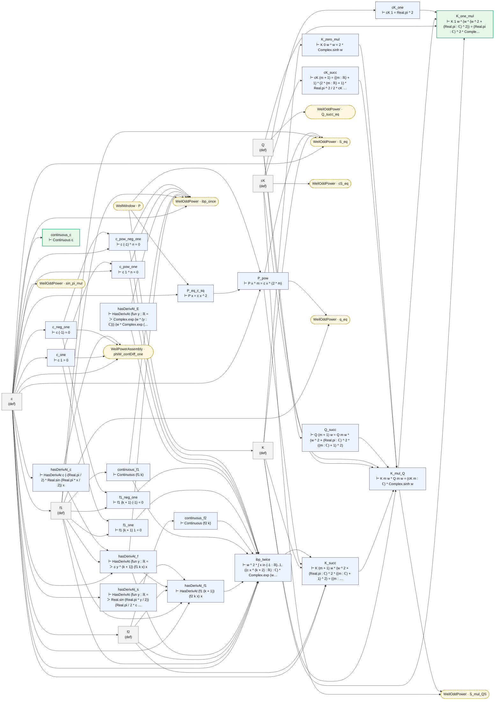

# `lean_stage3/Stage3/WeilPower.lean`

**What it does** (its own header): WeilPower — the m-th power window's transform in closed form. Rung 5, second slice, first module of the switched window (units 0326–0328). 2026-09-06.

**Imports:** [`WeilLobe`](../lean_stage3/WeilLobe.md).
**Imported by:** [`Stage3`](../lean_stage3/Stage3.md), [`WeilOddPower`](../lean_stage3/WeilOddPower.md).

Blue: theorem. Green: a theorem nothing else uses (an end). Dashed white: connects to nothing. Grey: definition. Red: contains `sorry`. Yellow: in another file. An arrow A → B reads "A is used by B".

## Every declaration

| declaration | proves (output) | needs (input) | why (its own docstring) | uses | used by |
|---|---|---|---|---|---|
| `WeilPower.c` def, line 50 | ℝ | x : ℝ | The half-angle cosine `c(x) = cos(πx/2)`; `P = c²`. | — | `WeilOddPower.S_eq`, `WeilOddPower.ibp_once`, `WeilOddPower.sin_pi_mul`, `WeilPower.K_succ`, `WeilPower.P_eq_c_sq`, `WeilPower.P_pow`, `WeilPower.c_neg_one`, `WeilPower.c_one`, `WeilPower.c_pow_neg_one`, `WeilPower.c_pow_one`, `WeilPower.continuous_c`, `WeilPower.f1`, `WeilPower.f2`, `WeilPower.hasDerivAt_c`, `WeilPower.hasDerivAt_f`, `WeilPower.hasDerivAt_f1`, `WeilPower.hasDerivAt_s`, `WeilPower.ibp_twice`, `WeilPowerAssembly.phiW_contDiff_one` |
| `WeilPower.P_eq_c_sq` theorem, line 52 | P x = c x ^ 2 | x : ℝ | — | `WeilPower.c`, `WeilWindow.P` | `WeilPower.P_pow` |
| `WeilPower.P_pow` theorem, line 54 | P x ^ m = c x ^ (2 * m) | m : ℕ; x : ℝ | — | `WeilPower.P_eq_c_sq`, `WeilPower.c`, `WeilWindow.P` | `WeilOddPower.S_eq`, `WeilOddPower.q_eq`, `WeilPower.K_succ` |
| `WeilPower.c_one` theorem, line 57 | c 1 = 0 | — | — | `WeilPower.c` | `WeilPower.c_pow_one`, `WeilPower.f1_one`, `WeilPowerAssembly.phiW_contDiff_one` |
| `WeilPower.c_neg_one` theorem, line 60 | c (-1) = 0 | — | — | `WeilPower.c` | `WeilPower.c_pow_neg_one`, `WeilPower.f1_neg_one`, `WeilPowerAssembly.phiW_contDiff_one` |
| `WeilPower.continuous_c` theorem, line 64 | Continuous c | — | — | `WeilPower.c` | — |
| `WeilPower.c_pow_one` theorem, line 69 | c 1 ^ n = 0 | hn : n ≠ 0 | — | `WeilPower.c`, `WeilPower.c_one` | `WeilOddPower.ibp_once`, `WeilPower.ibp_twice` |
| `WeilPower.c_pow_neg_one` theorem, line 72 | c (-1) ^ n = 0 | hn : n ≠ 0 | — | `WeilPower.c`, `WeilPower.c_neg_one` | `WeilOddPower.ibp_once`, `WeilPower.ibp_twice` |
| `WeilPower.hasDerivAt_c` theorem, line 75 | HasDerivAt c (-(Real.pi / 2) * Real.sin (Real.pi * x / 2)) x | x : ℝ | — | `WeilPower.c` | `WeilPower.hasDerivAt_f`, `WeilPowerAssembly.phiW_contDiff_one` |
| `WeilPower.hasDerivAt_s` theorem, line 81 | HasDerivAt (fun y : ℝ =&gt; Real.sin (Real.pi * y / 2)) (Real.pi / 2 * c x) x | x : ℝ | — | `WeilPower.c` | `WeilPower.hasDerivAt_f1` |
| `WeilPower.f1` def, line 88 | ℝ | k : ℕ; x : ℝ | The derivative of `c^{k+1}`. | `WeilPower.c` | `WeilOddPower.S_eq`, `WeilOddPower.ibp_once`, `WeilOddPower.q_eq`, `WeilPower.continuous_f1`, `WeilPower.f1_neg_one`, `WeilPower.f1_one`, `WeilPower.hasDerivAt_f`, `WeilPower.hasDerivAt_f1`, `WeilPower.ibp_twice` |
| `WeilPower.f2` def, line 92 | ℝ | k : ℕ; x : ℝ | The second derivative of `c^{k+2}`. | `WeilPower.c` | `WeilPower.K_succ`, `WeilPower.continuous_f2`, `WeilPower.hasDerivAt_f1`, `WeilPower.ibp_twice` |
| `WeilPower.hasDerivAt_f` theorem, line 95 | HasDerivAt (fun y : ℝ =&gt; c y ^ (k + 1)) (f1 k x) x | k : ℕ; x : ℝ | — | `WeilPower.c`, `WeilPower.f1`, `WeilPower.hasDerivAt_c` | `WeilOddPower.ibp_once`, `WeilPower.hasDerivAt_f1`, `WeilPower.ibp_twice` |
| `WeilPower.hasDerivAt_f1` theorem, line 103 | HasDerivAt (f1 (k + 1)) (f2 k x) x | k : ℕ; x : ℝ | — | `WeilPower.c`, `WeilPower.f1`, `WeilPower.f2`, `WeilPower.hasDerivAt_f`, `WeilPower.hasDerivAt_s` | `WeilPower.ibp_twice` |
| `WeilPower.continuous_f1` theorem, line 116 | Continuous (f1 k) | k : ℕ | — | `WeilPower.f1` | `WeilOddPower.ibp_once`, `WeilPower.ibp_twice` |
| `WeilPower.continuous_f2` theorem, line 120 | Continuous (f2 k) | k : ℕ | — | `WeilPower.f2` | `WeilPower.ibp_twice` |
| `WeilPower.f1_one` theorem, line 125 | f1 (k + 1) 1 = 0 | k : ℕ | — | `WeilPower.c_one`, `WeilPower.f1` | `WeilPower.ibp_twice` |
| `WeilPower.f1_neg_one` theorem, line 128 | f1 (k + 1) (-1) = 0 | k : ℕ | — | `WeilPower.c_neg_one`, `WeilPower.f1` | `WeilPower.ibp_twice` |
| `WeilPower.K` def, line 132 | ℂ | m : ℕ; w : ℂ | The envelope's transform, `∫₋₁¹ P(x)^m e^{wx} dx`. | `WeilWindow.P` | `WeilOddPower.S_eq`, `WeilPower.K_mul_Q`, `WeilPower.K_one_mul`, `WeilPower.K_succ`, `WeilPower.K_zero_mul` |
| `WeilPower.hasDerivAt_E` theorem, line 135 | HasDerivAt (fun y : ℝ =&gt; Complex.exp (w * (y : ℂ))) (w * Complex.exp (w * (x : ℂ))) x | w : ℂ; x : ℝ | — | — | `WeilOddPower.ibp_once`, `WeilPower.ibp_twice` |
| `WeilPower.ibp_twice` theorem, line 143 | w ^ 2 * ∫ x in (-1 : ℝ)..1, ((c x ^ (k + 2) : ℝ) : ℂ) * Complex.exp (w * (x : ℂ)) = ∫ x in (-1 : ℝ)..1, ((f2 k x : ℝ) : ℂ) * Complex.exp (w * (x : ℂ)) | k : ℕ; w : ℂ | The integral of `c^{k+2} e^{wx}` in terms of the second derivative: `w²·∫ c^{k+2} E = ∫ f2 k · E`. | `WeilPower.c`, `WeilPower.c_pow_neg_one`, `WeilPower.c_pow_one`, `WeilPower.continuous_f1`, `WeilPower.continuous_f2`, `WeilPower.f1`, `WeilPower.f1_neg_one`, `WeilPower.f1_one`, `WeilPower.f2`, `WeilPower.hasDerivAt_E`, `WeilPower.hasDerivAt_f`, `WeilPower.hasDerivAt_f1` | `WeilPower.K_succ` |
| `WeilPower.K_succ` theorem, line 185 | K (m + 1) w * (w ^ 2 + (Real.pi : ℂ) ^ 2 * ((m : ℂ) + 1) ^ 2) = ((m : ℂ) + 1) * (2 * (m : ℂ) + 1) * (Real.pi : ℂ) ^ 2 / 2 * K m w | m : ℕ; w : ℂ | The recurrence. `K (m+1) w · (w² + π²(m+1)²) = (m+1)(2m+1)π²/2 · K m w`. | `WeilPower.K`, `WeilPower.P_pow`, `WeilPower.c`, `WeilPower.f2`, `WeilPower.ibp_twice` | `WeilPower.K_mul_Q` |
| `WeilPower.Q` def, line 220 | ℂ | m : ℕ; w : ℂ | `w·∏_{j&lt;m}(w² + π²(j+1)²)`, the denominator of the closed form. | — | `WeilOddPower.Q_succ_eq`, `WeilPower.K_mul_Q`, `WeilPower.K_one_mul`, `WeilPower.Q_succ` |
| `WeilPower.cK` def, line 224 | ℝ | m : ℕ | `2·π^{2m}·(2m)!/4^m`, the numerator's constant. | — | `WeilOddPower.S_mul_QS`, `WeilOddPower.cS_eq`, `WeilPower.K_mul_Q`, `WeilPower.cK_one`, `WeilPower.cK_succ` |
| `WeilPower.Q_succ` theorem, line 226 | Q (m + 1) w = Q m w * (w ^ 2 + (Real.pi : ℂ) ^ 2 * ((m : ℂ) + 1) ^ 2) | m : ℕ; w : ℂ | — | `WeilPower.Q` | `WeilPower.K_mul_Q` |
| `WeilPower.cK_succ` theorem, line 232 | cK (m + 1) = ((m : ℝ) + 1) * (2 * (m : ℝ) + 1) * Real.pi ^ 2 / 2 * cK m | m : ℕ | — | `WeilPower.cK` | `WeilPower.K_mul_Q` |
| `WeilPower.K_zero_mul` theorem, line 243 | K 0 w * w = 2 * Complex.sinh w | w : ℂ | — | `WeilPower.K` | `WeilPower.K_mul_Q` |
| `WeilPower.K_mul_Q` theorem, line 255 | K m w * Q m w = (cK m : ℂ) * Complex.sinh w | m : ℕ; w : ℂ | The closed form, multiplied out. `K m w · w·∏_{j=1}^{m}(w² + π²j²) = 2·π^{2m}·(2m)!/4^m · sinh w`. | `WeilPower.K`, `WeilPower.K_succ`, `WeilPower.K_zero_mul`, `WeilPower.Q`, `WeilPower.Q_succ`, `WeilPower.cK`, `WeilPower.cK_succ` | `WeilOddPower.S_mul_QS`, `WeilPower.K_one_mul` |
| `WeilPower.cK_one` theorem, line 275 | cK 1 = Real.pi ^ 2 | — | At `m = 1`: `K 1 w · w(w² + π²) = π²·sinh w`, unit 0328's hand check. | `WeilPower.cK` | `WeilPower.K_one_mul` |
| `WeilPower.K_one_mul` theorem, line 280 | K 1 w * (w * (w ^ 2 + (Real.pi : ℂ) ^ 2)) = (Real.pi : ℂ) ^ 2 * Complex.sinh w | w : ℂ | — | `WeilPower.K`, `WeilPower.K_mul_Q`, `WeilPower.Q`, `WeilPower.cK_one` | — |
