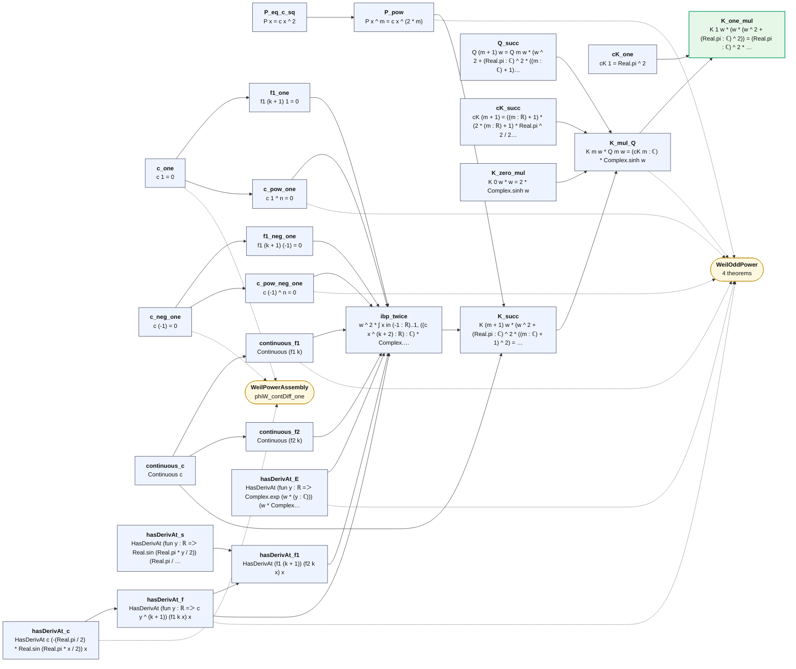

# `lean_stage3/Stage3/WeilPower.lean`

WeilPower — the m-th power window's transform in closed form. Rung 5, second slice, first module of the switched window (units 0326–0328). 2026-09-06.

24 theorems, 6 definitions, 304 lines. Arrows are Lean's own record of what each proof uses.

**Imports:** [`WeilLobe`](../lean_stage3/WeilLobe.md)  
**Imported by:** [`Stage3`](../lean_stage3/Stage3.md), [`WeilOddPower`](../lean_stage3/WeilOddPower.md)

## The picture



An arrow A → B reads "A is used in the proof of B". Blue: theorem. Green: a theorem nothing else uses (an end). Dashed: connects to nothing. Red: contains `sorry`. Yellow: theorems in another file, counted; a dotted arrow crosses files. Definitions are not drawn; they are listed below the diagram.

## Definitions

<a name="WeilPower-c"></a>
### `WeilPower.c`

def · line 50

The half-angle cosine `c(x) = cos(πx/2)`; `P = c²`.

- **Is:** `` c (x : ℝ) : ℝ := Real.cos (Real.pi * x / 2) ``
- **Used by 24:** [`WeilOddPower.S_eq`](../lean_stage3/WeilOddPower.md#WeilOddPower-S_eq), [`WeilOddPower.ibp_once`](../lean_stage3/WeilOddPower.md#WeilOddPower-ibp_once), [`WeilOddPower.q_eq`](../lean_stage3/WeilOddPower.md#WeilOddPower-q_eq), [`WeilOddPower.sin_pi_mul`](../lean_stage3/WeilOddPower.md#WeilOddPower-sin_pi_mul), [`WeilPower.K_succ`](#WeilPower-K_succ), [`WeilPower.P_eq_c_sq`](#WeilPower-P_eq_c_sq), [`WeilPower.P_pow`](#WeilPower-P_pow), [`WeilPower.c_neg_one`](#WeilPower-c_neg_one), [`WeilPower.c_one`](#WeilPower-c_one), [`WeilPower.c_pow_neg_one`](#WeilPower-c_pow_neg_one), [`WeilPower.c_pow_one`](#WeilPower-c_pow_one), [`WeilPower.continuous_c`](#WeilPower-continuous_c), [`WeilPower.continuous_f1`](#WeilPower-continuous_f1), [`WeilPower.continuous_f2`](#WeilPower-continuous_f2), [`WeilPower.f1`](#WeilPower-f1), [`WeilPower.f1_neg_one`](#WeilPower-f1_neg_one), [`WeilPower.f1_one`](#WeilPower-f1_one), [`WeilPower.f2`](#WeilPower-f2), [`WeilPower.hasDerivAt_c`](#WeilPower-hasDerivAt_c), [`WeilPower.hasDerivAt_f`](#WeilPower-hasDerivAt_f), [`WeilPower.hasDerivAt_f1`](#WeilPower-hasDerivAt_f1), [`WeilPower.hasDerivAt_s`](#WeilPower-hasDerivAt_s), [`WeilPower.ibp_twice`](#WeilPower-ibp_twice), [`WeilPowerAssembly.phiW_contDiff_one`](../lean_stage3/WeilPowerAssembly.md#WeilPowerAssembly-phiW_contDiff_one)

<a name="WeilPower-f1"></a>
### `WeilPower.f1`

def · line 88

The derivative of `c^{k+1}`.

- **Is:** `` f1 (k : ℕ) (x : ℝ) : ℝ := ((k : ℝ) + 1) * c x ^ k * (-(Real.pi / 2) * Real.sin (Real.pi * x / 2)) ``
- **Built from:** [`WeilPower.c`](#WeilPower-c)
- **Used by 9:** [`WeilOddPower.S_eq`](../lean_stage3/WeilOddPower.md#WeilOddPower-S_eq), [`WeilOddPower.ibp_once`](../lean_stage3/WeilOddPower.md#WeilOddPower-ibp_once), [`WeilOddPower.q_eq`](../lean_stage3/WeilOddPower.md#WeilOddPower-q_eq), [`WeilPower.continuous_f1`](#WeilPower-continuous_f1), [`WeilPower.f1_neg_one`](#WeilPower-f1_neg_one), [`WeilPower.f1_one`](#WeilPower-f1_one), [`WeilPower.hasDerivAt_f`](#WeilPower-hasDerivAt_f), [`WeilPower.hasDerivAt_f1`](#WeilPower-hasDerivAt_f1), [`WeilPower.ibp_twice`](#WeilPower-ibp_twice)

<a name="WeilPower-f2"></a>
### `WeilPower.f2`

def · line 92

The second derivative of `c^{k+2}`.

- **Is:** `` f2 (k : ℕ) (x : ℝ) : ℝ := ((k : ℝ) + 2) * (Real.pi / 2) ^ 2 * (((k : ℝ) + 1) * c x ^ k - ((k : ℝ) + 2) * c x ^ (k + 2)) ``
- **Built from:** [`WeilPower.c`](#WeilPower-c)
- **Used by 4:** [`WeilPower.K_succ`](#WeilPower-K_succ), [`WeilPower.continuous_f2`](#WeilPower-continuous_f2), [`WeilPower.hasDerivAt_f1`](#WeilPower-hasDerivAt_f1), [`WeilPower.ibp_twice`](#WeilPower-ibp_twice)

<a name="WeilPower-K"></a>
### `WeilPower.K`

def · line 132

The envelope's transform, `∫₋₁¹ P(x)^m e^{wx} dx`.

- **Is:** `` K (m : ℕ) (w : ℂ) : ℂ := ∫ x in (-1 : ℝ)..1, ((P x ^ m : ℝ) : ℂ) * Complex.exp (w * (x : ℂ)) ``
- **Built from:** [`WeilWindow.P`](../lean_stage3/WeilWindow.md#WeilWindow-P)
- **Used by 6:** [`WeilOddPower.S_eq`](../lean_stage3/WeilOddPower.md#WeilOddPower-S_eq), [`WeilOddPower.S_mul_QS`](../lean_stage3/WeilOddPower.md#WeilOddPower-S_mul_QS), [`WeilPower.K_mul_Q`](#WeilPower-K_mul_Q), [`WeilPower.K_one_mul`](#WeilPower-K_one_mul), [`WeilPower.K_succ`](#WeilPower-K_succ), [`WeilPower.K_zero_mul`](#WeilPower-K_zero_mul)

<a name="WeilPower-Q"></a>
### `WeilPower.Q`

def · line 220

`w·∏_{j<m}(w² + π²(j+1)²)`, the denominator of the closed form.

- **Is:** `` Q (m : ℕ) (w : ℂ) : ℂ := w * ∏ j ∈ Finset.range m, (w ^ 2 + (Real.pi : ℂ) ^ 2 * ((j : ℂ) + 1) ^ 2) ``
- **Used by 5:** [`WeilOddPower.Q_succ_eq`](../lean_stage3/WeilOddPower.md#WeilOddPower-Q_succ_eq), [`WeilOddPower.S_mul_QS`](../lean_stage3/WeilOddPower.md#WeilOddPower-S_mul_QS), [`WeilPower.K_mul_Q`](#WeilPower-K_mul_Q), [`WeilPower.K_one_mul`](#WeilPower-K_one_mul), [`WeilPower.Q_succ`](#WeilPower-Q_succ)

<a name="WeilPower-cK"></a>
### `WeilPower.cK`

def · line 224

`2·π^{2m}·(2m)!/4^m`, the numerator's constant.

- **Is:** `` cK (m : ℕ) : ℝ := 2 * Real.pi ^ (2 * m) * ((2 * m).factorial : ℝ) / 4 ^ m ``
- **Used by 6:** [`WeilOddPower.S_mul_QS`](../lean_stage3/WeilOddPower.md#WeilOddPower-S_mul_QS), [`WeilOddPower.cS_eq`](../lean_stage3/WeilOddPower.md#WeilOddPower-cS_eq), [`WeilPower.K_mul_Q`](#WeilPower-K_mul_Q), [`WeilPower.K_one_mul`](#WeilPower-K_one_mul), [`WeilPower.cK_one`](#WeilPower-cK_one), [`WeilPower.cK_succ`](#WeilPower-cK_succ)

## Theorems

<a name="WeilPower-P_eq_c_sq"></a>
### `WeilPower.P_eq_c_sq`

line 52

**Proves**

```lean
P x = c x ^ 2
```

**Needs** (its hypotheses)

  - `` x : ℝ ``

**Stated with:** [`WeilPower.c`](#WeilPower-c), [`WeilWindow.P`](../lean_stage3/WeilWindow.md#WeilWindow-P)

**Fed by:** no theorem of this repo; it stands on Mathlib and the definitions below.

**Feeds** (1 that use it)

  - [`WeilPower.P_pow`](#WeilPower-P_pow) — `` P x ^ m = c x ^ (2 * m) ``

<a name="WeilPower-P_pow"></a>
### `WeilPower.P_pow`

line 54

**Proves**

```lean
P x ^ m = c x ^ (2 * m)
```

**Needs** (its hypotheses)

  - `` m : ℕ ``
  - `` x : ℝ ``

**Stated with:** [`WeilPower.c`](#WeilPower-c), [`WeilWindow.P`](../lean_stage3/WeilWindow.md#WeilWindow-P)

**Fed by** (1 theorem its proof uses)

  - [`WeilPower.P_eq_c_sq`](#WeilPower-P_eq_c_sq) — `` P x = c x ^ 2 ``

**Feeds** (3 that use it)

  - [`WeilOddPower.S_eq`](../lean_stage3/WeilOddPower.md#WeilOddPower-S_eq) (WeilOddPower) — `` S m w = 2 * w * K (m + 1) w / (((m : ℂ) + 1) * (Real.pi : ℂ)) ``
  - [`WeilOddPower.q_eq`](../lean_stage3/WeilOddPower.md#WeilOddPower-q_eq) (WeilOddPower) — `` q m x = -(2 / (((m : ℝ) + 1) * Real.pi)) * f1 (2 * m + 1) x ``
  - [`WeilPower.K_succ`](#WeilPower-K_succ) — `` K (m + 1) w * (w ^ 2 + (Real.pi : ℂ) ^ 2 * ((m : ℂ) + 1) ^ 2) = ((m : ℂ) + 1) * (2 * (m : ℂ) + 1) * (Real.pi : ℂ) ^ 2 / 2 * K m w ``

<a name="WeilPower-c_one"></a>
### `WeilPower.c_one`

line 57

**Proves**

```lean
c 1 = 0
```

**Stated with:** [`WeilPower.c`](#WeilPower-c)

**Fed by:** no theorem of this repo; it stands on Mathlib and the definitions below.

**Feeds** (3 that use it)

  - [`WeilPower.c_pow_one`](#WeilPower-c_pow_one) — `` c 1 ^ n = 0 ``
  - [`WeilPower.f1_one`](#WeilPower-f1_one) — `` f1 (k + 1) 1 = 0 ``
  - [`WeilPowerAssembly.phiW_contDiff_one`](../lean_stage3/WeilPowerAssembly.md#WeilPowerAssembly-phiW_contDiff_one) (WeilPowerAssembly) — `` ContDiff ℝ 1 (WeilPowerBackground.phiW h γ m) ``

<a name="WeilPower-c_neg_one"></a>
### `WeilPower.c_neg_one`

line 60

**Proves**

```lean
c (-1) = 0
```

**Stated with:** [`WeilPower.c`](#WeilPower-c)

**Fed by:** no theorem of this repo; it stands on Mathlib and the definitions below.

**Feeds** (3 that use it)

  - [`WeilPower.c_pow_neg_one`](#WeilPower-c_pow_neg_one) — `` c (-1) ^ n = 0 ``
  - [`WeilPower.f1_neg_one`](#WeilPower-f1_neg_one) — `` f1 (k + 1) (-1) = 0 ``
  - [`WeilPowerAssembly.phiW_contDiff_one`](../lean_stage3/WeilPowerAssembly.md#WeilPowerAssembly-phiW_contDiff_one) (WeilPowerAssembly) — `` ContDiff ℝ 1 (WeilPowerBackground.phiW h γ m) ``

<a name="WeilPower-continuous_c"></a>
### `WeilPower.continuous_c`

line 64

**Proves**

```lean
Continuous c
```

**Stated with:** [`WeilPower.c`](#WeilPower-c)

**Fed by:** no theorem of this repo; it stands on Mathlib and the definitions below.

**Feeds** (3 that use it)

  - [`WeilPower.K_succ`](#WeilPower-K_succ) — `` K (m + 1) w * (w ^ 2 + (Real.pi : ℂ) ^ 2 * ((m : ℂ) + 1) ^ 2) = ((m : ℂ) + 1) * (2 * (m : ℂ) + 1) * (Real.pi : ℂ) ^ 2 / 2 * K m w ``
  - [`WeilPower.continuous_f1`](#WeilPower-continuous_f1) — `` Continuous (f1 k) ``
  - [`WeilPower.continuous_f2`](#WeilPower-continuous_f2) — `` Continuous (f2 k) ``

<a name="WeilPower-c_pow_one"></a>
### `WeilPower.c_pow_one`

line 69

**Proves**

```lean
c 1 ^ n = 0
```

**Needs** (its hypotheses)

  - `` hn : n ≠ 0 ``

**Stated with:** [`WeilPower.c`](#WeilPower-c)

**Fed by** (1 theorem its proof uses)

  - [`WeilPower.c_one`](#WeilPower-c_one) — `` c 1 = 0 ``

**Feeds** (2 that use it)

  - [`WeilOddPower.ibp_once`](../lean_stage3/WeilOddPower.md#WeilOddPower-ibp_once) (WeilOddPower) — `` (∫ x in (-1 : ℝ)..1, ((f1 (k + 1) x : ℝ) : ℂ) * Complex.exp (w * (x : ℂ))) = -(w * ∫ x in (-1 : ℝ)..1, ((c x ^ (k + 2) : ℝ) : ℂ) * Complex.exp (w * (x… ``
  - [`WeilPower.ibp_twice`](#WeilPower-ibp_twice) — `` w ^ 2 * ∫ x in (-1 : ℝ)..1, ((c x ^ (k + 2) : ℝ) : ℂ) * Complex.exp (w * (x : ℂ)) = ∫ x in (-1 : ℝ)..1, ((f2 k x : ℝ) : ℂ) * Complex.exp (w * (x : ℂ)) ``

<a name="WeilPower-c_pow_neg_one"></a>
### `WeilPower.c_pow_neg_one`

line 72

**Proves**

```lean
c (-1) ^ n = 0
```

**Needs** (its hypotheses)

  - `` hn : n ≠ 0 ``

**Stated with:** [`WeilPower.c`](#WeilPower-c)

**Fed by** (1 theorem its proof uses)

  - [`WeilPower.c_neg_one`](#WeilPower-c_neg_one) — `` c (-1) = 0 ``

**Feeds** (2 that use it)

  - [`WeilOddPower.ibp_once`](../lean_stage3/WeilOddPower.md#WeilOddPower-ibp_once) (WeilOddPower) — `` (∫ x in (-1 : ℝ)..1, ((f1 (k + 1) x : ℝ) : ℂ) * Complex.exp (w * (x : ℂ))) = -(w * ∫ x in (-1 : ℝ)..1, ((c x ^ (k + 2) : ℝ) : ℂ) * Complex.exp (w * (x… ``
  - [`WeilPower.ibp_twice`](#WeilPower-ibp_twice) — `` w ^ 2 * ∫ x in (-1 : ℝ)..1, ((c x ^ (k + 2) : ℝ) : ℂ) * Complex.exp (w * (x : ℂ)) = ∫ x in (-1 : ℝ)..1, ((f2 k x : ℝ) : ℂ) * Complex.exp (w * (x : ℂ)) ``

<a name="WeilPower-hasDerivAt_c"></a>
### `WeilPower.hasDerivAt_c`

line 75

**Proves**

```lean
HasDerivAt c (-(Real.pi / 2) * Real.sin (Real.pi * x / 2)) x
```

**Needs** (its hypotheses)

  - `` x : ℝ ``

**Stated with:** [`WeilPower.c`](#WeilPower-c)

**Fed by:** no theorem of this repo; it stands on Mathlib and the definitions below.

**Feeds** (2 that use it)

  - [`WeilPower.hasDerivAt_f`](#WeilPower-hasDerivAt_f) — `` HasDerivAt (fun y : ℝ => c y ^ (k + 1)) (f1 k x) x ``
  - [`WeilPowerAssembly.phiW_contDiff_one`](../lean_stage3/WeilPowerAssembly.md#WeilPowerAssembly-phiW_contDiff_one) (WeilPowerAssembly) — `` ContDiff ℝ 1 (WeilPowerBackground.phiW h γ m) ``

<a name="WeilPower-hasDerivAt_s"></a>
### `WeilPower.hasDerivAt_s`

line 81

**Proves**

```lean
HasDerivAt (fun y : ℝ => Real.sin (Real.pi * y / 2)) (Real.pi / 2 * c x) x
```

**Needs** (its hypotheses)

  - `` x : ℝ ``

**Stated with:** [`WeilPower.c`](#WeilPower-c)

**Fed by:** no theorem of this repo; it stands on Mathlib and the definitions below.

**Feeds** (1 that use it)

  - [`WeilPower.hasDerivAt_f1`](#WeilPower-hasDerivAt_f1) — `` HasDerivAt (f1 (k + 1)) (f2 k x) x ``

<a name="WeilPower-hasDerivAt_f"></a>
### `WeilPower.hasDerivAt_f`

line 95

**Proves**

```lean
HasDerivAt (fun y : ℝ => c y ^ (k + 1)) (f1 k x) x
```

**Needs** (its hypotheses)

  - `` k : ℕ ``
  - `` x : ℝ ``

**Stated with:** [`WeilPower.c`](#WeilPower-c), [`WeilPower.f1`](#WeilPower-f1)

**Fed by** (1 theorem its proof uses)

  - [`WeilPower.hasDerivAt_c`](#WeilPower-hasDerivAt_c) — `` HasDerivAt c (-(Real.pi / 2) * Real.sin (Real.pi * x / 2)) x ``

**Feeds** (3 that use it)

  - [`WeilOddPower.ibp_once`](../lean_stage3/WeilOddPower.md#WeilOddPower-ibp_once) (WeilOddPower) — `` (∫ x in (-1 : ℝ)..1, ((f1 (k + 1) x : ℝ) : ℂ) * Complex.exp (w * (x : ℂ))) = -(w * ∫ x in (-1 : ℝ)..1, ((c x ^ (k + 2) : ℝ) : ℂ) * Complex.exp (w * (x… ``
  - [`WeilPower.hasDerivAt_f1`](#WeilPower-hasDerivAt_f1) — `` HasDerivAt (f1 (k + 1)) (f2 k x) x ``
  - [`WeilPower.ibp_twice`](#WeilPower-ibp_twice) — `` w ^ 2 * ∫ x in (-1 : ℝ)..1, ((c x ^ (k + 2) : ℝ) : ℂ) * Complex.exp (w * (x : ℂ)) = ∫ x in (-1 : ℝ)..1, ((f2 k x : ℝ) : ℂ) * Complex.exp (w * (x : ℂ)) ``

<a name="WeilPower-hasDerivAt_f1"></a>
### `WeilPower.hasDerivAt_f1`

line 103

**Proves**

```lean
HasDerivAt (f1 (k + 1)) (f2 k x) x
```

**Needs** (its hypotheses)

  - `` k : ℕ ``
  - `` x : ℝ ``

**Stated with:** [`WeilPower.f1`](#WeilPower-f1), [`WeilPower.f2`](#WeilPower-f2)

**Fed by** (2 theorems its proof uses)

  - [`WeilPower.hasDerivAt_f`](#WeilPower-hasDerivAt_f) — `` HasDerivAt (fun y : ℝ => c y ^ (k + 1)) (f1 k x) x ``
  - [`WeilPower.hasDerivAt_s`](#WeilPower-hasDerivAt_s) — `` HasDerivAt (fun y : ℝ => Real.sin (Real.pi * y / 2)) (Real.pi / 2 * c x) x ``

**Definitions its proof touches:** [`WeilPower.c`](#WeilPower-c)

**Feeds** (1 that use it)

  - [`WeilPower.ibp_twice`](#WeilPower-ibp_twice) — `` w ^ 2 * ∫ x in (-1 : ℝ)..1, ((c x ^ (k + 2) : ℝ) : ℂ) * Complex.exp (w * (x : ℂ)) = ∫ x in (-1 : ℝ)..1, ((f2 k x : ℝ) : ℂ) * Complex.exp (w * (x : ℂ)) ``

<a name="WeilPower-continuous_f1"></a>
### `WeilPower.continuous_f1`

line 116

**Proves**

```lean
Continuous (f1 k)
```

**Needs** (its hypotheses)

  - `` k : ℕ ``

**Stated with:** [`WeilPower.f1`](#WeilPower-f1)

**Fed by** (1 theorem its proof uses)

  - [`WeilPower.continuous_c`](#WeilPower-continuous_c) — `` Continuous c ``

**Definitions its proof touches:** [`WeilPower.c`](#WeilPower-c)

**Feeds** (2 that use it)

  - [`WeilOddPower.ibp_once`](../lean_stage3/WeilOddPower.md#WeilOddPower-ibp_once) (WeilOddPower) — `` (∫ x in (-1 : ℝ)..1, ((f1 (k + 1) x : ℝ) : ℂ) * Complex.exp (w * (x : ℂ))) = -(w * ∫ x in (-1 : ℝ)..1, ((c x ^ (k + 2) : ℝ) : ℂ) * Complex.exp (w * (x… ``
  - [`WeilPower.ibp_twice`](#WeilPower-ibp_twice) — `` w ^ 2 * ∫ x in (-1 : ℝ)..1, ((c x ^ (k + 2) : ℝ) : ℂ) * Complex.exp (w * (x : ℂ)) = ∫ x in (-1 : ℝ)..1, ((f2 k x : ℝ) : ℂ) * Complex.exp (w * (x : ℂ)) ``

<a name="WeilPower-continuous_f2"></a>
### `WeilPower.continuous_f2`

line 120

**Proves**

```lean
Continuous (f2 k)
```

**Needs** (its hypotheses)

  - `` k : ℕ ``

**Stated with:** [`WeilPower.f2`](#WeilPower-f2)

**Fed by** (1 theorem its proof uses)

  - [`WeilPower.continuous_c`](#WeilPower-continuous_c) — `` Continuous c ``

**Definitions its proof touches:** [`WeilPower.c`](#WeilPower-c)

**Feeds** (1 that use it)

  - [`WeilPower.ibp_twice`](#WeilPower-ibp_twice) — `` w ^ 2 * ∫ x in (-1 : ℝ)..1, ((c x ^ (k + 2) : ℝ) : ℂ) * Complex.exp (w * (x : ℂ)) = ∫ x in (-1 : ℝ)..1, ((f2 k x : ℝ) : ℂ) * Complex.exp (w * (x : ℂ)) ``

<a name="WeilPower-f1_one"></a>
### `WeilPower.f1_one`

line 125

**Proves**

```lean
f1 (k + 1) 1 = 0
```

**Needs** (its hypotheses)

  - `` k : ℕ ``

**Stated with:** [`WeilPower.f1`](#WeilPower-f1)

**Fed by** (1 theorem its proof uses)

  - [`WeilPower.c_one`](#WeilPower-c_one) — `` c 1 = 0 ``

**Definitions its proof touches:** [`WeilPower.c`](#WeilPower-c)

**Feeds** (1 that use it)

  - [`WeilPower.ibp_twice`](#WeilPower-ibp_twice) — `` w ^ 2 * ∫ x in (-1 : ℝ)..1, ((c x ^ (k + 2) : ℝ) : ℂ) * Complex.exp (w * (x : ℂ)) = ∫ x in (-1 : ℝ)..1, ((f2 k x : ℝ) : ℂ) * Complex.exp (w * (x : ℂ)) ``

<a name="WeilPower-f1_neg_one"></a>
### `WeilPower.f1_neg_one`

line 128

**Proves**

```lean
f1 (k + 1) (-1) = 0
```

**Needs** (its hypotheses)

  - `` k : ℕ ``

**Stated with:** [`WeilPower.f1`](#WeilPower-f1)

**Fed by** (1 theorem its proof uses)

  - [`WeilPower.c_neg_one`](#WeilPower-c_neg_one) — `` c (-1) = 0 ``

**Definitions its proof touches:** [`WeilPower.c`](#WeilPower-c)

**Feeds** (1 that use it)

  - [`WeilPower.ibp_twice`](#WeilPower-ibp_twice) — `` w ^ 2 * ∫ x in (-1 : ℝ)..1, ((c x ^ (k + 2) : ℝ) : ℂ) * Complex.exp (w * (x : ℂ)) = ∫ x in (-1 : ℝ)..1, ((f2 k x : ℝ) : ℂ) * Complex.exp (w * (x : ℂ)) ``

<a name="WeilPower-hasDerivAt_E"></a>
### `WeilPower.hasDerivAt_E`

line 135

**Proves**

```lean
HasDerivAt (fun y : ℝ => Complex.exp (w * (y : ℂ))) (w * Complex.exp (w * (x : ℂ))) x
```

**Needs** (its hypotheses)

  - `` w : ℂ ``
  - `` x : ℝ ``

**Fed by:** no theorem of this repo; it stands on Mathlib.

**Feeds** (2 that use it)

  - [`WeilOddPower.ibp_once`](../lean_stage3/WeilOddPower.md#WeilOddPower-ibp_once) (WeilOddPower) — `` (∫ x in (-1 : ℝ)..1, ((f1 (k + 1) x : ℝ) : ℂ) * Complex.exp (w * (x : ℂ))) = -(w * ∫ x in (-1 : ℝ)..1, ((c x ^ (k + 2) : ℝ) : ℂ) * Complex.exp (w * (x… ``
  - [`WeilPower.ibp_twice`](#WeilPower-ibp_twice) — `` w ^ 2 * ∫ x in (-1 : ℝ)..1, ((c x ^ (k + 2) : ℝ) : ℂ) * Complex.exp (w * (x : ℂ)) = ∫ x in (-1 : ℝ)..1, ((f2 k x : ℝ) : ℂ) * Complex.exp (w * (x : ℂ)) ``

<a name="WeilPower-ibp_twice"></a>
### `WeilPower.ibp_twice`

line 143

**Why.** The integral of `c^{k+2} e^{wx}` in terms of the second derivative: `w²·∫ c^{k+2} E = ∫ f2 k · E`.

**Proves**

```lean
w ^ 2 * ∫ x in (-1 : ℝ)..1, ((c x ^ (k + 2) : ℝ) : ℂ) * Complex.exp (w * (x : ℂ)) = ∫ x in (-1 : ℝ)..1, ((f2 k x : ℝ) : ℂ) * Complex.exp (w * (x : ℂ))
```

**Needs** (its hypotheses)

  - `` k : ℕ ``
  - `` w : ℂ ``

**Stated with:** [`WeilPower.c`](#WeilPower-c), [`WeilPower.f2`](#WeilPower-f2)

**Fed by** (9 theorems its proof uses)

  - [`WeilPower.c_pow_neg_one`](#WeilPower-c_pow_neg_one) — `` c (-1) ^ n = 0 ``
  - [`WeilPower.c_pow_one`](#WeilPower-c_pow_one) — `` c 1 ^ n = 0 ``
  - [`WeilPower.continuous_f1`](#WeilPower-continuous_f1) — `` Continuous (f1 k) ``
  - [`WeilPower.continuous_f2`](#WeilPower-continuous_f2) — `` Continuous (f2 k) ``
  - [`WeilPower.f1_neg_one`](#WeilPower-f1_neg_one) — `` f1 (k + 1) (-1) = 0 ``
  - [`WeilPower.f1_one`](#WeilPower-f1_one) — `` f1 (k + 1) 1 = 0 ``
  - [`WeilPower.hasDerivAt_E`](#WeilPower-hasDerivAt_E) — `` HasDerivAt (fun y : ℝ => Complex.exp (w * (y : ℂ))) (w * Complex.exp (w * (x : ℂ))) x ``
  - [`WeilPower.hasDerivAt_f`](#WeilPower-hasDerivAt_f) — `` HasDerivAt (fun y : ℝ => c y ^ (k + 1)) (f1 k x) x ``
  - [`WeilPower.hasDerivAt_f1`](#WeilPower-hasDerivAt_f1) — `` HasDerivAt (f1 (k + 1)) (f2 k x) x ``

**Definitions its proof touches:** [`WeilPower.f1`](#WeilPower-f1)

**Feeds** (1 that use it)

  - [`WeilPower.K_succ`](#WeilPower-K_succ) — `` K (m + 1) w * (w ^ 2 + (Real.pi : ℂ) ^ 2 * ((m : ℂ) + 1) ^ 2) = ((m : ℂ) + 1) * (2 * (m : ℂ) + 1) * (Real.pi : ℂ) ^ 2 / 2 * K m w ``

<a name="WeilPower-K_succ"></a>
### `WeilPower.K_succ`

line 185

**Why.** The recurrence. `K (m+1) w · (w² + π²(m+1)²) = (m+1)(2m+1)π²/2 · K m w`.

**Proves**

```lean
K (m + 1) w * (w ^ 2 + (Real.pi : ℂ) ^ 2 * ((m : ℂ) + 1) ^ 2) = ((m : ℂ) + 1) * (2 * (m : ℂ) + 1) * (Real.pi : ℂ) ^ 2 / 2 * K m w
```

**Needs** (its hypotheses)

  - `` m : ℕ ``
  - `` w : ℂ ``

**Stated with:** [`WeilPower.K`](#WeilPower-K)

**Fed by** (3 theorems its proof uses)

  - [`WeilPower.P_pow`](#WeilPower-P_pow) — `` P x ^ m = c x ^ (2 * m) ``
  - [`WeilPower.continuous_c`](#WeilPower-continuous_c) — `` Continuous c ``
  - [`WeilPower.ibp_twice`](#WeilPower-ibp_twice) — `` w ^ 2 * ∫ x in (-1 : ℝ)..1, ((c x ^ (k + 2) : ℝ) : ℂ) * Complex.exp (w * (x : ℂ)) = ∫ x in (-1 : ℝ)..1, ((f2 k x : ℝ) : ℂ) * Complex.exp (w * (x : ℂ)) ``

**Definitions its proof touches:** [`WeilPower.c`](#WeilPower-c), [`WeilPower.f2`](#WeilPower-f2), [`WeilWindow.P`](../lean_stage3/WeilWindow.md#WeilWindow-P)

**Feeds** (1 that use it)

  - [`WeilPower.K_mul_Q`](#WeilPower-K_mul_Q) — `` K m w * Q m w = (cK m : ℂ) * Complex.sinh w ``

<a name="WeilPower-Q_succ"></a>
### `WeilPower.Q_succ`

line 226

**Proves**

```lean
Q (m + 1) w = Q m w * (w ^ 2 + (Real.pi : ℂ) ^ 2 * ((m : ℂ) + 1) ^ 2)
```

**Needs** (its hypotheses)

  - `` m : ℕ ``
  - `` w : ℂ ``

**Stated with:** [`WeilPower.Q`](#WeilPower-Q)

**Fed by:** no theorem of this repo; it stands on Mathlib and the definitions below.

**Feeds** (1 that use it)

  - [`WeilPower.K_mul_Q`](#WeilPower-K_mul_Q) — `` K m w * Q m w = (cK m : ℂ) * Complex.sinh w ``

<a name="WeilPower-cK_succ"></a>
### `WeilPower.cK_succ`

line 232

**Proves**

```lean
cK (m + 1) = ((m : ℝ) + 1) * (2 * (m : ℝ) + 1) * Real.pi ^ 2 / 2 * cK m
```

**Needs** (its hypotheses)

  - `` m : ℕ ``

**Stated with:** [`WeilPower.cK`](#WeilPower-cK)

**Fed by:** no theorem of this repo; it stands on Mathlib and the definitions below.

**Feeds** (1 that use it)

  - [`WeilPower.K_mul_Q`](#WeilPower-K_mul_Q) — `` K m w * Q m w = (cK m : ℂ) * Complex.sinh w ``

<a name="WeilPower-K_zero_mul"></a>
### `WeilPower.K_zero_mul`

line 243

**Proves**

```lean
K 0 w * w = 2 * Complex.sinh w
```

**Needs** (its hypotheses)

  - `` w : ℂ ``

**Stated with:** [`WeilPower.K`](#WeilPower-K)

**Fed by:** no theorem of this repo; it stands on Mathlib and the definitions below.

**Definitions its proof touches:** [`WeilWindow.P`](../lean_stage3/WeilWindow.md#WeilWindow-P)

**Feeds** (1 that use it)

  - [`WeilPower.K_mul_Q`](#WeilPower-K_mul_Q) — `` K m w * Q m w = (cK m : ℂ) * Complex.sinh w ``

<a name="WeilPower-K_mul_Q"></a>
### `WeilPower.K_mul_Q`

line 255

**Why.** The closed form, multiplied out. `K m w · w·∏_{j=1}^{m}(w² + π²j²) = 2·π^{2m}·(2m)!/4^m · sinh w`.

**Proves**

```lean
K m w * Q m w = (cK m : ℂ) * Complex.sinh w
```

**Needs** (its hypotheses)

  - `` m : ℕ ``
  - `` w : ℂ ``

**Stated with:** [`WeilPower.K`](#WeilPower-K), [`WeilPower.Q`](#WeilPower-Q), [`WeilPower.cK`](#WeilPower-cK)

**Fed by** (4 theorems its proof uses)

  - [`WeilPower.K_succ`](#WeilPower-K_succ) — `` K (m + 1) w * (w ^ 2 + (Real.pi : ℂ) ^ 2 * ((m : ℂ) + 1) ^ 2) = ((m : ℂ) + 1) * (2 * (m : ℂ) + 1) * (Real.pi : ℂ) ^ 2 / 2 * K m w ``
  - [`WeilPower.K_zero_mul`](#WeilPower-K_zero_mul) — `` K 0 w * w = 2 * Complex.sinh w ``
  - [`WeilPower.Q_succ`](#WeilPower-Q_succ) — `` Q (m + 1) w = Q m w * (w ^ 2 + (Real.pi : ℂ) ^ 2 * ((m : ℂ) + 1) ^ 2) ``
  - [`WeilPower.cK_succ`](#WeilPower-cK_succ) — `` cK (m + 1) = ((m : ℝ) + 1) * (2 * (m : ℝ) + 1) * Real.pi ^ 2 / 2 * cK m ``

**Feeds** (2 that use it)

  - [`WeilOddPower.S_mul_QS`](../lean_stage3/WeilOddPower.md#WeilOddPower-S_mul_QS) (WeilOddPower) — `` S m w * QS m w = (cS m : ℂ) * Complex.sinh w ``
  - [`WeilPower.K_one_mul`](#WeilPower-K_one_mul) — `` K 1 w * (w * (w ^ 2 + (Real.pi : ℂ) ^ 2)) = (Real.pi : ℂ) ^ 2 * Complex.sinh w ``

<a name="WeilPower-cK_one"></a>
### `WeilPower.cK_one`

line 275

**Why.** At `m = 1`: `K 1 w · w(w² + π²) = π²·sinh w`, unit 0328's hand check.

**Proves**

```lean
cK 1 = Real.pi ^ 2
```

**Stated with:** [`WeilPower.cK`](#WeilPower-cK)

**Fed by:** no theorem of this repo; it stands on Mathlib and the definitions below.

**Feeds** (1 that use it)

  - [`WeilPower.K_one_mul`](#WeilPower-K_one_mul) — `` K 1 w * (w * (w ^ 2 + (Real.pi : ℂ) ^ 2)) = (Real.pi : ℂ) ^ 2 * Complex.sinh w ``

<a name="WeilPower-K_one_mul"></a>
### `WeilPower.K_one_mul`

line 280

**Proves**

```lean
K 1 w * (w * (w ^ 2 + (Real.pi : ℂ) ^ 2)) = (Real.pi : ℂ) ^ 2 * Complex.sinh w
```

**Needs** (its hypotheses)

  - `` w : ℂ ``

**Stated with:** [`WeilPower.K`](#WeilPower-K)

**Fed by** (2 theorems its proof uses)

  - [`WeilPower.K_mul_Q`](#WeilPower-K_mul_Q) — `` K m w * Q m w = (cK m : ℂ) * Complex.sinh w ``
  - [`WeilPower.cK_one`](#WeilPower-cK_one) — `` cK 1 = Real.pi ^ 2 ``

**Definitions its proof touches:** [`WeilPower.Q`](#WeilPower-Q), [`WeilPower.cK`](#WeilPower-cK)

**Feeds:** nothing. It is an end.

