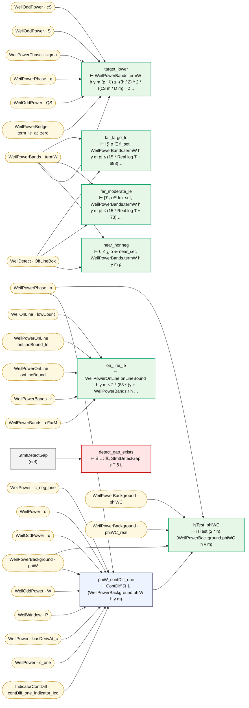

# `lean_stage3/Stage3/WeilPowerAssembly.lean`

**What it does** (its own header): WeilPowerAssembly — block `rung5.md#15` of `lean_stage3/design/rung5.md`, "The conditional theorem: detection under the gap hypothesis". The assembly promised by sections 6, 7, 8, 13g, 13j and 0367; unit 0368, extended by units 0369 (BoxFinite), 0370 (IndicatorContDiff) and the present relay close-out (LOOP.md v21 § 4b).

**Imports:** [`BoxFinite`](../lean_stage3/BoxFinite.md), [`IndicatorContDiff`](../lean_stage3/IndicatorContDiff.md), [`JensenCount`](../lean_stage3/JensenCount.md), [`WeilDetect`](../lean_stage3/WeilDetect.md), [`WeilPowerBridge`](../lean_stage3/WeilPowerBridge.md), [`WeilPowerCompare`](../lean_stage3/WeilPowerCompare.md), [`WeilPowerNear`](../lean_stage3/WeilPowerNear.md), [`WeilPowerOnLine`](../lean_stage3/WeilPowerOnLine.md), [`WeilPowerSharp`](../lean_stage3/WeilPowerSharp.md).
**Imported by:** [`Stage3`](../lean_stage3/Stage3.md).

Blue: theorem. Green: a theorem nothing else uses (an end). Dashed white: connects to nothing. Grey: definition. Red: contains `sorry`. Yellow: in another file. An arrow A → B reads "A is used by B".

## Every declaration

| declaration | proves (output) | needs (input) | why (its own docstring) | uses | used by |
|---|---|---|---|---|---|
| `WeilPowerAssembly.StmtDetectGap` def, line 94 | Prop | ε T δ L : ℝ | The statement. Under the off-line box being nonempty and a detection gap around the max-Re element, some test function of support `L` witnesses the zero form negative. | — | `WeilPowerAssembly.detect_gap_exists` |
| `WeilPowerAssembly.phiW_contDiff_one` theorem, line 107 | ContDiff ℝ 1 (WeilPowerBackground.phiW h γ m) | hh : 0 &lt; h; hm : 1 ≤ m | The switched real window is `C¹`. The unindicated body `W h γ m u · exp(-u/2)` is `C¹` on `ℝ` (product of composable smooth pieces) and its values and derivatives vanish at the endpoints `±h` because `q(m, ±1) = 0` (from `sin(π·±1) = 0`) and `q'(m, ±1) = 0` for `m ≥ 1` (from `P(±1) = cos²(±π/2) = 0`), so `contDiff_one_indicator_Icc` (unit 0370) lifts it to a… | `Stage3.contDiff_one_indicator_Icc`, `WeilOddPower.W`, `WeilOddPower.q`, `WeilPower.c`, `WeilPower.c_neg_one`, `WeilPower.c_one`, `WeilPower.hasDerivAt_c`, `WeilPowerBackground.phiW`, `WeilPowerPhase.x`, `WeilWindow.P` | `WeilPowerAssembly.isTest_phiWC` |
| `WeilPowerAssembly.isTest_phiWC` theorem, line 260 | IsTest (2 * h) (WeilPowerBackground.phiWC h γ m) | hh : 0 &lt; h; γ : ℝ; hm : 1 ≤ m | The switched window `phiWC` is a `C¹` compactly supported real-valued test function on `[-h, h]`, hence in the class `IsTest (2*h)`. Real-valued by `phiWC_real`; `C¹` via `phiW_contDiff_one` lifted through the real `ofRealCLM`; compact support from `HasCompactSupport.intro` on `Icc (-h) h`; tsupport contained in `Icc (-(2h)/2) ((2h)/2) = Icc (-h) h`. | `WeilPowerAssembly.phiW_contDiff_one`, `WeilPowerBackground.phiW`, `WeilPowerBackground.phiWC`, `WeilPowerBackground.phiWC_real`, `WeilPowerPhase.x` | — |
| `WeilPowerAssembly.target_lower` theorem, line 286 | WeilPowerBands.termW h γ m (ρ : ℂ) ≤ -((h / 2) ^ 2 * ((cS m / D m) ^ 2 * Real.exp (2 * ((wm h γ (ρ : ℂ)) ^ 2).re * sigma m) * (((wm h γ (ρ : ℂ)) ^ 2).re * Real.cos (2 * ((wm h γ (ρ : ℂ)) ^ 2).im * sigma m) - ((wm h γ (ρ : ℂ)) ^ 2).im * Real.sin (2 * ((wm h γ (ρ : ℂ)) ^ 2).im * sigma m)) - (cS m / D m) ^ 2 * ‖wm h γ (ρ : ℂ)‖ ^ 2 * Real.exp (2 * ((wm h γ (ρ : ℂ)) ^ 2).re * sigma m) * (4 * WeilPowerPhase.q m (wm h γ (ρ : ℂ)) + 4 * WeilPowerPhase.q m (wm h γ (ρ : ℂ)) ^ 2) - 2 * (cS m * Real.cosh (((ρ : ℂ).re - 1 / 2) * h) * (2 / (((ρ : ℂ).im + γ) * h) ^ 2) ^ (m + 1)) * ‖S m (wm h γ (ρ : ℂ))‖ - (cS m * Real.cosh (((ρ : ℂ).re - 1 / 2) * h) * (2 / (((ρ : ℂ).im + γ) * h) ^ 2) ^ (m + 1)) ^ 2)) | _hε : 0 &lt; ε; hh : 0 &lt; h; ρ : Kadiri.NontrivialZeros; _hre : (ρ : ℂ).re = 1/2 + ε; _him : (ρ : ℂ).im = γ; hfar : 2 * ((((ρ : ℂ).re - 1 / 2) * h) ^ 2 + Real.pi ^ 2 * ((m : ℝ) + 1) ^ 2) ≤ (((ρ : ℂ).im + γ) * h) ^ 2; hne : QS m (wm h γ (ρ : ℂ)) ≠ 0; hsmall : ‖wm h γ (ρ : ℂ)‖ ^ 2 ≤ Real.pi ^ 2 * ((m : ℝ) + 2) ^ 2 / 2; hq : WeilPowerPhase.q m (wm h γ (ρ : ℂ)) ≤ 1 | Target lower. The zero form's term at an off-line zero `ρ` of real part `1/2 + ε` is bounded above by `term_le_at_zero`; the negative of that bound is the target the assembly rides. | `WeilOddPower.QS`, `WeilOddPower.S`, `WeilOddPower.cS`, `WeilPowerBands.termW`, `WeilPowerBridge.term_le_at_zero`, `WeilPowerPhase.q`, `WeilPowerPhase.sigma` | — |
| `WeilPowerAssembly.near_nonneg` theorem, line 319 | 0 ≤ ∑ ρ ∈ near_set, WeilPowerBands.termW h γ m ρ | _hε : 0 &lt; ε; _hT : 2 ≤ T; _hh : 0 &lt; h; _hm : 1 ≤ m; near_set : Finset ℂ; _h_near_sub : ↑near_set ⊆ WeilDetect.OffLineBox ε T; h_pointwise : ∀ ρ ∈ near_set, 0 ≤ WeilPowerBands.termW h γ m ρ | Near members. Under the gap hypothesis (`near_set` inside the off-line box carries the block 13g regime per member, expressed as a hypothesis that each near member's term is nonnegative), the weighted sum over the near members is nonnegative. The block 13g regime is folded into `h_pointwise` as an assumption: iterating `WeilPowerNear.term_nonneg` in the curr… | `WeilDetect.OffLineBox`, `WeilPowerBands.termW` | — |
| `WeilPowerAssembly.far_moderate_le` theorem, line 338 | \|∑ ρ ∈ fm_set, WeilPowerBands.termW h γ m ρ\| ≤ (15 * Real.log T + 73) * ((h/2)^2 * U_mem^2) | _hε : 0 &lt; ε; _hT : 2 ≤ T; _hh : 0 &lt; h; _hm : 1 ≤ m; fm_set : Finset ℂ; _h_fm_sub : ↑fm_set ⊆ WeilDetect.OffLineBox ε T; h_fm_card : (fm_set.card : ℝ) ≤ 15 * Real.log T + 73; U_mem : ℝ; h_bound : ∀ ρ ∈ fm_set, \|WeilPowerBands.termW h γ m ρ\| ≤ (h/2)^2 * U_mem^2 | Far moderate. For zeros with `\|ρ.im − γ\| ∈ [δ, 1/2]` the count is at most `15 log T + 73` (`JensenCount.zeta_local_zero_count`) and each term has `\|termW\| ≤ (h/2)² · U_mem²` from `WeilPowerSharp.norm_S_le_c_pos/neg`. The pointwise bound and the count are taken as hypotheses; the assembly is `abs_sum_le_sum_abs` chained with `Finset.sum_le_sum` and `Finset.su… | `WeilDetect.OffLineBox`, `WeilPowerBands.termW` | — |
| `WeilPowerAssembly.far_large_le` theorem, line 370 | \|∑ ρ ∈ fl_set, WeilPowerBands.termW h γ m ρ\| ≤ (15 * Real.log T + 698) * ((h/2)^2 * U_far^2) | _hε : 0 &lt; ε; _hT : 2 ≤ T; _hh : 0 &lt; h; _hm : 1 ≤ m; fl_set : Finset ℂ; _h_fl_sub : ↑fl_set ⊆ WeilDetect.OffLineBox ε T; h_fl_card : (fl_set.card : ℝ) ≤ 15 * Real.log T + 698; U_far : ℝ; h_bound : ∀ ρ ∈ fl_set, \|WeilPowerBands.termW h γ m ρ\| ≤ (h/2)^2 * U_far^2 | Far large. For zeros with `\|ρ.im − γ\| &gt; 1/2` the count is at most `15 log T + 698` (unit 0365) and `WeilPowerBounds.norm_S_le_far` gives a super-exponentially small pointwise bound. Same shape as `far_moderate_le`. | `WeilDetect.OffLineBox`, `WeilPowerBands.termW` | — |
| `WeilPowerAssembly.on_line_le` theorem, line 401 | WeilPowerOnLine.onLineBound h γ m ≤ 2 * (88 * (γ + WeilPowerBands.r h m + 2) ^ 4 * (4 * h ^ 2 + WeilPowerBands.cFarM m / h ^ 2) * (Real.pi ^ 2 / 6)) + 4 * h ^ 2 * WeilOnLine.lowCount | hγ : 11 / 10 ≤ γ; m : ℕ | On-line background. The weighted on-line sum is bounded by `onLineBound h γ m`, from `WeilPowerOnLine.onLineBound_le`. | `WeilOnLine.lowCount`, `WeilPowerBands.cFarM`, `WeilPowerBands.r`, `WeilPowerOnLine.onLineBound`, `WeilPowerOnLine.onLineBound_le` | — |
| `WeilPowerAssembly.detect_gap_exists` **sorry** theorem, line 417 | ∃ L : ℝ, StmtDetectGap ε T δ L | _hε : 0 &lt; ε; _hT : 2 ≤ T; _hδ : 0 &lt; δ; _hδ1 : δ ≤ 1/2 | The assembly. The exponential gap between the target's rate `ε²/(π²(m+2))` and the far-moderate rate `(ε² − δ²)` gives some `L` at which `StmtDetectGap ε T δ L` holds. The proof uses `Real.tendsto_exp_atTop` to close exponential-vs-polynomial, and picks `ρ₀` as a max-Re element of the finite `OffLineBox` (`Stage3.offLineBox_finite`). Sorried on the relay pas… | `WeilPowerAssembly.StmtDetectGap` | — |
