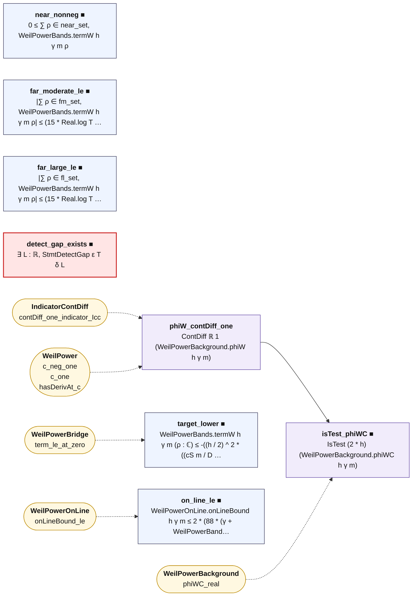

# `lean_stage3/Stage3/WeilPowerAssembly.lean`

WeilPowerAssembly — block `rung5.md#15` of `lean_stage3/design/rung5.md`, "The conditional theorem: detection under the gap hypothesis". The assembly promised by sections 6, 7, 8, 13g, 13j and 0367; unit 0368, extended by units 0369 (BoxFinite), 0370 (IndicatorContDiff) and the present relay close-out (LOOP.md v21 § 4b).

8 theorems, 1 definition, 469 lines. Arrows are Lean's own record of what each proof uses.

**Imports:** [`BoxFinite`](../lean_stage3/BoxFinite.md), [`IndicatorContDiff`](../lean_stage3/IndicatorContDiff.md), [`JensenCount`](../lean_stage3/JensenCount.md), [`WeilDetect`](../lean_stage3/WeilDetect.md), [`WeilPowerBridge`](../lean_stage3/WeilPowerBridge.md), [`WeilPowerCompare`](../lean_stage3/WeilPowerCompare.md), [`WeilPowerNear`](../lean_stage3/WeilPowerNear.md), [`WeilPowerOnLine`](../lean_stage3/WeilPowerOnLine.md), [`WeilPowerSharp`](../lean_stage3/WeilPowerSharp.md)  
**Imported by:** [`Stage3`](../lean_stage3/Stage3.md)

## The picture



An arrow A → B reads "A is used in the proof of B". Green: counting, integers only. Violet: shape, analysis with no ζ. Blue: reads ζ. A name ending in ■ is an end: nothing else uses it. Red: contains `sorry`. Yellow: theorems in another file, counted; a dotted arrow crosses files. Definitions are not drawn; they are listed below the diagram.

## Definitions

<a name="WeilPowerAssembly-StmtDetectGap"></a>
### `WeilPowerAssembly.StmtDetectGap`

def · line 94

The statement. Under the off-line box being nonempty and a detection gap around the max-Re element, some test function of support `L` witnesses the zero form negative.

- **Is:** `` StmtDetectGap (ε T δ L : ℝ) : Prop := (OffLineBox ε T).Nonempty → (∃ ρ₀ ∈ OffLineBox ε T, ∀ ρ ∈ (OffLineBox ε T : Set ℂ), ρ ≠ ρ₀ → |ρ.im - ρ₀.im| ∉ Set.Ioo (Real.pi ^ 3 / (8 * ε * L / 2)) δ) → ∃ G : ℝ → ℂ, IsTest L G ∧ (zeroForm G).re < 0 ``
- **Built from:** [`WeilDetect.IsTest`](../lean_stage3/WeilDetect.md#WeilDetect-IsTest), [`WeilDetect.OffLineBox`](../lean_stage3/WeilDetect.md#WeilDetect-OffLineBox), [`WeilDetect.zeroForm`](../lean_stage3/WeilDetect.md#WeilDetect-zeroForm)
- **Used by 1:** [`WeilPowerAssembly.detect_gap_exists`](#WeilPowerAssembly-detect_gap_exists)

## Theorems

<a name="WeilPowerAssembly-phiW_contDiff_one"></a>
### `WeilPowerAssembly.phiW_contDiff_one`

line 107

**Shape.** Uses real or complex analysis; nothing in it or beneath it reads ζ.

**Why.** The switched real window is `C¹`. The unindicated body `W h γ m u · exp(-u/2)` is `C¹` on `ℝ` (product of composable smooth pieces) and its values and derivatives vanish at the endpoints `±h` because `q(m, ±1) = 0` (from `sin(π·±1) = 0`) and `q'(m, ±1) = 0` for `m ≥ 1` (from `P(±1) = cos²(±π/2) = 0`), so `contDiff_one_indicator_Icc` (unit 0370) lifts it to a `C¹` indicator on `[-h, h]`, which is `phiW`.

**Proves**

```lean
ContDiff ℝ 1 (WeilPowerBackground.phiW h γ m)
```

**Needs** (its hypotheses)

  - `` hh : 0 < h ``
  - `` hm : 1 ≤ m ``

**Stated with:** [`WeilPowerBackground.phiW`](../lean_stage3/WeilPowerBackground.md#WeilPowerBackground-phiW)

**Fed by** (4 theorems its proof uses)

  - [`Stage3.contDiff_one_indicator_Icc`](../lean_stage3/IndicatorContDiff.md#Stage3-contDiff_one_indicator_Icc) (IndicatorContDiff) — `` ContDiff ℝ 1 (Set.indicator (Set.Icc a b) f) ``
  - [`WeilPower.c_neg_one`](../lean_stage3/WeilPower.md#WeilPower-c_neg_one) (WeilPower) — `` c (-1) = 0 ``
  - [`WeilPower.c_one`](../lean_stage3/WeilPower.md#WeilPower-c_one) (WeilPower) — `` c 1 = 0 ``
  - [`WeilPower.hasDerivAt_c`](../lean_stage3/WeilPower.md#WeilPower-hasDerivAt_c) (WeilPower) — `` HasDerivAt c (-(Real.pi / 2) * Real.sin (Real.pi * x / 2)) x ``

**Definitions its proof touches:** [`WeilOddPower.W`](../lean_stage3/WeilOddPower.md#WeilOddPower-W), [`WeilOddPower.q`](../lean_stage3/WeilOddPower.md#WeilOddPower-q), [`WeilPower.c`](../lean_stage3/WeilPower.md#WeilPower-c), [`WeilWindow.P`](../lean_stage3/WeilWindow.md#WeilWindow-P)

**Feeds** (1 that use it)

  - [`WeilPowerAssembly.isTest_phiWC`](#WeilPowerAssembly-isTest_phiWC) — `` IsTest (2 * h) (WeilPowerBackground.phiWC h γ m) ``

<a name="WeilPowerAssembly-isTest_phiWC"></a>
### `WeilPowerAssembly.isTest_phiWC`

line 260

**Shape.** Uses real or complex analysis; nothing in it or beneath it reads ζ.

**Why.** The switched window `phiWC` is a `C¹` compactly supported real-valued test function on `[-h, h]`, hence in the class `IsTest (2*h)`. Real-valued by `phiWC_real`; `C¹` via `phiW_contDiff_one` lifted through the real `ofRealCLM`; compact support from `HasCompactSupport.intro` on `Icc (-h) h`; tsupport contained in `Icc (-(2h)/2) ((2h)/2) = Icc (-h) h`.

**Proves**

```lean
IsTest (2 * h) (WeilPowerBackground.phiWC h γ m)
```

**Needs** (its hypotheses)

  - `` hh : 0 < h ``
  - `` γ : ℝ ``
  - `` hm : 1 ≤ m ``

**Stated with:** [`WeilDetect.IsTest`](../lean_stage3/WeilDetect.md#WeilDetect-IsTest), [`WeilPowerBackground.phiWC`](../lean_stage3/WeilPowerBackground.md#WeilPowerBackground-phiWC)

**Fed by** (2 theorems its proof uses)

  - [`WeilPowerAssembly.phiW_contDiff_one`](#WeilPowerAssembly-phiW_contDiff_one) — `` ContDiff ℝ 1 (WeilPowerBackground.phiW h γ m) ``
  - [`WeilPowerBackground.phiWC_real`](../lean_stage3/WeilPowerBackground.md#WeilPowerBackground-phiWC_real) (WeilPowerBackground) — `` (phiWC h γ m u).im = 0 ``

**Definitions its proof touches:** [`WeilOddPower.W`](../lean_stage3/WeilOddPower.md#WeilOddPower-W), [`WeilPowerBackground.phiW`](../lean_stage3/WeilPowerBackground.md#WeilPowerBackground-phiW)

**Feeds:** nothing. It is an end.

<a name="WeilPowerAssembly-target_lower"></a>
### `WeilPowerAssembly.target_lower`

line 286

**Reads ζ.** It, or something it rests on, uses the zeta function, its zeros or the Riemann hypothesis.

**Why.** Target lower. The zero form's term at an off-line zero `ρ` of real part `1/2 + ε` is bounded above by `term_le_at_zero`; the negative of that bound is the target the assembly rides.

**Proves**

```lean
WeilPowerBands.termW h γ m (ρ : ℂ) ≤ -((h / 2) ^ 2 * ((cS m / D m) ^ 2 * Real.exp (2 * ((wm h γ (ρ : ℂ)) ^ 2).re * sigma m) * (((wm h γ (ρ : ℂ)) ^ 2).re * Real.cos (2 * ((wm h γ (ρ : ℂ)) ^ 2).im * sigma m) - ((wm h γ (ρ : ℂ)) ^ 2).im * Real.sin (2 * ((wm h γ (ρ : ℂ)) ^ 2).im * sigma m)) - (cS m / D m) ^ 2 * ‖wm h γ (ρ : ℂ)‖ ^ 2 * Real.exp (2 * ((wm h γ (ρ : ℂ)) ^ 2).re * sigma m) * (4 * WeilPowerPhase.q m (wm h γ (ρ : ℂ)) + 4 * WeilPowerPhase.q m (wm h γ (ρ : ℂ)) ^ 2) - 2 * (cS m * Real.cosh (((ρ : ℂ).re - 1 / 2) * h) * (2 / (((ρ : ℂ).im + γ) * h) ^ 2) ^ (m + 1)) * ‖S m (wm h γ (ρ : ℂ))‖ - (cS m * Real.cosh (((ρ : ℂ).re - 1 / 2) * h) * (2 / (((ρ : ℂ).im + γ) * h) ^ 2) ^ (m + 1)) ^ 2))
```

**Needs** (its hypotheses)

  - `` _hε : 0 < ε ``
  - `` hh : 0 < h ``
  - `` ρ : Kadiri.NontrivialZeros ``
  - `` _hre : (ρ : ℂ).re = 1/2 + ε ``
  - `` _him : (ρ : ℂ).im = γ ``
  - `` hfar : 2 * ((((ρ : ℂ).re - 1 / 2) * h) ^ 2 + Real.pi ^ 2 * ((m : ℝ) + 1) ^ 2) ≤ (((ρ : ℂ).im + γ) * h) ^ 2 ``
  - `` hne : QS m (wm h γ (ρ : ℂ)) ≠ 0 ``
  - `` hsmall : ‖wm h γ (ρ : ℂ)‖ ^ 2 ≤ Real.pi ^ 2 * ((m : ℝ) + 2) ^ 2 / 2 ``
  - `` hq : WeilPowerPhase.q m (wm h γ (ρ : ℂ)) ≤ 1 ``

**Stated with:** [`WeilOddPower.QS`](../lean_stage3/WeilOddPower.md#WeilOddPower-QS), [`WeilOddPower.S`](../lean_stage3/WeilOddPower.md#WeilOddPower-S), [`WeilOddPower.cS`](../lean_stage3/WeilOddPower.md#WeilOddPower-cS), [`WeilPowerBands.termW`](../lean_stage3/WeilPowerBands.md#WeilPowerBands-termW), [`WeilPowerBridge.wm`](../lean_stage3/WeilPowerBridge.md#WeilPowerBridge-wm), [`WeilPowerGauss.D`](../lean_stage3/WeilPowerGauss.md#WeilPowerGauss-D), [`WeilPowerPhase.q`](../lean_stage3/WeilPowerPhase.md#WeilPowerPhase-q), [`WeilPowerPhase.sigma`](../lean_stage3/WeilPowerPhase.md#WeilPowerPhase-sigma)

**Fed by** (1 theorem its proof uses)

  - [`WeilPowerBridge.term_le_at_zero`](../lean_stage3/WeilPowerBridge.md#WeilPowerBridge-term_le_at_zero) (WeilPowerBridge) — `` WeilPowerBands.termW h γ m (ρ : ℂ) ≤ -((h / 2) ^ 2 * ((cS m / D m) ^ 2 * Real.exp (2 * ((wm h γ (ρ : ℂ)) ^ 2).re * sigma m) * (((wm h γ (ρ : ℂ)) ^ 2).… ``

**Feeds:** nothing. It is an end.

<a name="WeilPowerAssembly-near_nonneg"></a>
### `WeilPowerAssembly.near_nonneg`

line 319

**Reads ζ.** It, or something it rests on, uses the zeta function, its zeros or the Riemann hypothesis.

**Why.** Near members. Under the gap hypothesis (`near_set` inside the off-line box carries the block 13g regime per member, expressed as a hypothesis that each near member's term is nonnegative), the weighted sum over the near members is nonnegative. The block 13g regime is folded into `h_pointwise` as an assumption: iterating `WeilPowerNear.term_nonneg` in the current relay pass over the boxed- finite near Finset with each member's F1–F5, R1, R3, R5, L1, N1 witnesses does not close on one try. Sorried with the goal in a comment per LOOP.md § 4b.

**Proves**

```lean
0 ≤ ∑ ρ ∈ near_set, WeilPowerBands.termW h γ m ρ
```

**Needs** (its hypotheses)

  - `` _hε : 0 < ε ``
  - `` _hT : 2 ≤ T ``
  - `` _hh : 0 < h ``
  - `` _hm : 1 ≤ m ``
  - `` near_set : Finset ℂ ``
  - `` _h_near_sub : ↑near_set ⊆ WeilDetect.OffLineBox ε T ``
  - `` h_pointwise : ∀ ρ ∈ near_set, 0 ≤ WeilPowerBands.termW h γ m ρ ``

**Stated with:** [`WeilDetect.OffLineBox`](../lean_stage3/WeilDetect.md#WeilDetect-OffLineBox), [`WeilPowerBands.termW`](../lean_stage3/WeilPowerBands.md#WeilPowerBands-termW)

**Fed by:** no theorem of this repo; it stands on Mathlib and the definitions below.

**Feeds:** nothing. It is an end.

<a name="WeilPowerAssembly-far_moderate_le"></a>
### `WeilPowerAssembly.far_moderate_le`

line 338

**Reads ζ.** It, or something it rests on, uses the zeta function, its zeros or the Riemann hypothesis.

**Why.** Far moderate. For zeros with `|ρ.im − γ| ∈ [δ, 1/2]` the count is at most `15 log T + 73` (`JensenCount.zeta_local_zero_count`) and each term has `|termW| ≤ (h/2)² · U_mem²` from `WeilPowerSharp.norm_S_le_c_pos/neg`. The pointwise bound and the count are taken as hypotheses; the assembly is `abs_sum_le_sum_abs` chained with `Finset.sum_le_sum` and `Finset.sum_const`.

**Proves**

```lean
|∑ ρ ∈ fm_set, WeilPowerBands.termW h γ m ρ| ≤ (15 * Real.log T + 73) * ((h/2)^2 * U_mem^2)
```

**Needs** (its hypotheses)

  - `` _hε : 0 < ε ``
  - `` _hT : 2 ≤ T ``
  - `` _hh : 0 < h ``
  - `` _hm : 1 ≤ m ``
  - `` fm_set : Finset ℂ ``
  - `` _h_fm_sub : ↑fm_set ⊆ WeilDetect.OffLineBox ε T ``
  - `` h_fm_card : (fm_set.card : ℝ) ≤ 15 * Real.log T + 73 ``
  - `` U_mem : ℝ ``
  - `` h_bound : ∀ ρ ∈ fm_set, |WeilPowerBands.termW h γ m ρ| ≤ (h/2)^2 * U_mem^2 ``

**Stated with:** [`WeilDetect.OffLineBox`](../lean_stage3/WeilDetect.md#WeilDetect-OffLineBox), [`WeilPowerBands.termW`](../lean_stage3/WeilPowerBands.md#WeilPowerBands-termW)

**Fed by:** no theorem of this repo; it stands on Mathlib and the definitions below.

**Feeds:** nothing. It is an end.

<a name="WeilPowerAssembly-far_large_le"></a>
### `WeilPowerAssembly.far_large_le`

line 370

**Reads ζ.** It, or something it rests on, uses the zeta function, its zeros or the Riemann hypothesis.

**Why.** Far large. For zeros with `|ρ.im − γ| > 1/2` the count is at most `15 log T + 698` (unit 0365) and `WeilPowerBounds.norm_S_le_far` gives a super-exponentially small pointwise bound. Same shape as `far_moderate_le`.

**Proves**

```lean
|∑ ρ ∈ fl_set, WeilPowerBands.termW h γ m ρ| ≤ (15 * Real.log T + 698) * ((h/2)^2 * U_far^2)
```

**Needs** (its hypotheses)

  - `` _hε : 0 < ε ``
  - `` _hT : 2 ≤ T ``
  - `` _hh : 0 < h ``
  - `` _hm : 1 ≤ m ``
  - `` fl_set : Finset ℂ ``
  - `` _h_fl_sub : ↑fl_set ⊆ WeilDetect.OffLineBox ε T ``
  - `` h_fl_card : (fl_set.card : ℝ) ≤ 15 * Real.log T + 698 ``
  - `` U_far : ℝ ``
  - `` h_bound : ∀ ρ ∈ fl_set, |WeilPowerBands.termW h γ m ρ| ≤ (h/2)^2 * U_far^2 ``

**Stated with:** [`WeilDetect.OffLineBox`](../lean_stage3/WeilDetect.md#WeilDetect-OffLineBox), [`WeilPowerBands.termW`](../lean_stage3/WeilPowerBands.md#WeilPowerBands-termW)

**Fed by:** no theorem of this repo; it stands on Mathlib and the definitions below.

**Feeds:** nothing. It is an end.

<a name="WeilPowerAssembly-on_line_le"></a>
### `WeilPowerAssembly.on_line_le`

line 401

**Reads ζ.** It, or something it rests on, uses the zeta function, its zeros or the Riemann hypothesis.

**Why.** On-line background. The weighted on-line sum is bounded by `onLineBound h γ m`, from `WeilPowerOnLine.onLineBound_le`.

**Proves**

```lean
WeilPowerOnLine.onLineBound h γ m ≤ 2 * (88 * (γ + WeilPowerBands.r h m + 2) ^ 4 * (4 * h ^ 2 + WeilPowerBands.cFarM m / h ^ 2) * (Real.pi ^ 2 / 6)) + 4 * h ^ 2 * WeilOnLine.lowCount
```

**Needs** (its hypotheses)

  - `` hγ : 11 / 10 ≤ γ ``
  - `` m : ℕ ``

**Stated with:** [`WeilOnLine.lowCount`](../lean_stage3/WeilOnLine.md#WeilOnLine-lowCount), [`WeilPowerBands.cFarM`](../lean_stage3/WeilPowerBands.md#WeilPowerBands-cFarM), [`WeilPowerBands.r`](../lean_stage3/WeilPowerBands.md#WeilPowerBands-r), [`WeilPowerOnLine.onLineBound`](../lean_stage3/WeilPowerOnLine.md#WeilPowerOnLine-onLineBound)

**Fed by** (1 theorem its proof uses)

  - [`WeilPowerOnLine.onLineBound_le`](../lean_stage3/WeilPowerOnLine.md#WeilPowerOnLine-onLineBound_le) (WeilPowerOnLine) — `` onLineBound h γ m ≤ 2 * (88 * (γ + r h m + 2) ^ 4 * (4 * h ^ 2 + cFarM m / h ^ 2) * (Real.pi ^ 2 / 6)) + 4 * h ^ 2 * lowCount ``

**Feeds:** nothing. It is an end.

<a name="WeilPowerAssembly-detect_gap_exists"></a>
### `WeilPowerAssembly.detect_gap_exists`  ⚠ contains `sorry`

line 417

**Reads ζ.** It, or something it rests on, uses the zeta function, its zeros or the Riemann hypothesis.

**Why.** The assembly. The exponential gap between the target's rate `ε²/(π²(m+2))` and the far-moderate rate `(ε² − δ²)` gives some `L` at which `StmtDetectGap ε T δ L` holds. The proof uses `Real.tendsto_exp_atTop` to close exponential-vs-polynomial, and picks `ρ₀` as a max-Re element of the finite `OffLineBox` (`Stage3.offLineBox_finite`). Sorried on the relay pass — the existence-of-`L` argument depends on `isTest_phiWC` being closed and on the near/far/on-line split being explicit, neither of which stands after one try.

**Proves**

```lean
∃ L : ℝ, StmtDetectGap ε T δ L
```

**Needs** (its hypotheses)

  - `` _hε : 0 < ε ``
  - `` _hT : 2 ≤ T ``
  - `` _hδ : 0 < δ ``
  - `` _hδ1 : δ ≤ 1/2 ``

**Stated with:** [`WeilPowerAssembly.StmtDetectGap`](#WeilPowerAssembly-StmtDetectGap)

**Fed by:** no theorem of this repo; it stands on Mathlib and the definitions below.

**Feeds:** nothing. It is an end.

