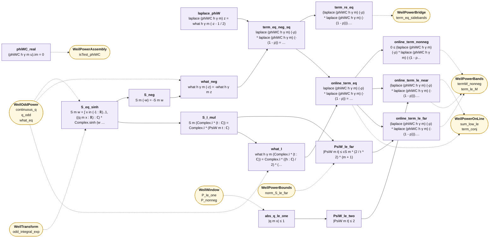

# `lean_stage3/Stage3/WeilPowerBackground.lean`

WeilPowerBackground — the switched window as a test function of the explicit formula, every term of the zero form as minus a square, and the on-line terms bounded. Rung 5, fifth slice. 2026-09-06.

16 theorems, 3 definitions, 265 lines. Arrows are Lean's own record of what each proof uses.

**Imports:** [`WeilDetect`](../lean_stage3/WeilDetect.md), [`WeilPowerBounds`](../lean_stage3/WeilPowerBounds.md)  
**Imported by:** [`Stage3`](../lean_stage3/Stage3.md), [`WeilPowerBands`](../lean_stage3/WeilPowerBands.md)

## The picture



An arrow A → B reads "A is used in the proof of B". Green: counting, integers only. Violet: shape, analysis with no ζ. Blue: reads ζ. A name ending in ■ is an end: nothing else uses it. Red: contains `sorry`. Yellow: theorems in another file, counted; a dotted arrow crosses files. Definitions are not drawn; they are listed below the diagram.

## Definitions

<a name="WeilPowerBackground-phiW"></a>
### `WeilPowerBackground.phiW`

def · line 48

The window as a test function of the explicit formula: cut off to `[−h, h]`, times `e^{−u/2}`. Real-valued.

- **Is:** `` phiW (h γ : ℝ) (m : ℕ) (u : ℝ) : ℝ := Set.indicator (Set.Icc (-h) h) (fun u => W h γ m u * Real.exp (-u / 2)) u ``
- **Built from:** [`WeilOddPower.W`](../lean_stage3/WeilOddPower.md#WeilOddPower-W)
- **Used by 4:** [`WeilPowerAssembly.isTest_phiWC`](../lean_stage3/WeilPowerAssembly.md#WeilPowerAssembly-isTest_phiWC), [`WeilPowerAssembly.phiW_contDiff_one`](../lean_stage3/WeilPowerAssembly.md#WeilPowerAssembly-phiW_contDiff_one), [`WeilPowerBackground.laplace_phiW`](#WeilPowerBackground-laplace_phiW), [`WeilPowerBackground.phiWC`](#WeilPowerBackground-phiWC)

<a name="WeilPowerBackground-phiWC"></a>
### `WeilPowerBackground.phiWC`

def · line 52

The complex-valued test function WeilDetect reads.

- **Is:** `` phiWC (h γ : ℝ) (m : ℕ) : ℝ → ℂ := fun u => ((phiW h γ m u : ℝ) : ℂ) ``
- **Built from:** [`WeilPowerBackground.phiW`](#WeilPowerBackground-phiW)
- **Used by 13:** [`WeilPowerAssembly.isTest_phiWC`](../lean_stage3/WeilPowerAssembly.md#WeilPowerAssembly-isTest_phiWC), [`WeilPowerBackground.laplace_phiW`](#WeilPowerBackground-laplace_phiW), [`WeilPowerBackground.online_term_eq`](#WeilPowerBackground-online_term_eq), [`WeilPowerBackground.online_term_le_far`](#WeilPowerBackground-online_term_le_far), [`WeilPowerBackground.online_term_le_near`](#WeilPowerBackground-online_term_le_near), [`WeilPowerBackground.online_term_nonneg`](#WeilPowerBackground-online_term_nonneg), [`WeilPowerBackground.phiWC_real`](#WeilPowerBackground-phiWC_real), [`WeilPowerBackground.term_eq_neg_sq`](#WeilPowerBackground-term_eq_neg_sq), [`WeilPowerBackground.term_re_eq`](#WeilPowerBackground-term_re_eq), [`WeilPowerBands.termW`](../lean_stage3/WeilPowerBands.md#WeilPowerBands-termW), [`WeilPowerBands.term_le_M`](../lean_stage3/WeilPowerBands.md#WeilPowerBands-term_le_M), [`WeilPowerBridge.term_eq_sidebands`](../lean_stage3/WeilPowerBridge.md#WeilPowerBridge-term_eq_sidebands), [`WeilPowerOnLine.term_conj`](../lean_stage3/WeilPowerOnLine.md#WeilPowerOnLine-term_conj)

<a name="WeilPowerBackground-PsiW"></a>
### `WeilPowerBackground.PsiW`

def · line 122

`PsiW m t = ∫₋₁¹ q m x · sin(tx) dx`: the transform on the line, real.

- **Is:** `` PsiW (m : ℕ) (t : ℝ) : ℝ := ∫ x in (-1 : ℝ)..1, q m x * Real.sin (t * x) ``
- **Built from:** [`WeilOddPower.q`](../lean_stage3/WeilOddPower.md#WeilOddPower-q)
- **Used by 10:** [`WeilPowerBackground.PsiW_le_far`](#WeilPowerBackground-PsiW_le_far), [`WeilPowerBackground.PsiW_le_two`](#WeilPowerBackground-PsiW_le_two), [`WeilPowerBackground.S_I_mul`](#WeilPowerBackground-S_I_mul), [`WeilPowerBackground.online_term_eq`](#WeilPowerBackground-online_term_eq), [`WeilPowerBackground.online_term_le_far`](#WeilPowerBackground-online_term_le_far), [`WeilPowerBackground.online_term_le_near`](#WeilPowerBackground-online_term_le_near), [`WeilPowerBackground.online_term_nonneg`](#WeilPowerBackground-online_term_nonneg), [`WeilPowerBackground.what_I`](#WeilPowerBackground-what_I), [`WeilPowerOnLine.PsiW_neg`](../lean_stage3/WeilPowerOnLine.md#WeilPowerOnLine-PsiW_neg), [`WeilPowerOnLine.term_conj`](../lean_stage3/WeilPowerOnLine.md#WeilPowerOnLine-term_conj)

## Theorems

<a name="WeilPowerBackground-phiWC_real"></a>
### `WeilPowerBackground.phiWC_real`

line 54

**Shape.** Uses real or complex analysis; nothing in it or beneath it reads ζ.

**Proves**

```lean
(phiWC h γ m u).im = 0
```

**Needs** (its hypotheses)

  - `` h γ : ℝ ``
  - `` m : ℕ ``
  - `` u : ℝ ``

**Stated with:** [`WeilPowerBackground.phiWC`](#WeilPowerBackground-phiWC)

**Fed by:** no theorem of this repo; it stands on Mathlib and the definitions below.

**Feeds** (1 that use it)

  - [`WeilPowerAssembly.isTest_phiWC`](../lean_stage3/WeilPowerAssembly.md#WeilPowerAssembly-isTest_phiWC) (WeilPowerAssembly) — `` IsTest (2 * h) (WeilPowerBackground.phiWC h γ m) ``

<a name="WeilPowerBackground-laplace_phiW"></a>
### `WeilPowerBackground.laplace_phiW`

line 59

**Shape.** Uses real or complex analysis; nothing in it or beneath it reads ζ.

**Why.** The transform in the explicit formula's convention. `laplace φ z = what h γ m (−z − 1/2)`.

**Proves**

```lean
laplace (phiWC h γ m) z = what h γ m (-z - 1 / 2)
```

**Needs** (its hypotheses)

  - `` hh : 0 < h ``
  - `` γ : ℝ ``
  - `` m : ℕ ``
  - `` z : ℂ ``

**Stated with:** [`WeilDetect.laplace`](../lean_stage3/WeilDetect.md#WeilDetect-laplace), [`WeilOddPower.what`](../lean_stage3/WeilOddPower.md#WeilOddPower-what), [`WeilPowerBackground.phiWC`](#WeilPowerBackground-phiWC)

**Fed by:** no theorem of this repo; it stands on Mathlib and the definitions below.

**Definitions its proof touches:** [`WeilOddPower.W`](../lean_stage3/WeilOddPower.md#WeilOddPower-W), [`WeilPowerBackground.phiW`](#WeilPowerBackground-phiW)

**Feeds** (1 that use it)

  - [`WeilPowerBackground.term_eq_neg_sq`](#WeilPowerBackground-term_eq_neg_sq) — `` laplace (phiWC h γ m) (-ρ) * laplace (phiWC h γ m) (-(1 - ρ)) = -(what h γ m (ρ - 1 / 2)) ^ 2 ``

<a name="WeilPowerBackground-S_eq_sinh"></a>
### `WeilPowerBackground.S_eq_sinh`

line 81

**Shape.** Uses real or complex analysis; nothing in it or beneath it reads ζ.

**Why.** The odd envelope's transform through `sinh`: unit 0318's odd-part lemma.

**Proves**

```lean
S m w = ∫ x in (-1 : ℝ)..1, ((q m x : ℝ) : ℂ) * Complex.sinh (w * (x : ℂ))
```

**Needs** (its hypotheses)

  - `` m : ℕ ``
  - `` w : ℂ ``

**Stated with:** [`WeilOddPower.S`](../lean_stage3/WeilOddPower.md#WeilOddPower-S), [`WeilOddPower.q`](../lean_stage3/WeilOddPower.md#WeilOddPower-q)

**Fed by** (3 theorems its proof uses)

  - [`WeilOddPower.continuous_q`](../lean_stage3/WeilOddPower.md#WeilOddPower-continuous_q) (WeilOddPower) — `` Continuous (q m) ``
  - [`WeilOddPower.q_odd`](../lean_stage3/WeilOddPower.md#WeilOddPower-q_odd) (WeilOddPower) — `` q m (-x) = -q m x ``
  - [`WeilTransform.odd_integral_exp`](../lean_stage3/WeilTransform.md#WeilTransform-odd_integral_exp) (WeilTransform) — `` (∫ x in (-1 : ℝ)..1, ((q x : ℝ) : ℂ) * Complex.exp (w * (x : ℂ))) = ∫ x in (-1 : ℝ)..1, ((q x : ℝ) : ℂ) * Complex.sinh (w * (x : ℂ)) ``

**Feeds** (2 that use it)

  - [`WeilPowerBackground.S_I_mul`](#WeilPowerBackground-S_I_mul) — `` S m (Complex.I * (t : ℂ)) = Complex.I * (PsiW m t : ℂ) ``
  - [`WeilPowerBackground.S_neg`](#WeilPowerBackground-S_neg) — `` S m (-w) = -S m w ``

<a name="WeilPowerBackground-S_neg"></a>
### `WeilPowerBackground.S_neg`

line 87

**Shape.** Uses real or complex analysis; nothing in it or beneath it reads ζ.

**Why.** `S` is odd.

**Proves**

```lean
S m (-w) = -S m w
```

**Needs** (its hypotheses)

  - `` m : ℕ ``
  - `` w : ℂ ``

**Stated with:** [`WeilOddPower.S`](../lean_stage3/WeilOddPower.md#WeilOddPower-S)

**Fed by** (1 theorem its proof uses)

  - [`WeilPowerBackground.S_eq_sinh`](#WeilPowerBackground-S_eq_sinh) — `` S m w = ∫ x in (-1 : ℝ)..1, ((q m x : ℝ) : ℂ) * Complex.sinh (w * (x : ℂ)) ``

**Definitions its proof touches:** [`WeilOddPower.q`](../lean_stage3/WeilOddPower.md#WeilOddPower-q)

**Feeds** (1 that use it)

  - [`WeilPowerBackground.what_neg`](#WeilPowerBackground-what_neg) — `` what h γ m (-z) = -what h γ m z ``

<a name="WeilPowerBackground-what_neg"></a>
### `WeilPowerBackground.what_neg`

line 95

**Shape.** Uses real or complex analysis; nothing in it or beneath it reads ζ.

**Why.** The window's transform is odd.

**Proves**

```lean
what h γ m (-z) = -what h γ m z
```

**Needs** (its hypotheses)

  - `` hh : 0 < h ``
  - `` γ : ℝ ``
  - `` m : ℕ ``
  - `` z : ℂ ``

**Stated with:** [`WeilOddPower.what`](../lean_stage3/WeilOddPower.md#WeilOddPower-what)

**Fed by** (2 theorems its proof uses)

  - [`WeilOddPower.what_eq`](../lean_stage3/WeilOddPower.md#WeilOddPower-what_eq) (WeilOddPower) — `` what h γ m z = ((h : ℂ) / 2) * (S m ((z + Complex.I * (γ : ℂ)) * (h : ℂ)) + S m ((z - Complex.I * (γ : ℂ)) * (h : ℂ))) ``
  - [`WeilPowerBackground.S_neg`](#WeilPowerBackground-S_neg) — `` S m (-w) = -S m w ``

**Definitions its proof touches:** [`WeilOddPower.S`](../lean_stage3/WeilOddPower.md#WeilOddPower-S)

**Feeds** (1 that use it)

  - [`WeilPowerBackground.term_eq_neg_sq`](#WeilPowerBackground-term_eq_neg_sq) — `` laplace (phiWC h γ m) (-ρ) * laplace (phiWC h γ m) (-(1 - ρ)) = -(what h γ m (ρ - 1 / 2)) ^ 2 ``

<a name="WeilPowerBackground-term_eq_neg_sq"></a>
### `WeilPowerBackground.term_eq_neg_sq`

line 106

**Shape.** Uses real or complex analysis; nothing in it or beneath it reads ζ.

**Why.** Every term is minus a square.

**Proves**

```lean
laplace (phiWC h γ m) (-ρ) * laplace (phiWC h γ m) (-(1 - ρ)) = -(what h γ m (ρ - 1 / 2)) ^ 2
```

**Needs** (its hypotheses)

  - `` hh : 0 < h ``
  - `` γ : ℝ ``
  - `` m : ℕ ``
  - `` ρ : ℂ ``

**Stated with:** [`WeilDetect.laplace`](../lean_stage3/WeilDetect.md#WeilDetect-laplace), [`WeilOddPower.what`](../lean_stage3/WeilOddPower.md#WeilOddPower-what), [`WeilPowerBackground.phiWC`](#WeilPowerBackground-phiWC)

**Fed by** (2 theorems its proof uses)

  - [`WeilPowerBackground.laplace_phiW`](#WeilPowerBackground-laplace_phiW) — `` laplace (phiWC h γ m) z = what h γ m (-z - 1 / 2) ``
  - [`WeilPowerBackground.what_neg`](#WeilPowerBackground-what_neg) — `` what h γ m (-z) = -what h γ m z ``

**Feeds** (2 that use it)

  - [`WeilPowerBackground.online_term_eq`](#WeilPowerBackground-online_term_eq) — `` laplace (phiWC h γ m) (-ρ) * laplace (phiWC h γ m) (-(1 - ρ)) = (((h / 2) ^ 2 * (PsiW m (h * (ρ.im + γ)) + PsiW m (h * (ρ.im - γ))) ^ 2 : ℝ) : ℂ) ``
  - [`WeilPowerBackground.term_re_eq`](#WeilPowerBackground-term_re_eq) — `` (laplace (phiWC h γ m) (-ρ) * laplace (phiWC h γ m) (-(1 - ρ))).re = (what h γ m (ρ - 1 / 2)).im ^ 2 - (what h γ m (ρ - 1 / 2)).re ^ 2 ``

<a name="WeilPowerBackground-term_re_eq"></a>
### `WeilPowerBackground.term_re_eq`

line 115

**Shape.** Uses real or complex analysis; nothing in it or beneath it reads ζ.

**Proves**

```lean
(laplace (phiWC h γ m) (-ρ) * laplace (phiWC h γ m) (-(1 - ρ))).re = (what h γ m (ρ - 1 / 2)).im ^ 2 - (what h γ m (ρ - 1 / 2)).re ^ 2
```

**Needs** (its hypotheses)

  - `` hh : 0 < h ``
  - `` γ : ℝ ``
  - `` m : ℕ ``
  - `` ρ : ℂ ``

**Stated with:** [`WeilDetect.laplace`](../lean_stage3/WeilDetect.md#WeilDetect-laplace), [`WeilOddPower.what`](../lean_stage3/WeilOddPower.md#WeilOddPower-what), [`WeilPowerBackground.phiWC`](#WeilPowerBackground-phiWC)

**Fed by** (1 theorem its proof uses)

  - [`WeilPowerBackground.term_eq_neg_sq`](#WeilPowerBackground-term_eq_neg_sq) — `` laplace (phiWC h γ m) (-ρ) * laplace (phiWC h γ m) (-(1 - ρ)) = -(what h γ m (ρ - 1 / 2)) ^ 2 ``

**Feeds** (1 that use it)

  - [`WeilPowerBridge.term_eq_sidebands`](../lean_stage3/WeilPowerBridge.md#WeilPowerBridge-term_eq_sidebands) (WeilPowerBridge) — `` WeilPowerBands.termW h γ m ρ = -((h / 2) ^ 2 * (((S m (wm h γ ρ)) ^ 2).re + 2 * (S m (wp h γ ρ) * S m (wm h γ ρ)).re + ((S m (wp h γ ρ)) ^ 2).re)) ``

<a name="WeilPowerBackground-S_I_mul"></a>
### `WeilPowerBackground.S_I_mul`

line 125

**Shape.** Uses real or complex analysis; nothing in it or beneath it reads ζ.

**Why.** `S m (it) = i·PsiW m t`.

**Proves**

```lean
S m (Complex.I * (t : ℂ)) = Complex.I * (PsiW m t : ℂ)
```

**Needs** (its hypotheses)

  - `` m : ℕ ``
  - `` t : ℝ ``

**Stated with:** [`WeilOddPower.S`](../lean_stage3/WeilOddPower.md#WeilOddPower-S), [`WeilPowerBackground.PsiW`](#WeilPowerBackground-PsiW)

**Fed by** (1 theorem its proof uses)

  - [`WeilPowerBackground.S_eq_sinh`](#WeilPowerBackground-S_eq_sinh) — `` S m w = ∫ x in (-1 : ℝ)..1, ((q m x : ℝ) : ℂ) * Complex.sinh (w * (x : ℂ)) ``

**Definitions its proof touches:** [`WeilOddPower.q`](../lean_stage3/WeilOddPower.md#WeilOddPower-q)

**Feeds** (2 that use it)

  - [`WeilPowerBackground.PsiW_le_far`](#WeilPowerBackground-PsiW_le_far) — `` |PsiW m t| ≤ cS m * (2 / t ^ 2) ^ (m + 1) ``
  - [`WeilPowerBackground.what_I`](#WeilPowerBackground-what_I) — `` what h γ m (Complex.I * (t : ℂ)) = Complex.I * ((h : ℂ) / 2) * ((PsiW m (h * (t + γ)) : ℂ) + (PsiW m (h * (t - γ)) : ℂ)) ``

<a name="WeilPowerBackground-what_I"></a>
### `WeilPowerBackground.what_I`

line 138

**Shape.** Uses real or complex analysis; nothing in it or beneath it reads ζ.

**Why.** The window's transform on the line: `what h γ m (it) = i(h/2)[PsiW(h(t+γ)) + PsiW(h(t−γ))]`.

**Proves**

```lean
what h γ m (Complex.I * (t : ℂ)) = Complex.I * ((h : ℂ) / 2) * ((PsiW m (h * (t + γ)) : ℂ) + (PsiW m (h * (t - γ)) : ℂ))
```

**Needs** (its hypotheses)

  - `` hh : 0 < h ``
  - `` γ : ℝ ``
  - `` m : ℕ ``
  - `` t : ℝ ``

**Stated with:** [`WeilOddPower.what`](../lean_stage3/WeilOddPower.md#WeilOddPower-what), [`WeilPowerBackground.PsiW`](#WeilPowerBackground-PsiW)

**Fed by** (2 theorems its proof uses)

  - [`WeilOddPower.what_eq`](../lean_stage3/WeilOddPower.md#WeilOddPower-what_eq) (WeilOddPower) — `` what h γ m z = ((h : ℂ) / 2) * (S m ((z + Complex.I * (γ : ℂ)) * (h : ℂ)) + S m ((z - Complex.I * (γ : ℂ)) * (h : ℂ))) ``
  - [`WeilPowerBackground.S_I_mul`](#WeilPowerBackground-S_I_mul) — `` S m (Complex.I * (t : ℂ)) = Complex.I * (PsiW m t : ℂ) ``

**Definitions its proof touches:** [`WeilOddPower.S`](../lean_stage3/WeilOddPower.md#WeilOddPower-S)

**Feeds** (1 that use it)

  - [`WeilPowerBackground.online_term_eq`](#WeilPowerBackground-online_term_eq) — `` laplace (phiWC h γ m) (-ρ) * laplace (phiWC h γ m) (-(1 - ρ)) = (((h / 2) ^ 2 * (PsiW m (h * (ρ.im + γ)) + PsiW m (h * (ρ.im - γ))) ^ 2 : ℝ) : ℂ) ``

<a name="WeilPowerBackground-online_term_eq"></a>
### `WeilPowerBackground.online_term_eq`

line 150

**Shape.** Uses real or complex analysis; nothing in it or beneath it reads ζ.

**Why.** On the line the term is a real square.

**Proves**

```lean
laplace (phiWC h γ m) (-ρ) * laplace (phiWC h γ m) (-(1 - ρ)) = (((h / 2) ^ 2 * (PsiW m (h * (ρ.im + γ)) + PsiW m (h * (ρ.im - γ))) ^ 2 : ℝ) : ℂ)
```

**Needs** (its hypotheses)

  - `` hh : 0 < h ``
  - `` γ : ℝ ``
  - `` m : ℕ ``
  - `` hρ : ρ.re = 1 / 2 ``

**Stated with:** [`WeilDetect.laplace`](../lean_stage3/WeilDetect.md#WeilDetect-laplace), [`WeilPowerBackground.PsiW`](#WeilPowerBackground-PsiW), [`WeilPowerBackground.phiWC`](#WeilPowerBackground-phiWC)

**Fed by** (2 theorems its proof uses)

  - [`WeilPowerBackground.term_eq_neg_sq`](#WeilPowerBackground-term_eq_neg_sq) — `` laplace (phiWC h γ m) (-ρ) * laplace (phiWC h γ m) (-(1 - ρ)) = -(what h γ m (ρ - 1 / 2)) ^ 2 ``
  - [`WeilPowerBackground.what_I`](#WeilPowerBackground-what_I) — `` what h γ m (Complex.I * (t : ℂ)) = Complex.I * ((h : ℂ) / 2) * ((PsiW m (h * (t + γ)) : ℂ) + (PsiW m (h * (t - γ)) : ℂ)) ``

**Definitions its proof touches:** [`WeilOddPower.what`](../lean_stage3/WeilOddPower.md#WeilOddPower-what)

**Feeds** (4 that use it)

  - [`WeilPowerBackground.online_term_le_far`](#WeilPowerBackground-online_term_le_far) — `` (laplace (phiWC h γ m) (-ρ) * laplace (phiWC h γ m) (-(1 - ρ))).re ≤ (h / 2) ^ 2 * (cS m * (2 / (h * (ρ.im - γ)) ^ 2) ^ (m + 1) + cS m * (2 / (h * (ρ.… ``
  - [`WeilPowerBackground.online_term_le_near`](#WeilPowerBackground-online_term_le_near) — `` (laplace (phiWC h γ m) (-ρ) * laplace (phiWC h γ m) (-(1 - ρ))).re ≤ 4 * h ^ 2 ``
  - [`WeilPowerBackground.online_term_nonneg`](#WeilPowerBackground-online_term_nonneg) — `` 0 ≤ (laplace (phiWC h γ m) (-ρ) * laplace (phiWC h γ m) (-(1 - ρ))).re ``
  - [`WeilPowerOnLine.term_conj`](../lean_stage3/WeilPowerOnLine.md#WeilPowerOnLine-term_conj) (WeilPowerOnLine) — `` termW h γ m ((starRingEnd ℂ) ρ) = termW h γ m ρ ``

<a name="WeilPowerBackground-online_term_nonneg"></a>
### `WeilPowerBackground.online_term_nonneg`

line 164

**Shape.** Uses real or complex analysis; nothing in it or beneath it reads ζ.

**Proves**

```lean
0 ≤ (laplace (phiWC h γ m) (-ρ) * laplace (phiWC h γ m) (-(1 - ρ))).re
```

**Needs** (its hypotheses)

  - `` hh : 0 < h ``
  - `` γ : ℝ ``
  - `` m : ℕ ``
  - `` hρ : ρ.re = 1 / 2 ``

**Stated with:** [`WeilDetect.laplace`](../lean_stage3/WeilDetect.md#WeilDetect-laplace), [`WeilPowerBackground.phiWC`](#WeilPowerBackground-phiWC)

**Fed by** (1 theorem its proof uses)

  - [`WeilPowerBackground.online_term_eq`](#WeilPowerBackground-online_term_eq) — `` laplace (phiWC h γ m) (-ρ) * laplace (phiWC h γ m) (-(1 - ρ)) = (((h / 2) ^ 2 * (PsiW m (h * (ρ.im + γ)) + PsiW m (h * (ρ.im - γ))) ^ 2 : ℝ) : ℂ) ``

**Definitions its proof touches:** [`WeilPowerBackground.PsiW`](#WeilPowerBackground-PsiW)

**Feeds** (1 that use it)

  - [`WeilPowerBands.termW_nonneg`](../lean_stage3/WeilPowerBands.md#WeilPowerBands-termW_nonneg) (WeilPowerBands) — `` 0 ≤ termW h γ m ρ ``

<a name="WeilPowerBackground-abs_q_le_one"></a>
### `WeilPowerBackground.abs_q_le_one`

line 170

**Shape.** Uses real or complex analysis; nothing in it or beneath it reads ζ.

**Why.** `|q m x| ≤ 1` on `[−1, 1]`.

**Proves**

```lean
|q m x| ≤ 1
```

**Needs** (its hypotheses)

  - `` m : ℕ ``
  - `` x : ℝ ``

**Stated with:** [`WeilOddPower.q`](../lean_stage3/WeilOddPower.md#WeilOddPower-q)

**Fed by** (2 theorems its proof uses)

  - [`WeilWindow.P_le_one`](../lean_stage3/WeilWindow.md#WeilWindow-P_le_one) (WeilWindow) — `` P x ≤ 1 ``
  - [`WeilWindow.P_nonneg`](../lean_stage3/WeilWindow.md#WeilWindow-P_nonneg) (WeilWindow) — `` 0 ≤ P x ``

**Definitions its proof touches:** [`WeilWindow.P`](../lean_stage3/WeilWindow.md#WeilWindow-P)

**Feeds** (1 that use it)

  - [`WeilPowerBackground.PsiW_le_two`](#WeilPowerBackground-PsiW_le_two) — `` |PsiW m t| ≤ 2 ``

<a name="WeilPowerBackground-PsiW_le_two"></a>
### `WeilPowerBackground.PsiW_le_two`

line 181

**Shape.** Uses real or complex analysis; nothing in it or beneath it reads ζ.

**Why.** `|PsiW m t| ≤ 2`.

**Proves**

```lean
|PsiW m t| ≤ 2
```

**Needs** (its hypotheses)

  - `` m : ℕ ``
  - `` t : ℝ ``

**Stated with:** [`WeilPowerBackground.PsiW`](#WeilPowerBackground-PsiW)

**Fed by** (1 theorem its proof uses)

  - [`WeilPowerBackground.abs_q_le_one`](#WeilPowerBackground-abs_q_le_one) — `` |q m x| ≤ 1 ``

**Definitions its proof touches:** [`WeilOddPower.q`](../lean_stage3/WeilOddPower.md#WeilOddPower-q)

**Feeds** (1 that use it)

  - [`WeilPowerBackground.online_term_le_near`](#WeilPowerBackground-online_term_le_near) — `` (laplace (phiWC h γ m) (-ρ) * laplace (phiWC h γ m) (-(1 - ρ))).re ≤ 4 * h ^ 2 ``

<a name="WeilPowerBackground-online_term_le_near"></a>
### `WeilPowerBackground.online_term_le_near`

line 196

**Shape.** Uses real or complex analysis; nothing in it or beneath it reads ζ.

**Why.** Near the carrier: the on-line term is at most `4h²`.

**Proves**

```lean
(laplace (phiWC h γ m) (-ρ) * laplace (phiWC h γ m) (-(1 - ρ))).re ≤ 4 * h ^ 2
```

**Needs** (its hypotheses)

  - `` hh : 0 < h ``
  - `` γ : ℝ ``
  - `` m : ℕ ``
  - `` hρ : ρ.re = 1 / 2 ``

**Stated with:** [`WeilDetect.laplace`](../lean_stage3/WeilDetect.md#WeilDetect-laplace), [`WeilPowerBackground.phiWC`](#WeilPowerBackground-phiWC)

**Fed by** (2 theorems its proof uses)

  - [`WeilPowerBackground.PsiW_le_two`](#WeilPowerBackground-PsiW_le_two) — `` |PsiW m t| ≤ 2 ``
  - [`WeilPowerBackground.online_term_eq`](#WeilPowerBackground-online_term_eq) — `` laplace (phiWC h γ m) (-ρ) * laplace (phiWC h γ m) (-(1 - ρ)) = (((h / 2) ^ 2 * (PsiW m (h * (ρ.im + γ)) + PsiW m (h * (ρ.im - γ))) ^ 2 : ℝ) : ℂ) ``

**Definitions its proof touches:** [`WeilPowerBackground.PsiW`](#WeilPowerBackground-PsiW)

**Feeds** (2 that use it)

  - [`WeilPowerBands.term_le_M`](../lean_stage3/WeilPowerBands.md#WeilPowerBands-term_le_M) (WeilPowerBands) — `` termW h γ m ρ ≤ M h γ m (idx (ρ : ℂ).im) ``
  - [`WeilPowerOnLine.sum_low_le`](../lean_stage3/WeilPowerOnLine.md#WeilPowerOnLine-sum_low_le) (WeilPowerOnLine) — `` ∑ ρ ∈ S, weightedTermW h γ m ρ ≤ 4 * h ^ 2 * lowCount ``

<a name="WeilPowerBackground-PsiW_le_far"></a>
### `WeilPowerBackground.PsiW_le_far`

line 215

**Shape.** Uses real or complex analysis; nothing in it or beneath it reads ζ.

**Why.** `|PsiW m t| ≤ cS m·(2/t²)^{m+1}` when `2π²(m+1)² ≤ t²`: unit 0331's far bound at real part zero.

**Proves**

```lean
|PsiW m t| ≤ cS m * (2 / t ^ 2) ^ (m + 1)
```

**Needs** (its hypotheses)

  - `` ht : 2 * (Real.pi ^ 2 * ((m : ℝ) + 1) ^ 2) ≤ t ^ 2 ``

**Stated with:** [`WeilOddPower.cS`](../lean_stage3/WeilOddPower.md#WeilOddPower-cS), [`WeilPowerBackground.PsiW`](#WeilPowerBackground-PsiW)

**Fed by** (2 theorems its proof uses)

  - [`WeilPowerBackground.S_I_mul`](#WeilPowerBackground-S_I_mul) — `` S m (Complex.I * (t : ℂ)) = Complex.I * (PsiW m t : ℂ) ``
  - [`WeilPowerBounds.norm_S_le_far`](../lean_stage3/WeilPowerBounds.md#WeilPowerBounds-norm_S_le_far) (WeilPowerBounds) — `` ‖S m w‖ ≤ cS m * Real.cosh w.re * (2 / w.im ^ 2) ^ (m + 1) ``

**Definitions its proof touches:** [`WeilOddPower.S`](../lean_stage3/WeilOddPower.md#WeilOddPower-S)

**Feeds** (1 that use it)

  - [`WeilPowerBackground.online_term_le_far`](#WeilPowerBackground-online_term_le_far) — `` (laplace (phiWC h γ m) (-ρ) * laplace (phiWC h γ m) (-(1 - ρ))).re ≤ (h / 2) ^ 2 * (cS m * (2 / (h * (ρ.im - γ)) ^ 2) ^ (m + 1) + cS m * (2 / (h * (ρ.… ``

<a name="WeilPowerBackground-online_term_le_far"></a>
### `WeilPowerBackground.online_term_le_far`

line 223

**Shape.** Uses real or complex analysis; nothing in it or beneath it reads ζ.

**Why.** Away from the carrier: for `h|γ_ρ ∓ γ|` both at least `√2·π(m+1)`, the on-line term is at most `(h/2)²·[cS m·(2/(h(γ_ρ−γ))²)^{m+1} + cS m·(2/(h(γ_ρ+γ))²)^{m+1}]²`.

**Proves**

```lean
(laplace (phiWC h γ m) (-ρ) * laplace (phiWC h γ m) (-(1 - ρ))).re ≤ (h / 2) ^ 2 * (cS m * (2 / (h * (ρ.im - γ)) ^ 2) ^ (m + 1) + cS m * (2 / (h * (ρ.im + γ)) ^ 2) ^ (m + 1)) ^ 2
```

**Needs** (its hypotheses)

  - `` hh : 0 < h ``
  - `` γ : ℝ ``
  - `` m : ℕ ``
  - `` hρ : ρ.re = 1 / 2 ``
  - `` hfar1 : 2 * (Real.pi ^ 2 * ((m : ℝ) + 1) ^ 2) ≤ (h * (ρ.im - γ)) ^ 2 ``
  - `` hfar2 : 2 * (Real.pi ^ 2 * ((m : ℝ) + 1) ^ 2) ≤ (h * (ρ.im + γ)) ^ 2 ``

**Stated with:** [`WeilDetect.laplace`](../lean_stage3/WeilDetect.md#WeilDetect-laplace), [`WeilOddPower.cS`](../lean_stage3/WeilOddPower.md#WeilOddPower-cS), [`WeilPowerBackground.phiWC`](#WeilPowerBackground-phiWC)

**Fed by** (2 theorems its proof uses)

  - [`WeilPowerBackground.PsiW_le_far`](#WeilPowerBackground-PsiW_le_far) — `` |PsiW m t| ≤ cS m * (2 / t ^ 2) ^ (m + 1) ``
  - [`WeilPowerBackground.online_term_eq`](#WeilPowerBackground-online_term_eq) — `` laplace (phiWC h γ m) (-ρ) * laplace (phiWC h γ m) (-(1 - ρ)) = (((h / 2) ^ 2 * (PsiW m (h * (ρ.im + γ)) + PsiW m (h * (ρ.im - γ))) ^ 2 : ℝ) : ℂ) ``

**Definitions its proof touches:** [`WeilPowerBackground.PsiW`](#WeilPowerBackground-PsiW)

**Feeds** (1 that use it)

  - [`WeilPowerBands.term_le_M`](../lean_stage3/WeilPowerBands.md#WeilPowerBands-term_le_M) (WeilPowerBands) — `` termW h γ m ρ ≤ M h γ m (idx (ρ : ℂ).im) ``

