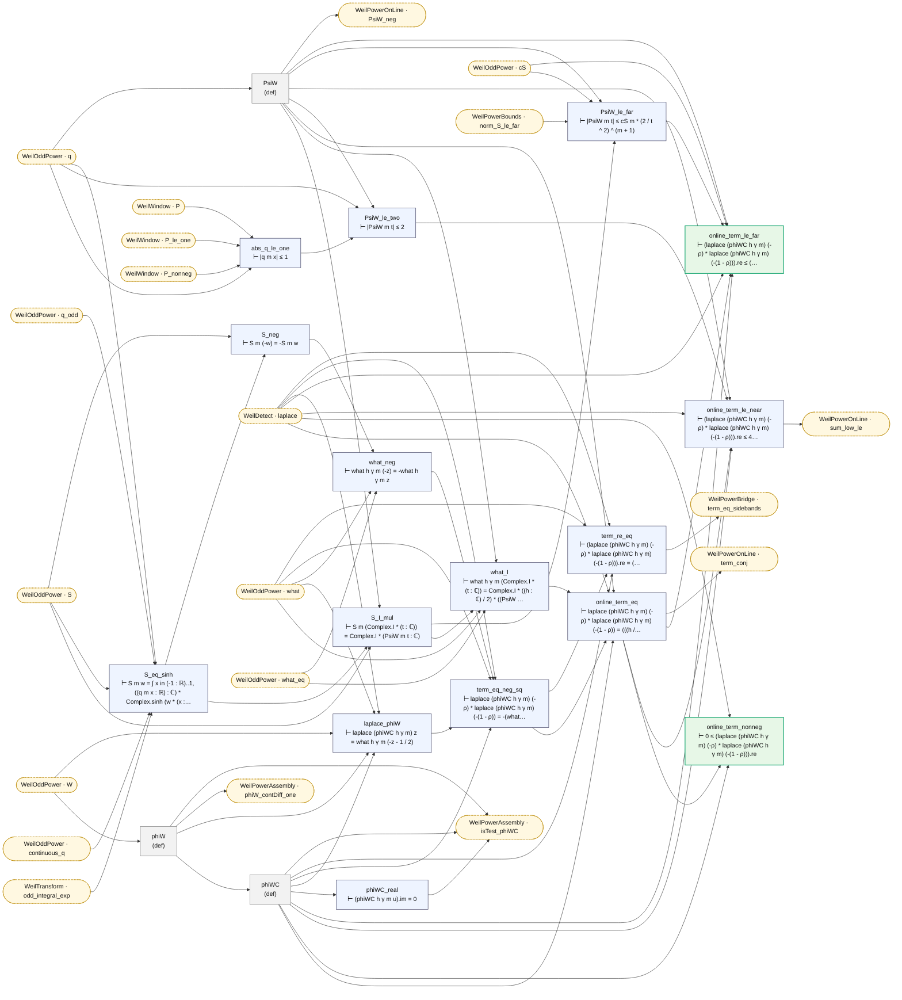

# `lean_stage3/Stage3/WeilPowerBackground.lean`

**What it does** (its own header): WeilPowerBackground — the switched window as a test function of the explicit formula, every term of the zero form as minus a square, and the on-line terms bounded. Rung 5, fifth slice. 2026-09-06.

**Imports:** [`WeilDetect`](../lean_stage3/WeilDetect.md), [`WeilPowerBounds`](../lean_stage3/WeilPowerBounds.md).
**Imported by:** [`Stage3`](../lean_stage3/Stage3.md), [`WeilPowerBands`](../lean_stage3/WeilPowerBands.md).

Blue: theorem. Green: a theorem nothing else uses (an end). Dashed white: connects to nothing. Grey: definition. Red: contains `sorry`. Yellow: in another file. An arrow A → B reads "A is used by B".

## Every declaration

| declaration | proves (output) | needs (input) | why (its own docstring) | uses | used by |
|---|---|---|---|---|---|
| `WeilPowerBackground.phiW` def, line 48 | ℝ | h γ : ℝ; m : ℕ; u : ℝ | The window as a test function of the explicit formula: cut off to `[−h, h]`, times `e^{−u/2}`. Real-valued. | `WeilOddPower.W` | `WeilPowerAssembly.isTest_phiWC`, `WeilPowerAssembly.phiW_contDiff_one`, `WeilPowerBackground.laplace_phiW`, `WeilPowerBackground.phiWC` |
| `WeilPowerBackground.phiWC` def, line 52 | ℝ → ℂ | h γ : ℝ; m : ℕ | The complex-valued test function WeilDetect reads. | `WeilPowerBackground.phiW` | `WeilPowerAssembly.isTest_phiWC`, `WeilPowerBackground.laplace_phiW`, `WeilPowerBackground.online_term_eq`, `WeilPowerBackground.online_term_le_far`, `WeilPowerBackground.online_term_le_near`, `WeilPowerBackground.online_term_nonneg`, `WeilPowerBackground.phiWC_real`, `WeilPowerBackground.term_eq_neg_sq`, `WeilPowerBackground.term_re_eq` |
| `WeilPowerBackground.phiWC_real` theorem, line 54 | (phiWC h γ m u).im = 0 | h γ : ℝ; m : ℕ; u : ℝ | — | `WeilPowerBackground.phiWC` | `WeilPowerAssembly.isTest_phiWC` |
| `WeilPowerBackground.laplace_phiW` theorem, line 59 | laplace (phiWC h γ m) z = what h γ m (-z - 1 / 2) | hh : 0 &lt; h; γ : ℝ; m : ℕ; z : ℂ | The transform in the explicit formula's convention. `laplace φ z = what h γ m (−z − 1/2)`. | `WeilDetect.laplace`, `WeilOddPower.W`, `WeilOddPower.what`, `WeilPowerBackground.phiW`, `WeilPowerBackground.phiWC` | `WeilPowerBackground.term_eq_neg_sq` |
| `WeilPowerBackground.S_eq_sinh` theorem, line 81 | S m w = ∫ x in (-1 : ℝ)..1, ((q m x : ℝ) : ℂ) * Complex.sinh (w * (x : ℂ)) | m : ℕ; w : ℂ | The odd envelope's transform through `sinh`: unit 0318's odd-part lemma. | `WeilOddPower.S`, `WeilOddPower.continuous_q`, `WeilOddPower.q`, `WeilOddPower.q_odd`, `WeilTransform.odd_integral_exp` | `WeilPowerBackground.S_I_mul`, `WeilPowerBackground.S_neg` |
| `WeilPowerBackground.S_neg` theorem, line 87 | S m (-w) = -S m w | m : ℕ; w : ℂ | `S` is odd. | `WeilOddPower.S`, `WeilPowerBackground.S_eq_sinh` | `WeilPowerBackground.what_neg` |
| `WeilPowerBackground.what_neg` theorem, line 95 | what h γ m (-z) = -what h γ m z | hh : 0 &lt; h; γ : ℝ; m : ℕ; z : ℂ | The window's transform is odd. | `WeilOddPower.what`, `WeilOddPower.what_eq`, `WeilPowerBackground.S_neg` | `WeilPowerBackground.term_eq_neg_sq` |
| `WeilPowerBackground.term_eq_neg_sq` theorem, line 106 | laplace (phiWC h γ m) (-ρ) * laplace (phiWC h γ m) (-(1 - ρ)) = -(what h γ m (ρ - 1 / 2)) ^ 2 | hh : 0 &lt; h; γ : ℝ; m : ℕ; ρ : ℂ | Every term is minus a square. | `WeilDetect.laplace`, `WeilOddPower.what`, `WeilPowerBackground.laplace_phiW`, `WeilPowerBackground.phiWC`, `WeilPowerBackground.what_neg` | `WeilPowerBackground.online_term_eq`, `WeilPowerBackground.term_re_eq` |
| `WeilPowerBackground.term_re_eq` theorem, line 115 | (laplace (phiWC h γ m) (-ρ) * laplace (phiWC h γ m) (-(1 - ρ))).re = (what h γ m (ρ - 1 / 2)).im ^ 2 - (what h γ m (ρ - 1 / 2)).re ^ 2 | hh : 0 &lt; h; γ : ℝ; m : ℕ; ρ : ℂ | — | `WeilDetect.laplace`, `WeilOddPower.what`, `WeilPowerBackground.phiWC`, `WeilPowerBackground.term_eq_neg_sq` | `WeilPowerBridge.term_eq_sidebands` |
| `WeilPowerBackground.PsiW` def, line 122 | ℝ | m : ℕ; t : ℝ | `PsiW m t = ∫₋₁¹ q m x · sin(tx) dx`: the transform on the line, real. | `WeilOddPower.q` | `WeilPowerBackground.PsiW_le_far`, `WeilPowerBackground.PsiW_le_two`, `WeilPowerBackground.S_I_mul`, `WeilPowerBackground.online_term_eq`, `WeilPowerBackground.online_term_le_far`, `WeilPowerBackground.online_term_le_near`, `WeilPowerBackground.what_I`, `WeilPowerOnLine.PsiW_neg` |
| `WeilPowerBackground.S_I_mul` theorem, line 125 | S m (Complex.I * (t : ℂ)) = Complex.I * (PsiW m t : ℂ) | m : ℕ; t : ℝ | `S m (it) = i·PsiW m t`. | `WeilOddPower.S`, `WeilPowerBackground.PsiW`, `WeilPowerBackground.S_eq_sinh` | `WeilPowerBackground.PsiW_le_far`, `WeilPowerBackground.what_I` |
| `WeilPowerBackground.what_I` theorem, line 138 | what h γ m (Complex.I * (t : ℂ)) = Complex.I * ((h : ℂ) / 2) * ((PsiW m (h * (t + γ)) : ℂ) + (PsiW m (h * (t - γ)) : ℂ)) | hh : 0 &lt; h; γ : ℝ; m : ℕ; t : ℝ | The window's transform on the line: `what h γ m (it) = i(h/2)[PsiW(h(t+γ)) + PsiW(h(t−γ))]`. | `WeilOddPower.what`, `WeilOddPower.what_eq`, `WeilPowerBackground.PsiW`, `WeilPowerBackground.S_I_mul` | `WeilPowerBackground.online_term_eq` |
| `WeilPowerBackground.online_term_eq` theorem, line 150 | laplace (phiWC h γ m) (-ρ) * laplace (phiWC h γ m) (-(1 - ρ)) = (((h / 2) ^ 2 * (PsiW m (h * (ρ.im + γ)) + PsiW m (h * (ρ.im - γ))) ^ 2 : ℝ) : ℂ) | hh : 0 &lt; h; γ : ℝ; m : ℕ; hρ : ρ.re = 1 / 2 | On the line the term is a real square. | `WeilDetect.laplace`, `WeilPowerBackground.PsiW`, `WeilPowerBackground.phiWC`, `WeilPowerBackground.term_eq_neg_sq`, `WeilPowerBackground.what_I` | `WeilPowerBackground.online_term_le_far`, `WeilPowerBackground.online_term_le_near`, `WeilPowerBackground.online_term_nonneg`, `WeilPowerOnLine.term_conj` |
| `WeilPowerBackground.online_term_nonneg` theorem, line 164 | 0 ≤ (laplace (phiWC h γ m) (-ρ) * laplace (phiWC h γ m) (-(1 - ρ))).re | hh : 0 &lt; h; γ : ℝ; m : ℕ; hρ : ρ.re = 1 / 2 | — | `WeilDetect.laplace`, `WeilPowerBackground.online_term_eq`, `WeilPowerBackground.phiWC` | — |
| `WeilPowerBackground.abs_q_le_one` theorem, line 170 | \|q m x\| ≤ 1 | m : ℕ; x : ℝ | `\|q m x\| ≤ 1` on `[−1, 1]`. | `WeilOddPower.q`, `WeilWindow.P`, `WeilWindow.P_le_one`, `WeilWindow.P_nonneg` | `WeilPowerBackground.PsiW_le_two` |
| `WeilPowerBackground.PsiW_le_two` theorem, line 181 | \|PsiW m t\| ≤ 2 | m : ℕ; t : ℝ | `\|PsiW m t\| ≤ 2`. | `WeilOddPower.q`, `WeilPowerBackground.PsiW`, `WeilPowerBackground.abs_q_le_one` | `WeilPowerBackground.online_term_le_near` |
| `WeilPowerBackground.online_term_le_near` theorem, line 196 | (laplace (phiWC h γ m) (-ρ) * laplace (phiWC h γ m) (-(1 - ρ))).re ≤ 4 * h ^ 2 | hh : 0 &lt; h; γ : ℝ; m : ℕ; hρ : ρ.re = 1 / 2 | Near the carrier: the on-line term is at most `4h²`. | `WeilDetect.laplace`, `WeilPowerBackground.PsiW`, `WeilPowerBackground.PsiW_le_two`, `WeilPowerBackground.online_term_eq`, `WeilPowerBackground.phiWC` | `WeilPowerOnLine.sum_low_le` |
| `WeilPowerBackground.PsiW_le_far` theorem, line 215 | \|PsiW m t\| ≤ cS m * (2 / t ^ 2) ^ (m + 1) | ht : 2 * (Real.pi ^ 2 * ((m : ℝ) + 1) ^ 2) ≤ t ^ 2 | `\|PsiW m t\| ≤ cS m·(2/t²)^{m+1}` when `2π²(m+1)² ≤ t²`: unit 0331's far bound at real part zero. | `WeilOddPower.cS`, `WeilPowerBackground.PsiW`, `WeilPowerBackground.S_I_mul`, `WeilPowerBounds.norm_S_le_far` | `WeilPowerBackground.online_term_le_far` |
| `WeilPowerBackground.online_term_le_far` theorem, line 223 | (laplace (phiWC h γ m) (-ρ) * laplace (phiWC h γ m) (-(1 - ρ))).re ≤ (h / 2) ^ 2 * (cS m * (2 / (h * (ρ.im - γ)) ^ 2) ^ (m + 1) + cS m * (2 / (h * (ρ.im + γ)) ^ 2) ^ (m + 1)) ^ 2 | hh : 0 &lt; h; γ : ℝ; m : ℕ; hρ : ρ.re = 1 / 2; hfar1 : 2 * (Real.pi ^ 2 * ((m : ℝ) + 1) ^ 2) ≤ (h * (ρ.im - γ)) ^ 2; hfar2 : 2 * (Real.pi ^ 2 * ((m : ℝ) + 1) ^ 2) ≤ (h * (ρ.im + γ)) ^ 2 | Away from the carrier: for `h\|γ_ρ ∓ γ\|` both at least `√2·π(m+1)`, the on-line term is at most `(h/2)²·[cS m·(2/(h(γ_ρ−γ))²)^{m+1} + cS m·(2/(h(γ_ρ+γ))²)^{m+1}]²`. | `WeilDetect.laplace`, `WeilOddPower.cS`, `WeilPowerBackground.PsiW`, `WeilPowerBackground.PsiW_le_far`, `WeilPowerBackground.online_term_eq`, `WeilPowerBackground.phiWC` | — |
