# `lean_stage3/Stage3/WeilPowerBands.lean`

**What it does** (its own header): WeilPowerBands — the on-line background of the switched window over the upper heights: bands, tiles and the explicit band series. Rung 5, seventh slice. 2026-09-06.

**Imports:** [`WeilPowerBackground`](../lean_stage3/WeilPowerBackground.md), [`WeilSeries`](../lean_stage3/WeilSeries.md).
**Imported by:** [`Stage3`](../lean_stage3/Stage3.md), [`WeilPowerBridge`](../lean_stage3/WeilPowerBridge.md), [`WeilPowerOnLine`](../lean_stage3/WeilPowerOnLine.md).

```mermaid
flowchart LR
  n0["termW<br/>(def)"]:::dfn
  n1["weightedTermW<br/>(def)"]:::dfn
  n2["termW_nonneg<br/>⊢ 0 ≤ termW h γ m ρ"]:::thm
  n3["weightedTermW_nonneg<br/>⊢ 0 ≤ weightedTermW h γ m ρ"]:::thm
  n4["band_sum_le<br/>⊢ ∑ ρ ∈ S, weightedTermW h γ m ρ ≤ M * (15 * Real.log T + 73)"]:::thm
  n5["sum_by_bands<br/>⊢ ∑ ρ ∈ S, weightedTermW h γ m ρ ≤ ∑ k ∈ S.image (fun ρ : Kadiri.Nontriv…"]:::thm
  n6["sum_le_bandSeries<br/>⊢ ∑ ρ ∈ S, weightedTermW h γ m ρ ≤ ∑' k : ℕ, M k * (15 * Real.log (centr…"]:::thm
  n7["tsum_upper_le<br/>⊢ ∑' ρ : Upper, weightedTermW h γ m ρ.1 ≤ ∑' k : ℕ, M k * (15 * Real.log…"]:::thm
  n8["r<br/>(def)"]:::dfn
  n9["one_le_r<br/>⊢ 1 ≤ r h m"]:::thm
  n10["cFarM<br/>(def)"]:::dfn
  n11["cFarM_nonneg<br/>⊢ 0 ≤ cFarM m"]:::thm
  n12["factorial_odd_le<br/>⊢ (((2 * m + 1).factorial : ℕ) : ℝ) ≤ 2 * 4 ^ m * ((m : ℝ) + 1) ^ (2 * m…"]:::thm
  n13["cS_le<br/>⊢ cS m ≤ 4 * Real.pi ^ (2 * m + 1) * ((m : ℝ) + 1) ^ (2 * m + 1)"]:::thm
  n14["cFarM_le<br/>⊢ cFarM m ≤ 1000 * ((m : ℝ) + 1) ^ 2"]:::end_
  n15["M<br/>(def)"]:::dfn
  n16["M_nonneg<br/>⊢ 0 ≤ M h γ m k"]:::thm
  n17["term_le_M<br/>⊢ termW h γ m ρ ≤ M h γ m (idx (ρ : ℂ).im)"]:::thm
  n18["A<br/>(def)"]:::dfn
  n19["four_h_add_nonneg<br/>⊢ 0 ≤ 4 * h ^ 2 + cFarM m / h ^ 2"]:::thm
  n20["A_nonneg<br/>⊢ 0 ≤ A h γ m"]:::thm
  n21["bandTerm_le_A<br/>⊢ M h γ m k * (15 * Real.log (centre k) + 73) ≤ A h γ m / ((k : ℝ) + 1) …"]:::thm
  n22["bandSeries_summable<br/>⊢ Summable (fun k : ℕ =＞ M h γ m k * (15 * Real.log (centre k) + 73))"]:::thm
  n23["bandSeries_le<br/>⊢ ∑' k : ℕ, M h γ m k * (15 * Real.log (centre k) + 73) ≤ A h γ m * (Rea…"]:::thm
  n24["tsum_upper_le_explicit<br/>⊢ ∑' ρ : Upper, weightedTermW h γ m ρ.1 ≤ A h γ m * (Real.pi ^ 2 / 6)"]:::thm
  n25["A_le<br/>⊢ A h γ m ≤ 88 * (γ + r h m + 2) ^ 4 * (4 * h ^ 2 + cFarM m / h ^ 2)"]:::thm
  n26["tsum_upper_le_explicit'<br/>⊢ ∑' ρ : Upper, weightedTermW h γ m ρ.1 ≤ 88 * (γ + r h m + 2) ^ 4 * (4 …"]:::end_
  x0(["WeilBands · band_count"]):::ext
  x1(["WeilBands · order_eq_analyticOrderNatAt"]):::ext
  x2(["WeilDetect · laplace"]):::ext
  x3(["WeilOddPower · S"]):::ext
  x4(["WeilOddPower · cS"]):::ext
  x5(["WeilPowerAssembly · far_large_le"]):::ext
  x6(["WeilPowerAssembly · far_moderate_le"]):::ext
  x7(["WeilPowerAssembly · near_nonneg"]):::ext
  x8(["WeilPowerAssembly · on_line_le"]):::ext
  x9(["WeilPowerAssembly · target_lower"]):::ext
  x10(["WeilPowerBounds · cS_pos"]):::ext
  x11(["WeilPowerBridge · term_eq_sidebands"]):::ext
  x12(["WeilPowerBridge · term_le_at_zero"]):::ext
  x13(["WeilPowerBridge · term_le_sidebands"]):::ext
  x14(["WeilPowerOnLine · B"]):::ext
  x15(["WeilPowerOnLine · onLineBound_le"]):::ext
  x16(["WeilPowerOnLine · sum_low_le"]):::ext
  x17(["WeilPowerOnLine · sum_lower_le"]):::ext
  x18(["WeilPowerOnLine · sum_onLine_le"]):::ext
  x19(["WeilPowerOnLine · sum_onLine_subtype_le"]):::ext
  x20(["WeilPowerOnLine · sum_upper_le"]):::ext
  x21(["WeilPowerOnLine · summable_onLine"]):::ext
  x22(["WeilPowerOnLine · term_conj"]):::ext
  x23(["WeilPowerOnLine · tsum_onLine_le"]):::ext
  x24(["WeilPowerOnLine · weightedTermW_conjZ"]):::ext
  x25(["WeilSeries · dist_ge"]):::ext
  x26(["WeilSeries · idx_le"]):::ext
  x27(["WeilSeries · tsum_shift2"]):::ext
  x28(["WeilSeries · two_le_of_one_lt"]):::ext
  x29(["WeilSeries · weight_le"]):::ext
  x30(["WeilSeries · weight_nonneg"]):::ext
  x31(["WeilTiles · Upper"]):::ext
  x32(["WeilTiles · bandSeries_nonneg"]):::ext
  x33(["WeilTiles · centre"]):::ext
  x34(["WeilTiles · idx"]):::ext
  x35(["WeilTiles · idx_spec"]):::ext
  x36(["WeilTiles · online_term_nonneg"]):::ext
  x37(["WeilTiles · two_le_centre"]):::ext
  n0 --> n1
  n0 --> n17
  n0 --> n2
  n0 --> n4
  n0 --> n5
  n0 --> n6
  n0 --> n7
  n0 --> x11
  n0 --> x12
  n0 --> x13
  n0 --> x22
  n0 --> x24
  n0 --> x5
  n0 --> x6
  n0 --> x7
  n0 --> x9
  n1 --> n24
  n1 --> n26
  n1 --> n3
  n1 --> n4
  n1 --> n5
  n1 --> n6
  n1 --> n7
  n1 --> x16
  n1 --> x17
  n1 --> x18
  n1 --> x19
  n1 --> x20
  n1 --> x21
  n1 --> x23
  n1 --> x24
  n10 --> n11
  n10 --> n14
  n10 --> n15
  n10 --> n17
  n10 --> n18
  n10 --> n19
  n10 --> n21
  n10 --> n25
  n10 --> n26
  n10 --> x15
  n10 --> x8
  n11 --> n16
  n11 --> n19
  n11 --> n21
  n12 --> n13
  n13 --> n14
  n15 --> n16
  n15 --> n17
  n15 --> n21
  n15 --> n22
  n15 --> n23
  n15 --> n24
  n15 --> n4
  n15 --> n5
  n15 --> n6
  n15 --> n7
  n15 --> x20
  n16 --> n22
  n16 --> n24
  n16 --> x20
  n17 --> n24
  n17 --> x20
  n18 --> n20
  n18 --> n21
  n18 --> n22
  n18 --> n23
  n18 --> n24
  n18 --> n25
  n18 --> x14
  n18 --> x15
  n19 --> n20
  n19 --> n21
  n19 --> n25
  n2 --> n3
  n20 --> n23
  n21 --> n22
  n21 --> n23
  n22 --> n23
  n22 --> n24
  n22 --> x20
  n23 --> n24
  n23 --> x20
  n24 --> n26
  n25 --> n26
  n25 --> x15
  n3 --> n7
  n3 --> x21
  n3 --> x23
  n4 --> n5
  n5 --> n6
  n6 --> n7
  n6 --> x20
  n7 --> n24
  n8 --> n15
  n8 --> n18
  n8 --> n21
  n8 --> n25
  n8 --> n26
  n8 --> n9
  n8 --> x15
  n8 --> x8
  n9 --> n17
  n9 --> n20
  n9 --> n21
  n9 --> n25
  x0 --> n4
  x1 --> n4
  x10 --> n14
  x10 --> n17
  x2 --> n0
  x25 --> n17
  x26 --> n25
  x27 --> n23
  x28 --> n17
  x28 --> n21
  x29 --> n21
  x3 --> n4
  x3 --> n5
  x3 --> n6
  x30 --> n21
  x31 --> n24
  x31 --> n26
  x31 --> n7
  x32 --> n22
  x32 --> n6
  x33 --> n21
  x33 --> n22
  x33 --> n23
  x33 --> n5
  x33 --> n6
  x33 --> n7
  x34 --> n15
  x34 --> n17
  x34 --> n18
  x34 --> n21
  x34 --> n25
  x34 --> n5
  x34 --> n6
  x34 --> n7
  x35 --> n5
  x36 --> n2
  x37 --> n5
  x4 --> n10
  x4 --> n13
  x4 --> n14
  x4 --> n17
  classDef thm fill:#eef4ff,stroke:#335,color:#111
  classDef dfn fill:#f2f2f2,stroke:#777,color:#111
  classDef end_ fill:#e7f7e7,stroke:#2a7,color:#111,stroke-width:2px
  classDef lone fill:#fff,stroke:#999,color:#111,stroke-dasharray:4 3
  classDef bad fill:#ffe5e5,stroke:#c22,color:#111,stroke-width:2px
  classDef ext fill:#fff8e1,stroke:#b80,color:#111,stroke-dasharray:2 2
```

Blue: theorem. Green: a theorem nothing else uses (an end). Dashed white: connects to nothing. Grey: definition. Red: contains `sorry`. Yellow: in another file. An arrow A → B reads "A is used by B".

## Every declaration

| declaration | proves (output) | needs (input) | why (its own docstring) | uses | used by |
|---|---|---|---|---|---|
| `WeilPowerBands.termW` def, line 53 | ℝ | h γ : ℝ; m : ℕ; ρ : ℂ | The term of the zero form at the switched window, real part. | `WeilDetect.laplace` | `WeilPowerAssembly.far_large_le`, `WeilPowerAssembly.far_moderate_le`, `WeilPowerAssembly.near_nonneg`, `WeilPowerAssembly.target_lower`, `WeilPowerBands.band_sum_le`, `WeilPowerBands.sum_by_bands`, `WeilPowerBands.sum_le_bandSeries`, `WeilPowerBands.termW_nonneg`, `WeilPowerBands.term_le_M`, `WeilPowerBands.tsum_upper_le`, `WeilPowerBands.weightedTermW`, `WeilPowerBridge.term_eq_sidebands`, `WeilPowerBridge.term_le_at_zero`, `WeilPowerBridge.term_le_sidebands`, `WeilPowerOnLine.term_conj`, `WeilPowerOnLine.weightedTermW_conjZ` |
| `WeilPowerBands.weightedTermW` def, line 57 | ℝ | h γ : ℝ; m : ℕ; ρ : Kadiri.NontrivialZeros | The term with its multiplicity. | `WeilPowerBands.termW` | `WeilPowerBands.band_sum_le`, `WeilPowerBands.sum_by_bands`, `WeilPowerBands.sum_le_bandSeries`, `WeilPowerBands.tsum_upper_le`, `WeilPowerBands.tsum_upper_le_explicit`, `WeilPowerBands.tsum_upper_le_explicit'`, `WeilPowerBands.weightedTermW_nonneg`, `WeilPowerOnLine.sum_low_le`, `WeilPowerOnLine.sum_lower_le`, `WeilPowerOnLine.sum_onLine_le`, `WeilPowerOnLine.sum_onLine_subtype_le`, `WeilPowerOnLine.sum_upper_le`, `WeilPowerOnLine.summable_onLine`, `WeilPowerOnLine.tsum_onLine_le`, `WeilPowerOnLine.weightedTermW_conjZ` |
| `WeilPowerBands.termW_nonneg` theorem, line 60 | 0 ≤ termW h γ m ρ | hh : 0 &lt; h; γ : ℝ; m : ℕ; hρ : ρ.re = 1 / 2 | — | `WeilPowerBands.termW`, `WeilTiles.online_term_nonneg` | `WeilPowerBands.weightedTermW_nonneg` |
| `WeilPowerBands.weightedTermW_nonneg` theorem, line 64 | 0 ≤ weightedTermW h γ m ρ | hh : 0 &lt; h; γ : ℝ; m : ℕ; ρ : Kadiri.NontrivialZeros; hρ : (ρ : ℂ).re = 1 / 2 | — | `WeilPowerBands.termW_nonneg`, `WeilPowerBands.weightedTermW` | `WeilPowerBands.tsum_upper_le`, `WeilPowerOnLine.summable_onLine`, `WeilPowerOnLine.tsum_onLine_le` |
| `WeilPowerBands.band_sum_le` theorem, line 71 | ∑ ρ ∈ S, weightedTermW h γ m ρ ≤ M * (15 * Real.log T + 73) | m : ℕ; hT : 2 ≤ T; S : Finset Kadiri.NontrivialZeros; hS : ∀ ρ ∈ S, (ρ : ℂ).re = 1 / 2 ∧ \|(ρ : ℂ).im - T\| ≤ 9 / 10; hM0 : 0 ≤ M; hM : ∀ ρ ∈ S, termW h γ m ρ ≤ M | Band sum. Unit 0321's, for the switched window. | `WeilBands.band_count`, `WeilBands.order_eq_analyticOrderNatAt`, `WeilOddPower.S`, `WeilPowerBands.M`, `WeilPowerBands.termW`, `WeilPowerBands.weightedTermW` | `WeilPowerBands.sum_by_bands` |
| `WeilPowerBands.sum_by_bands` theorem, line 111 | ∑ ρ ∈ S, weightedTermW h γ m ρ ≤ ∑ k ∈ S.image (fun ρ : Kadiri.NontrivialZeros =&gt; idx (ρ : ℂ).im), M k * (15 * Real.log (centre k) + 73) | m : ℕ; S : Finset Kadiri.NontrivialZeros; hS : ∀ ρ ∈ S, (ρ : ℂ).re = 1 / 2 ∧ 11 / 10 ≤ (ρ : ℂ).im; M : ℕ → ℝ; hM0 : ∀ k, 0 ≤ M k; hM : ∀ ρ ∈ S, termW h γ m ρ ≤ M (idx (ρ : ℂ).im) | Sum by bands. Unit 0322's. | `WeilOddPower.S`, `WeilPowerBands.M`, `WeilPowerBands.band_sum_le`, `WeilPowerBands.termW`, `WeilPowerBands.weightedTermW`, `WeilTiles.centre`, `WeilTiles.idx`, `WeilTiles.idx_spec`, `WeilTiles.two_le_centre` | `WeilPowerBands.sum_le_bandSeries` |
| `WeilPowerBands.sum_le_bandSeries` theorem, line 137 | ∑ ρ ∈ S, weightedTermW h γ m ρ ≤ ∑' k : ℕ, M k * (15 * Real.log (centre k) + 73) | m : ℕ; S : Finset Kadiri.NontrivialZeros; hS : ∀ ρ ∈ S, (ρ : ℂ).re = 1 / 2 ∧ 11 / 10 ≤ (ρ : ℂ).im; M : ℕ → ℝ; hM0 : ∀ k, 0 ≤ M k; hM : ∀ ρ ∈ S, termW h γ m ρ ≤ M (idx (ρ : ℂ).im); hsum : Summable (fun k : ℕ =&gt; M k * (15 * Real.log (centre k) + 73)) | — | `WeilOddPower.S`, `WeilPowerBands.M`, `WeilPowerBands.sum_by_bands`, `WeilPowerBands.termW`, `WeilPowerBands.weightedTermW`, `WeilTiles.bandSeries_nonneg`, `WeilTiles.centre`, `WeilTiles.idx` | `WeilPowerBands.tsum_upper_le`, `WeilPowerOnLine.sum_upper_le` |
| `WeilPowerBands.tsum_upper_le` theorem, line 147 | ∑' ρ : Upper, weightedTermW h γ m ρ.1 ≤ ∑' k : ℕ, M k * (15 * Real.log (centre k) + 73) | hh : 0 &lt; h; m : ℕ; M : ℕ → ℝ; hM0 : ∀ k, 0 ≤ M k; hM : ∀ ρ : Kadiri.NontrivialZeros, (ρ : ℂ).re = 1 / 2 → 11 / 10 ≤ (ρ : ℂ).im → termW h γ m ρ ≤ M (idx (ρ : ℂ).im); hsum : Summable (fun k : ℕ =&gt; M k * (15 * Real.log (centre k) + 73)) | Upper on-line sum. Unit 0322's. | `WeilPowerBands.M`, `WeilPowerBands.sum_le_bandSeries`, `WeilPowerBands.termW`, `WeilPowerBands.weightedTermW`, `WeilPowerBands.weightedTermW_nonneg`, `WeilTiles.Upper`, `WeilTiles.centre`, `WeilTiles.idx` | `WeilPowerBands.tsum_upper_le_explicit` |
| `WeilPowerBands.r` def, line 170 | ℝ | h : ℝ; m : ℕ | The near-band radius, in band steps: `max 1 (5(m+1)/h)`. | — | `WeilPowerAssembly.on_line_le`, `WeilPowerBands.A`, `WeilPowerBands.A_le`, `WeilPowerBands.M`, `WeilPowerBands.bandTerm_le_A`, `WeilPowerBands.one_le_r`, `WeilPowerBands.tsum_upper_le_explicit'`, `WeilPowerOnLine.onLineBound_le` |
| `WeilPowerBands.one_le_r` theorem, line 172 | 1 ≤ r h m | h : ℝ; m : ℕ | — | `WeilPowerBands.r` | `WeilPowerBands.A_le`, `WeilPowerBands.A_nonneg`, `WeilPowerBands.bandTerm_le_A`, `WeilPowerBands.term_le_M` |
| `WeilPowerBands.cFarM` def, line 175 | ℝ | m : ℕ | The far constant: `cS m² · (200/81)² · (10(m+1)²)^{−2m}`. | `WeilOddPower.cS` | `WeilPowerAssembly.on_line_le`, `WeilPowerBands.A`, `WeilPowerBands.A_le`, `WeilPowerBands.M`, `WeilPowerBands.bandTerm_le_A`, `WeilPowerBands.cFarM_le`, `WeilPowerBands.cFarM_nonneg`, `WeilPowerBands.four_h_add_nonneg`, `WeilPowerBands.term_le_M`, `WeilPowerBands.tsum_upper_le_explicit'`, `WeilPowerOnLine.onLineBound_le` |
| `WeilPowerBands.cFarM_nonneg` theorem, line 177 | 0 ≤ cFarM m | m : ℕ | — | `WeilPowerBands.cFarM` | `WeilPowerBands.M_nonneg`, `WeilPowerBands.bandTerm_le_A`, `WeilPowerBands.four_h_add_nonneg` |
| `WeilPowerBands.factorial_odd_le` theorem, line 182 | (((2 * m + 1).factorial : ℕ) : ℝ) ≤ 2 * 4 ^ m * ((m : ℝ) + 1) ^ (2 * m + 1) | m : ℕ | `(2m+1)! ≤ 2·4^m·(m+1)^{2m+1}`. | — | `WeilPowerBands.cS_le` |
| `WeilPowerBands.cS_le` theorem, line 198 | cS m ≤ 4 * Real.pi ^ (2 * m + 1) * ((m : ℝ) + 1) ^ (2 * m + 1) | m : ℕ | `cS m ≤ 4·π^{2m+1}·(m+1)^{2m+1}`. | `WeilOddPower.cS`, `WeilPowerBands.factorial_odd_le` | `WeilPowerBands.cFarM_le` |
| `WeilPowerBands.cFarM_le` theorem, line 209 | cFarM m ≤ 1000 * ((m : ℝ) + 1) ^ 2 | m : ℕ | The far constant is polynomial in `m`: `cFarM m ≤ 1000·(m+1)²`. | `WeilOddPower.cS`, `WeilPowerBands.cFarM`, `WeilPowerBands.cS_le`, `WeilPowerBounds.cS_pos` | — |
| `WeilPowerBands.M` def, line 245 | ℝ | h γ : ℝ; m : ℕ; k : ℕ | The dominating band series for the switched window. | `WeilPowerBands.cFarM`, `WeilPowerBands.r`, `WeilTiles.idx` | `WeilPowerBands.M_nonneg`, `WeilPowerBands.bandSeries_le`, `WeilPowerBands.bandSeries_summable`, `WeilPowerBands.bandTerm_le_A`, `WeilPowerBands.band_sum_le`, `WeilPowerBands.sum_by_bands`, `WeilPowerBands.sum_le_bandSeries`, `WeilPowerBands.term_le_M`, `WeilPowerBands.tsum_upper_le`, `WeilPowerBands.tsum_upper_le_explicit`, `WeilPowerOnLine.sum_upper_le` |
| `WeilPowerBands.M_nonneg` theorem, line 249 | 0 ≤ M h γ m k | h γ : ℝ; m k : ℕ | — | `WeilPowerBands.M`, `WeilPowerBands.cFarM_nonneg` | `WeilPowerBands.bandSeries_summable`, `WeilPowerBands.tsum_upper_le_explicit`, `WeilPowerOnLine.sum_upper_le` |
| `WeilPowerBands.term_le_M` theorem, line 257 | termW h γ m ρ ≤ M h γ m (idx (ρ : ℂ).im) | hh : 0 &lt; h; hγ : 11 / 10 ≤ γ; m : ℕ; ρ : Kadiri.NontrivialZeros; hre : (ρ : ℂ).re = 1 / 2; him : 11 / 10 ≤ (ρ : ℂ).im | Domination. Every on-line term of height `≥ 11/10` is at most `M` at its band index. | `WeilOddPower.cS`, `WeilPowerBands.M`, `WeilPowerBands.cFarM`, `WeilPowerBands.one_le_r`, `WeilPowerBands.termW`, `WeilPowerBounds.cS_pos`, `WeilSeries.dist_ge`, `WeilSeries.two_le_of_one_lt`, `WeilTiles.idx` | `WeilPowerBands.tsum_upper_le_explicit`, `WeilPowerOnLine.sum_upper_le` |
| `WeilPowerBands.A` def, line 350 | ℝ | h γ : ℝ; m : ℕ | The crude constant, with the wider near band. | `WeilPowerBands.cFarM`, `WeilPowerBands.r`, `WeilTiles.idx` | `WeilPowerBands.A_le`, `WeilPowerBands.A_nonneg`, `WeilPowerBands.bandSeries_le`, `WeilPowerBands.bandSeries_summable`, `WeilPowerBands.bandTerm_le_A`, `WeilPowerBands.tsum_upper_le_explicit`, `WeilPowerOnLine.B`, `WeilPowerOnLine.onLineBound_le` |
| `WeilPowerBands.four_h_add_nonneg` theorem, line 353 | 0 ≤ 4 * h ^ 2 + cFarM m / h ^ 2 | h : ℝ; m : ℕ | — | `WeilPowerBands.cFarM`, `WeilPowerBands.cFarM_nonneg` | `WeilPowerBands.A_le`, `WeilPowerBands.A_nonneg`, `WeilPowerBands.bandTerm_le_A` |
| `WeilPowerBands.A_nonneg` theorem, line 358 | 0 ≤ A h γ m | h γ : ℝ; m : ℕ | — | `WeilPowerBands.A`, `WeilPowerBands.four_h_add_nonneg`, `WeilPowerBands.one_le_r` | `WeilPowerBands.bandSeries_le` |
| `WeilPowerBands.bandTerm_le_A` theorem, line 364 | M h γ m k * (15 * Real.log (centre k) + 73) ≤ A h γ m / ((k : ℝ) + 1) ^ 3 | hh : 0 &lt; h; m k : ℕ | Comparison. Each band term is at most `A/(k+1)³`. | `WeilPowerBands.A`, `WeilPowerBands.M`, `WeilPowerBands.cFarM`, `WeilPowerBands.cFarM_nonneg`, `WeilPowerBands.four_h_add_nonneg`, `WeilPowerBands.one_le_r`, `WeilPowerBands.r`, `WeilSeries.two_le_of_one_lt`, `WeilSeries.weight_le`, `WeilSeries.weight_nonneg`, `WeilTiles.centre`, `WeilTiles.idx` | `WeilPowerBands.bandSeries_le`, `WeilPowerBands.bandSeries_summable` |
| `WeilPowerBands.bandSeries_summable` theorem, line 424 | Summable (fun k : ℕ =&gt; M h γ m k * (15 * Real.log (centre k) + 73)) | hh : 0 &lt; h; m : ℕ | Summability of the band series. | `WeilPowerBands.A`, `WeilPowerBands.M`, `WeilPowerBands.M_nonneg`, `WeilPowerBands.bandTerm_le_A`, `WeilTiles.bandSeries_nonneg`, `WeilTiles.centre` | `WeilPowerBands.bandSeries_le`, `WeilPowerBands.tsum_upper_le_explicit`, `WeilPowerOnLine.sum_upper_le` |
| `WeilPowerBands.bandSeries_le` theorem, line 433 | ∑' k : ℕ, M h γ m k * (15 * Real.log (centre k) + 73) ≤ A h γ m * (Real.pi ^ 2 / 6) | hh : 0 &lt; h; m : ℕ | The band series in closed form: at most `A·π²/6`. | `WeilPowerBands.A`, `WeilPowerBands.A_nonneg`, `WeilPowerBands.M`, `WeilPowerBands.bandSeries_summable`, `WeilPowerBands.bandTerm_le_A`, `WeilSeries.tsum_shift2`, `WeilTiles.centre` | `WeilPowerBands.tsum_upper_le_explicit`, `WeilPowerOnLine.sum_upper_le` |
| `WeilPowerBands.tsum_upper_le_explicit` theorem, line 448 | ∑' ρ : Upper, weightedTermW h γ m ρ.1 ≤ A h γ m * (Real.pi ^ 2 / 6) | hh : 0 &lt; h; hγ : 11 / 10 ≤ γ; m : ℕ | Upper on-line background. | `WeilPowerBands.A`, `WeilPowerBands.M`, `WeilPowerBands.M_nonneg`, `WeilPowerBands.bandSeries_le`, `WeilPowerBands.bandSeries_summable`, `WeilPowerBands.term_le_M`, `WeilPowerBands.tsum_upper_le`, `WeilPowerBands.weightedTermW`, `WeilTiles.Upper` | `WeilPowerBands.tsum_upper_le_explicit'` |
| `WeilPowerBands.A_le` theorem, line 455 | A h γ m ≤ 88 * (γ + r h m + 2) ^ 4 * (4 * h ^ 2 + cFarM m / h ^ 2) | hγ : 11 / 10 ≤ γ; m : ℕ | — | `WeilPowerBands.A`, `WeilPowerBands.cFarM`, `WeilPowerBands.four_h_add_nonneg`, `WeilPowerBands.one_le_r`, `WeilPowerBands.r`, `WeilSeries.idx_le`, `WeilTiles.idx` | `WeilPowerBands.tsum_upper_le_explicit'`, `WeilPowerOnLine.onLineBound_le` |
| `WeilPowerBands.tsum_upper_le_explicit'` theorem, line 468 | ∑' ρ : Upper, weightedTermW h γ m ρ.1 ≤ 88 * (γ + r h m + 2) ^ 4 * (4 * h ^ 2 + cFarM m / h ^ 2) * (Real.pi ^ 2 / 6) | hh : 0 &lt; h; hγ : 11 / 10 ≤ γ; m : ℕ | Upper on-line background, in `γ`, `h` and `m` alone: `≤ 88·(γ + r + 2)⁴·(4h² + cFarM m/h²)·π²/6`. | `WeilPowerBands.A_le`, `WeilPowerBands.cFarM`, `WeilPowerBands.r`, `WeilPowerBands.tsum_upper_le_explicit`, `WeilPowerBands.weightedTermW`, `WeilTiles.Upper` | — |
