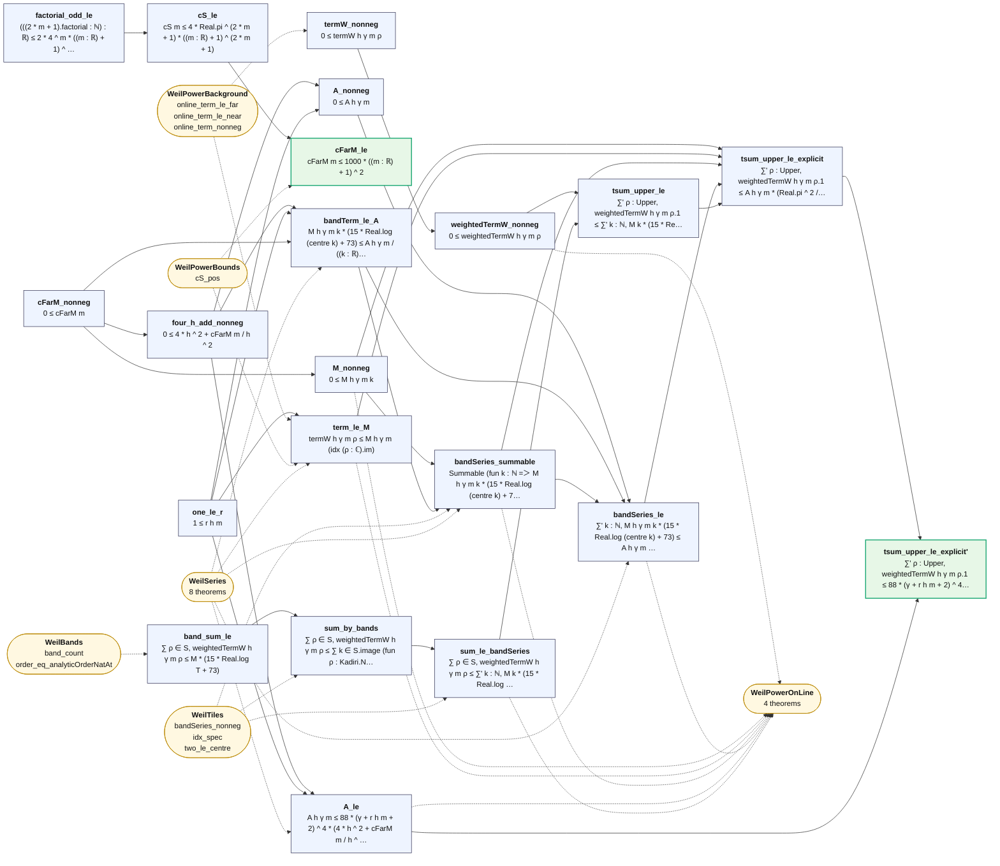

# `lean_stage3/Stage3/WeilPowerBands.lean`

WeilPowerBands — the on-line background of the switched window over the upper heights: bands, tiles and the explicit band series. Rung 5, seventh slice. 2026-09-06.

21 theorems, 6 definitions, 489 lines. Arrows are Lean's own record of what each proof uses.

**Imports:** [`WeilPowerBackground`](../lean_stage3/WeilPowerBackground.md), [`WeilSeries`](../lean_stage3/WeilSeries.md)  
**Imported by:** [`Stage3`](../lean_stage3/Stage3.md), [`WeilPowerBridge`](../lean_stage3/WeilPowerBridge.md), [`WeilPowerOnLine`](../lean_stage3/WeilPowerOnLine.md)

## The picture



An arrow A → B reads "A is used in the proof of B". Blue: theorem. Green: a theorem nothing else uses (an end). Dashed: connects to nothing. Red: contains `sorry`. Yellow: theorems in another file, counted; a dotted arrow crosses files. Definitions are not drawn; they are listed below the diagram.

## Definitions

<a name="WeilPowerBands-termW"></a>
### `WeilPowerBands.termW`

def · line 53

The term of the zero form at the switched window, real part.

- **Is:** `` termW (h γ : ℝ) (m : ℕ) (ρ : ℂ) : ℝ := (laplace (phiWC h γ m) (-ρ) * laplace (phiWC h γ m) (-(1 - ρ))).re ``
- **Built from:** [`WeilDetect.laplace`](../lean_stage3/WeilDetect.md#WeilDetect-laplace), [`WeilPowerBackground.phiWC`](../lean_stage3/WeilPowerBackground.md#WeilPowerBackground-phiWC)
- **Used by 18:** [`WeilPowerAssembly.far_large_le`](../lean_stage3/WeilPowerAssembly.md#WeilPowerAssembly-far_large_le), [`WeilPowerAssembly.far_moderate_le`](../lean_stage3/WeilPowerAssembly.md#WeilPowerAssembly-far_moderate_le), [`WeilPowerAssembly.near_nonneg`](../lean_stage3/WeilPowerAssembly.md#WeilPowerAssembly-near_nonneg), [`WeilPowerAssembly.target_lower`](../lean_stage3/WeilPowerAssembly.md#WeilPowerAssembly-target_lower), [`WeilPowerBands.band_sum_le`](#WeilPowerBands-band_sum_le), [`WeilPowerBands.sum_by_bands`](#WeilPowerBands-sum_by_bands), [`WeilPowerBands.sum_le_bandSeries`](#WeilPowerBands-sum_le_bandSeries), [`WeilPowerBands.termW_nonneg`](#WeilPowerBands-termW_nonneg), [`WeilPowerBands.term_le_M`](#WeilPowerBands-term_le_M), [`WeilPowerBands.tsum_upper_le`](#WeilPowerBands-tsum_upper_le), [`WeilPowerBands.weightedTermW`](#WeilPowerBands-weightedTermW), [`WeilPowerBands.weightedTermW_nonneg`](#WeilPowerBands-weightedTermW_nonneg), [`WeilPowerBridge.term_eq_sidebands`](../lean_stage3/WeilPowerBridge.md#WeilPowerBridge-term_eq_sidebands), [`WeilPowerBridge.term_le_at_zero`](../lean_stage3/WeilPowerBridge.md#WeilPowerBridge-term_le_at_zero), [`WeilPowerBridge.term_le_sidebands`](../lean_stage3/WeilPowerBridge.md#WeilPowerBridge-term_le_sidebands), [`WeilPowerOnLine.sum_low_le`](../lean_stage3/WeilPowerOnLine.md#WeilPowerOnLine-sum_low_le), [`WeilPowerOnLine.term_conj`](../lean_stage3/WeilPowerOnLine.md#WeilPowerOnLine-term_conj), [`WeilPowerOnLine.weightedTermW_conjZ`](../lean_stage3/WeilPowerOnLine.md#WeilPowerOnLine-weightedTermW_conjZ)

<a name="WeilPowerBands-weightedTermW"></a>
### `WeilPowerBands.weightedTermW`

def · line 57

The term with its multiplicity.

- **Is:** `` weightedTermW (h γ : ℝ) (m : ℕ) (ρ : Kadiri.NontrivialZeros) : ℝ := termW h γ m ρ * ((riemannZeta.order (ρ : ℂ) : ℤ) : ℝ) ``
- **Built from:** [`WeilPowerBands.termW`](#WeilPowerBands-termW)
- **Used by 15:** [`WeilPowerBands.band_sum_le`](#WeilPowerBands-band_sum_le), [`WeilPowerBands.sum_by_bands`](#WeilPowerBands-sum_by_bands), [`WeilPowerBands.sum_le_bandSeries`](#WeilPowerBands-sum_le_bandSeries), [`WeilPowerBands.tsum_upper_le`](#WeilPowerBands-tsum_upper_le), [`WeilPowerBands.tsum_upper_le_explicit`](#WeilPowerBands-tsum_upper_le_explicit), [`WeilPowerBands.tsum_upper_le_explicit'`](#WeilPowerBands-tsum_upper_le_explicit-), [`WeilPowerBands.weightedTermW_nonneg`](#WeilPowerBands-weightedTermW_nonneg), [`WeilPowerOnLine.sum_low_le`](../lean_stage3/WeilPowerOnLine.md#WeilPowerOnLine-sum_low_le), [`WeilPowerOnLine.sum_lower_le`](../lean_stage3/WeilPowerOnLine.md#WeilPowerOnLine-sum_lower_le), [`WeilPowerOnLine.sum_onLine_le`](../lean_stage3/WeilPowerOnLine.md#WeilPowerOnLine-sum_onLine_le), [`WeilPowerOnLine.sum_onLine_subtype_le`](../lean_stage3/WeilPowerOnLine.md#WeilPowerOnLine-sum_onLine_subtype_le), [`WeilPowerOnLine.sum_upper_le`](../lean_stage3/WeilPowerOnLine.md#WeilPowerOnLine-sum_upper_le), [`WeilPowerOnLine.summable_onLine`](../lean_stage3/WeilPowerOnLine.md#WeilPowerOnLine-summable_onLine), [`WeilPowerOnLine.tsum_onLine_le`](../lean_stage3/WeilPowerOnLine.md#WeilPowerOnLine-tsum_onLine_le), [`WeilPowerOnLine.weightedTermW_conjZ`](../lean_stage3/WeilPowerOnLine.md#WeilPowerOnLine-weightedTermW_conjZ)

<a name="WeilPowerBands-r"></a>
### `WeilPowerBands.r`

def · line 170

The near-band radius, in band steps: `max 1 (5(m+1)/h)`.

- **Is:** `` r (h : ℝ) (m : ℕ) : ℝ := max 1 (5 * ((m : ℝ) + 1) / h) ``
- **Used by 11:** [`WeilPowerAssembly.on_line_le`](../lean_stage3/WeilPowerAssembly.md#WeilPowerAssembly-on_line_le), [`WeilPowerBands.A`](#WeilPowerBands-A), [`WeilPowerBands.A_le`](#WeilPowerBands-A_le), [`WeilPowerBands.A_nonneg`](#WeilPowerBands-A_nonneg), [`WeilPowerBands.M`](#WeilPowerBands-M), [`WeilPowerBands.M_nonneg`](#WeilPowerBands-M_nonneg), [`WeilPowerBands.bandTerm_le_A`](#WeilPowerBands-bandTerm_le_A), [`WeilPowerBands.one_le_r`](#WeilPowerBands-one_le_r), [`WeilPowerBands.term_le_M`](#WeilPowerBands-term_le_M), [`WeilPowerBands.tsum_upper_le_explicit'`](#WeilPowerBands-tsum_upper_le_explicit-), [`WeilPowerOnLine.onLineBound_le`](../lean_stage3/WeilPowerOnLine.md#WeilPowerOnLine-onLineBound_le)

<a name="WeilPowerBands-cFarM"></a>
### `WeilPowerBands.cFarM`

def · line 175

The far constant: `cS m² · (200/81)² · (10(m+1)²)^{−2m}`.

- **Is:** `` cFarM (m : ℕ) : ℝ := cS m ^ 2 * (200 / 81) ^ 2 * (1 / (10 * ((m : ℝ) + 1) ^ 2)) ^ (2 * m) ``
- **Built from:** [`WeilOddPower.cS`](../lean_stage3/WeilOddPower.md#WeilOddPower-cS)
- **Used by 13:** [`WeilPowerAssembly.on_line_le`](../lean_stage3/WeilPowerAssembly.md#WeilPowerAssembly-on_line_le), [`WeilPowerBands.A`](#WeilPowerBands-A), [`WeilPowerBands.A_le`](#WeilPowerBands-A_le), [`WeilPowerBands.A_nonneg`](#WeilPowerBands-A_nonneg), [`WeilPowerBands.M`](#WeilPowerBands-M), [`WeilPowerBands.M_nonneg`](#WeilPowerBands-M_nonneg), [`WeilPowerBands.bandTerm_le_A`](#WeilPowerBands-bandTerm_le_A), [`WeilPowerBands.cFarM_le`](#WeilPowerBands-cFarM_le), [`WeilPowerBands.cFarM_nonneg`](#WeilPowerBands-cFarM_nonneg), [`WeilPowerBands.four_h_add_nonneg`](#WeilPowerBands-four_h_add_nonneg), [`WeilPowerBands.term_le_M`](#WeilPowerBands-term_le_M), [`WeilPowerBands.tsum_upper_le_explicit'`](#WeilPowerBands-tsum_upper_le_explicit-), [`WeilPowerOnLine.onLineBound_le`](../lean_stage3/WeilPowerOnLine.md#WeilPowerOnLine-onLineBound_le)

<a name="WeilPowerBands-M"></a>
### `WeilPowerBands.M`

def · line 245

The dominating band series for the switched window.

- **Is:** `` M (h γ : ℝ) (m : ℕ) (k : ℕ) : ℝ := if |(k : ℝ) - (idx γ : ℝ)| ≤ r h m then 4 * h ^ 2 else cFarM m / (h ^ 2 * |(k : ℝ) - (idx γ : ℝ)| ^ 4) ``
- **Built from:** [`WeilPowerBands.cFarM`](#WeilPowerBands-cFarM), [`WeilPowerBands.r`](#WeilPowerBands-r), [`WeilTiles.idx`](../lean_stage3/WeilTiles.md#WeilTiles-idx)
- **Used by 7:** [`WeilPowerBands.M_nonneg`](#WeilPowerBands-M_nonneg), [`WeilPowerBands.bandSeries_le`](#WeilPowerBands-bandSeries_le), [`WeilPowerBands.bandSeries_summable`](#WeilPowerBands-bandSeries_summable), [`WeilPowerBands.bandTerm_le_A`](#WeilPowerBands-bandTerm_le_A), [`WeilPowerBands.term_le_M`](#WeilPowerBands-term_le_M), [`WeilPowerBands.tsum_upper_le_explicit`](#WeilPowerBands-tsum_upper_le_explicit), [`WeilPowerOnLine.sum_upper_le`](../lean_stage3/WeilPowerOnLine.md#WeilPowerOnLine-sum_upper_le)

<a name="WeilPowerBands-A"></a>
### `WeilPowerBands.A`

def · line 350

The crude constant, with the wider near band.

- **Is:** `` A (h γ : ℝ) (m : ℕ) : ℝ := 88 * ((idx γ : ℝ) + r h m + 2) ^ 4 * (4 * h ^ 2 + cFarM m / h ^ 2) ``
- **Built from:** [`WeilPowerBands.cFarM`](#WeilPowerBands-cFarM), [`WeilPowerBands.r`](#WeilPowerBands-r), [`WeilTiles.idx`](../lean_stage3/WeilTiles.md#WeilTiles-idx)
- **Used by 10:** [`WeilPowerBands.A_le`](#WeilPowerBands-A_le), [`WeilPowerBands.A_nonneg`](#WeilPowerBands-A_nonneg), [`WeilPowerBands.bandSeries_le`](#WeilPowerBands-bandSeries_le), [`WeilPowerBands.bandSeries_summable`](#WeilPowerBands-bandSeries_summable), [`WeilPowerBands.bandTerm_le_A`](#WeilPowerBands-bandTerm_le_A), [`WeilPowerBands.tsum_upper_le_explicit`](#WeilPowerBands-tsum_upper_le_explicit), [`WeilPowerBands.tsum_upper_le_explicit'`](#WeilPowerBands-tsum_upper_le_explicit-), [`WeilPowerOnLine.B`](../lean_stage3/WeilPowerOnLine.md#WeilPowerOnLine-B), [`WeilPowerOnLine.onLineBound_le`](../lean_stage3/WeilPowerOnLine.md#WeilPowerOnLine-onLineBound_le), [`WeilPowerOnLine.sum_upper_le`](../lean_stage3/WeilPowerOnLine.md#WeilPowerOnLine-sum_upper_le)

## Theorems

<a name="WeilPowerBands-termW_nonneg"></a>
### `WeilPowerBands.termW_nonneg`

line 60

**Proves**

```lean
0 ≤ termW h γ m ρ
```

**Needs** (its hypotheses)

  - `` hh : 0 < h ``
  - `` γ : ℝ ``
  - `` m : ℕ ``
  - `` hρ : ρ.re = 1 / 2 ``

**Stated with:** [`WeilPowerBands.termW`](#WeilPowerBands-termW)

**Fed by** (1 theorem its proof uses)

  - [`WeilPowerBackground.online_term_nonneg`](../lean_stage3/WeilPowerBackground.md#WeilPowerBackground-online_term_nonneg) (WeilPowerBackground) — `` 0 ≤ (laplace (phiWC h γ m) (-ρ) * laplace (phiWC h γ m) (-(1 - ρ))).re ``

**Feeds** (1 that use it)

  - [`WeilPowerBands.weightedTermW_nonneg`](#WeilPowerBands-weightedTermW_nonneg) — `` 0 ≤ weightedTermW h γ m ρ ``

<a name="WeilPowerBands-weightedTermW_nonneg"></a>
### `WeilPowerBands.weightedTermW_nonneg`

line 64

**Proves**

```lean
0 ≤ weightedTermW h γ m ρ
```

**Needs** (its hypotheses)

  - `` hh : 0 < h ``
  - `` γ : ℝ ``
  - `` m : ℕ ``
  - `` ρ : Kadiri.NontrivialZeros ``
  - `` hρ : (ρ : ℂ).re = 1 / 2 ``

**Stated with:** [`WeilPowerBands.weightedTermW`](#WeilPowerBands-weightedTermW)

**Fed by** (1 theorem its proof uses)

  - [`WeilPowerBands.termW_nonneg`](#WeilPowerBands-termW_nonneg) — `` 0 ≤ termW h γ m ρ ``

**Definitions its proof touches:** [`WeilPowerBands.termW`](#WeilPowerBands-termW)

**Feeds** (3 that use it)

  - [`WeilPowerBands.tsum_upper_le`](#WeilPowerBands-tsum_upper_le) — `` ∑' ρ : Upper, weightedTermW h γ m ρ.1 ≤ ∑' k : ℕ, M k * (15 * Real.log (centre k) + 73) ``
  - [`WeilPowerOnLine.summable_onLine`](../lean_stage3/WeilPowerOnLine.md#WeilPowerOnLine-summable_onLine) (WeilPowerOnLine) — `` Summable (fun ρ : OnLine => weightedTermW h γ m ρ.1) ``
  - [`WeilPowerOnLine.tsum_onLine_le`](../lean_stage3/WeilPowerOnLine.md#WeilPowerOnLine-tsum_onLine_le) (WeilPowerOnLine) — `` ∑' ρ : OnLine, weightedTermW h γ m ρ.1 ≤ onLineBound h γ m ``

<a name="WeilPowerBands-band_sum_le"></a>
### `WeilPowerBands.band_sum_le`

line 71

**Why.** Band sum. Unit 0321's, for the switched window.

**Proves**

```lean
∑ ρ ∈ S, weightedTermW h γ m ρ ≤ M * (15 * Real.log T + 73)
```

**Needs** (its hypotheses)

  - `` m : ℕ ``
  - `` hT : 2 ≤ T ``
  - `` S : Finset Kadiri.NontrivialZeros ``
  - `` hS : ∀ ρ ∈ S, (ρ : ℂ).re = 1 / 2 ∧ |(ρ : ℂ).im - T| ≤ 9 / 10 ``
  - `` hM0 : 0 ≤ M ``
  - `` hM : ∀ ρ ∈ S, termW h γ m ρ ≤ M ``

**Stated with:** [`WeilPowerBands.termW`](#WeilPowerBands-termW), [`WeilPowerBands.weightedTermW`](#WeilPowerBands-weightedTermW)

**Fed by** (2 theorems its proof uses)

  - [`WeilBands.band_count`](../lean_stage3/WeilBands.md#WeilBands-band_count) (WeilBands) — `` ∑ ρ ∈ S, (analyticOrderNatAt riemannZeta ρ : ℝ) ≤ 15 * Real.log T + 73 ``
  - [`WeilBands.order_eq_analyticOrderNatAt`](../lean_stage3/WeilBands.md#WeilBands-order_eq_analyticOrderNatAt) (WeilBands) — `` ((riemannZeta.order (ρ : ℂ) : ℤ) : ℝ) = (analyticOrderNatAt riemannZeta (ρ : ℂ) : ℝ) ``

**Feeds** (1 that use it)

  - [`WeilPowerBands.sum_by_bands`](#WeilPowerBands-sum_by_bands) — `` ∑ ρ ∈ S, weightedTermW h γ m ρ ≤ ∑ k ∈ S.image (fun ρ : Kadiri.NontrivialZeros => idx (ρ : ℂ).im), M k * (15 * Real.log (centre k) + 73) ``

<a name="WeilPowerBands-sum_by_bands"></a>
### `WeilPowerBands.sum_by_bands`

line 111

**Why.** Sum by bands. Unit 0322's.

**Proves**

```lean
∑ ρ ∈ S, weightedTermW h γ m ρ ≤ ∑ k ∈ S.image (fun ρ : Kadiri.NontrivialZeros => idx (ρ : ℂ).im), M k * (15 * Real.log (centre k) + 73)
```

**Needs** (its hypotheses)

  - `` m : ℕ ``
  - `` S : Finset Kadiri.NontrivialZeros ``
  - `` hS : ∀ ρ ∈ S, (ρ : ℂ).re = 1 / 2 ∧ 11 / 10 ≤ (ρ : ℂ).im ``
  - `` M : ℕ → ℝ ``
  - `` hM0 : ∀ k, 0 ≤ M k ``
  - `` hM : ∀ ρ ∈ S, termW h γ m ρ ≤ M (idx (ρ : ℂ).im) ``

**Stated with:** [`WeilPowerBands.termW`](#WeilPowerBands-termW), [`WeilPowerBands.weightedTermW`](#WeilPowerBands-weightedTermW), [`WeilTiles.centre`](../lean_stage3/WeilTiles.md#WeilTiles-centre), [`WeilTiles.idx`](../lean_stage3/WeilTiles.md#WeilTiles-idx)

**Fed by** (3 theorems its proof uses)

  - [`WeilPowerBands.band_sum_le`](#WeilPowerBands-band_sum_le) — `` ∑ ρ ∈ S, weightedTermW h γ m ρ ≤ M * (15 * Real.log T + 73) ``
  - [`WeilTiles.idx_spec`](../lean_stage3/WeilTiles.md#WeilTiles-idx_spec) (WeilTiles) — `` |t - centre (idx t)| ≤ 9 / 10 ``
  - [`WeilTiles.two_le_centre`](../lean_stage3/WeilTiles.md#WeilTiles-two_le_centre) (WeilTiles) — `` 2 ≤ centre k ``

**Feeds** (1 that use it)

  - [`WeilPowerBands.sum_le_bandSeries`](#WeilPowerBands-sum_le_bandSeries) — `` ∑ ρ ∈ S, weightedTermW h γ m ρ ≤ ∑' k : ℕ, M k * (15 * Real.log (centre k) + 73) ``

<a name="WeilPowerBands-sum_le_bandSeries"></a>
### `WeilPowerBands.sum_le_bandSeries`

line 137

**Proves**

```lean
∑ ρ ∈ S, weightedTermW h γ m ρ ≤ ∑' k : ℕ, M k * (15 * Real.log (centre k) + 73)
```

**Needs** (its hypotheses)

  - `` m : ℕ ``
  - `` S : Finset Kadiri.NontrivialZeros ``
  - `` hS : ∀ ρ ∈ S, (ρ : ℂ).re = 1 / 2 ∧ 11 / 10 ≤ (ρ : ℂ).im ``
  - `` M : ℕ → ℝ ``
  - `` hM0 : ∀ k, 0 ≤ M k ``
  - `` hM : ∀ ρ ∈ S, termW h γ m ρ ≤ M (idx (ρ : ℂ).im) ``
  - `` hsum : Summable (fun k : ℕ => M k * (15 * Real.log (centre k) + 73)) ``

**Stated with:** [`WeilPowerBands.termW`](#WeilPowerBands-termW), [`WeilPowerBands.weightedTermW`](#WeilPowerBands-weightedTermW), [`WeilTiles.centre`](../lean_stage3/WeilTiles.md#WeilTiles-centre), [`WeilTiles.idx`](../lean_stage3/WeilTiles.md#WeilTiles-idx)

**Fed by** (2 theorems its proof uses)

  - [`WeilPowerBands.sum_by_bands`](#WeilPowerBands-sum_by_bands) — `` ∑ ρ ∈ S, weightedTermW h γ m ρ ≤ ∑ k ∈ S.image (fun ρ : Kadiri.NontrivialZeros => idx (ρ : ℂ).im), M k * (15 * Real.log (centre k) + 73) ``
  - [`WeilTiles.bandSeries_nonneg`](../lean_stage3/WeilTiles.md#WeilTiles-bandSeries_nonneg) (WeilTiles) — `` 0 ≤ M k * (15 * Real.log (centre k) + 73) ``

**Feeds** (2 that use it)

  - [`WeilPowerBands.tsum_upper_le`](#WeilPowerBands-tsum_upper_le) — `` ∑' ρ : Upper, weightedTermW h γ m ρ.1 ≤ ∑' k : ℕ, M k * (15 * Real.log (centre k) + 73) ``
  - [`WeilPowerOnLine.sum_upper_le`](../lean_stage3/WeilPowerOnLine.md#WeilPowerOnLine-sum_upper_le) (WeilPowerOnLine) — `` ∑ ρ ∈ S, weightedTermW h γ m ρ ≤ B h γ m ``

<a name="WeilPowerBands-tsum_upper_le"></a>
### `WeilPowerBands.tsum_upper_le`

line 147

**Why.** Upper on-line sum. Unit 0322's.

**Proves**

```lean
∑' ρ : Upper, weightedTermW h γ m ρ.1 ≤ ∑' k : ℕ, M k * (15 * Real.log (centre k) + 73)
```

**Needs** (its hypotheses)

  - `` hh : 0 < h ``
  - `` m : ℕ ``
  - `` M : ℕ → ℝ ``
  - `` hM0 : ∀ k, 0 ≤ M k ``
  - `` hM : ∀ ρ : Kadiri.NontrivialZeros, (ρ : ℂ).re = 1 / 2 → 11 / 10 ≤ (ρ : ℂ).im → termW h γ m ρ ≤ M (idx (ρ : ℂ).im) ``
  - `` hsum : Summable (fun k : ℕ => M k * (15 * Real.log (centre k) + 73)) ``

**Stated with:** [`WeilPowerBands.termW`](#WeilPowerBands-termW), [`WeilPowerBands.weightedTermW`](#WeilPowerBands-weightedTermW), [`WeilTiles.Upper`](../lean_stage3/WeilTiles.md#WeilTiles-Upper), [`WeilTiles.centre`](../lean_stage3/WeilTiles.md#WeilTiles-centre), [`WeilTiles.idx`](../lean_stage3/WeilTiles.md#WeilTiles-idx)

**Fed by** (2 theorems its proof uses)

  - [`WeilPowerBands.sum_le_bandSeries`](#WeilPowerBands-sum_le_bandSeries) — `` ∑ ρ ∈ S, weightedTermW h γ m ρ ≤ ∑' k : ℕ, M k * (15 * Real.log (centre k) + 73) ``
  - [`WeilPowerBands.weightedTermW_nonneg`](#WeilPowerBands-weightedTermW_nonneg) — `` 0 ≤ weightedTermW h γ m ρ ``

**Feeds** (1 that use it)

  - [`WeilPowerBands.tsum_upper_le_explicit`](#WeilPowerBands-tsum_upper_le_explicit) — `` ∑' ρ : Upper, weightedTermW h γ m ρ.1 ≤ A h γ m * (Real.pi ^ 2 / 6) ``

<a name="WeilPowerBands-one_le_r"></a>
### `WeilPowerBands.one_le_r`

line 172

**Proves**

```lean
1 ≤ r h m
```

**Needs** (its hypotheses)

  - `` h : ℝ ``
  - `` m : ℕ ``

**Stated with:** [`WeilPowerBands.r`](#WeilPowerBands-r)

**Fed by:** no theorem of this repo; it stands on Mathlib and the definitions below.

**Feeds** (4 that use it)

  - [`WeilPowerBands.A_le`](#WeilPowerBands-A_le) — `` A h γ m ≤ 88 * (γ + r h m + 2) ^ 4 * (4 * h ^ 2 + cFarM m / h ^ 2) ``
  - [`WeilPowerBands.A_nonneg`](#WeilPowerBands-A_nonneg) — `` 0 ≤ A h γ m ``
  - [`WeilPowerBands.bandTerm_le_A`](#WeilPowerBands-bandTerm_le_A) — `` M h γ m k * (15 * Real.log (centre k) + 73) ≤ A h γ m / ((k : ℝ) + 1) ^ 3 ``
  - [`WeilPowerBands.term_le_M`](#WeilPowerBands-term_le_M) — `` termW h γ m ρ ≤ M h γ m (idx (ρ : ℂ).im) ``

<a name="WeilPowerBands-cFarM_nonneg"></a>
### `WeilPowerBands.cFarM_nonneg`

line 177

**Proves**

```lean
0 ≤ cFarM m
```

**Needs** (its hypotheses)

  - `` m : ℕ ``

**Stated with:** [`WeilPowerBands.cFarM`](#WeilPowerBands-cFarM)

**Fed by:** no theorem of this repo; it stands on Mathlib and the definitions below.

**Definitions its proof touches:** [`WeilOddPower.cS`](../lean_stage3/WeilOddPower.md#WeilOddPower-cS)

**Feeds** (3 that use it)

  - [`WeilPowerBands.M_nonneg`](#WeilPowerBands-M_nonneg) — `` 0 ≤ M h γ m k ``
  - [`WeilPowerBands.bandTerm_le_A`](#WeilPowerBands-bandTerm_le_A) — `` M h γ m k * (15 * Real.log (centre k) + 73) ≤ A h γ m / ((k : ℝ) + 1) ^ 3 ``
  - [`WeilPowerBands.four_h_add_nonneg`](#WeilPowerBands-four_h_add_nonneg) — `` 0 ≤ 4 * h ^ 2 + cFarM m / h ^ 2 ``

<a name="WeilPowerBands-factorial_odd_le"></a>
### `WeilPowerBands.factorial_odd_le`

line 182

**Why.** `(2m+1)! ≤ 2·4^m·(m+1)^{2m+1}`.

**Proves**

```lean
(((2 * m + 1).factorial : ℕ) : ℝ) ≤ 2 * 4 ^ m * ((m : ℝ) + 1) ^ (2 * m + 1)
```

**Needs** (its hypotheses)

  - `` m : ℕ ``

**Fed by:** no theorem of this repo; it stands on Mathlib.

**Feeds** (1 that use it)

  - [`WeilPowerBands.cS_le`](#WeilPowerBands-cS_le) — `` cS m ≤ 4 * Real.pi ^ (2 * m + 1) * ((m : ℝ) + 1) ^ (2 * m + 1) ``

<a name="WeilPowerBands-cS_le"></a>
### `WeilPowerBands.cS_le`

line 198

**Why.** `cS m ≤ 4·π^{2m+1}·(m+1)^{2m+1}`.

**Proves**

```lean
cS m ≤ 4 * Real.pi ^ (2 * m + 1) * ((m : ℝ) + 1) ^ (2 * m + 1)
```

**Needs** (its hypotheses)

  - `` m : ℕ ``

**Stated with:** [`WeilOddPower.cS`](../lean_stage3/WeilOddPower.md#WeilOddPower-cS)

**Fed by** (1 theorem its proof uses)

  - [`WeilPowerBands.factorial_odd_le`](#WeilPowerBands-factorial_odd_le) — `` (((2 * m + 1).factorial : ℕ) : ℝ) ≤ 2 * 4 ^ m * ((m : ℝ) + 1) ^ (2 * m + 1) ``

**Feeds** (1 that use it)

  - [`WeilPowerBands.cFarM_le`](#WeilPowerBands-cFarM_le) — `` cFarM m ≤ 1000 * ((m : ℝ) + 1) ^ 2 ``

<a name="WeilPowerBands-cFarM_le"></a>
### `WeilPowerBands.cFarM_le`

line 209

**Why.** The far constant is polynomial in `m`: `cFarM m ≤ 1000·(m+1)²`.

**Proves**

```lean
cFarM m ≤ 1000 * ((m : ℝ) + 1) ^ 2
```

**Needs** (its hypotheses)

  - `` m : ℕ ``

**Stated with:** [`WeilPowerBands.cFarM`](#WeilPowerBands-cFarM)

**Fed by** (2 theorems its proof uses)

  - [`WeilPowerBands.cS_le`](#WeilPowerBands-cS_le) — `` cS m ≤ 4 * Real.pi ^ (2 * m + 1) * ((m : ℝ) + 1) ^ (2 * m + 1) ``
  - [`WeilPowerBounds.cS_pos`](../lean_stage3/WeilPowerBounds.md#WeilPowerBounds-cS_pos) (WeilPowerBounds) — `` 0 < cS m ``

**Definitions its proof touches:** [`WeilOddPower.cS`](../lean_stage3/WeilOddPower.md#WeilOddPower-cS)

**Feeds:** nothing. It is an end.

<a name="WeilPowerBands-M_nonneg"></a>
### `WeilPowerBands.M_nonneg`

line 249

**Proves**

```lean
0 ≤ M h γ m k
```

**Needs** (its hypotheses)

  - `` h γ : ℝ ``
  - `` m k : ℕ ``

**Stated with:** [`WeilPowerBands.M`](#WeilPowerBands-M)

**Fed by** (1 theorem its proof uses)

  - [`WeilPowerBands.cFarM_nonneg`](#WeilPowerBands-cFarM_nonneg) — `` 0 ≤ cFarM m ``

**Definitions its proof touches:** [`WeilPowerBands.cFarM`](#WeilPowerBands-cFarM), [`WeilPowerBands.r`](#WeilPowerBands-r), [`WeilTiles.idx`](../lean_stage3/WeilTiles.md#WeilTiles-idx)

**Feeds** (3 that use it)

  - [`WeilPowerBands.bandSeries_summable`](#WeilPowerBands-bandSeries_summable) — `` Summable (fun k : ℕ => M h γ m k * (15 * Real.log (centre k) + 73)) ``
  - [`WeilPowerBands.tsum_upper_le_explicit`](#WeilPowerBands-tsum_upper_le_explicit) — `` ∑' ρ : Upper, weightedTermW h γ m ρ.1 ≤ A h γ m * (Real.pi ^ 2 / 6) ``
  - [`WeilPowerOnLine.sum_upper_le`](../lean_stage3/WeilPowerOnLine.md#WeilPowerOnLine-sum_upper_le) (WeilPowerOnLine) — `` ∑ ρ ∈ S, weightedTermW h γ m ρ ≤ B h γ m ``

<a name="WeilPowerBands-term_le_M"></a>
### `WeilPowerBands.term_le_M`

line 257

**Why.** Domination. Every on-line term of height `≥ 11/10` is at most `M` at its band index.

**Proves**

```lean
termW h γ m ρ ≤ M h γ m (idx (ρ : ℂ).im)
```

**Needs** (its hypotheses)

  - `` hh : 0 < h ``
  - `` hγ : 11 / 10 ≤ γ ``
  - `` m : ℕ ``
  - `` ρ : Kadiri.NontrivialZeros ``
  - `` hre : (ρ : ℂ).re = 1 / 2 ``
  - `` him : 11 / 10 ≤ (ρ : ℂ).im ``

**Stated with:** [`WeilPowerBands.M`](#WeilPowerBands-M), [`WeilPowerBands.termW`](#WeilPowerBands-termW), [`WeilTiles.idx`](../lean_stage3/WeilTiles.md#WeilTiles-idx)

**Fed by** (6 theorems its proof uses)

  - [`WeilPowerBackground.online_term_le_far`](../lean_stage3/WeilPowerBackground.md#WeilPowerBackground-online_term_le_far) (WeilPowerBackground) — `` (laplace (phiWC h γ m) (-ρ) * laplace (phiWC h γ m) (-(1 - ρ))).re ≤ (h / 2) ^ 2 * (cS m * (2 / (h * (ρ.im - γ)) ^ 2) ^ (m + 1) + cS m * (2 / (h * (ρ.… ``
  - [`WeilPowerBackground.online_term_le_near`](../lean_stage3/WeilPowerBackground.md#WeilPowerBackground-online_term_le_near) (WeilPowerBackground) — `` (laplace (phiWC h γ m) (-ρ) * laplace (phiWC h γ m) (-(1 - ρ))).re ≤ 4 * h ^ 2 ``
  - [`WeilPowerBands.one_le_r`](#WeilPowerBands-one_le_r) — `` 1 ≤ r h m ``
  - [`WeilPowerBounds.cS_pos`](../lean_stage3/WeilPowerBounds.md#WeilPowerBounds-cS_pos) (WeilPowerBounds) — `` 0 < cS m ``
  - [`WeilSeries.dist_ge`](../lean_stage3/WeilSeries.md#WeilSeries-dist_ge) (WeilSeries) — `` 9 / 5 * |(idx t : ℝ) - (idx γ : ℝ)| - 9 / 5 ≤ |t - γ| ``
  - [`WeilSeries.two_le_of_one_lt`](../lean_stage3/WeilSeries.md#WeilSeries-two_le_of_one_lt) (WeilSeries) — `` 2 ≤ |(k : ℝ) - (k0 : ℝ)| ``

**Definitions its proof touches:** [`WeilDetect.laplace`](../lean_stage3/WeilDetect.md#WeilDetect-laplace), [`WeilOddPower.cS`](../lean_stage3/WeilOddPower.md#WeilOddPower-cS), [`WeilPowerBackground.phiWC`](../lean_stage3/WeilPowerBackground.md#WeilPowerBackground-phiWC), [`WeilPowerBands.cFarM`](#WeilPowerBands-cFarM), [`WeilPowerBands.r`](#WeilPowerBands-r)

**Feeds** (2 that use it)

  - [`WeilPowerBands.tsum_upper_le_explicit`](#WeilPowerBands-tsum_upper_le_explicit) — `` ∑' ρ : Upper, weightedTermW h γ m ρ.1 ≤ A h γ m * (Real.pi ^ 2 / 6) ``
  - [`WeilPowerOnLine.sum_upper_le`](../lean_stage3/WeilPowerOnLine.md#WeilPowerOnLine-sum_upper_le) (WeilPowerOnLine) — `` ∑ ρ ∈ S, weightedTermW h γ m ρ ≤ B h γ m ``

<a name="WeilPowerBands-four_h_add_nonneg"></a>
### `WeilPowerBands.four_h_add_nonneg`

line 353

**Proves**

```lean
0 ≤ 4 * h ^ 2 + cFarM m / h ^ 2
```

**Needs** (its hypotheses)

  - `` h : ℝ ``
  - `` m : ℕ ``

**Stated with:** [`WeilPowerBands.cFarM`](#WeilPowerBands-cFarM)

**Fed by** (1 theorem its proof uses)

  - [`WeilPowerBands.cFarM_nonneg`](#WeilPowerBands-cFarM_nonneg) — `` 0 ≤ cFarM m ``

**Feeds** (3 that use it)

  - [`WeilPowerBands.A_le`](#WeilPowerBands-A_le) — `` A h γ m ≤ 88 * (γ + r h m + 2) ^ 4 * (4 * h ^ 2 + cFarM m / h ^ 2) ``
  - [`WeilPowerBands.A_nonneg`](#WeilPowerBands-A_nonneg) — `` 0 ≤ A h γ m ``
  - [`WeilPowerBands.bandTerm_le_A`](#WeilPowerBands-bandTerm_le_A) — `` M h γ m k * (15 * Real.log (centre k) + 73) ≤ A h γ m / ((k : ℝ) + 1) ^ 3 ``

<a name="WeilPowerBands-A_nonneg"></a>
### `WeilPowerBands.A_nonneg`

line 358

**Proves**

```lean
0 ≤ A h γ m
```

**Needs** (its hypotheses)

  - `` h γ : ℝ ``
  - `` m : ℕ ``

**Stated with:** [`WeilPowerBands.A`](#WeilPowerBands-A)

**Fed by** (2 theorems its proof uses)

  - [`WeilPowerBands.four_h_add_nonneg`](#WeilPowerBands-four_h_add_nonneg) — `` 0 ≤ 4 * h ^ 2 + cFarM m / h ^ 2 ``
  - [`WeilPowerBands.one_le_r`](#WeilPowerBands-one_le_r) — `` 1 ≤ r h m ``

**Definitions its proof touches:** [`WeilPowerBands.cFarM`](#WeilPowerBands-cFarM), [`WeilPowerBands.r`](#WeilPowerBands-r), [`WeilTiles.idx`](../lean_stage3/WeilTiles.md#WeilTiles-idx)

**Feeds** (1 that use it)

  - [`WeilPowerBands.bandSeries_le`](#WeilPowerBands-bandSeries_le) — `` ∑' k : ℕ, M h γ m k * (15 * Real.log (centre k) + 73) ≤ A h γ m * (Real.pi ^ 2 / 6) ``

<a name="WeilPowerBands-bandTerm_le_A"></a>
### `WeilPowerBands.bandTerm_le_A`

line 364

**Why.** Comparison. Each band term is at most `A/(k+1)³`.

**Proves**

```lean
M h γ m k * (15 * Real.log (centre k) + 73) ≤ A h γ m / ((k : ℝ) + 1) ^ 3
```

**Needs** (its hypotheses)

  - `` hh : 0 < h ``
  - `` m k : ℕ ``

**Stated with:** [`WeilPowerBands.A`](#WeilPowerBands-A), [`WeilPowerBands.M`](#WeilPowerBands-M), [`WeilTiles.centre`](../lean_stage3/WeilTiles.md#WeilTiles-centre)

**Fed by** (6 theorems its proof uses)

  - [`WeilPowerBands.cFarM_nonneg`](#WeilPowerBands-cFarM_nonneg) — `` 0 ≤ cFarM m ``
  - [`WeilPowerBands.four_h_add_nonneg`](#WeilPowerBands-four_h_add_nonneg) — `` 0 ≤ 4 * h ^ 2 + cFarM m / h ^ 2 ``
  - [`WeilPowerBands.one_le_r`](#WeilPowerBands-one_le_r) — `` 1 ≤ r h m ``
  - [`WeilSeries.two_le_of_one_lt`](../lean_stage3/WeilSeries.md#WeilSeries-two_le_of_one_lt) (WeilSeries) — `` 2 ≤ |(k : ℝ) - (k0 : ℝ)| ``
  - [`WeilSeries.weight_le`](../lean_stage3/WeilSeries.md#WeilSeries-weight_le) (WeilSeries) — `` 15 * Real.log (centre k) + 73 ≤ 88 * ((k : ℝ) + 1) ``
  - [`WeilSeries.weight_nonneg`](../lean_stage3/WeilSeries.md#WeilSeries-weight_nonneg) (WeilSeries) — `` 0 ≤ 15 * Real.log (centre k) + 73 ``

**Definitions its proof touches:** [`WeilPowerBands.cFarM`](#WeilPowerBands-cFarM), [`WeilPowerBands.r`](#WeilPowerBands-r), [`WeilTiles.idx`](../lean_stage3/WeilTiles.md#WeilTiles-idx)

**Feeds** (2 that use it)

  - [`WeilPowerBands.bandSeries_le`](#WeilPowerBands-bandSeries_le) — `` ∑' k : ℕ, M h γ m k * (15 * Real.log (centre k) + 73) ≤ A h γ m * (Real.pi ^ 2 / 6) ``
  - [`WeilPowerBands.bandSeries_summable`](#WeilPowerBands-bandSeries_summable) — `` Summable (fun k : ℕ => M h γ m k * (15 * Real.log (centre k) + 73)) ``

<a name="WeilPowerBands-bandSeries_summable"></a>
### `WeilPowerBands.bandSeries_summable`

line 424

**Why.** Summability of the band series.

**Proves**

```lean
Summable (fun k : ℕ => M h γ m k * (15 * Real.log (centre k) + 73))
```

**Needs** (its hypotheses)

  - `` hh : 0 < h ``
  - `` m : ℕ ``

**Stated with:** [`WeilPowerBands.M`](#WeilPowerBands-M), [`WeilTiles.centre`](../lean_stage3/WeilTiles.md#WeilTiles-centre)

**Fed by** (4 theorems its proof uses)

  - [`WeilPowerBands.M_nonneg`](#WeilPowerBands-M_nonneg) — `` 0 ≤ M h γ m k ``
  - [`WeilPowerBands.bandTerm_le_A`](#WeilPowerBands-bandTerm_le_A) — `` M h γ m k * (15 * Real.log (centre k) + 73) ≤ A h γ m / ((k : ℝ) + 1) ^ 3 ``
  - [`WeilSeries.summable_shift3`](../lean_stage3/WeilSeries.md#WeilSeries-summable_shift3) (WeilSeries) — `` Summable (fun k : ℕ => 1 / ((k : ℝ) + 1) ^ 3) ``
  - [`WeilTiles.bandSeries_nonneg`](../lean_stage3/WeilTiles.md#WeilTiles-bandSeries_nonneg) (WeilTiles) — `` 0 ≤ M k * (15 * Real.log (centre k) + 73) ``

**Definitions its proof touches:** [`WeilPowerBands.A`](#WeilPowerBands-A)

**Feeds** (3 that use it)

  - [`WeilPowerBands.bandSeries_le`](#WeilPowerBands-bandSeries_le) — `` ∑' k : ℕ, M h γ m k * (15 * Real.log (centre k) + 73) ≤ A h γ m * (Real.pi ^ 2 / 6) ``
  - [`WeilPowerBands.tsum_upper_le_explicit`](#WeilPowerBands-tsum_upper_le_explicit) — `` ∑' ρ : Upper, weightedTermW h γ m ρ.1 ≤ A h γ m * (Real.pi ^ 2 / 6) ``
  - [`WeilPowerOnLine.sum_upper_le`](../lean_stage3/WeilPowerOnLine.md#WeilPowerOnLine-sum_upper_le) (WeilPowerOnLine) — `` ∑ ρ ∈ S, weightedTermW h γ m ρ ≤ B h γ m ``

<a name="WeilPowerBands-bandSeries_le"></a>
### `WeilPowerBands.bandSeries_le`

line 433

**Why.** The band series in closed form: at most `A·π²/6`.

**Proves**

```lean
∑' k : ℕ, M h γ m k * (15 * Real.log (centre k) + 73) ≤ A h γ m * (Real.pi ^ 2 / 6)
```

**Needs** (its hypotheses)

  - `` hh : 0 < h ``
  - `` m : ℕ ``

**Stated with:** [`WeilPowerBands.A`](#WeilPowerBands-A), [`WeilPowerBands.M`](#WeilPowerBands-M), [`WeilTiles.centre`](../lean_stage3/WeilTiles.md#WeilTiles-centre)

**Fed by** (5 theorems its proof uses)

  - [`WeilPowerBands.A_nonneg`](#WeilPowerBands-A_nonneg) — `` 0 ≤ A h γ m ``
  - [`WeilPowerBands.bandSeries_summable`](#WeilPowerBands-bandSeries_summable) — `` Summable (fun k : ℕ => M h γ m k * (15 * Real.log (centre k) + 73)) ``
  - [`WeilPowerBands.bandTerm_le_A`](#WeilPowerBands-bandTerm_le_A) — `` M h γ m k * (15 * Real.log (centre k) + 73) ≤ A h γ m / ((k : ℝ) + 1) ^ 3 ``
  - [`WeilSeries.summable_shift2`](../lean_stage3/WeilSeries.md#WeilSeries-summable_shift2) (WeilSeries) — `` Summable (fun k : ℕ => 1 / ((k : ℝ) + 1) ^ 2) ``
  - [`WeilSeries.tsum_shift2`](../lean_stage3/WeilSeries.md#WeilSeries-tsum_shift2) (WeilSeries) — `` ∑' k : ℕ, 1 / ((k : ℝ) + 1) ^ 2 = Real.pi ^ 2 / 6 ``

**Feeds** (2 that use it)

  - [`WeilPowerBands.tsum_upper_le_explicit`](#WeilPowerBands-tsum_upper_le_explicit) — `` ∑' ρ : Upper, weightedTermW h γ m ρ.1 ≤ A h γ m * (Real.pi ^ 2 / 6) ``
  - [`WeilPowerOnLine.sum_upper_le`](../lean_stage3/WeilPowerOnLine.md#WeilPowerOnLine-sum_upper_le) (WeilPowerOnLine) — `` ∑ ρ ∈ S, weightedTermW h γ m ρ ≤ B h γ m ``

<a name="WeilPowerBands-tsum_upper_le_explicit"></a>
### `WeilPowerBands.tsum_upper_le_explicit`

line 448

**Why.** Upper on-line background.

**Proves**

```lean
∑' ρ : Upper, weightedTermW h γ m ρ.1 ≤ A h γ m * (Real.pi ^ 2 / 6)
```

**Needs** (its hypotheses)

  - `` hh : 0 < h ``
  - `` hγ : 11 / 10 ≤ γ ``
  - `` m : ℕ ``

**Stated with:** [`WeilPowerBands.A`](#WeilPowerBands-A), [`WeilPowerBands.weightedTermW`](#WeilPowerBands-weightedTermW), [`WeilTiles.Upper`](../lean_stage3/WeilTiles.md#WeilTiles-Upper)

**Fed by** (5 theorems its proof uses)

  - [`WeilPowerBands.M_nonneg`](#WeilPowerBands-M_nonneg) — `` 0 ≤ M h γ m k ``
  - [`WeilPowerBands.bandSeries_le`](#WeilPowerBands-bandSeries_le) — `` ∑' k : ℕ, M h γ m k * (15 * Real.log (centre k) + 73) ≤ A h γ m * (Real.pi ^ 2 / 6) ``
  - [`WeilPowerBands.bandSeries_summable`](#WeilPowerBands-bandSeries_summable) — `` Summable (fun k : ℕ => M h γ m k * (15 * Real.log (centre k) + 73)) ``
  - [`WeilPowerBands.term_le_M`](#WeilPowerBands-term_le_M) — `` termW h γ m ρ ≤ M h γ m (idx (ρ : ℂ).im) ``
  - [`WeilPowerBands.tsum_upper_le`](#WeilPowerBands-tsum_upper_le) — `` ∑' ρ : Upper, weightedTermW h γ m ρ.1 ≤ ∑' k : ℕ, M k * (15 * Real.log (centre k) + 73) ``

**Definitions its proof touches:** [`WeilPowerBands.M`](#WeilPowerBands-M), [`WeilTiles.centre`](../lean_stage3/WeilTiles.md#WeilTiles-centre)

**Feeds** (1 that use it)

  - [`WeilPowerBands.tsum_upper_le_explicit'`](#WeilPowerBands-tsum_upper_le_explicit-) — `` ∑' ρ : Upper, weightedTermW h γ m ρ.1 ≤ 88 * (γ + r h m + 2) ^ 4 * (4 * h ^ 2 + cFarM m / h ^ 2) * (Real.pi ^ 2 / 6) ``

<a name="WeilPowerBands-A_le"></a>
### `WeilPowerBands.A_le`

line 455

**Proves**

```lean
A h γ m ≤ 88 * (γ + r h m + 2) ^ 4 * (4 * h ^ 2 + cFarM m / h ^ 2)
```

**Needs** (its hypotheses)

  - `` hγ : 11 / 10 ≤ γ ``
  - `` m : ℕ ``

**Stated with:** [`WeilPowerBands.A`](#WeilPowerBands-A), [`WeilPowerBands.cFarM`](#WeilPowerBands-cFarM), [`WeilPowerBands.r`](#WeilPowerBands-r)

**Fed by** (3 theorems its proof uses)

  - [`WeilPowerBands.four_h_add_nonneg`](#WeilPowerBands-four_h_add_nonneg) — `` 0 ≤ 4 * h ^ 2 + cFarM m / h ^ 2 ``
  - [`WeilPowerBands.one_le_r`](#WeilPowerBands-one_le_r) — `` 1 ≤ r h m ``
  - [`WeilSeries.idx_le`](../lean_stage3/WeilSeries.md#WeilSeries-idx_le) (WeilSeries) — `` (idx γ : ℝ) ≤ γ ``

**Definitions its proof touches:** [`WeilTiles.idx`](../lean_stage3/WeilTiles.md#WeilTiles-idx)

**Feeds** (2 that use it)

  - [`WeilPowerBands.tsum_upper_le_explicit'`](#WeilPowerBands-tsum_upper_le_explicit-) — `` ∑' ρ : Upper, weightedTermW h γ m ρ.1 ≤ 88 * (γ + r h m + 2) ^ 4 * (4 * h ^ 2 + cFarM m / h ^ 2) * (Real.pi ^ 2 / 6) ``
  - [`WeilPowerOnLine.onLineBound_le`](../lean_stage3/WeilPowerOnLine.md#WeilPowerOnLine-onLineBound_le) (WeilPowerOnLine) — `` onLineBound h γ m ≤ 2 * (88 * (γ + r h m + 2) ^ 4 * (4 * h ^ 2 + cFarM m / h ^ 2) * (Real.pi ^ 2 / 6)) + 4 * h ^ 2 * lowCount ``

<a name="WeilPowerBands-tsum_upper_le_explicit-"></a>
### `WeilPowerBands.tsum_upper_le_explicit'`

line 468

**Why.** Upper on-line background, in `γ`, `h` and `m` alone: `≤ 88·(γ + r + 2)⁴·(4h² + cFarM m/h²)·π²/6`.

**Proves**

```lean
∑' ρ : Upper, weightedTermW h γ m ρ.1 ≤ 88 * (γ + r h m + 2) ^ 4 * (4 * h ^ 2 + cFarM m / h ^ 2) * (Real.pi ^ 2 / 6)
```

**Needs** (its hypotheses)

  - `` hh : 0 < h ``
  - `` hγ : 11 / 10 ≤ γ ``
  - `` m : ℕ ``

**Stated with:** [`WeilPowerBands.cFarM`](#WeilPowerBands-cFarM), [`WeilPowerBands.r`](#WeilPowerBands-r), [`WeilPowerBands.weightedTermW`](#WeilPowerBands-weightedTermW), [`WeilTiles.Upper`](../lean_stage3/WeilTiles.md#WeilTiles-Upper)

**Fed by** (2 theorems its proof uses)

  - [`WeilPowerBands.A_le`](#WeilPowerBands-A_le) — `` A h γ m ≤ 88 * (γ + r h m + 2) ^ 4 * (4 * h ^ 2 + cFarM m / h ^ 2) ``
  - [`WeilPowerBands.tsum_upper_le_explicit`](#WeilPowerBands-tsum_upper_le_explicit) — `` ∑' ρ : Upper, weightedTermW h γ m ρ.1 ≤ A h γ m * (Real.pi ^ 2 / 6) ``

**Definitions its proof touches:** [`WeilPowerBands.A`](#WeilPowerBands-A)

**Feeds:** nothing. It is an end.

