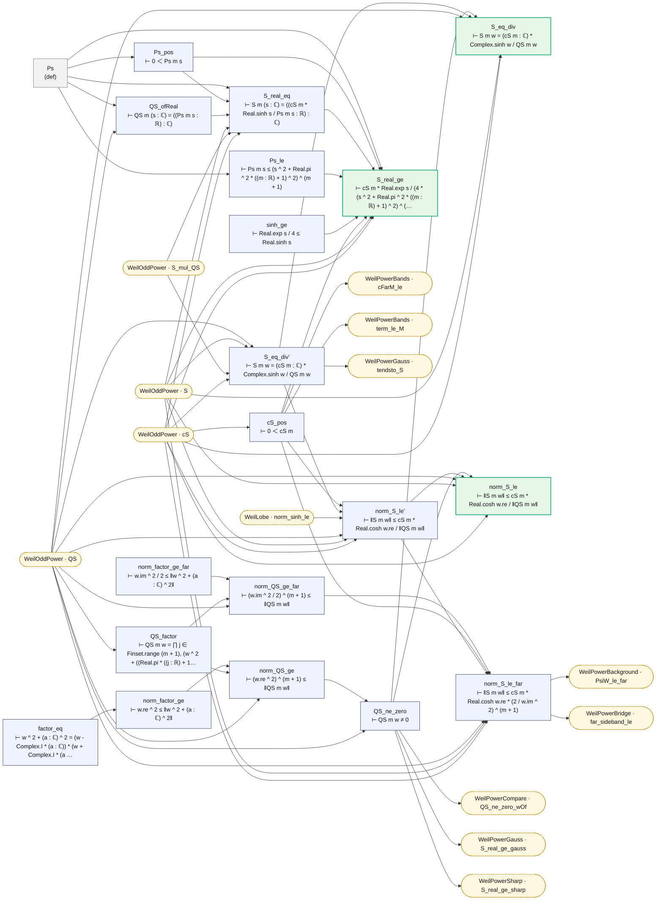

# `lean_stage3/Stage3/WeilPowerBounds.lean`

**What it does** (its own header): WeilPowerBounds — bounds on the odd transform read off its polynomial. Rung 5, fourth slice. 2026-09-06.

**Imports:** [`WeilOddPower`](../lean_stage3/WeilOddPower.md).
**Imported by:** [`Stage3`](../lean_stage3/Stage3.md), [`WeilPowerBackground`](../lean_stage3/WeilPowerBackground.md), [`WeilPowerBridge`](../lean_stage3/WeilPowerBridge.md), [`WeilPowerGauss`](../lean_stage3/WeilPowerGauss.md).

Blue: theorem. Green: a theorem nothing else uses (an end). Dashed white: connects to nothing. Grey: definition. Red: contains `sorry`. Yellow: in another file. An arrow A → B reads "A is used by B".

## Every declaration

| declaration | proves (output) | needs (input) | why (its own docstring) | uses | used by |
|---|---|---|---|---|---|
| `WeilPowerBounds.factor_eq` theorem, line 40 | w ^ 2 + (a : ℂ) ^ 2 = (w - Complex.I * (a : ℂ)) * (w + Complex.I * (a : ℂ)) | w : ℂ; a : ℝ | One factor of the product, factored: `w² + a² = (w − ia)(w + ia)`. | — | `WeilPowerBounds.norm_factor_ge` |
| `WeilPowerBounds.norm_factor_ge` theorem, line 45 | w.re ^ 2 ≤ ‖w ^ 2 + (a : ℂ) ^ 2‖ | w : ℂ; a : ℝ | Each factor has norm at least `(Re w)²`. | `WeilPowerBounds.factor_eq` | `WeilPowerBounds.norm_QS_ge` |
| `WeilPowerBounds.QS_factor` theorem, line 57 | QS m w = ∏ j ∈ Finset.range (m + 1), (w ^ 2 + ((Real.pi * ((j : ℝ) + 1) : ℝ) : ℂ) ^ 2) | m : ℕ; w : ℂ | — | `WeilOddPower.QS` | `WeilPowerBounds.norm_QS_ge`, `WeilPowerBounds.norm_QS_ge_far` |
| `WeilPowerBounds.norm_QS_ge` theorem, line 66 | (w.re ^ 2) ^ (m + 1) ≤ ‖QS m w‖ | m : ℕ; w : ℂ | `‖QS m w‖ ≥ (Re w)^{2(m+1)}`. | `WeilOddPower.QS`, `WeilPowerBounds.QS_factor`, `WeilPowerBounds.norm_factor_ge` | `WeilPowerBounds.QS_ne_zero` |
| `WeilPowerBounds.QS_ne_zero` theorem, line 73 | QS m w ≠ 0 | hw : w.re ≠ 0 | — | `WeilOddPower.QS`, `WeilPowerBounds.norm_QS_ge` | `WeilPowerBounds.S_eq_div`, `WeilPowerBounds.norm_S_le`, `WeilPowerCompare.QS_ne_zero_wOf`, `WeilPowerGauss.S_real_ge_gauss`, `WeilPowerSharp.S_real_ge_sharp` |
| `WeilPowerBounds.cS_pos` theorem, line 80 | 0 &lt; cS m | m : ℕ | — | `WeilOddPower.cS` | `WeilPowerBands.cFarM_le`, `WeilPowerBands.term_le_M`, `WeilPowerBounds.S_real_ge`, `WeilPowerBounds.norm_S_le'`, `WeilPowerBounds.norm_S_le_far` |
| `WeilPowerBounds.S_eq_div'` theorem, line 85 | S m w = (cS m : ℂ) * Complex.sinh w / QS m w | hne : QS m w ≠ 0 | Wherever the product is nonzero the closed form is a quotient. | `WeilOddPower.QS`, `WeilOddPower.S`, `WeilOddPower.S_mul_QS`, `WeilOddPower.cS` | `WeilPowerBounds.S_eq_div`, `WeilPowerBounds.norm_S_le'`, `WeilPowerGauss.tendsto_S` |
| `WeilPowerBounds.S_eq_div` theorem, line 90 | S m w = (cS m : ℂ) * Complex.sinh w / QS m w | hw : w.re ≠ 0 | — | `WeilOddPower.QS`, `WeilOddPower.S`, `WeilOddPower.cS`, `WeilPowerBounds.QS_ne_zero`, `WeilPowerBounds.S_eq_div'` | — |
| `WeilPowerBounds.norm_S_le'` theorem, line 95 | ‖S m w‖ ≤ cS m * Real.cosh w.re / ‖QS m w‖ | hne : QS m w ≠ 0 | The norm of the quotient, bounded by `cosh(Re w)` over the product's norm. | `WeilLobe.norm_sinh_le`, `WeilOddPower.QS`, `WeilOddPower.S`, `WeilOddPower.cS`, `WeilPowerBounds.S_eq_div'`, `WeilPowerBounds.cS_pos` | `WeilPowerBounds.norm_S_le`, `WeilPowerBounds.norm_S_le_far` |
| `WeilPowerBounds.norm_S_le` theorem, line 104 | ‖S m w‖ ≤ cS m * Real.cosh w.re / ‖QS m w‖ | hw : w.re ≠ 0 | Upper bound. `‖S m w‖ ≤ cS m · cosh(Re w) / ‖QS m w‖` for `Re w ≠ 0`. | `WeilOddPower.QS`, `WeilOddPower.S`, `WeilOddPower.cS`, `WeilPowerBounds.QS_ne_zero`, `WeilPowerBounds.norm_S_le'` | — |
| `WeilPowerBounds.norm_factor_ge_far` theorem, line 109 | w.im ^ 2 / 2 ≤ ‖w ^ 2 + (a : ℂ) ^ 2‖ | hfar : 2 * (w.re ^ 2 + a ^ 2) ≤ w.im ^ 2 | Far up in height each factor is at least half the height squared. | — | `WeilPowerBounds.norm_QS_ge_far` |
| `WeilPowerBounds.norm_QS_ge_far` theorem, line 121 | (w.im ^ 2 / 2) ^ (m + 1) ≤ ‖QS m w‖ | hfar : 2 * (w.re ^ 2 + Real.pi ^ 2 * ((m : ℝ) + 1) ^ 2) ≤ w.im ^ 2 | `‖QS m w‖ ≥ ((Im w)²/2)^{m+1}` when `2·((Re w)² + π²(m+1)²) ≤ (Im w)²`. | `WeilOddPower.QS`, `WeilPowerBounds.QS_factor`, `WeilPowerBounds.norm_factor_ge_far` | `WeilPowerBounds.norm_S_le_far` |
| `WeilPowerBounds.norm_S_le_far` theorem, line 142 | ‖S m w‖ ≤ cS m * Real.cosh w.re * (2 / w.im ^ 2) ^ (m + 1) | hfar : 2 * (w.re ^ 2 + Real.pi ^ 2 * ((m : ℝ) + 1) ^ 2) ≤ w.im ^ 2 | Far bound. `‖S m w‖ ≤ cS m · cosh(Re w) · (2/(Im w)²)^{m+1}` when `2·((Re w)² + π²(m+1)²) ≤ (Im w)²`. | `WeilOddPower.QS`, `WeilOddPower.S`, `WeilOddPower.cS`, `WeilPowerBounds.cS_pos`, `WeilPowerBounds.norm_QS_ge_far`, `WeilPowerBounds.norm_S_le'` | `WeilPowerBackground.PsiW_le_far`, `WeilPowerBridge.far_sideband_le` |
| `WeilPowerBounds.Ps` def, line 163 | ℝ | m : ℕ; s : ℝ | The real product `∏_{j=1}^{m+1}(s² + π²j²)`. | — | `WeilPowerBounds.Ps_le`, `WeilPowerBounds.Ps_pos`, `WeilPowerBounds.QS_ofReal`, `WeilPowerBounds.S_real_eq`, `WeilPowerBounds.S_real_ge` |
| `WeilPowerBounds.Ps_pos` theorem, line 166 | 0 &lt; Ps m s | m : ℕ; s : ℝ | — | `WeilPowerBounds.Ps` | `WeilPowerBounds.S_real_eq`, `WeilPowerBounds.S_real_ge` |
| `WeilPowerBounds.QS_ofReal` theorem, line 172 | QS m (s : ℂ) = ((Ps m s : ℝ) : ℂ) | m : ℕ; s : ℝ | — | `WeilOddPower.QS`, `WeilPowerBounds.Ps` | `WeilPowerBounds.S_real_eq` |
| `WeilPowerBounds.S_real_eq` theorem, line 178 | S m (s : ℂ) = ((cS m * Real.sinh s / Ps m s : ℝ) : ℂ) | m : ℕ; s : ℝ | At real `s` the transform is real: `cS m · sinh s / ∏(s² + π²j²)`. | `WeilOddPower.S`, `WeilOddPower.S_mul_QS`, `WeilOddPower.cS`, `WeilPowerBounds.Ps`, `WeilPowerBounds.Ps_pos`, `WeilPowerBounds.QS_ofReal` | `WeilPowerBounds.S_real_ge` |
| `WeilPowerBounds.Ps_le` theorem, line 188 | Ps m s ≤ (s ^ 2 + Real.pi ^ 2 * ((m : ℝ) + 1) ^ 2) ^ (m + 1) | m : ℕ; s : ℝ | `Ps m s ≤ (s² + π²(m+1)²)^{m+1}`. | `WeilPowerBounds.Ps` | `WeilPowerBounds.S_real_ge` |
| `WeilPowerBounds.sinh_ge` theorem, line 203 | Real.exp s / 4 ≤ Real.sinh s | hs : 1 ≤ s | `sinh s ≥ e^s/4` for `s ≥ 1`. | — | `WeilPowerBounds.S_real_ge` |
| `WeilPowerBounds.S_real_ge` theorem, line 217 | cS m * Real.exp s / (4 * (s ^ 2 + Real.pi ^ 2 * ((m : ℝ) + 1) ^ 2) ^ (m + 1)) ≤ (S m (s : ℂ)).re | hs : 1 ≤ s | Lower bound at the target. For `1 ≤ s`, `cS m · e^s / (4·(s² + π²(m+1)²)^{m+1}) ≤ Re (S m s)`. | `WeilOddPower.S`, `WeilOddPower.cS`, `WeilPowerBounds.Ps`, `WeilPowerBounds.Ps_le`, `WeilPowerBounds.Ps_pos`, `WeilPowerBounds.S_real_eq`, `WeilPowerBounds.cS_pos`, `WeilPowerBounds.sinh_ge` | — |
