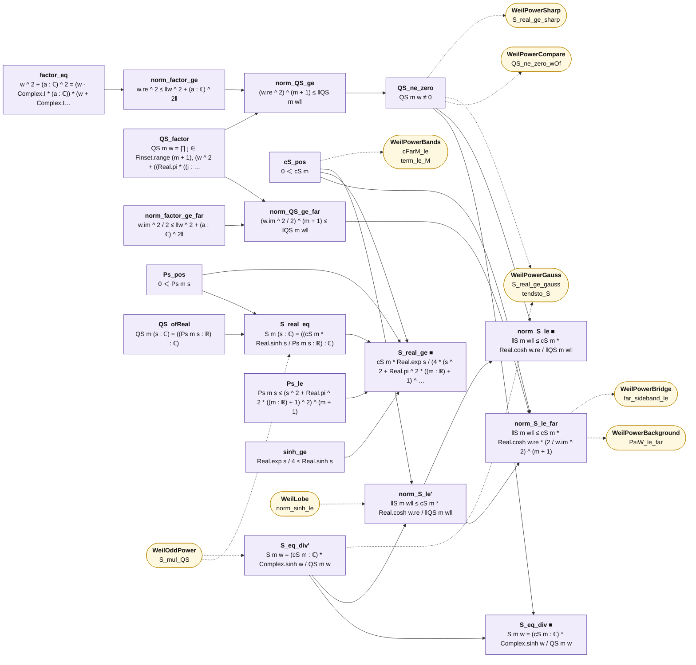

# `lean_stage3/Stage3/WeilPowerBounds.lean`

WeilPowerBounds — bounds on the odd transform read off its polynomial. Rung 5, fourth slice. 2026-09-06.

19 theorems, 1 definition, 250 lines. Arrows are Lean's own record of what each proof uses.

**Imports:** [`WeilOddPower`](../lean_stage3/WeilOddPower.md)  
**Imported by:** [`Stage3`](../lean_stage3/Stage3.md), [`WeilPowerBackground`](../lean_stage3/WeilPowerBackground.md), [`WeilPowerBridge`](../lean_stage3/WeilPowerBridge.md), [`WeilPowerGauss`](../lean_stage3/WeilPowerGauss.md)

## The picture



An arrow A → B reads "A is used in the proof of B". Green: counting, integers only. Violet: shape, analysis with no ζ. Blue: reads ζ. A name ending in ■ is an end: nothing else uses it. Red: contains `sorry`. Yellow: theorems in another file, counted; a dotted arrow crosses files. Definitions are not drawn; they are listed below the diagram.

## Definitions

<a name="WeilPowerBounds-Ps"></a>
### `WeilPowerBounds.Ps`

def · line 163

The real product `∏_{j=1}^{m+1}(s² + π²j²)`.

- **Is:** `` Ps (m : ℕ) (s : ℝ) : ℝ := ∏ j ∈ Finset.range (m + 1), (s ^ 2 + Real.pi ^ 2 * ((j : ℝ) + 1) ^ 2) ``
- **Used by 5:** [`WeilPowerBounds.Ps_le`](#WeilPowerBounds-Ps_le), [`WeilPowerBounds.Ps_pos`](#WeilPowerBounds-Ps_pos), [`WeilPowerBounds.QS_ofReal`](#WeilPowerBounds-QS_ofReal), [`WeilPowerBounds.S_real_eq`](#WeilPowerBounds-S_real_eq), [`WeilPowerBounds.S_real_ge`](#WeilPowerBounds-S_real_ge)

## Theorems

<a name="WeilPowerBounds-factor_eq"></a>
### `WeilPowerBounds.factor_eq`

line 40

**Shape.** Uses real or complex analysis; nothing in it or beneath it reads ζ.

**Why.** One factor of the product, factored: `w² + a² = (w − ia)(w + ia)`.

**Proves**

```lean
w ^ 2 + (a : ℂ) ^ 2 = (w - Complex.I * (a : ℂ)) * (w + Complex.I * (a : ℂ))
```

**Needs** (its hypotheses)

  - `` w : ℂ ``
  - `` a : ℝ ``

**Fed by:** no theorem of this repo; it stands on Mathlib.

**Feeds** (1 that use it)

  - [`WeilPowerBounds.norm_factor_ge`](#WeilPowerBounds-norm_factor_ge) — `` w.re ^ 2 ≤ ‖w ^ 2 + (a : ℂ) ^ 2‖ ``

<a name="WeilPowerBounds-norm_factor_ge"></a>
### `WeilPowerBounds.norm_factor_ge`

line 45

**Shape.** Uses real or complex analysis; nothing in it or beneath it reads ζ.

**Why.** Each factor has norm at least `(Re w)²`.

**Proves**

```lean
w.re ^ 2 ≤ ‖w ^ 2 + (a : ℂ) ^ 2‖
```

**Needs** (its hypotheses)

  - `` w : ℂ ``
  - `` a : ℝ ``

**Fed by** (1 theorem its proof uses)

  - [`WeilPowerBounds.factor_eq`](#WeilPowerBounds-factor_eq) — `` w ^ 2 + (a : ℂ) ^ 2 = (w - Complex.I * (a : ℂ)) * (w + Complex.I * (a : ℂ)) ``

**Feeds** (1 that use it)

  - [`WeilPowerBounds.norm_QS_ge`](#WeilPowerBounds-norm_QS_ge) — `` (w.re ^ 2) ^ (m + 1) ≤ ‖QS m w‖ ``

<a name="WeilPowerBounds-QS_factor"></a>
### `WeilPowerBounds.QS_factor`

line 57

**Shape.** Uses real or complex analysis; nothing in it or beneath it reads ζ.

**Proves**

```lean
QS m w = ∏ j ∈ Finset.range (m + 1), (w ^ 2 + ((Real.pi * ((j : ℝ) + 1) : ℝ) : ℂ) ^ 2)
```

**Needs** (its hypotheses)

  - `` m : ℕ ``
  - `` w : ℂ ``

**Stated with:** [`WeilOddPower.QS`](../lean_stage3/WeilOddPower.md#WeilOddPower-QS)

**Fed by:** no theorem of this repo; it stands on Mathlib and the definitions below.

**Feeds** (2 that use it)

  - [`WeilPowerBounds.norm_QS_ge`](#WeilPowerBounds-norm_QS_ge) — `` (w.re ^ 2) ^ (m + 1) ≤ ‖QS m w‖ ``
  - [`WeilPowerBounds.norm_QS_ge_far`](#WeilPowerBounds-norm_QS_ge_far) — `` (w.im ^ 2 / 2) ^ (m + 1) ≤ ‖QS m w‖ ``

<a name="WeilPowerBounds-norm_QS_ge"></a>
### `WeilPowerBounds.norm_QS_ge`

line 66

**Shape.** Uses real or complex analysis; nothing in it or beneath it reads ζ.

**Why.** `‖QS m w‖ ≥ (Re w)^{2(m+1)}`.

**Proves**

```lean
(w.re ^ 2) ^ (m + 1) ≤ ‖QS m w‖
```

**Needs** (its hypotheses)

  - `` m : ℕ ``
  - `` w : ℂ ``

**Stated with:** [`WeilOddPower.QS`](../lean_stage3/WeilOddPower.md#WeilOddPower-QS)

**Fed by** (2 theorems its proof uses)

  - [`WeilPowerBounds.QS_factor`](#WeilPowerBounds-QS_factor) — `` QS m w = ∏ j ∈ Finset.range (m + 1), (w ^ 2 + ((Real.pi * ((j : ℝ) + 1) : ℝ) : ℂ) ^ 2) ``
  - [`WeilPowerBounds.norm_factor_ge`](#WeilPowerBounds-norm_factor_ge) — `` w.re ^ 2 ≤ ‖w ^ 2 + (a : ℂ) ^ 2‖ ``

**Feeds** (1 that use it)

  - [`WeilPowerBounds.QS_ne_zero`](#WeilPowerBounds-QS_ne_zero) — `` QS m w ≠ 0 ``

<a name="WeilPowerBounds-QS_ne_zero"></a>
### `WeilPowerBounds.QS_ne_zero`

line 73

**Shape.** Uses real or complex analysis; nothing in it or beneath it reads ζ.

**Proves**

```lean
QS m w ≠ 0
```

**Needs** (its hypotheses)

  - `` hw : w.re ≠ 0 ``

**Stated with:** [`WeilOddPower.QS`](../lean_stage3/WeilOddPower.md#WeilOddPower-QS)

**Fed by** (1 theorem its proof uses)

  - [`WeilPowerBounds.norm_QS_ge`](#WeilPowerBounds-norm_QS_ge) — `` (w.re ^ 2) ^ (m + 1) ≤ ‖QS m w‖ ``

**Feeds** (5 that use it)

  - [`WeilPowerBounds.S_eq_div`](#WeilPowerBounds-S_eq_div) — `` S m w = (cS m : ℂ) * Complex.sinh w / QS m w ``
  - [`WeilPowerBounds.norm_S_le`](#WeilPowerBounds-norm_S_le) — `` ‖S m w‖ ≤ cS m * Real.cosh w.re / ‖QS m w‖ ``
  - [`WeilPowerCompare.QS_ne_zero_wOf`](../lean_stage3/WeilPowerCompare.md#WeilPowerCompare-QS_ne_zero_wOf) (WeilPowerCompare) — `` QS m (wOf ε Δ h) ≠ 0 ``
  - [`WeilPowerGauss.S_real_ge_gauss`](../lean_stage3/WeilPowerGauss.md#WeilPowerGauss-S_real_ge_gauss) (WeilPowerGauss) — `` 4 / (Real.pi * ((m : ℝ) + 1) * (2 * (m : ℝ) + 3)) * s * Real.exp (s ^ 2 * ((m : ℝ) + 2) / (Real.pi ^ 2 * (2 * (m : ℝ) + 3) ^ 2) - s ^ 4 / (Real.pi ^ 4… ``
  - [`WeilPowerSharp.S_real_ge_sharp`](../lean_stage3/WeilPowerSharp.md#WeilPowerSharp-S_real_ge_sharp) (WeilPowerSharp) — `` cS m / D m * s * Real.exp (s ^ 2 / (Real.pi ^ 2 * ((m : ℝ) + 2)) - s ^ 4 / (Real.pi ^ 4 * ((m : ℝ) + 1) ^ 3)) ≤ (S m (s : ℂ)).re ``

<a name="WeilPowerBounds-cS_pos"></a>
### `WeilPowerBounds.cS_pos`

line 80

**Shape.** Uses real or complex analysis; nothing in it or beneath it reads ζ.

**Proves**

```lean
0 < cS m
```

**Needs** (its hypotheses)

  - `` m : ℕ ``

**Stated with:** [`WeilOddPower.cS`](../lean_stage3/WeilOddPower.md#WeilOddPower-cS)

**Fed by:** no theorem of this repo; it stands on Mathlib and the definitions below.

**Feeds** (5 that use it)

  - [`WeilPowerBands.cFarM_le`](../lean_stage3/WeilPowerBands.md#WeilPowerBands-cFarM_le) (WeilPowerBands) — `` cFarM m ≤ 1000 * ((m : ℝ) + 1) ^ 2 ``
  - [`WeilPowerBands.term_le_M`](../lean_stage3/WeilPowerBands.md#WeilPowerBands-term_le_M) (WeilPowerBands) — `` termW h γ m ρ ≤ M h γ m (idx (ρ : ℂ).im) ``
  - [`WeilPowerBounds.S_real_ge`](#WeilPowerBounds-S_real_ge) — `` cS m * Real.exp s / (4 * (s ^ 2 + Real.pi ^ 2 * ((m : ℝ) + 1) ^ 2) ^ (m + 1)) ≤ (S m (s : ℂ)).re ``
  - [`WeilPowerBounds.norm_S_le'`](#WeilPowerBounds-norm_S_le-) — `` ‖S m w‖ ≤ cS m * Real.cosh w.re / ‖QS m w‖ ``
  - [`WeilPowerBounds.norm_S_le_far`](#WeilPowerBounds-norm_S_le_far) — `` ‖S m w‖ ≤ cS m * Real.cosh w.re * (2 / w.im ^ 2) ^ (m + 1) ``

<a name="WeilPowerBounds-S_eq_div-"></a>
### `WeilPowerBounds.S_eq_div'`

line 85

**Shape.** Uses real or complex analysis; nothing in it or beneath it reads ζ.

**Why.** Wherever the product is nonzero the closed form is a quotient.

**Proves**

```lean
S m w = (cS m : ℂ) * Complex.sinh w / QS m w
```

**Needs** (its hypotheses)

  - `` hne : QS m w ≠ 0 ``

**Stated with:** [`WeilOddPower.QS`](../lean_stage3/WeilOddPower.md#WeilOddPower-QS), [`WeilOddPower.S`](../lean_stage3/WeilOddPower.md#WeilOddPower-S), [`WeilOddPower.cS`](../lean_stage3/WeilOddPower.md#WeilOddPower-cS)

**Fed by** (1 theorem its proof uses)

  - [`WeilOddPower.S_mul_QS`](../lean_stage3/WeilOddPower.md#WeilOddPower-S_mul_QS) (WeilOddPower) — `` S m w * QS m w = (cS m : ℂ) * Complex.sinh w ``

**Feeds** (3 that use it)

  - [`WeilPowerBounds.S_eq_div`](#WeilPowerBounds-S_eq_div) — `` S m w = (cS m : ℂ) * Complex.sinh w / QS m w ``
  - [`WeilPowerBounds.norm_S_le'`](#WeilPowerBounds-norm_S_le-) — `` ‖S m w‖ ≤ cS m * Real.cosh w.re / ‖QS m w‖ ``
  - [`WeilPowerGauss.tendsto_S`](../lean_stage3/WeilPowerGauss.md#WeilPowerGauss-tendsto_S) (WeilPowerGauss) — `` Tendsto (fun n : ℕ => ((cS m / D m : ℝ) : ℂ) * w * T m w n) atTop (𝓝 (S m w)) ``

<a name="WeilPowerBounds-S_eq_div"></a>
### `WeilPowerBounds.S_eq_div`

line 90

**Shape.** Uses real or complex analysis; nothing in it or beneath it reads ζ.

**Proves**

```lean
S m w = (cS m : ℂ) * Complex.sinh w / QS m w
```

**Needs** (its hypotheses)

  - `` hw : w.re ≠ 0 ``

**Stated with:** [`WeilOddPower.QS`](../lean_stage3/WeilOddPower.md#WeilOddPower-QS), [`WeilOddPower.S`](../lean_stage3/WeilOddPower.md#WeilOddPower-S), [`WeilOddPower.cS`](../lean_stage3/WeilOddPower.md#WeilOddPower-cS)

**Fed by** (2 theorems its proof uses)

  - [`WeilPowerBounds.QS_ne_zero`](#WeilPowerBounds-QS_ne_zero) — `` QS m w ≠ 0 ``
  - [`WeilPowerBounds.S_eq_div'`](#WeilPowerBounds-S_eq_div-) — `` S m w = (cS m : ℂ) * Complex.sinh w / QS m w ``

**Feeds:** nothing. It is an end.

<a name="WeilPowerBounds-norm_S_le-"></a>
### `WeilPowerBounds.norm_S_le'`

line 95

**Shape.** Uses real or complex analysis; nothing in it or beneath it reads ζ.

**Why.** The norm of the quotient, bounded by `cosh(Re w)` over the product's norm.

**Proves**

```lean
‖S m w‖ ≤ cS m * Real.cosh w.re / ‖QS m w‖
```

**Needs** (its hypotheses)

  - `` hne : QS m w ≠ 0 ``

**Stated with:** [`WeilOddPower.QS`](../lean_stage3/WeilOddPower.md#WeilOddPower-QS), [`WeilOddPower.S`](../lean_stage3/WeilOddPower.md#WeilOddPower-S), [`WeilOddPower.cS`](../lean_stage3/WeilOddPower.md#WeilOddPower-cS)

**Fed by** (3 theorems its proof uses)

  - [`WeilLobe.norm_sinh_le`](../lean_stage3/WeilLobe.md#WeilLobe-norm_sinh_le) (WeilLobe) — `` ‖Complex.sinh z‖ ≤ Real.cosh z.re ``
  - [`WeilPowerBounds.S_eq_div'`](#WeilPowerBounds-S_eq_div-) — `` S m w = (cS m : ℂ) * Complex.sinh w / QS m w ``
  - [`WeilPowerBounds.cS_pos`](#WeilPowerBounds-cS_pos) — `` 0 < cS m ``

**Feeds** (2 that use it)

  - [`WeilPowerBounds.norm_S_le`](#WeilPowerBounds-norm_S_le) — `` ‖S m w‖ ≤ cS m * Real.cosh w.re / ‖QS m w‖ ``
  - [`WeilPowerBounds.norm_S_le_far`](#WeilPowerBounds-norm_S_le_far) — `` ‖S m w‖ ≤ cS m * Real.cosh w.re * (2 / w.im ^ 2) ^ (m + 1) ``

<a name="WeilPowerBounds-norm_S_le"></a>
### `WeilPowerBounds.norm_S_le`

line 104

**Shape.** Uses real or complex analysis; nothing in it or beneath it reads ζ.

**Why.** Upper bound. `‖S m w‖ ≤ cS m · cosh(Re w) / ‖QS m w‖` for `Re w ≠ 0`.

**Proves**

```lean
‖S m w‖ ≤ cS m * Real.cosh w.re / ‖QS m w‖
```

**Needs** (its hypotheses)

  - `` hw : w.re ≠ 0 ``

**Stated with:** [`WeilOddPower.QS`](../lean_stage3/WeilOddPower.md#WeilOddPower-QS), [`WeilOddPower.S`](../lean_stage3/WeilOddPower.md#WeilOddPower-S), [`WeilOddPower.cS`](../lean_stage3/WeilOddPower.md#WeilOddPower-cS)

**Fed by** (2 theorems its proof uses)

  - [`WeilPowerBounds.QS_ne_zero`](#WeilPowerBounds-QS_ne_zero) — `` QS m w ≠ 0 ``
  - [`WeilPowerBounds.norm_S_le'`](#WeilPowerBounds-norm_S_le-) — `` ‖S m w‖ ≤ cS m * Real.cosh w.re / ‖QS m w‖ ``

**Feeds:** nothing. It is an end.

<a name="WeilPowerBounds-norm_factor_ge_far"></a>
### `WeilPowerBounds.norm_factor_ge_far`

line 109

**Shape.** Uses real or complex analysis; nothing in it or beneath it reads ζ.

**Why.** Far up in height each factor is at least half the height squared.

**Proves**

```lean
w.im ^ 2 / 2 ≤ ‖w ^ 2 + (a : ℂ) ^ 2‖
```

**Needs** (its hypotheses)

  - `` hfar : 2 * (w.re ^ 2 + a ^ 2) ≤ w.im ^ 2 ``

**Fed by:** no theorem of this repo; it stands on Mathlib.

**Feeds** (1 that use it)

  - [`WeilPowerBounds.norm_QS_ge_far`](#WeilPowerBounds-norm_QS_ge_far) — `` (w.im ^ 2 / 2) ^ (m + 1) ≤ ‖QS m w‖ ``

<a name="WeilPowerBounds-norm_QS_ge_far"></a>
### `WeilPowerBounds.norm_QS_ge_far`

line 121

**Shape.** Uses real or complex analysis; nothing in it or beneath it reads ζ.

**Why.** `‖QS m w‖ ≥ ((Im w)²/2)^{m+1}` when `2·((Re w)² + π²(m+1)²) ≤ (Im w)²`.

**Proves**

```lean
(w.im ^ 2 / 2) ^ (m + 1) ≤ ‖QS m w‖
```

**Needs** (its hypotheses)

  - `` hfar : 2 * (w.re ^ 2 + Real.pi ^ 2 * ((m : ℝ) + 1) ^ 2) ≤ w.im ^ 2 ``

**Stated with:** [`WeilOddPower.QS`](../lean_stage3/WeilOddPower.md#WeilOddPower-QS)

**Fed by** (2 theorems its proof uses)

  - [`WeilPowerBounds.QS_factor`](#WeilPowerBounds-QS_factor) — `` QS m w = ∏ j ∈ Finset.range (m + 1), (w ^ 2 + ((Real.pi * ((j : ℝ) + 1) : ℝ) : ℂ) ^ 2) ``
  - [`WeilPowerBounds.norm_factor_ge_far`](#WeilPowerBounds-norm_factor_ge_far) — `` w.im ^ 2 / 2 ≤ ‖w ^ 2 + (a : ℂ) ^ 2‖ ``

**Feeds** (1 that use it)

  - [`WeilPowerBounds.norm_S_le_far`](#WeilPowerBounds-norm_S_le_far) — `` ‖S m w‖ ≤ cS m * Real.cosh w.re * (2 / w.im ^ 2) ^ (m + 1) ``

<a name="WeilPowerBounds-norm_S_le_far"></a>
### `WeilPowerBounds.norm_S_le_far`

line 142

**Shape.** Uses real or complex analysis; nothing in it or beneath it reads ζ.

**Why.** Far bound. `‖S m w‖ ≤ cS m · cosh(Re w) · (2/(Im w)²)^{m+1}` when `2·((Re w)² + π²(m+1)²) ≤ (Im w)²`.

**Proves**

```lean
‖S m w‖ ≤ cS m * Real.cosh w.re * (2 / w.im ^ 2) ^ (m + 1)
```

**Needs** (its hypotheses)

  - `` hfar : 2 * (w.re ^ 2 + Real.pi ^ 2 * ((m : ℝ) + 1) ^ 2) ≤ w.im ^ 2 ``

**Stated with:** [`WeilOddPower.S`](../lean_stage3/WeilOddPower.md#WeilOddPower-S), [`WeilOddPower.cS`](../lean_stage3/WeilOddPower.md#WeilOddPower-cS)

**Fed by** (3 theorems its proof uses)

  - [`WeilPowerBounds.cS_pos`](#WeilPowerBounds-cS_pos) — `` 0 < cS m ``
  - [`WeilPowerBounds.norm_QS_ge_far`](#WeilPowerBounds-norm_QS_ge_far) — `` (w.im ^ 2 / 2) ^ (m + 1) ≤ ‖QS m w‖ ``
  - [`WeilPowerBounds.norm_S_le'`](#WeilPowerBounds-norm_S_le-) — `` ‖S m w‖ ≤ cS m * Real.cosh w.re / ‖QS m w‖ ``

**Definitions its proof touches:** [`WeilOddPower.QS`](../lean_stage3/WeilOddPower.md#WeilOddPower-QS)

**Feeds** (2 that use it)

  - [`WeilPowerBackground.PsiW_le_far`](../lean_stage3/WeilPowerBackground.md#WeilPowerBackground-PsiW_le_far) (WeilPowerBackground) — `` |PsiW m t| ≤ cS m * (2 / t ^ 2) ^ (m + 1) ``
  - [`WeilPowerBridge.far_sideband_le`](../lean_stage3/WeilPowerBridge.md#WeilPowerBridge-far_sideband_le) (WeilPowerBridge) — `` ‖S m (wp h γ ρ)‖ ≤ cS m * Real.cosh ((ρ.re - 1 / 2) * h) * (2 / ((ρ.im + γ) * h) ^ 2) ^ (m + 1) ``

<a name="WeilPowerBounds-Ps_pos"></a>
### `WeilPowerBounds.Ps_pos`

line 166

**Shape.** Uses real or complex analysis; nothing in it or beneath it reads ζ.

**Proves**

```lean
0 < Ps m s
```

**Needs** (its hypotheses)

  - `` m : ℕ ``
  - `` s : ℝ ``

**Stated with:** [`WeilPowerBounds.Ps`](#WeilPowerBounds-Ps)

**Fed by:** no theorem of this repo; it stands on Mathlib and the definitions below.

**Feeds** (2 that use it)

  - [`WeilPowerBounds.S_real_eq`](#WeilPowerBounds-S_real_eq) — `` S m (s : ℂ) = ((cS m * Real.sinh s / Ps m s : ℝ) : ℂ) ``
  - [`WeilPowerBounds.S_real_ge`](#WeilPowerBounds-S_real_ge) — `` cS m * Real.exp s / (4 * (s ^ 2 + Real.pi ^ 2 * ((m : ℝ) + 1) ^ 2) ^ (m + 1)) ≤ (S m (s : ℂ)).re ``

<a name="WeilPowerBounds-QS_ofReal"></a>
### `WeilPowerBounds.QS_ofReal`

line 172

**Shape.** Uses real or complex analysis; nothing in it or beneath it reads ζ.

**Proves**

```lean
QS m (s : ℂ) = ((Ps m s : ℝ) : ℂ)
```

**Needs** (its hypotheses)

  - `` m : ℕ ``
  - `` s : ℝ ``

**Stated with:** [`WeilOddPower.QS`](../lean_stage3/WeilOddPower.md#WeilOddPower-QS), [`WeilPowerBounds.Ps`](#WeilPowerBounds-Ps)

**Fed by:** no theorem of this repo; it stands on Mathlib and the definitions below.

**Feeds** (1 that use it)

  - [`WeilPowerBounds.S_real_eq`](#WeilPowerBounds-S_real_eq) — `` S m (s : ℂ) = ((cS m * Real.sinh s / Ps m s : ℝ) : ℂ) ``

<a name="WeilPowerBounds-S_real_eq"></a>
### `WeilPowerBounds.S_real_eq`

line 178

**Shape.** Uses real or complex analysis; nothing in it or beneath it reads ζ.

**Why.** At real `s` the transform is real: `cS m · sinh s / ∏(s² + π²j²)`.

**Proves**

```lean
S m (s : ℂ) = ((cS m * Real.sinh s / Ps m s : ℝ) : ℂ)
```

**Needs** (its hypotheses)

  - `` m : ℕ ``
  - `` s : ℝ ``

**Stated with:** [`WeilOddPower.S`](../lean_stage3/WeilOddPower.md#WeilOddPower-S), [`WeilOddPower.cS`](../lean_stage3/WeilOddPower.md#WeilOddPower-cS), [`WeilPowerBounds.Ps`](#WeilPowerBounds-Ps)

**Fed by** (3 theorems its proof uses)

  - [`WeilOddPower.S_mul_QS`](../lean_stage3/WeilOddPower.md#WeilOddPower-S_mul_QS) (WeilOddPower) — `` S m w * QS m w = (cS m : ℂ) * Complex.sinh w ``
  - [`WeilPowerBounds.Ps_pos`](#WeilPowerBounds-Ps_pos) — `` 0 < Ps m s ``
  - [`WeilPowerBounds.QS_ofReal`](#WeilPowerBounds-QS_ofReal) — `` QS m (s : ℂ) = ((Ps m s : ℝ) : ℂ) ``

**Definitions its proof touches:** [`WeilOddPower.QS`](../lean_stage3/WeilOddPower.md#WeilOddPower-QS)

**Feeds** (1 that use it)

  - [`WeilPowerBounds.S_real_ge`](#WeilPowerBounds-S_real_ge) — `` cS m * Real.exp s / (4 * (s ^ 2 + Real.pi ^ 2 * ((m : ℝ) + 1) ^ 2) ^ (m + 1)) ≤ (S m (s : ℂ)).re ``

<a name="WeilPowerBounds-Ps_le"></a>
### `WeilPowerBounds.Ps_le`

line 188

**Shape.** Uses real or complex analysis; nothing in it or beneath it reads ζ.

**Why.** `Ps m s ≤ (s² + π²(m+1)²)^{m+1}`.

**Proves**

```lean
Ps m s ≤ (s ^ 2 + Real.pi ^ 2 * ((m : ℝ) + 1) ^ 2) ^ (m + 1)
```

**Needs** (its hypotheses)

  - `` m : ℕ ``
  - `` s : ℝ ``

**Stated with:** [`WeilPowerBounds.Ps`](#WeilPowerBounds-Ps)

**Fed by:** no theorem of this repo; it stands on Mathlib and the definitions below.

**Feeds** (1 that use it)

  - [`WeilPowerBounds.S_real_ge`](#WeilPowerBounds-S_real_ge) — `` cS m * Real.exp s / (4 * (s ^ 2 + Real.pi ^ 2 * ((m : ℝ) + 1) ^ 2) ^ (m + 1)) ≤ (S m (s : ℂ)).re ``

<a name="WeilPowerBounds-sinh_ge"></a>
### `WeilPowerBounds.sinh_ge`

line 203

**Shape.** Uses real or complex analysis; nothing in it or beneath it reads ζ.

**Why.** `sinh s ≥ e^s/4` for `s ≥ 1`.

**Proves**

```lean
Real.exp s / 4 ≤ Real.sinh s
```

**Needs** (its hypotheses)

  - `` hs : 1 ≤ s ``

**Fed by:** no theorem of this repo; it stands on Mathlib.

**Feeds** (1 that use it)

  - [`WeilPowerBounds.S_real_ge`](#WeilPowerBounds-S_real_ge) — `` cS m * Real.exp s / (4 * (s ^ 2 + Real.pi ^ 2 * ((m : ℝ) + 1) ^ 2) ^ (m + 1)) ≤ (S m (s : ℂ)).re ``

<a name="WeilPowerBounds-S_real_ge"></a>
### `WeilPowerBounds.S_real_ge`

line 217

**Shape.** Uses real or complex analysis; nothing in it or beneath it reads ζ.

**Why.** Lower bound at the target. For `1 ≤ s`, `cS m · e^s / (4·(s² + π²(m+1)²)^{m+1}) ≤ Re (S m s)`.

**Proves**

```lean
cS m * Real.exp s / (4 * (s ^ 2 + Real.pi ^ 2 * ((m : ℝ) + 1) ^ 2) ^ (m + 1)) ≤ (S m (s : ℂ)).re
```

**Needs** (its hypotheses)

  - `` hs : 1 ≤ s ``

**Stated with:** [`WeilOddPower.S`](../lean_stage3/WeilOddPower.md#WeilOddPower-S), [`WeilOddPower.cS`](../lean_stage3/WeilOddPower.md#WeilOddPower-cS)

**Fed by** (5 theorems its proof uses)

  - [`WeilPowerBounds.Ps_le`](#WeilPowerBounds-Ps_le) — `` Ps m s ≤ (s ^ 2 + Real.pi ^ 2 * ((m : ℝ) + 1) ^ 2) ^ (m + 1) ``
  - [`WeilPowerBounds.Ps_pos`](#WeilPowerBounds-Ps_pos) — `` 0 < Ps m s ``
  - [`WeilPowerBounds.S_real_eq`](#WeilPowerBounds-S_real_eq) — `` S m (s : ℂ) = ((cS m * Real.sinh s / Ps m s : ℝ) : ℂ) ``
  - [`WeilPowerBounds.cS_pos`](#WeilPowerBounds-cS_pos) — `` 0 < cS m ``
  - [`WeilPowerBounds.sinh_ge`](#WeilPowerBounds-sinh_ge) — `` Real.exp s / 4 ≤ Real.sinh s ``

**Definitions its proof touches:** [`WeilPowerBounds.Ps`](#WeilPowerBounds-Ps)

**Feeds:** nothing. It is an end.

