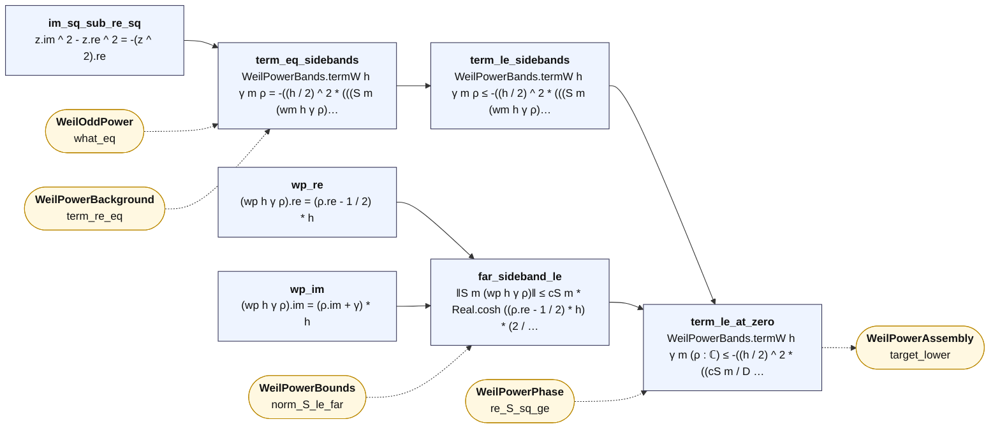

# `lean_stage3/Stage3/WeilPowerBridge.lean`

WeilPowerBridge — the term at an actual zero: two sidebands, the far one bounded. Rung 5, twentieth slice; worksheet § 13 block 13j. 2026-09-07.

7 theorems, 2 definitions, 213 lines. Arrows are Lean's own record of what each proof uses.

**Imports:** [`WeilPowerBands`](../lean_stage3/WeilPowerBands.md), [`WeilPowerBounds`](../lean_stage3/WeilPowerBounds.md), [`WeilPowerPhase`](../lean_stage3/WeilPowerPhase.md)  
**Imported by:** [`Stage3`](../lean_stage3/Stage3.md), [`WeilPowerAssembly`](../lean_stage3/WeilPowerAssembly.md)

## The picture



An arrow A → B reads "A is used in the proof of B". Blue: theorem. Green: a theorem nothing else uses (an end). Dashed: connects to nothing. Red: contains `sorry`. Yellow: theorems in another file, counted; a dotted arrow crosses files. Definitions are not drawn; they are listed below the diagram.

## Definitions

<a name="WeilPowerBridge-wp"></a>
### `WeilPowerBridge.wp`

def · line 72

The far sideband: `w₊ = (ρ − 1/2 + iγ)h`.

- **Is:** `` wp (h γ : ℝ) (ρ : ℂ) : ℂ := (ρ - 1 / 2 + Complex.I * (γ : ℂ)) * (h : ℂ) ``
- **Used by 6:** [`WeilPowerBridge.far_sideband_le`](#WeilPowerBridge-far_sideband_le), [`WeilPowerBridge.term_eq_sidebands`](#WeilPowerBridge-term_eq_sidebands), [`WeilPowerBridge.term_le_at_zero`](#WeilPowerBridge-term_le_at_zero), [`WeilPowerBridge.term_le_sidebands`](#WeilPowerBridge-term_le_sidebands), [`WeilPowerBridge.wp_im`](#WeilPowerBridge-wp_im), [`WeilPowerBridge.wp_re`](#WeilPowerBridge-wp_re)

<a name="WeilPowerBridge-wm"></a>
### `WeilPowerBridge.wm`

def · line 75

The near sideband: `w₋ = (ρ − 1/2 − iγ)h`.

- **Is:** `` wm (h γ : ℝ) (ρ : ℂ) : ℂ := (ρ - 1 / 2 - Complex.I * (γ : ℂ)) * (h : ℂ) ``
- **Used by 4:** [`WeilPowerAssembly.target_lower`](../lean_stage3/WeilPowerAssembly.md#WeilPowerAssembly-target_lower), [`WeilPowerBridge.term_eq_sidebands`](#WeilPowerBridge-term_eq_sidebands), [`WeilPowerBridge.term_le_at_zero`](#WeilPowerBridge-term_le_at_zero), [`WeilPowerBridge.term_le_sidebands`](#WeilPowerBridge-term_le_sidebands)

## Theorems

<a name="WeilPowerBridge-im_sq_sub_re_sq"></a>
### `WeilPowerBridge.im_sq_sub_re_sq`

line 79

**Why.** `Im(z)² − Re(z)² = −Re(z²)`: the arithmetic that turns the background's term into a square.

**Proves**

```lean
z.im ^ 2 - z.re ^ 2 = -(z ^ 2).re
```

**Needs** (its hypotheses)

  - `` z : ℂ ``

**Fed by:** no theorem of this repo; it stands on Mathlib.

**Feeds** (1 that use it)

  - [`WeilPowerBridge.term_eq_sidebands`](#WeilPowerBridge-term_eq_sidebands) — `` WeilPowerBands.termW h γ m ρ = -((h / 2) ^ 2 * (((S m (wm h γ ρ)) ^ 2).re + 2 * (S m (wp h γ ρ) * S m (wm h γ ρ)).re + ((S m (wp h γ ρ)) ^ 2).re)) ``

<a name="WeilPowerBridge-term_eq_sidebands"></a>
### `WeilPowerBridge.term_eq_sidebands`

line 85

**Why.** The term of the zero form at `ρ`, read at the two sidebands: the window is a cosine at height `γ` times an envelope, so `what` is `(h/2)(S₊ + S₋)` and the term is `−(h/2)²` times the real part of its square.

**Proves**

```lean
WeilPowerBands.termW h γ m ρ = -((h / 2) ^ 2 * (((S m (wm h γ ρ)) ^ 2).re + 2 * (S m (wp h γ ρ) * S m (wm h γ ρ)).re + ((S m (wp h γ ρ)) ^ 2).re))
```

**Needs** (its hypotheses)

  - `` hh : 0 < h ``
  - `` γ : ℝ ``
  - `` m : ℕ ``
  - `` ρ : ℂ ``

**Stated with:** [`WeilOddPower.S`](../lean_stage3/WeilOddPower.md#WeilOddPower-S), [`WeilPowerBands.termW`](../lean_stage3/WeilPowerBands.md#WeilPowerBands-termW), [`WeilPowerBridge.wm`](#WeilPowerBridge-wm), [`WeilPowerBridge.wp`](#WeilPowerBridge-wp)

**Fed by** (3 theorems its proof uses)

  - [`WeilOddPower.what_eq`](../lean_stage3/WeilOddPower.md#WeilOddPower-what_eq) (WeilOddPower) — `` what h γ m z = ((h : ℂ) / 2) * (S m ((z + Complex.I * (γ : ℂ)) * (h : ℂ)) + S m ((z - Complex.I * (γ : ℂ)) * (h : ℂ))) ``
  - [`WeilPowerBackground.term_re_eq`](../lean_stage3/WeilPowerBackground.md#WeilPowerBackground-term_re_eq) (WeilPowerBackground) — `` (laplace (phiWC h γ m) (-ρ) * laplace (phiWC h γ m) (-(1 - ρ))).re = (what h γ m (ρ - 1 / 2)).im ^ 2 - (what h γ m (ρ - 1 / 2)).re ^ 2 ``
  - [`WeilPowerBridge.im_sq_sub_re_sq`](#WeilPowerBridge-im_sq_sub_re_sq) — `` z.im ^ 2 - z.re ^ 2 = -(z ^ 2).re ``

**Definitions its proof touches:** [`WeilDetect.laplace`](../lean_stage3/WeilDetect.md#WeilDetect-laplace), [`WeilOddPower.what`](../lean_stage3/WeilOddPower.md#WeilOddPower-what), [`WeilPowerBackground.phiWC`](../lean_stage3/WeilPowerBackground.md#WeilPowerBackground-phiWC)

**Feeds** (1 that use it)

  - [`WeilPowerBridge.term_le_sidebands`](#WeilPowerBridge-term_le_sidebands) — `` WeilPowerBands.termW h γ m ρ ≤ -((h / 2) ^ 2 * (((S m (wm h γ ρ)) ^ 2).re - 2 * ‖S m (wp h γ ρ)‖ * ‖S m (wm h γ ρ)‖ - ‖S m (wp h γ ρ)‖ ^ 2)) ``

<a name="WeilPowerBridge-term_le_sidebands"></a>
### `WeilPowerBridge.term_le_sidebands`

line 103

**Why.** The same term with the two unbounded pieces sent to their norms: `Re(S₊S₋) ≥ −‖S₊‖‖S₋‖` and `Re(S₊²) ≥ −‖S₊‖²`, and a larger bracket makes the term more negative.

**Proves**

```lean
WeilPowerBands.termW h γ m ρ ≤ -((h / 2) ^ 2 * (((S m (wm h γ ρ)) ^ 2).re - 2 * ‖S m (wp h γ ρ)‖ * ‖S m (wm h γ ρ)‖ - ‖S m (wp h γ ρ)‖ ^ 2))
```

**Needs** (its hypotheses)

  - `` hh : 0 < h ``
  - `` γ : ℝ ``
  - `` m : ℕ ``
  - `` ρ : ℂ ``

**Stated with:** [`WeilOddPower.S`](../lean_stage3/WeilOddPower.md#WeilOddPower-S), [`WeilPowerBands.termW`](../lean_stage3/WeilPowerBands.md#WeilPowerBands-termW), [`WeilPowerBridge.wm`](#WeilPowerBridge-wm), [`WeilPowerBridge.wp`](#WeilPowerBridge-wp)

**Fed by** (1 theorem its proof uses)

  - [`WeilPowerBridge.term_eq_sidebands`](#WeilPowerBridge-term_eq_sidebands) — `` WeilPowerBands.termW h γ m ρ = -((h / 2) ^ 2 * (((S m (wm h γ ρ)) ^ 2).re + 2 * (S m (wp h γ ρ) * S m (wm h γ ρ)).re + ((S m (wp h γ ρ)) ^ 2).re)) ``

**Feeds** (1 that use it)

  - [`WeilPowerBridge.term_le_at_zero`](#WeilPowerBridge-term_le_at_zero) — `` WeilPowerBands.termW h γ m (ρ : ℂ) ≤ -((h / 2) ^ 2 * ((cS m / D m) ^ 2 * Real.exp (2 * ((wm h γ (ρ : ℂ)) ^ 2).re * sigma m) * (((wm h γ (ρ : ℂ)) ^ 2).… ``

<a name="WeilPowerBridge-wp_re"></a>
### `WeilPowerBridge.wp_re`

line 127

**Why.** `Re w₊ = (ρ.re − 1/2)h`.

**Proves**

```lean
(wp h γ ρ).re = (ρ.re - 1 / 2) * h
```

**Needs** (its hypotheses)

  - `` h γ : ℝ ``
  - `` ρ : ℂ ``

**Stated with:** [`WeilPowerBridge.wp`](#WeilPowerBridge-wp)

**Fed by:** no theorem of this repo; it stands on Mathlib and the definitions below.

**Feeds** (1 that use it)

  - [`WeilPowerBridge.far_sideband_le`](#WeilPowerBridge-far_sideband_le) — `` ‖S m (wp h γ ρ)‖ ≤ cS m * Real.cosh ((ρ.re - 1 / 2) * h) * (2 / ((ρ.im + γ) * h) ^ 2) ^ (m + 1) ``

<a name="WeilPowerBridge-wp_im"></a>
### `WeilPowerBridge.wp_im`

line 133

**Why.** `Im w₊ = (ρ.im + γ)h`: the far sideband sits at about `2γh` when `ρ` is near height `γ`.

**Proves**

```lean
(wp h γ ρ).im = (ρ.im + γ) * h
```

**Needs** (its hypotheses)

  - `` h γ : ℝ ``
  - `` ρ : ℂ ``

**Stated with:** [`WeilPowerBridge.wp`](#WeilPowerBridge-wp)

**Fed by:** no theorem of this repo; it stands on Mathlib and the definitions below.

**Feeds** (1 that use it)

  - [`WeilPowerBridge.far_sideband_le`](#WeilPowerBridge-far_sideband_le) — `` ‖S m (wp h γ ρ)‖ ≤ cS m * Real.cosh ((ρ.re - 1 / 2) * h) * (2 / ((ρ.im + γ) * h) ^ 2) ^ (m + 1) ``

<a name="WeilPowerBridge-far_sideband_le"></a>
### `WeilPowerBridge.far_sideband_le`

line 139

**Why.** The far sideband is § 4's decay: once the far condition holds at `w₊`, `‖S m w₊‖` is `cS m·cosh((ρ.re − 1/2)h)` times `(2/((ρ.im + γ)h)²)^(m+1)`.

**Proves**

```lean
‖S m (wp h γ ρ)‖ ≤ cS m * Real.cosh ((ρ.re - 1 / 2) * h) * (2 / ((ρ.im + γ) * h) ^ 2) ^ (m + 1)
```

**Needs** (its hypotheses)

  - `` hfar : 2 * (((ρ.re - 1 / 2) * h) ^ 2 + Real.pi ^ 2 * ((m : ℝ) + 1) ^ 2) ≤ ((ρ.im + γ) * h) ^ 2 ``

**Stated with:** [`WeilOddPower.S`](../lean_stage3/WeilOddPower.md#WeilOddPower-S), [`WeilOddPower.cS`](../lean_stage3/WeilOddPower.md#WeilOddPower-cS), [`WeilPowerBridge.wp`](#WeilPowerBridge-wp)

**Fed by** (3 theorems its proof uses)

  - [`WeilPowerBounds.norm_S_le_far`](../lean_stage3/WeilPowerBounds.md#WeilPowerBounds-norm_S_le_far) (WeilPowerBounds) — `` ‖S m w‖ ≤ cS m * Real.cosh w.re * (2 / w.im ^ 2) ^ (m + 1) ``
  - [`WeilPowerBridge.wp_im`](#WeilPowerBridge-wp_im) — `` (wp h γ ρ).im = (ρ.im + γ) * h ``
  - [`WeilPowerBridge.wp_re`](#WeilPowerBridge-wp_re) — `` (wp h γ ρ).re = (ρ.re - 1 / 2) * h ``

**Feeds** (1 that use it)

  - [`WeilPowerBridge.term_le_at_zero`](#WeilPowerBridge-term_le_at_zero) — `` WeilPowerBands.termW h γ m (ρ : ℂ) ≤ -((h / 2) ^ 2 * ((cS m / D m) ^ 2 * Real.exp (2 * ((wm h γ (ρ : ℂ)) ^ 2).re * sigma m) * (((wm h γ (ρ : ℂ)) ^ 2).… ``

<a name="WeilPowerBridge-term_le_at_zero"></a>
### `WeilPowerBridge.term_le_at_zero`

line 154

**Why.** The term at an actual nontrivial zero of zeta, every constant explicit: 13b's lower bound on the near sideband, § 4's decay on the far one, and the cross term between them. This is the ladder attached to a zero.

**Proves**

```lean
WeilPowerBands.termW h γ m (ρ : ℂ) ≤ -((h / 2) ^ 2 * ((cS m / D m) ^ 2 * Real.exp (2 * ((wm h γ (ρ : ℂ)) ^ 2).re * sigma m) * (((wm h γ (ρ : ℂ)) ^ 2).re * Real.cos (2 * ((wm h γ (ρ : ℂ)) ^ 2).im * sigma m) - ((wm h γ (ρ : ℂ)) ^ 2).im * Real.sin (2 * ((wm h γ (ρ : ℂ)) ^ 2).im * sigma m)) - (cS m / D m) ^ 2 * ‖wm h γ (ρ : ℂ)‖ ^ 2 * Real.exp (2 * ((wm h γ (ρ : ℂ)) ^ 2).re * sigma m) * (4 * q m (wm h γ (ρ : ℂ)) + 4 * q m (wm h γ (ρ : ℂ)) ^ 2) - 2 * (cS m * Real.cosh (((ρ : ℂ).re - 1 / 2) * h) * (2 / (((ρ : ℂ).im + γ) * h) ^ 2) ^ (m + 1)) * ‖S m (wm h γ (ρ : ℂ))‖ - (cS m * Real.cosh (((ρ : ℂ).re - 1 / 2) * h) * (2 / (((ρ : ℂ).im + γ) * h) ^ 2) ^ (m + 1)) ^ 2))
```

**Needs** (its hypotheses)

  - `` hh : 0 < h ``
  - `` ρ : Kadiri.NontrivialZeros ``
  - `` hfar : 2 * ((((ρ : ℂ).re - 1 / 2) * h) ^ 2 + Real.pi ^ 2 * ((m : ℝ) + 1) ^ 2) ≤ (((ρ : ℂ).im + γ) * h) ^ 2 ``
  - `` hne : QS m (wm h γ (ρ : ℂ)) ≠ 0 ``
  - `` hsmall : ‖wm h γ (ρ : ℂ)‖ ^ 2 ≤ Real.pi ^ 2 * ((m : ℝ) + 2) ^ 2 / 2 ``
  - `` hq : q m (wm h γ (ρ : ℂ)) ≤ 1 ``

**Stated with:** [`WeilOddPower.QS`](../lean_stage3/WeilOddPower.md#WeilOddPower-QS), [`WeilOddPower.S`](../lean_stage3/WeilOddPower.md#WeilOddPower-S), [`WeilOddPower.cS`](../lean_stage3/WeilOddPower.md#WeilOddPower-cS), [`WeilPowerBands.termW`](../lean_stage3/WeilPowerBands.md#WeilPowerBands-termW), [`WeilPowerBridge.wm`](#WeilPowerBridge-wm), [`WeilPowerGauss.D`](../lean_stage3/WeilPowerGauss.md#WeilPowerGauss-D), [`WeilPowerPhase.q`](../lean_stage3/WeilPowerPhase.md#WeilPowerPhase-q), [`WeilPowerPhase.sigma`](../lean_stage3/WeilPowerPhase.md#WeilPowerPhase-sigma)

**Fed by** (3 theorems its proof uses)

  - [`WeilPowerBridge.far_sideband_le`](#WeilPowerBridge-far_sideband_le) — `` ‖S m (wp h γ ρ)‖ ≤ cS m * Real.cosh ((ρ.re - 1 / 2) * h) * (2 / ((ρ.im + γ) * h) ^ 2) ^ (m + 1) ``
  - [`WeilPowerBridge.term_le_sidebands`](#WeilPowerBridge-term_le_sidebands) — `` WeilPowerBands.termW h γ m ρ ≤ -((h / 2) ^ 2 * (((S m (wm h γ ρ)) ^ 2).re - 2 * ‖S m (wp h γ ρ)‖ * ‖S m (wm h γ ρ)‖ - ‖S m (wp h γ ρ)‖ ^ 2)) ``
  - [`WeilPowerPhase.re_S_sq_ge`](../lean_stage3/WeilPowerPhase.md#WeilPowerPhase-re_S_sq_ge) (WeilPowerPhase) — `` (cS m / D m) ^ 2 * Real.exp (2 * (w ^ 2).re * sigma m) * ((w ^ 2).re * Real.cos (2 * (w ^ 2).im * sigma m) - (w ^ 2).im * Real.sin (2 * (w ^ 2).im * s… ``

**Definitions its proof touches:** [`WeilPowerBridge.wp`](#WeilPowerBridge-wp)

**Feeds** (1 that use it)

  - [`WeilPowerAssembly.target_lower`](../lean_stage3/WeilPowerAssembly.md#WeilPowerAssembly-target_lower) (WeilPowerAssembly) — `` WeilPowerBands.termW h γ m (ρ : ℂ) ≤ -((h / 2) ^ 2 * ((cS m / D m) ^ 2 * Real.exp (2 * ((wm h γ (ρ : ℂ)) ^ 2).re * sigma m) * (((wm h γ (ρ : ℂ)) ^ 2).… ``

