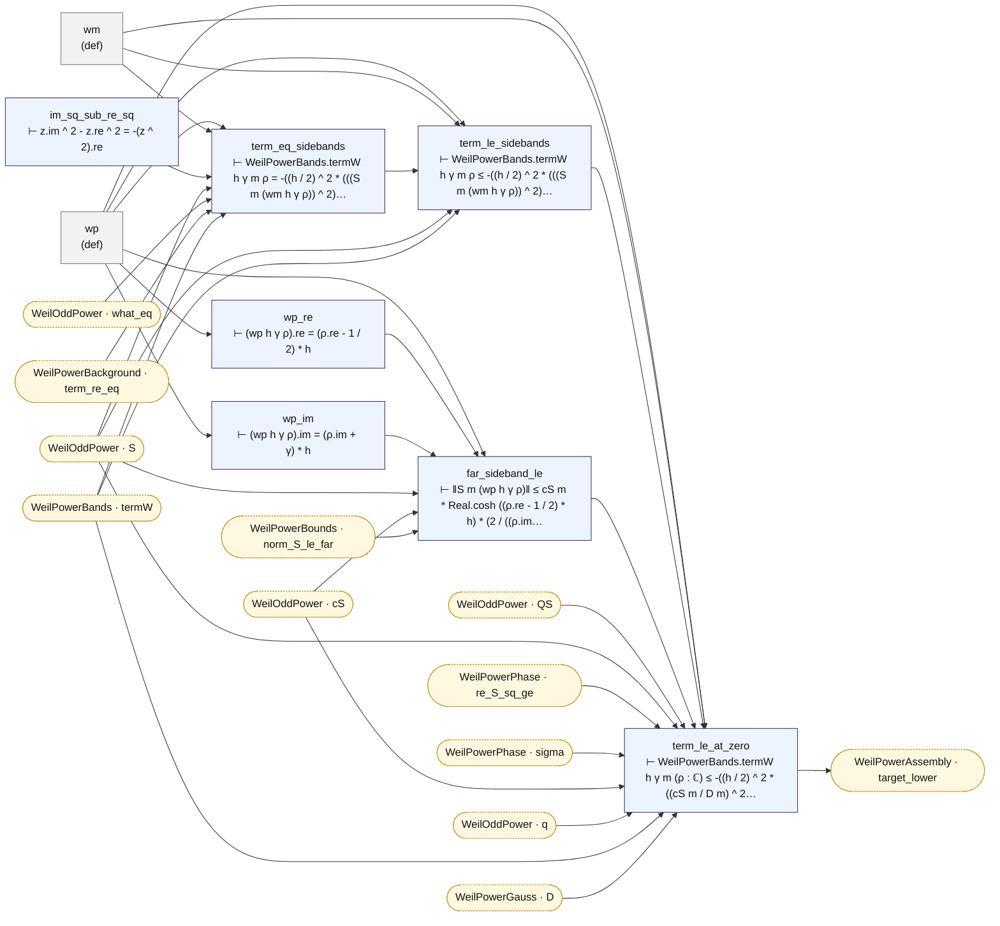

# `lean_stage3/Stage3/WeilPowerBridge.lean`

**What it does** (its own header): WeilPowerBridge — the term at an actual zero: two sidebands, the far one bounded. Rung 5, twentieth slice; worksheet § 13 block 13j. 2026-09-07.

**Imports:** [`WeilPowerBands`](../lean_stage3/WeilPowerBands.md), [`WeilPowerBounds`](../lean_stage3/WeilPowerBounds.md), [`WeilPowerPhase`](../lean_stage3/WeilPowerPhase.md).
**Imported by:** [`Stage3`](../lean_stage3/Stage3.md), [`WeilPowerAssembly`](../lean_stage3/WeilPowerAssembly.md).

Blue: theorem. Green: a theorem nothing else uses (an end). Dashed white: connects to nothing. Grey: definition. Red: contains `sorry`. Yellow: in another file. An arrow A → B reads "A is used by B".

## Every declaration

| declaration | proves (output) | needs (input) | why (its own docstring) | uses | used by |
|---|---|---|---|---|---|
| `WeilPowerBridge.wp` def, line 72 | ℂ | h γ : ℝ; ρ : ℂ | The far sideband: `w₊ = (ρ − 1/2 + iγ)h`. | — | `WeilPowerBridge.far_sideband_le`, `WeilPowerBridge.term_eq_sidebands`, `WeilPowerBridge.term_le_at_zero`, `WeilPowerBridge.term_le_sidebands`, `WeilPowerBridge.wp_im`, `WeilPowerBridge.wp_re` |
| `WeilPowerBridge.wm` def, line 75 | ℂ | h γ : ℝ; ρ : ℂ | The near sideband: `w₋ = (ρ − 1/2 − iγ)h`. | — | `WeilPowerBridge.term_eq_sidebands`, `WeilPowerBridge.term_le_at_zero`, `WeilPowerBridge.term_le_sidebands` |
| `WeilPowerBridge.im_sq_sub_re_sq` theorem, line 79 | z.im ^ 2 - z.re ^ 2 = -(z ^ 2).re | z : ℂ | `Im(z)² − Re(z)² = −Re(z²)`: the arithmetic that turns the background's term into a square. | — | `WeilPowerBridge.term_eq_sidebands` |
| `WeilPowerBridge.term_eq_sidebands` theorem, line 85 | WeilPowerBands.termW h γ m ρ = -((h / 2) ^ 2 * (((S m (wm h γ ρ)) ^ 2).re + 2 * (S m (wp h γ ρ) * S m (wm h γ ρ)).re + ((S m (wp h γ ρ)) ^ 2).re)) | hh : 0 &lt; h; γ : ℝ; m : ℕ; ρ : ℂ | The term of the zero form at `ρ`, read at the two sidebands: the window is a cosine at height `γ` times an envelope, so `what` is `(h/2)(S₊ + S₋)` and the term is `−(h/2)²` times the real part of its square. | `WeilOddPower.S`, `WeilOddPower.what_eq`, `WeilPowerBackground.term_re_eq`, `WeilPowerBands.termW`, `WeilPowerBridge.im_sq_sub_re_sq`, `WeilPowerBridge.wm`, `WeilPowerBridge.wp` | `WeilPowerBridge.term_le_sidebands` |
| `WeilPowerBridge.term_le_sidebands` theorem, line 103 | WeilPowerBands.termW h γ m ρ ≤ -((h / 2) ^ 2 * (((S m (wm h γ ρ)) ^ 2).re - 2 * ‖S m (wp h γ ρ)‖ * ‖S m (wm h γ ρ)‖ - ‖S m (wp h γ ρ)‖ ^ 2)) | hh : 0 &lt; h; γ : ℝ; m : ℕ; ρ : ℂ | The same term with the two unbounded pieces sent to their norms: `Re(S₊S₋) ≥ −‖S₊‖‖S₋‖` and `Re(S₊²) ≥ −‖S₊‖²`, and a larger bracket makes the term more negative. | `WeilOddPower.S`, `WeilPowerBands.termW`, `WeilPowerBridge.term_eq_sidebands`, `WeilPowerBridge.wm`, `WeilPowerBridge.wp` | `WeilPowerBridge.term_le_at_zero` |
| `WeilPowerBridge.wp_re` theorem, line 127 | (wp h γ ρ).re = (ρ.re - 1 / 2) * h | h γ : ℝ; ρ : ℂ | `Re w₊ = (ρ.re − 1/2)h`. | `WeilPowerBridge.wp` | `WeilPowerBridge.far_sideband_le` |
| `WeilPowerBridge.wp_im` theorem, line 133 | (wp h γ ρ).im = (ρ.im + γ) * h | h γ : ℝ; ρ : ℂ | `Im w₊ = (ρ.im + γ)h`: the far sideband sits at about `2γh` when `ρ` is near height `γ`. | `WeilPowerBridge.wp` | `WeilPowerBridge.far_sideband_le` |
| `WeilPowerBridge.far_sideband_le` theorem, line 139 | ‖S m (wp h γ ρ)‖ ≤ cS m * Real.cosh ((ρ.re - 1 / 2) * h) * (2 / ((ρ.im + γ) * h) ^ 2) ^ (m + 1) | hfar : 2 * (((ρ.re - 1 / 2) * h) ^ 2 + Real.pi ^ 2 * ((m : ℝ) + 1) ^ 2) ≤ ((ρ.im + γ) * h) ^ 2 | The far sideband is § 4's decay: once the far condition holds at `w₊`, `‖S m w₊‖` is `cS m·cosh((ρ.re − 1/2)h)` times `(2/((ρ.im + γ)h)²)^(m+1)`. | `WeilOddPower.S`, `WeilOddPower.cS`, `WeilPowerBounds.norm_S_le_far`, `WeilPowerBridge.wp`, `WeilPowerBridge.wp_im`, `WeilPowerBridge.wp_re` | `WeilPowerBridge.term_le_at_zero` |
| `WeilPowerBridge.term_le_at_zero` theorem, line 154 | WeilPowerBands.termW h γ m (ρ : ℂ) ≤ -((h / 2) ^ 2 * ((cS m / D m) ^ 2 * Real.exp (2 * ((wm h γ (ρ : ℂ)) ^ 2).re * sigma m) * (((wm h γ (ρ : ℂ)) ^ 2).re * Real.cos (2 * ((wm h γ (ρ : ℂ)) ^ 2).im * sigma m) - ((wm h γ (ρ : ℂ)) ^ 2).im * Real.sin (2 * ((wm h γ (ρ : ℂ)) ^ 2).im * sigma m)) - (cS m / D m) ^ 2 * ‖wm h γ (ρ : ℂ)‖ ^ 2 * Real.exp (2 * ((wm h γ (ρ : ℂ)) ^ 2).re * sigma m) * (4 * q m (wm h γ (ρ : ℂ)) + 4 * q m (wm h γ (ρ : ℂ)) ^ 2) - 2 * (cS m * Real.cosh (((ρ : ℂ).re - 1 / 2) * h) * (2 / (((ρ : ℂ).im + γ) * h) ^ 2) ^ (m + 1)) * ‖S m (wm h γ (ρ : ℂ))‖ - (cS m * Real.cosh (((ρ : ℂ).re - 1 / 2) * h) * (2 / (((ρ : ℂ).im + γ) * h) ^ 2) ^ (m + 1)) ^ 2)) | hh : 0 &lt; h; ρ : Kadiri.NontrivialZeros; hfar : 2 * ((((ρ : ℂ).re - 1 / 2) * h) ^ 2 + Real.pi ^ 2 * ((m : ℝ) + 1) ^ 2) ≤ (((ρ : ℂ).im + γ) * h) ^ 2; hne : QS m (wm h γ (ρ : ℂ)) ≠ 0; hsmall : ‖wm h γ (ρ : ℂ)‖ ^ 2 ≤ Real.pi ^ 2 * ((m : ℝ) + 2) ^ 2 / 2; hq : q m (wm h γ (ρ : ℂ)) ≤ 1 | The term at an actual nontrivial zero of zeta, every constant explicit: 13b's lower bound on the near sideband, § 4's decay on the far one, and the cross term between them. This is the ladder attached to a zero. | `WeilOddPower.QS`, `WeilOddPower.S`, `WeilOddPower.cS`, `WeilOddPower.q`, `WeilPowerBands.termW`, `WeilPowerBridge.far_sideband_le`, `WeilPowerBridge.term_le_sidebands`, `WeilPowerBridge.wm`, `WeilPowerBridge.wp`, `WeilPowerGauss.D`, `WeilPowerPhase.re_S_sq_ge`, `WeilPowerPhase.sigma` | `WeilPowerAssembly.target_lower` |
