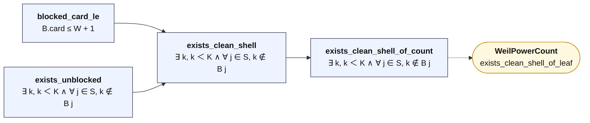

# `lean_stage3/Stage3/WeilPowerClean.lean`

WeilPowerClean — the clean shell. Rung 5, eighteenth slice; worksheet § 13 block 13h. 2026-09-07.

4 theorems, 0 definitions, 152 lines. Arrows are Lean's own record of what each proof uses.

**Imports:** [`Statement`](../lean_stage3/Statement.md)  
**Imported by:** [`Stage3`](../lean_stage3/Stage3.md), [`WeilPowerCount`](../lean_stage3/WeilPowerCount.md)

## The picture



An arrow A → B reads "A is used in the proof of B". Blue: theorem. Green: a theorem nothing else uses (an end). Dashed: connects to nothing. Red: contains `sorry`. Yellow: theorems in another file, counted; a dotted arrow crosses files. Definitions are not drawn; they are listed below the diagram.

## Theorems

<a name="WeilPowerClean-blocked_card_le"></a>
### `WeilPowerClean.blocked_card_le`

line 62

**Why.** One member's blocked shells sit inside `W + 1` consecutive shells: the shell scale `a * ρ ^ k` climbs by the factor `ρ`, while the window `[lo, hi]` does not move.

**Proves**

```lean
B.card ≤ W + 1
```

**Needs** (its hypotheses)

  - `` B : Finset ℕ ``
  - `` hρ : 1 ≤ ρ ``
  - `` hlo : 0 < lo ``
  - `` hW : hi < lo * ρ ^ (W + 1) ``
  - `` hB : ∀ k ∈ B, lo ≤ d * (a * ρ ^ k) ∧ d * (a * ρ ^ k) ≤ hi ``

**Fed by:** no theorem of this repo; it stands on Mathlib.

**Feeds** (1 that use it)

  - [`WeilPowerClean.exists_clean_shell`](#WeilPowerClean-exists_clean_shell) — `` ∃ k, k < K ∧ ∀ j ∈ S, k ∉ B j ``

<a name="WeilPowerClean-exists_unblocked"></a>
### `WeilPowerClean.exists_unblocked`

line 95

**Why.** More shells than the members can block leaves one shell in no member's blocking set.

**Proves**

```lean
∃ k, k < K ∧ ∀ j ∈ S, k ∉ B j
```

**Needs** (its hypotheses)

  - `` S : Finset ι ``
  - `` B : ι → Finset ℕ ``
  - `` hB : ∀ j ∈ S, (B j).card ≤ W ``
  - `` hK : S.card * W < K ``

**Fed by:** no theorem of this repo; it stands on Mathlib.

**Feeds** (1 that use it)

  - [`WeilPowerClean.exists_clean_shell`](#WeilPowerClean-exists_clean_shell) — `` ∃ k, k < K ∧ ∀ j ∈ S, k ∉ B j ``

<a name="WeilPowerClean-exists_clean_shell"></a>
### `WeilPowerClean.exists_clean_shell`

line 114

**Why.** The clean shell: `blocked_card_le` at each member, then `exists_unblocked` at `W + 1`.

**Proves**

```lean
∃ k, k < K ∧ ∀ j ∈ S, k ∉ B j
```

**Needs** (its hypotheses)

  - `` S : Finset ι ``
  - `` B : ι → Finset ℕ ``
  - `` d : ι → ℝ ``
  - `` hρ : 1 ≤ ρ ``
  - `` hlo : 0 < lo ``
  - `` hW : hi < lo * ρ ^ (W + 1) ``
  - `` hB : ∀ j ∈ S, ∀ k ∈ B j, lo ≤ d j * (a * ρ ^ k) ∧ d j * (a * ρ ^ k) ≤ hi ``
  - `` hK : S.card * (W + 1) < K ``

**Fed by** (2 theorems its proof uses)

  - [`WeilPowerClean.blocked_card_le`](#WeilPowerClean-blocked_card_le) — `` B.card ≤ W + 1 ``
  - [`WeilPowerClean.exists_unblocked`](#WeilPowerClean-exists_unblocked) — `` ∃ k, k < K ∧ ∀ j ∈ S, k ∉ B j ``

**Feeds** (1 that use it)

  - [`WeilPowerClean.exists_clean_shell_of_count`](#WeilPowerClean-exists_clean_shell_of_count) — `` ∃ k, k < K ∧ ∀ j ∈ S, k ∉ B j ``

<a name="WeilPowerClean-exists_clean_shell_of_count"></a>
### `WeilPowerClean.exists_clean_shell_of_count`

line 124

**Why.** The same with the member count given by a bound `N`.

**Proves**

```lean
∃ k, k < K ∧ ∀ j ∈ S, k ∉ B j
```

**Needs** (its hypotheses)

  - `` S : Finset ι ``
  - `` B : ι → Finset ℕ ``
  - `` d : ι → ℝ ``
  - `` hρ : 1 ≤ ρ ``
  - `` hlo : 0 < lo ``
  - `` hW : hi < lo * ρ ^ (W + 1) ``
  - `` hB : ∀ j ∈ S, ∀ k ∈ B j, lo ≤ d j * (a * ρ ^ k) ∧ d j * (a * ρ ^ k) ≤ hi ``
  - `` hN : S.card ≤ N ``
  - `` hK : N * (W + 1) < K ``

**Fed by** (1 theorem its proof uses)

  - [`WeilPowerClean.exists_clean_shell`](#WeilPowerClean-exists_clean_shell) — `` ∃ k, k < K ∧ ∀ j ∈ S, k ∉ B j ``

**Feeds** (1 that use it)

  - [`WeilPowerCount.exists_clean_shell_of_leaf`](../lean_stage3/WeilPowerCount.md#WeilPowerCount-exists_clean_shell_of_leaf) (WeilPowerCount) — `` ∃ k, k < K ∧ ∀ j ∈ S, k ∉ B j ``

