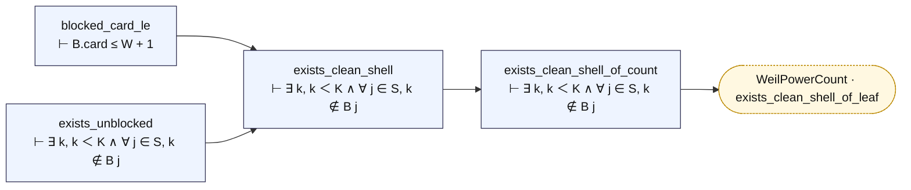

# `lean_stage3/Stage3/WeilPowerClean.lean`

**What it does** (its own header): WeilPowerClean — the clean shell. Rung 5, eighteenth slice; worksheet § 13 block 13h. 2026-09-07.

**Imports:** [`Statement`](../lean_stage3/Statement.md).
**Imported by:** [`Stage3`](../lean_stage3/Stage3.md), [`WeilPowerCount`](../lean_stage3/WeilPowerCount.md).

Blue: theorem. Green: a theorem nothing else uses (an end). Dashed white: connects to nothing. Grey: definition. Red: contains `sorry`. Yellow: in another file. An arrow A → B reads "A is used by B".

## Every declaration

| declaration | proves (output) | needs (input) | why (its own docstring) | uses | used by |
|---|---|---|---|---|---|
| `WeilPowerClean.blocked_card_le` theorem, line 62 | B.card ≤ W + 1 | B : Finset ℕ; hρ : 1 ≤ ρ; hlo : 0 &lt; lo; hW : hi &lt; lo * ρ ^ (W + 1); hB : ∀ k ∈ B, lo ≤ d * (a * ρ ^ k) ∧ d * (a * ρ ^ k) ≤ hi | One member's blocked shells sit inside `W + 1` consecutive shells: the shell scale `a * ρ ^ k` climbs by the factor `ρ`, while the window `[lo, hi]` does not move. | — | `WeilPowerClean.exists_clean_shell` |
| `WeilPowerClean.exists_unblocked` theorem, line 95 | ∃ k, k &lt; K ∧ ∀ j ∈ S, k ∉ B j | S : Finset ι; B : ι → Finset ℕ; hB : ∀ j ∈ S, (B j).card ≤ W; hK : S.card * W &lt; K | More shells than the members can block leaves one shell in no member's blocking set. | — | `WeilPowerClean.exists_clean_shell` |
| `WeilPowerClean.exists_clean_shell` theorem, line 114 | ∃ k, k &lt; K ∧ ∀ j ∈ S, k ∉ B j | S : Finset ι; B : ι → Finset ℕ; d : ι → ℝ; hρ : 1 ≤ ρ; hlo : 0 &lt; lo; hW : hi &lt; lo * ρ ^ (W + 1); hB : ∀ j ∈ S, ∀ k ∈ B j, lo ≤ d j * (a * ρ ^ k) ∧ d j * (a * ρ ^ k) ≤ hi; hK : S.card * (W + 1) &lt; K | The clean shell: `blocked_card_le` at each member, then `exists_unblocked` at `W + 1`. | `WeilPowerClean.blocked_card_le`, `WeilPowerClean.exists_unblocked` | `WeilPowerClean.exists_clean_shell_of_count` |
| `WeilPowerClean.exists_clean_shell_of_count` theorem, line 124 | ∃ k, k &lt; K ∧ ∀ j ∈ S, k ∉ B j | S : Finset ι; B : ι → Finset ℕ; d : ι → ℝ; hρ : 1 ≤ ρ; hlo : 0 &lt; lo; hW : hi &lt; lo * ρ ^ (W + 1); hB : ∀ j ∈ S, ∀ k ∈ B j, lo ≤ d j * (a * ρ ^ k) ∧ d j * (a * ρ ^ k) ≤ hi; hN : S.card ≤ N; hK : N * (W + 1) &lt; K | The same with the member count given by a bound `N`. | `WeilPowerClean.exists_clean_shell` | `WeilPowerCount.exists_clean_shell_of_leaf` |
