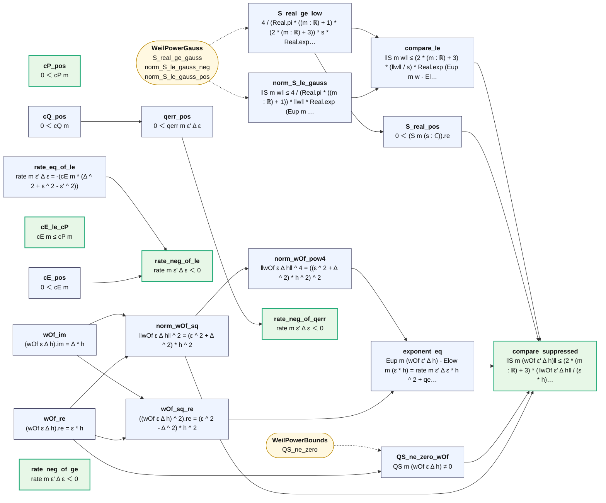

# `lean_stage3/Stage3/WeilPowerCompare.lean`

WeilPowerCompare — the comparison at another off-line zero. Rung 5, ninth slice, worksheet section 7. 2026-09-06.

21 theorems, 8 definitions, 341 lines. Arrows are Lean's own record of what each proof uses.

**Imports:** [`WeilPowerGauss`](../lean_stage3/WeilPowerGauss.md)  
**Imported by:** [`Stage3`](../lean_stage3/Stage3.md), [`WeilPowerAssembly`](../lean_stage3/WeilPowerAssembly.md), [`WeilPowerSelect`](../lean_stage3/WeilPowerSelect.md)

## The picture



An arrow A → B reads "A is used in the proof of B". Blue: theorem. Green: a theorem nothing else uses (an end). Dashed: connects to nothing. Red: contains `sorry`. Yellow: theorems in another file, counted; a dotted arrow crosses files. Definitions are not drawn; they are listed below the diagram.

## Definitions

<a name="WeilPowerCompare-cP"></a>
### `WeilPowerCompare.cP`

def · line 81

The strong Gaussian coefficient `1/(π²(m+1))`: the exponent's rate where `Re(w²) ≥ 0`.

- **Is:** `` cP (m : ℕ) : ℝ := 1 / (Real.pi ^ 2 * ((m : ℝ) + 1)) ``
- **Used by 8:** [`WeilPowerCompare.Eup`](#WeilPowerCompare-Eup), [`WeilPowerCompare.cE_le_cP`](#WeilPowerCompare-cE_le_cP), [`WeilPowerCompare.cP_pos`](#WeilPowerCompare-cP_pos), [`WeilPowerCompare.exponent_eq`](#WeilPowerCompare-exponent_eq), [`WeilPowerCompare.norm_S_le_gauss`](#WeilPowerCompare-norm_S_le_gauss), [`WeilPowerCompare.rate`](#WeilPowerCompare-rate), [`WeilPowerCompare.rate_eq_of_le`](#WeilPowerCompare-rate_eq_of_le), [`WeilPowerCompare.rate_neg_of_ge`](#WeilPowerCompare-rate_neg_of_ge)

<a name="WeilPowerCompare-cE"></a>
### `WeilPowerCompare.cE`

def · line 85

The weak Gaussian coefficient `(m+2)/(π²(2m+3)²)`: the rate where `Re(w²) ≤ 0`, and the one the target's lower bound carries.

- **Is:** `` cE (m : ℕ) : ℝ := ((m : ℝ) + 2) / (Real.pi ^ 2 * (2 * (m : ℝ) + 3) ^ 2) ``
- **Used by 11:** [`WeilPowerCompare.Elow`](#WeilPowerCompare-Elow), [`WeilPowerCompare.Eup`](#WeilPowerCompare-Eup), [`WeilPowerCompare.S_real_ge_low`](#WeilPowerCompare-S_real_ge_low), [`WeilPowerCompare.cE_le_cP`](#WeilPowerCompare-cE_le_cP), [`WeilPowerCompare.cE_pos`](#WeilPowerCompare-cE_pos), [`WeilPowerCompare.exponent_eq`](#WeilPowerCompare-exponent_eq), [`WeilPowerCompare.norm_S_le_gauss`](#WeilPowerCompare-norm_S_le_gauss), [`WeilPowerCompare.rate`](#WeilPowerCompare-rate), [`WeilPowerCompare.rate_eq_of_le`](#WeilPowerCompare-rate_eq_of_le), [`WeilPowerCompare.rate_neg_of_ge`](#WeilPowerCompare-rate_neg_of_ge), [`WeilPowerCompare.rate_neg_of_le`](#WeilPowerCompare-rate_neg_of_le)

<a name="WeilPowerCompare-cQ"></a>
### `WeilPowerCompare.cQ`

def · line 88

The quartic error coefficient `1/(π⁴(m+1)³)`.

- **Is:** `` cQ (m : ℕ) : ℝ := 1 / (Real.pi ^ 4 * ((m : ℝ) + 1) ^ 3) ``
- **Used by 8:** [`WeilPowerCompare.Elow`](#WeilPowerCompare-Elow), [`WeilPowerCompare.Eup`](#WeilPowerCompare-Eup), [`WeilPowerCompare.S_real_ge_low`](#WeilPowerCompare-S_real_ge_low), [`WeilPowerCompare.cQ_pos`](#WeilPowerCompare-cQ_pos), [`WeilPowerCompare.exponent_eq`](#WeilPowerCompare-exponent_eq), [`WeilPowerCompare.norm_S_le_gauss`](#WeilPowerCompare-norm_S_le_gauss), [`WeilPowerCompare.qerr`](#WeilPowerCompare-qerr), [`WeilPowerCompare.qerr_pos`](#WeilPowerCompare-qerr_pos)

<a name="WeilPowerCompare-Eup"></a>
### `WeilPowerCompare.Eup`

def · line 116

The upper exponent, both signs of `Re(w²)` in one expression: `max _ 0` picks the strong coefficient where `Re(w²) ≥ 0` and the weak one elsewhere.

- **Is:** `` Eup (m : ℕ) (w : ℂ) : ℝ := cE m * (w ^ 2).re + (cP m - cE m) * max ((w ^ 2).re) 0 + cQ m * ‖w‖ ^ 4 ``
- **Built from:** [`WeilPowerCompare.cE`](#WeilPowerCompare-cE), [`WeilPowerCompare.cP`](#WeilPowerCompare-cP), [`WeilPowerCompare.cQ`](#WeilPowerCompare-cQ)
- **Used by 4:** [`WeilPowerCompare.compare_le`](#WeilPowerCompare-compare_le), [`WeilPowerCompare.compare_suppressed`](#WeilPowerCompare-compare_suppressed), [`WeilPowerCompare.exponent_eq`](#WeilPowerCompare-exponent_eq), [`WeilPowerCompare.norm_S_le_gauss`](#WeilPowerCompare-norm_S_le_gauss)

<a name="WeilPowerCompare-Elow"></a>
### `WeilPowerCompare.Elow`

def · line 120

The lower exponent at the target, on the real axis.

- **Is:** `` Elow (m : ℕ) (s : ℝ) : ℝ := cE m * s ^ 2 - cQ m * s ^ 4 ``
- **Built from:** [`WeilPowerCompare.cE`](#WeilPowerCompare-cE), [`WeilPowerCompare.cQ`](#WeilPowerCompare-cQ)
- **Used by 5:** [`WeilPowerCompare.S_real_ge_low`](#WeilPowerCompare-S_real_ge_low), [`WeilPowerCompare.S_real_pos`](#WeilPowerCompare-S_real_pos), [`WeilPowerCompare.compare_le`](#WeilPowerCompare-compare_le), [`WeilPowerCompare.compare_suppressed`](#WeilPowerCompare-compare_suppressed), [`WeilPowerCompare.exponent_eq`](#WeilPowerCompare-exponent_eq)

<a name="WeilPowerCompare-wOf"></a>
### `WeilPowerCompare.wOf`

def · line 206

The point the window reads at a zero of real-part offset `ε` and height offset `Δ`: `w = (ε + iΔ)h`.

- **Is:** `` wOf (ε Δ h : ℝ) : ℂ := ((ε : ℂ) + Complex.I * (Δ : ℂ)) * (h : ℂ) ``
- **Used by 8:** [`WeilPowerCompare.QS_ne_zero_wOf`](#WeilPowerCompare-QS_ne_zero_wOf), [`WeilPowerCompare.compare_suppressed`](#WeilPowerCompare-compare_suppressed), [`WeilPowerCompare.exponent_eq`](#WeilPowerCompare-exponent_eq), [`WeilPowerCompare.norm_wOf_pow4`](#WeilPowerCompare-norm_wOf_pow4), [`WeilPowerCompare.norm_wOf_sq`](#WeilPowerCompare-norm_wOf_sq), [`WeilPowerCompare.wOf_im`](#WeilPowerCompare-wOf_im), [`WeilPowerCompare.wOf_re`](#WeilPowerCompare-wOf_re), [`WeilPowerCompare.wOf_sq_re`](#WeilPowerCompare-wOf_sq_re)

<a name="WeilPowerCompare-rate"></a>
### `WeilPowerCompare.rate`

def · line 232

The quadratic rate of the exponent difference, per unit `h²`.

- **Is:** `` rate (m : ℕ) (ε' Δ ε : ℝ) : ℝ := cE m * (ε' ^ 2 - Δ ^ 2) + (cP m - cE m) * max (ε' ^ 2 - Δ ^ 2) 0 - cE m * ε ^ 2 ``
- **Built from:** [`WeilPowerCompare.cE`](#WeilPowerCompare-cE), [`WeilPowerCompare.cP`](#WeilPowerCompare-cP)
- **Used by 6:** [`WeilPowerCompare.compare_suppressed`](#WeilPowerCompare-compare_suppressed), [`WeilPowerCompare.exponent_eq`](#WeilPowerCompare-exponent_eq), [`WeilPowerCompare.rate_eq_of_le`](#WeilPowerCompare-rate_eq_of_le), [`WeilPowerCompare.rate_neg_of_ge`](#WeilPowerCompare-rate_neg_of_ge), [`WeilPowerCompare.rate_neg_of_le`](#WeilPowerCompare-rate_neg_of_le), [`WeilPowerCompare.rate_neg_of_qerr`](#WeilPowerCompare-rate_neg_of_qerr)

<a name="WeilPowerCompare-qerr"></a>
### `WeilPowerCompare.qerr`

def · line 236

The quartic error of the exponent difference, per unit `h⁴`.

- **Is:** `` qerr (m : ℕ) (ε' Δ ε : ℝ) : ℝ := cQ m * ((ε' ^ 2 + Δ ^ 2) ^ 2 + ε ^ 4) ``
- **Built from:** [`WeilPowerCompare.cQ`](#WeilPowerCompare-cQ)
- **Used by 4:** [`WeilPowerCompare.compare_suppressed`](#WeilPowerCompare-compare_suppressed), [`WeilPowerCompare.exponent_eq`](#WeilPowerCompare-exponent_eq), [`WeilPowerCompare.qerr_pos`](#WeilPowerCompare-qerr_pos), [`WeilPowerCompare.rate_neg_of_qerr`](#WeilPowerCompare-rate_neg_of_qerr)

## Theorems

<a name="WeilPowerCompare-cP_pos"></a>
### `WeilPowerCompare.cP_pos`

line 90

**Proves**

```lean
0 < cP m
```

**Needs** (its hypotheses)

  - `` m : ℕ ``

**Stated with:** [`WeilPowerCompare.cP`](#WeilPowerCompare-cP)

**Fed by:** no theorem of this repo; it stands on Mathlib and the definitions below.

**Feeds:** nothing. It is an end.

<a name="WeilPowerCompare-cE_pos"></a>
### `WeilPowerCompare.cE_pos`

line 95

**Proves**

```lean
0 < cE m
```

**Needs** (its hypotheses)

  - `` m : ℕ ``

**Stated with:** [`WeilPowerCompare.cE`](#WeilPowerCompare-cE)

**Fed by:** no theorem of this repo; it stands on Mathlib and the definitions below.

**Feeds** (1 that use it)

  - [`WeilPowerCompare.rate_neg_of_le`](#WeilPowerCompare-rate_neg_of_le) — `` rate m ε' Δ ε < 0 ``

<a name="WeilPowerCompare-cQ_pos"></a>
### `WeilPowerCompare.cQ_pos`

line 101

**Proves**

```lean
0 < cQ m
```

**Needs** (its hypotheses)

  - `` m : ℕ ``

**Stated with:** [`WeilPowerCompare.cQ`](#WeilPowerCompare-cQ)

**Fed by:** no theorem of this repo; it stands on Mathlib and the definitions below.

**Feeds** (1 that use it)

  - [`WeilPowerCompare.qerr_pos`](#WeilPowerCompare-qerr_pos) — `` 0 < qerr m ε' Δ ε ``

<a name="WeilPowerCompare-cE_le_cP"></a>
### `WeilPowerCompare.cE_le_cP`

line 107

**Why.** `(m+1)(m+2) ≤ (2m+3)²`, so the weak coefficient is at most the strong one.

**Proves**

```lean
cE m ≤ cP m
```

**Needs** (its hypotheses)

  - `` m : ℕ ``

**Stated with:** [`WeilPowerCompare.cE`](#WeilPowerCompare-cE), [`WeilPowerCompare.cP`](#WeilPowerCompare-cP)

**Fed by:** no theorem of this repo; it stands on Mathlib and the definitions below.

**Feeds:** nothing. It is an end.

<a name="WeilPowerCompare-norm_S_le_gauss"></a>
### `WeilPowerCompare.norm_S_le_gauss`

line 123

**Why.** The Gaussian upper bound, both signs in one exponent.

**Proves**

```lean
‖S m w‖ ≤ 4 / (Real.pi * ((m : ℝ) + 1)) * ‖w‖ * Real.exp (Eup m w)
```

**Needs** (its hypotheses)

  - `` hne : QS m w ≠ 0 ``
  - `` hsmall : ‖w‖ ^ 2 ≤ Real.pi ^ 2 * ((m : ℝ) + 2) ^ 2 / 2 ``

**Stated with:** [`WeilOddPower.QS`](../lean_stage3/WeilOddPower.md#WeilOddPower-QS), [`WeilOddPower.S`](../lean_stage3/WeilOddPower.md#WeilOddPower-S), [`WeilPowerCompare.Eup`](#WeilPowerCompare-Eup)

**Fed by** (2 theorems its proof uses)

  - [`WeilPowerGauss.norm_S_le_gauss_neg`](../lean_stage3/WeilPowerGauss.md#WeilPowerGauss-norm_S_le_gauss_neg) (WeilPowerGauss) — `` ‖S m w‖ ≤ 4 / (Real.pi * ((m : ℝ) + 1)) * ‖w‖ * Real.exp ((w ^ 2).re * ((m : ℝ) + 2) / (Real.pi ^ 2 * (2 * (m : ℝ) + 3) ^ 2) + ‖w‖ ^ 4 / (Real.pi ^ 4 … ``
  - [`WeilPowerGauss.norm_S_le_gauss_pos`](../lean_stage3/WeilPowerGauss.md#WeilPowerGauss-norm_S_le_gauss_pos) (WeilPowerGauss) — `` ‖S m w‖ ≤ 4 / (Real.pi * ((m : ℝ) + 1)) * ‖w‖ * Real.exp ((w ^ 2).re / (Real.pi ^ 2 * ((m : ℝ) + 1)) + ‖w‖ ^ 4 / (Real.pi ^ 4 * ((m : ℝ) + 1) ^ 3)) ``

**Definitions its proof touches:** [`WeilPowerCompare.cE`](#WeilPowerCompare-cE), [`WeilPowerCompare.cP`](#WeilPowerCompare-cP), [`WeilPowerCompare.cQ`](#WeilPowerCompare-cQ)

**Feeds** (1 that use it)

  - [`WeilPowerCompare.compare_le`](#WeilPowerCompare-compare_le) — `` ‖S m w‖ ≤ (2 * (m : ℝ) + 3) * (‖w‖ / s) * Real.exp (Eup m w - Elow m s) * (S m (s : ℂ)).re ``

<a name="WeilPowerCompare-S_real_ge_low"></a>
### `WeilPowerCompare.S_real_ge_low`

line 150

**Why.** The Gaussian lower bound at the target, in the `Elow` form.

**Proves**

```lean
4 / (Real.pi * ((m : ℝ) + 1) * (2 * (m : ℝ) + 3)) * s * Real.exp (Elow m s) ≤ (S m (s : ℂ)).re
```

**Needs** (its hypotheses)

  - `` hs : 0 < s ``
  - `` hsmall : s ^ 2 ≤ Real.pi ^ 2 * ((m : ℝ) + 2) ^ 2 / 2 ``

**Stated with:** [`WeilOddPower.S`](../lean_stage3/WeilOddPower.md#WeilOddPower-S), [`WeilPowerCompare.Elow`](#WeilPowerCompare-Elow)

**Fed by** (1 theorem its proof uses)

  - [`WeilPowerGauss.S_real_ge_gauss`](../lean_stage3/WeilPowerGauss.md#WeilPowerGauss-S_real_ge_gauss) (WeilPowerGauss) — `` 4 / (Real.pi * ((m : ℝ) + 1) * (2 * (m : ℝ) + 3)) * s * Real.exp (s ^ 2 * ((m : ℝ) + 2) / (Real.pi ^ 2 * (2 * (m : ℝ) + 3) ^ 2) - s ^ 4 / (Real.pi ^ 4… ``

**Definitions its proof touches:** [`WeilPowerCompare.cE`](#WeilPowerCompare-cE), [`WeilPowerCompare.cQ`](#WeilPowerCompare-cQ)

**Feeds** (2 that use it)

  - [`WeilPowerCompare.S_real_pos`](#WeilPowerCompare-S_real_pos) — `` 0 < (S m (s : ℂ)).re ``
  - [`WeilPowerCompare.compare_le`](#WeilPowerCompare-compare_le) — `` ‖S m w‖ ≤ (2 * (m : ℝ) + 3) * (‖w‖ / s) * Real.exp (Eup m w - Elow m s) * (S m (s : ℂ)).re ``

<a name="WeilPowerCompare-S_real_pos"></a>
### `WeilPowerCompare.S_real_pos`

line 166

**Why.** The target's transform is positive on the real axis inside the regime.

**Proves**

```lean
0 < (S m (s : ℂ)).re
```

**Needs** (its hypotheses)

  - `` hs : 0 < s ``
  - `` hsmall : s ^ 2 ≤ Real.pi ^ 2 * ((m : ℝ) + 2) ^ 2 / 2 ``

**Stated with:** [`WeilOddPower.S`](../lean_stage3/WeilOddPower.md#WeilOddPower-S)

**Fed by** (1 theorem its proof uses)

  - [`WeilPowerCompare.S_real_ge_low`](#WeilPowerCompare-S_real_ge_low) — `` 4 / (Real.pi * ((m : ℝ) + 1) * (2 * (m : ℝ) + 3)) * s * Real.exp (Elow m s) ≤ (S m (s : ℂ)).re ``

**Definitions its proof touches:** [`WeilPowerCompare.Elow`](#WeilPowerCompare-Elow)

**Feeds** (1 that use it)

  - [`WeilPowerCompare.compare_suppressed`](#WeilPowerCompare-compare_suppressed) — `` ‖S m (wOf ε' Δ h)‖ ≤ (2 * (m : ℝ) + 3) * (‖wOf ε' Δ h‖ / (ε * h)) * Real.exp (rate m ε' Δ ε * h ^ 2 / 2) * (S m ((ε * h : ℝ) : ℂ)).re ``

<a name="WeilPowerCompare-compare_le"></a>
### `WeilPowerCompare.compare_le`

line 179

**Why.** The comparison at another off-line zero. The transform at any point of the regime is at most `2m+3` times `‖w‖/s` times the exponential of the exponent difference, times the target's transform.

**Proves**

```lean
‖S m w‖ ≤ (2 * (m : ℝ) + 3) * (‖w‖ / s) * Real.exp (Eup m w - Elow m s) * (S m (s : ℂ)).re
```

**Needs** (its hypotheses)

  - `` hne : QS m w ≠ 0 ``
  - `` hw : ‖w‖ ^ 2 ≤ Real.pi ^ 2 * ((m : ℝ) + 2) ^ 2 / 2 ``
  - `` hs : 0 < s ``
  - `` hs2 : s ^ 2 ≤ Real.pi ^ 2 * ((m : ℝ) + 2) ^ 2 / 2 ``

**Stated with:** [`WeilOddPower.QS`](../lean_stage3/WeilOddPower.md#WeilOddPower-QS), [`WeilOddPower.S`](../lean_stage3/WeilOddPower.md#WeilOddPower-S), [`WeilPowerCompare.Elow`](#WeilPowerCompare-Elow), [`WeilPowerCompare.Eup`](#WeilPowerCompare-Eup)

**Fed by** (2 theorems its proof uses)

  - [`WeilPowerCompare.S_real_ge_low`](#WeilPowerCompare-S_real_ge_low) — `` 4 / (Real.pi * ((m : ℝ) + 1) * (2 * (m : ℝ) + 3)) * s * Real.exp (Elow m s) ≤ (S m (s : ℂ)).re ``
  - [`WeilPowerCompare.norm_S_le_gauss`](#WeilPowerCompare-norm_S_le_gauss) — `` ‖S m w‖ ≤ 4 / (Real.pi * ((m : ℝ) + 1)) * ‖w‖ * Real.exp (Eup m w) ``

**Feeds** (1 that use it)

  - [`WeilPowerCompare.compare_suppressed`](#WeilPowerCompare-compare_suppressed) — `` ‖S m (wOf ε' Δ h)‖ ≤ (2 * (m : ℝ) + 3) * (‖wOf ε' Δ h‖ / (ε * h)) * Real.exp (rate m ε' Δ ε * h ^ 2 / 2) * (S m ((ε * h : ℝ) : ℂ)).re ``

<a name="WeilPowerCompare-wOf_re"></a>
### `WeilPowerCompare.wOf_re`

line 208

**Proves**

```lean
(wOf ε Δ h).re = ε * h
```

**Needs** (its hypotheses)

  - `` ε Δ h : ℝ ``

**Stated with:** [`WeilPowerCompare.wOf`](#WeilPowerCompare-wOf)

**Fed by:** no theorem of this repo; it stands on Mathlib and the definitions below.

**Feeds** (3 that use it)

  - [`WeilPowerCompare.QS_ne_zero_wOf`](#WeilPowerCompare-QS_ne_zero_wOf) — `` QS m (wOf ε Δ h) ≠ 0 ``
  - [`WeilPowerCompare.norm_wOf_sq`](#WeilPowerCompare-norm_wOf_sq) — `` ‖wOf ε Δ h‖ ^ 2 = (ε ^ 2 + Δ ^ 2) * h ^ 2 ``
  - [`WeilPowerCompare.wOf_sq_re`](#WeilPowerCompare-wOf_sq_re) — `` ((wOf ε Δ h) ^ 2).re = (ε ^ 2 - Δ ^ 2) * h ^ 2 ``

<a name="WeilPowerCompare-wOf_im"></a>
### `WeilPowerCompare.wOf_im`

line 211

**Proves**

```lean
(wOf ε Δ h).im = Δ * h
```

**Needs** (its hypotheses)

  - `` ε Δ h : ℝ ``

**Stated with:** [`WeilPowerCompare.wOf`](#WeilPowerCompare-wOf)

**Fed by:** no theorem of this repo; it stands on Mathlib and the definitions below.

**Feeds** (2 that use it)

  - [`WeilPowerCompare.norm_wOf_sq`](#WeilPowerCompare-norm_wOf_sq) — `` ‖wOf ε Δ h‖ ^ 2 = (ε ^ 2 + Δ ^ 2) * h ^ 2 ``
  - [`WeilPowerCompare.wOf_sq_re`](#WeilPowerCompare-wOf_sq_re) — `` ((wOf ε Δ h) ^ 2).re = (ε ^ 2 - Δ ^ 2) * h ^ 2 ``

<a name="WeilPowerCompare-wOf_sq_re"></a>
### `WeilPowerCompare.wOf_sq_re`

line 214

**Proves**

```lean
((wOf ε Δ h) ^ 2).re = (ε ^ 2 - Δ ^ 2) * h ^ 2
```

**Needs** (its hypotheses)

  - `` ε Δ h : ℝ ``

**Stated with:** [`WeilPowerCompare.wOf`](#WeilPowerCompare-wOf)

**Fed by** (2 theorems its proof uses)

  - [`WeilPowerCompare.wOf_im`](#WeilPowerCompare-wOf_im) — `` (wOf ε Δ h).im = Δ * h ``
  - [`WeilPowerCompare.wOf_re`](#WeilPowerCompare-wOf_re) — `` (wOf ε Δ h).re = ε * h ``

**Feeds** (1 that use it)

  - [`WeilPowerCompare.exponent_eq`](#WeilPowerCompare-exponent_eq) — `` Eup m (wOf ε' Δ h) - Elow m (ε * h) = rate m ε' Δ ε * h ^ 2 + qerr m ε' Δ ε * h ^ 4 ``

<a name="WeilPowerCompare-norm_wOf_sq"></a>
### `WeilPowerCompare.norm_wOf_sq`

line 218

**Proves**

```lean
‖wOf ε Δ h‖ ^ 2 = (ε ^ 2 + Δ ^ 2) * h ^ 2
```

**Needs** (its hypotheses)

  - `` ε Δ h : ℝ ``

**Stated with:** [`WeilPowerCompare.wOf`](#WeilPowerCompare-wOf)

**Fed by** (2 theorems its proof uses)

  - [`WeilPowerCompare.wOf_im`](#WeilPowerCompare-wOf_im) — `` (wOf ε Δ h).im = Δ * h ``
  - [`WeilPowerCompare.wOf_re`](#WeilPowerCompare-wOf_re) — `` (wOf ε Δ h).re = ε * h ``

**Feeds** (2 that use it)

  - [`WeilPowerCompare.compare_suppressed`](#WeilPowerCompare-compare_suppressed) — `` ‖S m (wOf ε' Δ h)‖ ≤ (2 * (m : ℝ) + 3) * (‖wOf ε' Δ h‖ / (ε * h)) * Real.exp (rate m ε' Δ ε * h ^ 2 / 2) * (S m ((ε * h : ℝ) : ℂ)).re ``
  - [`WeilPowerCompare.norm_wOf_pow4`](#WeilPowerCompare-norm_wOf_pow4) — `` ‖wOf ε Δ h‖ ^ 4 = ((ε ^ 2 + Δ ^ 2) * h ^ 2) ^ 2 ``

<a name="WeilPowerCompare-norm_wOf_pow4"></a>
### `WeilPowerCompare.norm_wOf_pow4`

line 222

**Proves**

```lean
‖wOf ε Δ h‖ ^ 4 = ((ε ^ 2 + Δ ^ 2) * h ^ 2) ^ 2
```

**Needs** (its hypotheses)

  - `` ε Δ h : ℝ ``

**Stated with:** [`WeilPowerCompare.wOf`](#WeilPowerCompare-wOf)

**Fed by** (1 theorem its proof uses)

  - [`WeilPowerCompare.norm_wOf_sq`](#WeilPowerCompare-norm_wOf_sq) — `` ‖wOf ε Δ h‖ ^ 2 = (ε ^ 2 + Δ ^ 2) * h ^ 2 ``

**Feeds** (1 that use it)

  - [`WeilPowerCompare.exponent_eq`](#WeilPowerCompare-exponent_eq) — `` Eup m (wOf ε' Δ h) - Elow m (ε * h) = rate m ε' Δ ε * h ^ 2 + qerr m ε' Δ ε * h ^ 4 ``

<a name="WeilPowerCompare-QS_ne_zero_wOf"></a>
### `WeilPowerCompare.QS_ne_zero_wOf`

line 225

**Proves**

```lean
QS m (wOf ε Δ h) ≠ 0
```

**Needs** (its hypotheses)

  - `` hε : ε ≠ 0 ``
  - `` hh : h ≠ 0 ``

**Stated with:** [`WeilOddPower.QS`](../lean_stage3/WeilOddPower.md#WeilOddPower-QS), [`WeilPowerCompare.wOf`](#WeilPowerCompare-wOf)

**Fed by** (2 theorems its proof uses)

  - [`WeilPowerBounds.QS_ne_zero`](../lean_stage3/WeilPowerBounds.md#WeilPowerBounds-QS_ne_zero) (WeilPowerBounds) — `` QS m w ≠ 0 ``
  - [`WeilPowerCompare.wOf_re`](#WeilPowerCompare-wOf_re) — `` (wOf ε Δ h).re = ε * h ``

**Feeds** (1 that use it)

  - [`WeilPowerCompare.compare_suppressed`](#WeilPowerCompare-compare_suppressed) — `` ‖S m (wOf ε' Δ h)‖ ≤ (2 * (m : ℝ) + 3) * (‖wOf ε' Δ h‖ / (ε * h)) * Real.exp (rate m ε' Δ ε * h ^ 2 / 2) * (S m ((ε * h : ℝ) : ℂ)).re ``

<a name="WeilPowerCompare-exponent_eq"></a>
### `WeilPowerCompare.exponent_eq`

line 240

**Why.** The exponent difference in the worksheet's variables, with no sign hypothesis: a quadratic rate against a quartic error.

**Proves**

```lean
Eup m (wOf ε' Δ h) - Elow m (ε * h) = rate m ε' Δ ε * h ^ 2 + qerr m ε' Δ ε * h ^ 4
```

**Needs** (its hypotheses)

  - `` m : ℕ ``
  - `` ε' Δ ε h : ℝ ``

**Stated with:** [`WeilPowerCompare.Elow`](#WeilPowerCompare-Elow), [`WeilPowerCompare.Eup`](#WeilPowerCompare-Eup), [`WeilPowerCompare.qerr`](#WeilPowerCompare-qerr), [`WeilPowerCompare.rate`](#WeilPowerCompare-rate), [`WeilPowerCompare.wOf`](#WeilPowerCompare-wOf)

**Fed by** (2 theorems its proof uses)

  - [`WeilPowerCompare.norm_wOf_pow4`](#WeilPowerCompare-norm_wOf_pow4) — `` ‖wOf ε Δ h‖ ^ 4 = ((ε ^ 2 + Δ ^ 2) * h ^ 2) ^ 2 ``
  - [`WeilPowerCompare.wOf_sq_re`](#WeilPowerCompare-wOf_sq_re) — `` ((wOf ε Δ h) ^ 2).re = (ε ^ 2 - Δ ^ 2) * h ^ 2 ``

**Definitions its proof touches:** [`WeilPowerCompare.cE`](#WeilPowerCompare-cE), [`WeilPowerCompare.cP`](#WeilPowerCompare-cP), [`WeilPowerCompare.cQ`](#WeilPowerCompare-cQ)

**Feeds** (1 that use it)

  - [`WeilPowerCompare.compare_suppressed`](#WeilPowerCompare-compare_suppressed) — `` ‖S m (wOf ε' Δ h)‖ ≤ (2 * (m : ℝ) + 3) * (‖wOf ε' Δ h‖ / (ε * h)) * Real.exp (rate m ε' Δ ε * h ^ 2 / 2) * (S m ((ε * h : ℝ) : ℂ)).re ``

<a name="WeilPowerCompare-rate_eq_of_le"></a>
### `WeilPowerCompare.rate_eq_of_le`

line 253

**Why.** At `Δ² ≥ ε'²` the rate is `−cE·(Δ² + ε² − ε'²)`.

**Proves**

```lean
rate m ε' Δ ε = -(cE m * (Δ ^ 2 + ε ^ 2 - ε' ^ 2))
```

**Needs** (its hypotheses)

  - `` m : ℕ ``
  - `` hsq : ε' ^ 2 ≤ Δ ^ 2 ``

**Stated with:** [`WeilPowerCompare.cE`](#WeilPowerCompare-cE), [`WeilPowerCompare.rate`](#WeilPowerCompare-rate)

**Fed by:** no theorem of this repo; it stands on Mathlib and the definitions below.

**Definitions its proof touches:** [`WeilPowerCompare.cP`](#WeilPowerCompare-cP)

**Feeds** (1 that use it)

  - [`WeilPowerCompare.rate_neg_of_le`](#WeilPowerCompare-rate_neg_of_le) — `` rate m ε' Δ ε < 0 ``

<a name="WeilPowerCompare-rate_neg_of_le"></a>
### `WeilPowerCompare.rate_neg_of_le`

line 261

**Why.** A zero above the target in height is suppressed at every real part. `Δ² ≥ ε'²` and `0 < ε` make the rate negative with no condition on `ε'`.

**Proves**

```lean
rate m ε' Δ ε < 0
```

**Needs** (its hypotheses)

  - `` m : ℕ ``
  - `` hε : 0 < ε ``
  - `` hsq : ε' ^ 2 ≤ Δ ^ 2 ``

**Stated with:** [`WeilPowerCompare.rate`](#WeilPowerCompare-rate)

**Fed by** (2 theorems its proof uses)

  - [`WeilPowerCompare.cE_pos`](#WeilPowerCompare-cE_pos) — `` 0 < cE m ``
  - [`WeilPowerCompare.rate_eq_of_le`](#WeilPowerCompare-rate_eq_of_le) — `` rate m ε' Δ ε = -(cE m * (Δ ^ 2 + ε ^ 2 - ε' ^ 2)) ``

**Definitions its proof touches:** [`WeilPowerCompare.cE`](#WeilPowerCompare-cE)

**Feeds:** nothing. It is an end.

<a name="WeilPowerCompare-rate_neg_of_ge"></a>
### `WeilPowerCompare.rate_neg_of_ge`

line 270

**Why.** A zero inside the target's height is suppressed when its real part does not exceed the target's by the constant `cE/cP`.

**Proves**

```lean
rate m ε' Δ ε < 0
```

**Needs** (its hypotheses)

  - `` m : ℕ ``
  - `` hsq : Δ ^ 2 ≤ ε' ^ 2 ``
  - `` hlt : cP m * (ε' ^ 2 - Δ ^ 2) < cE m * ε ^ 2 ``

**Stated with:** [`WeilPowerCompare.cE`](#WeilPowerCompare-cE), [`WeilPowerCompare.cP`](#WeilPowerCompare-cP), [`WeilPowerCompare.rate`](#WeilPowerCompare-rate)

**Fed by:** no theorem of this repo; it stands on Mathlib and the definitions below.

**Feeds:** nothing. It is an end.

<a name="WeilPowerCompare-qerr_pos"></a>
### `WeilPowerCompare.qerr_pos`

line 277

**Why.** The quartic error is positive at any target with `0 < ε`.

**Proves**

```lean
0 < qerr m ε' Δ ε
```

**Needs** (its hypotheses)

  - `` m : ℕ ``
  - `` hε : 0 < ε ``

**Stated with:** [`WeilPowerCompare.qerr`](#WeilPowerCompare-qerr)

**Fed by** (1 theorem its proof uses)

  - [`WeilPowerCompare.cQ_pos`](#WeilPowerCompare-cQ_pos) — `` 0 < cQ m ``

**Definitions its proof touches:** [`WeilPowerCompare.cQ`](#WeilPowerCompare-cQ)

**Feeds** (1 that use it)

  - [`WeilPowerCompare.rate_neg_of_qerr`](#WeilPowerCompare-rate_neg_of_qerr) — `` rate m ε' Δ ε < 0 ``

<a name="WeilPowerCompare-rate_neg_of_qerr"></a>
### `WeilPowerCompare.rate_neg_of_qerr`

line 284

**Why.** The range condition on `h` already forces the rate negative.

**Proves**

```lean
rate m ε' Δ ε < 0
```

**Needs** (its hypotheses)

  - `` hε : 0 < ε ``
  - `` hh : 0 < h ``
  - `` hq : qerr m ε' Δ ε * h ^ 2 ≤ -rate m ε' Δ ε / 2 ``

**Stated with:** [`WeilPowerCompare.qerr`](#WeilPowerCompare-qerr), [`WeilPowerCompare.rate`](#WeilPowerCompare-rate)

**Fed by** (1 theorem its proof uses)

  - [`WeilPowerCompare.qerr_pos`](#WeilPowerCompare-qerr_pos) — `` 0 < qerr m ε' Δ ε ``

**Feeds:** nothing. It is an end.

<a name="WeilPowerCompare-compare_suppressed"></a>
### `WeilPowerCompare.compare_suppressed`

line 294

**Why.** Suppression at another off-line zero. For `h` in the range where the quartic error is at most half the rate — which by `rate_neg_of_qerr` already makes the rate negative — the transform at the other zero is an exponentially small multiple of the target's.

**Proves**

```lean
‖S m (wOf ε' Δ h)‖ ≤ (2 * (m : ℝ) + 3) * (‖wOf ε' Δ h‖ / (ε * h)) * Real.exp (rate m ε' Δ ε * h ^ 2 / 2) * (S m ((ε * h : ℝ) : ℂ)).re
```

**Needs** (its hypotheses)

  - `` hε : 0 < ε ``
  - `` hh : 0 < h ``
  - `` hε' : ε' ≠ 0 ``
  - `` hq : qerr m ε' Δ ε * h ^ 2 ≤ -rate m ε' Δ ε / 2 ``
  - `` hw : (ε' ^ 2 + Δ ^ 2) * h ^ 2 ≤ Real.pi ^ 2 * ((m : ℝ) + 2) ^ 2 / 2 ``
  - `` hs : (ε * h) ^ 2 ≤ Real.pi ^ 2 * ((m : ℝ) + 2) ^ 2 / 2 ``

**Stated with:** [`WeilOddPower.S`](../lean_stage3/WeilOddPower.md#WeilOddPower-S), [`WeilPowerCompare.qerr`](#WeilPowerCompare-qerr), [`WeilPowerCompare.rate`](#WeilPowerCompare-rate), [`WeilPowerCompare.wOf`](#WeilPowerCompare-wOf)

**Fed by** (5 theorems its proof uses)

  - [`WeilPowerCompare.QS_ne_zero_wOf`](#WeilPowerCompare-QS_ne_zero_wOf) — `` QS m (wOf ε Δ h) ≠ 0 ``
  - [`WeilPowerCompare.S_real_pos`](#WeilPowerCompare-S_real_pos) — `` 0 < (S m (s : ℂ)).re ``
  - [`WeilPowerCompare.compare_le`](#WeilPowerCompare-compare_le) — `` ‖S m w‖ ≤ (2 * (m : ℝ) + 3) * (‖w‖ / s) * Real.exp (Eup m w - Elow m s) * (S m (s : ℂ)).re ``
  - [`WeilPowerCompare.exponent_eq`](#WeilPowerCompare-exponent_eq) — `` Eup m (wOf ε' Δ h) - Elow m (ε * h) = rate m ε' Δ ε * h ^ 2 + qerr m ε' Δ ε * h ^ 4 ``
  - [`WeilPowerCompare.norm_wOf_sq`](#WeilPowerCompare-norm_wOf_sq) — `` ‖wOf ε Δ h‖ ^ 2 = (ε ^ 2 + Δ ^ 2) * h ^ 2 ``

**Definitions its proof touches:** [`WeilOddPower.QS`](../lean_stage3/WeilOddPower.md#WeilOddPower-QS), [`WeilPowerCompare.Elow`](#WeilPowerCompare-Elow), [`WeilPowerCompare.Eup`](#WeilPowerCompare-Eup)

**Feeds:** nothing. It is an end.

