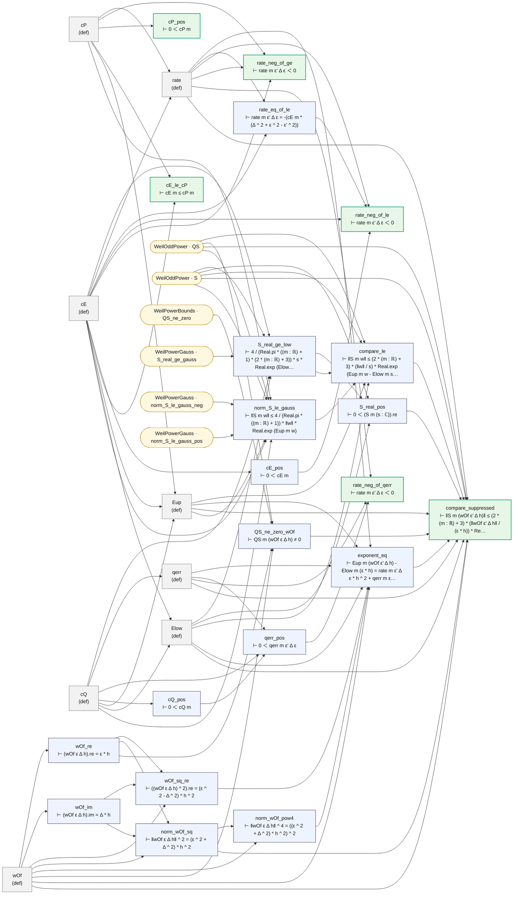

# `lean_stage3/Stage3/WeilPowerCompare.lean`

**What it does** (its own header): WeilPowerCompare — the comparison at another off-line zero. Rung 5, ninth slice, worksheet section 7. 2026-09-06.

**Imports:** [`WeilPowerGauss`](../lean_stage3/WeilPowerGauss.md).
**Imported by:** [`Stage3`](../lean_stage3/Stage3.md), [`WeilPowerAssembly`](../lean_stage3/WeilPowerAssembly.md), [`WeilPowerSelect`](../lean_stage3/WeilPowerSelect.md).

Blue: theorem. Green: a theorem nothing else uses (an end). Dashed white: connects to nothing. Grey: definition. Red: contains `sorry`. Yellow: in another file. An arrow A → B reads "A is used by B".

## Every declaration

| declaration | proves (output) | needs (input) | why (its own docstring) | uses | used by |
|---|---|---|---|---|---|
| `WeilPowerCompare.cP` def, line 81 | ℝ | m : ℕ | The strong Gaussian coefficient `1/(π²(m+1))`: the exponent's rate where `Re(w²) ≥ 0`. | — | `WeilPowerCompare.Eup`, `WeilPowerCompare.cE_le_cP`, `WeilPowerCompare.cP_pos`, `WeilPowerCompare.norm_S_le_gauss`, `WeilPowerCompare.rate`, `WeilPowerCompare.rate_neg_of_ge` |
| `WeilPowerCompare.cE` def, line 85 | ℝ | m : ℕ | The weak Gaussian coefficient `(m+2)/(π²(2m+3)²)`: the rate where `Re(w²) ≤ 0`, and the one the target's lower bound carries. | — | `WeilPowerCompare.Elow`, `WeilPowerCompare.Eup`, `WeilPowerCompare.S_real_ge_low`, `WeilPowerCompare.cE_le_cP`, `WeilPowerCompare.cE_pos`, `WeilPowerCompare.norm_S_le_gauss`, `WeilPowerCompare.rate`, `WeilPowerCompare.rate_eq_of_le`, `WeilPowerCompare.rate_neg_of_ge`, `WeilPowerCompare.rate_neg_of_le` |
| `WeilPowerCompare.cQ` def, line 88 | ℝ | m : ℕ | The quartic error coefficient `1/(π⁴(m+1)³)`. | — | `WeilPowerCompare.Elow`, `WeilPowerCompare.Eup`, `WeilPowerCompare.S_real_ge_low`, `WeilPowerCompare.cQ_pos`, `WeilPowerCompare.norm_S_le_gauss`, `WeilPowerCompare.qerr`, `WeilPowerCompare.qerr_pos` |
| `WeilPowerCompare.cP_pos` theorem, line 90 | 0 &lt; cP m | m : ℕ | — | `WeilPowerCompare.cP` | — |
| `WeilPowerCompare.cE_pos` theorem, line 95 | 0 &lt; cE m | m : ℕ | — | `WeilPowerCompare.cE` | `WeilPowerCompare.rate_neg_of_le` |
| `WeilPowerCompare.cQ_pos` theorem, line 101 | 0 &lt; cQ m | m : ℕ | — | `WeilPowerCompare.cQ` | `WeilPowerCompare.qerr_pos` |
| `WeilPowerCompare.cE_le_cP` theorem, line 107 | cE m ≤ cP m | m : ℕ | `(m+1)(m+2) ≤ (2m+3)²`, so the weak coefficient is at most the strong one. | `WeilPowerCompare.cE`, `WeilPowerCompare.cP` | — |
| `WeilPowerCompare.Eup` def, line 116 | ℝ | m : ℕ; w : ℂ | The upper exponent, both signs of `Re(w²)` in one expression: `max _ 0` picks the strong coefficient where `Re(w²) ≥ 0` and the weak one elsewhere. | `WeilPowerCompare.cE`, `WeilPowerCompare.cP`, `WeilPowerCompare.cQ` | `WeilPowerCompare.compare_le`, `WeilPowerCompare.compare_suppressed`, `WeilPowerCompare.exponent_eq`, `WeilPowerCompare.norm_S_le_gauss` |
| `WeilPowerCompare.Elow` def, line 120 | ℝ | m : ℕ; s : ℝ | The lower exponent at the target, on the real axis. | `WeilPowerCompare.cE`, `WeilPowerCompare.cQ` | `WeilPowerCompare.S_real_ge_low`, `WeilPowerCompare.S_real_pos`, `WeilPowerCompare.compare_le`, `WeilPowerCompare.compare_suppressed`, `WeilPowerCompare.exponent_eq` |
| `WeilPowerCompare.norm_S_le_gauss` theorem, line 123 | ‖S m w‖ ≤ 4 / (Real.pi * ((m : ℝ) + 1)) * ‖w‖ * Real.exp (Eup m w) | hne : QS m w ≠ 0; hsmall : ‖w‖ ^ 2 ≤ Real.pi ^ 2 * ((m : ℝ) + 2) ^ 2 / 2 | The Gaussian upper bound, both signs in one exponent. | `WeilOddPower.QS`, `WeilOddPower.S`, `WeilPowerCompare.Eup`, `WeilPowerCompare.cE`, `WeilPowerCompare.cP`, `WeilPowerCompare.cQ`, `WeilPowerGauss.norm_S_le_gauss_neg`, `WeilPowerGauss.norm_S_le_gauss_pos` | `WeilPowerCompare.compare_le` |
| `WeilPowerCompare.S_real_ge_low` theorem, line 150 | 4 / (Real.pi * ((m : ℝ) + 1) * (2 * (m : ℝ) + 3)) * s * Real.exp (Elow m s) ≤ (S m (s : ℂ)).re | hs : 0 &lt; s; hsmall : s ^ 2 ≤ Real.pi ^ 2 * ((m : ℝ) + 2) ^ 2 / 2 | The Gaussian lower bound at the target, in the `Elow` form. | `WeilOddPower.S`, `WeilPowerCompare.Elow`, `WeilPowerCompare.cE`, `WeilPowerCompare.cQ`, `WeilPowerGauss.S_real_ge_gauss` | `WeilPowerCompare.S_real_pos`, `WeilPowerCompare.compare_le` |
| `WeilPowerCompare.S_real_pos` theorem, line 166 | 0 &lt; (S m (s : ℂ)).re | hs : 0 &lt; s; hsmall : s ^ 2 ≤ Real.pi ^ 2 * ((m : ℝ) + 2) ^ 2 / 2 | The target's transform is positive on the real axis inside the regime. | `WeilOddPower.S`, `WeilPowerCompare.Elow`, `WeilPowerCompare.S_real_ge_low` | `WeilPowerCompare.compare_suppressed` |
| `WeilPowerCompare.compare_le` theorem, line 179 | ‖S m w‖ ≤ (2 * (m : ℝ) + 3) * (‖w‖ / s) * Real.exp (Eup m w - Elow m s) * (S m (s : ℂ)).re | hne : QS m w ≠ 0; hw : ‖w‖ ^ 2 ≤ Real.pi ^ 2 * ((m : ℝ) + 2) ^ 2 / 2; hs : 0 &lt; s; hs2 : s ^ 2 ≤ Real.pi ^ 2 * ((m : ℝ) + 2) ^ 2 / 2 | The comparison at another off-line zero. The transform at any point of the regime is at most `2m+3` times `‖w‖/s` times the exponential of the exponent difference, times the target's transform. | `WeilOddPower.QS`, `WeilOddPower.S`, `WeilPowerCompare.Elow`, `WeilPowerCompare.Eup`, `WeilPowerCompare.S_real_ge_low`, `WeilPowerCompare.norm_S_le_gauss` | `WeilPowerCompare.compare_suppressed` |
| `WeilPowerCompare.wOf` def, line 206 | ℂ | ε Δ h : ℝ | The point the window reads at a zero of real-part offset `ε` and height offset `Δ`: `w = (ε + iΔ)h`. | — | `WeilPowerCompare.QS_ne_zero_wOf`, `WeilPowerCompare.compare_suppressed`, `WeilPowerCompare.exponent_eq`, `WeilPowerCompare.norm_wOf_pow4`, `WeilPowerCompare.norm_wOf_sq`, `WeilPowerCompare.wOf_im`, `WeilPowerCompare.wOf_re`, `WeilPowerCompare.wOf_sq_re` |
| `WeilPowerCompare.wOf_re` theorem, line 208 | (wOf ε Δ h).re = ε * h | ε Δ h : ℝ | — | `WeilPowerCompare.wOf` | `WeilPowerCompare.QS_ne_zero_wOf`, `WeilPowerCompare.norm_wOf_sq`, `WeilPowerCompare.wOf_sq_re` |
| `WeilPowerCompare.wOf_im` theorem, line 211 | (wOf ε Δ h).im = Δ * h | ε Δ h : ℝ | — | `WeilPowerCompare.wOf` | `WeilPowerCompare.norm_wOf_sq`, `WeilPowerCompare.wOf_sq_re` |
| `WeilPowerCompare.wOf_sq_re` theorem, line 214 | ((wOf ε Δ h) ^ 2).re = (ε ^ 2 - Δ ^ 2) * h ^ 2 | ε Δ h : ℝ | — | `WeilPowerCompare.wOf`, `WeilPowerCompare.wOf_im`, `WeilPowerCompare.wOf_re` | `WeilPowerCompare.exponent_eq` |
| `WeilPowerCompare.norm_wOf_sq` theorem, line 218 | ‖wOf ε Δ h‖ ^ 2 = (ε ^ 2 + Δ ^ 2) * h ^ 2 | ε Δ h : ℝ | — | `WeilPowerCompare.wOf`, `WeilPowerCompare.wOf_im`, `WeilPowerCompare.wOf_re` | `WeilPowerCompare.compare_suppressed`, `WeilPowerCompare.norm_wOf_pow4` |
| `WeilPowerCompare.norm_wOf_pow4` theorem, line 222 | ‖wOf ε Δ h‖ ^ 4 = ((ε ^ 2 + Δ ^ 2) * h ^ 2) ^ 2 | ε Δ h : ℝ | — | `WeilPowerCompare.norm_wOf_sq`, `WeilPowerCompare.wOf` | `WeilPowerCompare.exponent_eq` |
| `WeilPowerCompare.QS_ne_zero_wOf` theorem, line 225 | QS m (wOf ε Δ h) ≠ 0 | hε : ε ≠ 0; hh : h ≠ 0 | — | `WeilOddPower.QS`, `WeilPowerBounds.QS_ne_zero`, `WeilPowerCompare.wOf`, `WeilPowerCompare.wOf_re` | `WeilPowerCompare.compare_suppressed` |
| `WeilPowerCompare.rate` def, line 232 | ℝ | m : ℕ; ε' Δ ε : ℝ | The quadratic rate of the exponent difference, per unit `h²`. | `WeilPowerCompare.cE`, `WeilPowerCompare.cP` | `WeilPowerCompare.compare_suppressed`, `WeilPowerCompare.exponent_eq`, `WeilPowerCompare.rate_eq_of_le`, `WeilPowerCompare.rate_neg_of_ge`, `WeilPowerCompare.rate_neg_of_le`, `WeilPowerCompare.rate_neg_of_qerr` |
| `WeilPowerCompare.qerr` def, line 236 | ℝ | m : ℕ; ε' Δ ε : ℝ | The quartic error of the exponent difference, per unit `h⁴`. | `WeilPowerCompare.cQ` | `WeilPowerCompare.compare_suppressed`, `WeilPowerCompare.exponent_eq`, `WeilPowerCompare.qerr_pos`, `WeilPowerCompare.rate_neg_of_qerr` |
| `WeilPowerCompare.exponent_eq` theorem, line 240 | Eup m (wOf ε' Δ h) - Elow m (ε * h) = rate m ε' Δ ε * h ^ 2 + qerr m ε' Δ ε * h ^ 4 | m : ℕ; ε' Δ ε h : ℝ | The exponent difference in the worksheet's variables, with no sign hypothesis: a quadratic rate against a quartic error. | `WeilPowerCompare.Elow`, `WeilPowerCompare.Eup`, `WeilPowerCompare.norm_wOf_pow4`, `WeilPowerCompare.qerr`, `WeilPowerCompare.rate`, `WeilPowerCompare.wOf`, `WeilPowerCompare.wOf_sq_re` | `WeilPowerCompare.compare_suppressed` |
| `WeilPowerCompare.rate_eq_of_le` theorem, line 253 | rate m ε' Δ ε = -(cE m * (Δ ^ 2 + ε ^ 2 - ε' ^ 2)) | m : ℕ; hsq : ε' ^ 2 ≤ Δ ^ 2 | At `Δ² ≥ ε'²` the rate is `−cE·(Δ² + ε² − ε'²)`. | `WeilPowerCompare.cE`, `WeilPowerCompare.rate` | `WeilPowerCompare.rate_neg_of_le` |
| `WeilPowerCompare.rate_neg_of_le` theorem, line 261 | rate m ε' Δ ε &lt; 0 | m : ℕ; hε : 0 &lt; ε; hsq : ε' ^ 2 ≤ Δ ^ 2 | A zero above the target in height is suppressed at every real part. `Δ² ≥ ε'²` and `0 &lt; ε` make the rate negative with no condition on `ε'`. | `WeilPowerCompare.cE`, `WeilPowerCompare.cE_pos`, `WeilPowerCompare.rate`, `WeilPowerCompare.rate_eq_of_le` | — |
| `WeilPowerCompare.rate_neg_of_ge` theorem, line 270 | rate m ε' Δ ε &lt; 0 | m : ℕ; hsq : Δ ^ 2 ≤ ε' ^ 2; hlt : cP m * (ε' ^ 2 - Δ ^ 2) &lt; cE m * ε ^ 2 | A zero inside the target's height is suppressed when its real part does not exceed the target's by the constant `cE/cP`. | `WeilPowerCompare.cE`, `WeilPowerCompare.cP`, `WeilPowerCompare.rate` | — |
| `WeilPowerCompare.qerr_pos` theorem, line 277 | 0 &lt; qerr m ε' Δ ε | m : ℕ; hε : 0 &lt; ε | The quartic error is positive at any target with `0 &lt; ε`. | `WeilPowerCompare.cQ`, `WeilPowerCompare.cQ_pos`, `WeilPowerCompare.qerr` | `WeilPowerCompare.rate_neg_of_qerr` |
| `WeilPowerCompare.rate_neg_of_qerr` theorem, line 284 | rate m ε' Δ ε &lt; 0 | hε : 0 &lt; ε; hh : 0 &lt; h; hq : qerr m ε' Δ ε * h ^ 2 ≤ -rate m ε' Δ ε / 2 | The range condition on `h` already forces the rate negative. | `WeilPowerCompare.qerr`, `WeilPowerCompare.qerr_pos`, `WeilPowerCompare.rate` | — |
| `WeilPowerCompare.compare_suppressed` theorem, line 294 | ‖S m (wOf ε' Δ h)‖ ≤ (2 * (m : ℝ) + 3) * (‖wOf ε' Δ h‖ / (ε * h)) * Real.exp (rate m ε' Δ ε * h ^ 2 / 2) * (S m ((ε * h : ℝ) : ℂ)).re | hε : 0 &lt; ε; hh : 0 &lt; h; hε' : ε' ≠ 0; hq : qerr m ε' Δ ε * h ^ 2 ≤ -rate m ε' Δ ε / 2; hw : (ε' ^ 2 + Δ ^ 2) * h ^ 2 ≤ Real.pi ^ 2 * ((m : ℝ) + 2) ^ 2 / 2; hs : (ε * h) ^ 2 ≤ Real.pi ^ 2 * ((m : ℝ) + 2) ^ 2 / 2 | Suppression at another off-line zero. For `h` in the range where the quartic error is at most half the rate — which by `rate_neg_of_qerr` already makes the rate negative — the transform at the other zero is an exponentially small multiple of the target's. | `WeilOddPower.QS`, `WeilOddPower.S`, `WeilPowerCompare.Elow`, `WeilPowerCompare.Eup`, `WeilPowerCompare.QS_ne_zero_wOf`, `WeilPowerCompare.S_real_pos`, `WeilPowerCompare.compare_le`, `WeilPowerCompare.exponent_eq`, `WeilPowerCompare.norm_wOf_sq`, `WeilPowerCompare.qerr`, `WeilPowerCompare.rate`, `WeilPowerCompare.wOf` | — |
