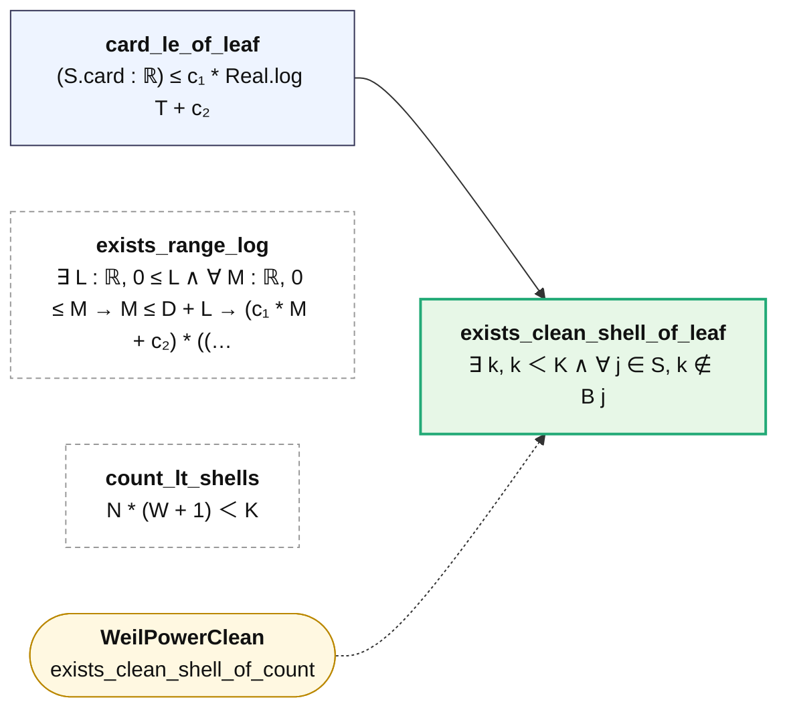

# `lean_stage3/Stage3/WeilPowerCount.lean`

WeilPowerCount — the short-interval count leaf, and the range that closes. Rung 5, nineteenth slice; worksheet § 13 block 13i. 2026-09-07.

4 theorems, 1 definition, 153 lines. Arrows are Lean's own record of what each proof uses.

**Imports:** [`WeilPowerClean`](../lean_stage3/WeilPowerClean.md)  
**Imported by:** [`Stage3`](../lean_stage3/Stage3.md)

## The picture



An arrow A → B reads "A is used in the proof of B". Blue: theorem. Green: a theorem nothing else uses (an end). Dashed: connects to nothing. Red: contains `sorry`. Yellow: theorems in another file, counted; a dotted arrow crosses files. Definitions are not drawn; they are listed below the diagram.

## Definitions

<a name="WeilPowerCount-StmtShortCount"></a>
### `WeilPowerCount.StmtShortCount`

def · line 70

The short-interval zero-count leaf: the number of zeros the target carries at height `T` is at most `c₁ log T + c₂`. Budget `c₁ ≤ 0.48`; route: Backlund plus `ArgCrude.StmtSCrude`, see the module header.

- **Is:** `` StmtShortCount (cnt : ℝ → ℝ) (c₁ c₂ : ℝ) : Prop := ∀ T : ℝ, 2 ≤ T → cnt T ≤ c₁ * Real.log T + c₂ ``
- **Used by 2:** [`WeilPowerCount.card_le_of_leaf`](#WeilPowerCount-card_le_of_leaf), [`WeilPowerCount.exists_clean_shell_of_leaf`](#WeilPowerCount-exists_clean_shell_of_leaf)

## Theorems

<a name="WeilPowerCount-card_le_of_leaf"></a>
### `WeilPowerCount.card_le_of_leaf`

line 74

**Why.** A member set counted by the leaf is bounded by `c₁ log T + c₂`.

**Proves**

```lean
(S.card : ℝ) ≤ c₁ * Real.log T + c₂
```

**Needs** (its hypotheses)

  - `` S : Finset ι ``
  - `` hleaf : StmtShortCount cnt c₁ c₂ ``
  - `` hT : 2 ≤ T ``
  - `` hS : (S.card : ℝ) ≤ cnt T ``

**Stated with:** [`WeilPowerCount.StmtShortCount`](#WeilPowerCount-StmtShortCount)

**Fed by:** no theorem of this repo; it stands on Mathlib and the definitions below.

**Feeds** (1 that use it)

  - [`WeilPowerCount.exists_clean_shell_of_leaf`](#WeilPowerCount-exists_clean_shell_of_leaf) — `` ∃ k, k < K ∧ ∀ j ∈ S, k ∉ B j ``

<a name="WeilPowerCount-exists_range_log"></a>
### `WeilPowerCount.exists_range_log`

line 85

**Why.** The closure: with `α = c₁(W+1)lρ < 1` there is an `L ≥ 0` — namely `(c₂(W+1)lρ + E + αD)/(1 − α)` — at which the shells fit for every count parameter `M` below `D + L`. This is what removes unit 0351's circularity: the demand is linear in `L` and the coefficient is `α`.

**Proves**

```lean
∃ L : ℝ, 0 ≤ L ∧ ∀ M : ℝ, 0 ≤ M → M ≤ D + L → (c₁ * M + c₂) * ((W : ℝ) + 1) * lρ + E ≤ L
```

**Needs** (its hypotheses)

  - `` hlρ : 0 < lρ ``
  - `` hc₁ : 0 ≤ c₁ ``
  - `` hc₂ : 0 ≤ c₂ ``
  - `` hD : 0 ≤ D ``
  - `` hE : 0 ≤ E ``
  - `` hα : c₁ * ((W : ℝ) + 1) * lρ < 1 ``

**Fed by:** no theorem of this repo; it stands on Mathlib.

**Feeds:** nothing. It connects to nothing.

<a name="WeilPowerCount-count_lt_shells"></a>
### `WeilPowerCount.count_lt_shells`

line 111

**Why.** The shell count in `ℕ`, read off the same inequality scaled by `lρ`.

**Proves**

```lean
N * (W + 1) < K
```

**Needs** (its hypotheses)

  - `` hlρ : 0 < lρ ``
  - `` h : ((N : ℝ) * ((W : ℝ) + 1) + 1) * lρ ≤ (K : ℝ) * lρ ``

**Fed by:** no theorem of this repo; it stands on Mathlib.

**Feeds:** nothing. It connects to nothing.

<a name="WeilPowerCount-exists_clean_shell_of_leaf"></a>
### `WeilPowerCount.exists_clean_shell_of_leaf`

line 121

**Why.** 13h's clean shell with the member count supplied by the leaf rather than assumed.

**Proves**

```lean
∃ k, k < K ∧ ∀ j ∈ S, k ∉ B j
```

**Needs** (its hypotheses)

  - `` S : Finset ι ``
  - `` B : ι → Finset ℕ ``
  - `` d : ι → ℝ ``
  - `` hleaf : StmtShortCount cnt c₁ c₂ ``
  - `` hT : 2 ≤ T ``
  - `` hS : (S.card : ℝ) ≤ cnt T ``
  - `` hN : c₁ * Real.log T + c₂ ≤ (N : ℝ) ``
  - `` hρ : 1 ≤ ρ ``
  - `` hlo : 0 < lo ``
  - `` hW : hi < lo * ρ ^ (W + 1) ``
  - `` hB : ∀ j ∈ S, ∀ k ∈ B j, lo ≤ d j * (a * ρ ^ k) ∧ d j * (a * ρ ^ k) ≤ hi ``
  - `` hK : N * (W + 1) < K ``

**Stated with:** [`WeilPowerCount.StmtShortCount`](#WeilPowerCount-StmtShortCount)

**Fed by** (2 theorems its proof uses)

  - [`WeilPowerClean.exists_clean_shell_of_count`](../lean_stage3/WeilPowerClean.md#WeilPowerClean-exists_clean_shell_of_count) (WeilPowerClean) — `` ∃ k, k < K ∧ ∀ j ∈ S, k ∉ B j ``
  - [`WeilPowerCount.card_le_of_leaf`](#WeilPowerCount-card_le_of_leaf) — `` (S.card : ℝ) ≤ c₁ * Real.log T + c₂ ``

**Feeds:** nothing. It is an end.

