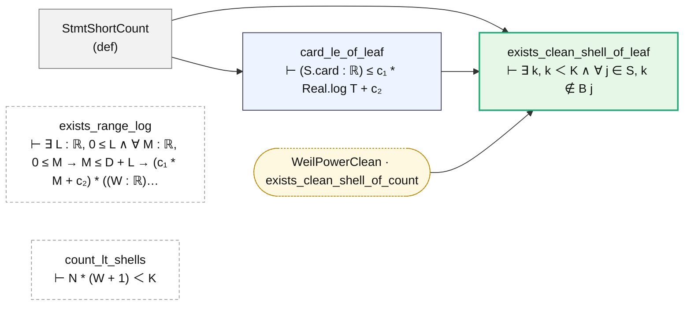

# `lean_stage3/Stage3/WeilPowerCount.lean`

**What it does** (its own header): WeilPowerCount — the short-interval count leaf, and the range that closes. Rung 5, nineteenth slice; worksheet § 13 block 13i. 2026-09-07.

**Imports:** [`WeilPowerClean`](../lean_stage3/WeilPowerClean.md).
**Imported by:** [`Stage3`](../lean_stage3/Stage3.md).

Blue: theorem. Green: a theorem nothing else uses (an end). Dashed white: connects to nothing. Grey: definition. Red: contains `sorry`. Yellow: in another file. An arrow A → B reads "A is used by B".

## Every declaration

| declaration | proves (output) | needs (input) | why (its own docstring) | uses | used by |
|---|---|---|---|---|---|
| `WeilPowerCount.StmtShortCount` def, line 70 | Prop | cnt : ℝ → ℝ; c₁ c₂ : ℝ | The short-interval zero-count leaf: the number of zeros the target carries at height `T` is at most `c₁ log T + c₂`. Budget `c₁ ≤ 0.48`; route: Backlund plus `ArgCrude.StmtSCrude`, see the module header. | — | `WeilPowerCount.card_le_of_leaf`, `WeilPowerCount.exists_clean_shell_of_leaf` |
| `WeilPowerCount.card_le_of_leaf` theorem, line 74 | (S.card : ℝ) ≤ c₁ * Real.log T + c₂ | S : Finset ι; hleaf : StmtShortCount cnt c₁ c₂; hT : 2 ≤ T; hS : (S.card : ℝ) ≤ cnt T | A member set counted by the leaf is bounded by `c₁ log T + c₂`. | `WeilPowerCount.StmtShortCount` | `WeilPowerCount.exists_clean_shell_of_leaf` |
| `WeilPowerCount.exists_range_log` theorem, line 85 | ∃ L : ℝ, 0 ≤ L ∧ ∀ M : ℝ, 0 ≤ M → M ≤ D + L → (c₁ * M + c₂) * ((W : ℝ) + 1) * lρ + E ≤ L | hlρ : 0 &lt; lρ; hc₁ : 0 ≤ c₁; hc₂ : 0 ≤ c₂; hD : 0 ≤ D; hE : 0 ≤ E; hα : c₁ * ((W : ℝ) + 1) * lρ &lt; 1 | The closure: with `α = c₁(W+1)lρ &lt; 1` there is an `L ≥ 0` — namely `(c₂(W+1)lρ + E + αD)/(1 − α)` — at which the shells fit for every count parameter `M` below `D + L`. This is what removes unit 0351's circularity: the demand is linear in `L` and the coefficient is `α`. | — | — |
| `WeilPowerCount.count_lt_shells` theorem, line 111 | N * (W + 1) &lt; K | hlρ : 0 &lt; lρ; h : ((N : ℝ) * ((W : ℝ) + 1) + 1) * lρ ≤ (K : ℝ) * lρ | The shell count in `ℕ`, read off the same inequality scaled by `lρ`. | — | — |
| `WeilPowerCount.exists_clean_shell_of_leaf` theorem, line 121 | ∃ k, k &lt; K ∧ ∀ j ∈ S, k ∉ B j | S : Finset ι; B : ι → Finset ℕ; d : ι → ℝ; hleaf : StmtShortCount cnt c₁ c₂; hT : 2 ≤ T; hS : (S.card : ℝ) ≤ cnt T; hN : c₁ * Real.log T + c₂ ≤ (N : ℝ); hρ : 1 ≤ ρ; hlo : 0 &lt; lo; hW : hi &lt; lo * ρ ^ (W + 1); hB : ∀ j ∈ S, ∀ k ∈ B j, lo ≤ d j * (a * ρ ^ k) ∧ d j * (a * ρ ^ k) ≤ hi; hK : N * (W + 1) &lt; K | 13h's clean shell with the member count supplied by the leaf rather than assumed. | `WeilPowerClean.exists_clean_shell_of_count`, `WeilPowerCount.StmtShortCount`, `WeilPowerCount.card_le_of_leaf` | — |
