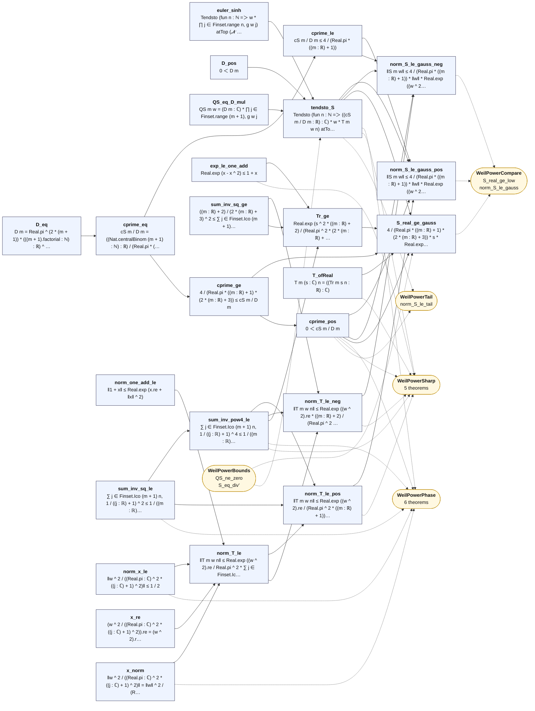

# `lean_stage3/Stage3/WeilPowerGauss.lean`

WeilPowerGauss — the odd transform in the Gaussian regime, through Euler's product for `sinh`. Rung 5, sixth slice. 2026-09-06.

25 theorems, 4 definitions, 565 lines. Arrows are Lean's own record of what each proof uses.

**Imports:** [`WeilPowerBounds`](../lean_stage3/WeilPowerBounds.md)  
**Imported by:** [`Stage3`](../lean_stage3/Stage3.md), [`WeilPowerCompare`](../lean_stage3/WeilPowerCompare.md), [`WeilPowerSharp`](../lean_stage3/WeilPowerSharp.md)

## The picture



An arrow A → B reads "A is used in the proof of B". Blue: theorem. Green: a theorem nothing else uses (an end). Dashed: connects to nothing. Red: contains `sorry`. Yellow: theorems in another file, counted; a dotted arrow crosses files. Definitions are not drawn; they are listed below the diagram.

## Definitions

<a name="WeilPowerGauss-g"></a>
### `WeilPowerGauss.g`

def · line 52

One factor of Euler's product for `sinh`: `1 + w²/(π²(j+1)²)`.

- **Is:** `` g (w : ℂ) (j : ℕ) : ℂ := 1 + w ^ 2 / ((Real.pi : ℂ) ^ 2 * ((j : ℂ) + 1) ^ 2) ``
- **Used by 15:** [`WeilPowerGauss.QS_eq_D_mul`](#WeilPowerGauss-QS_eq_D_mul), [`WeilPowerGauss.T`](#WeilPowerGauss-T), [`WeilPowerGauss.T_ofReal`](#WeilPowerGauss-T_ofReal), [`WeilPowerGauss.euler_sinh`](#WeilPowerGauss-euler_sinh), [`WeilPowerGauss.norm_T_le`](#WeilPowerGauss-norm_T_le), [`WeilPowerGauss.tendsto_S`](#WeilPowerGauss-tendsto_S), [`WeilPowerPhase.T_eq_exp`](../lean_stage3/WeilPowerPhase.md#WeilPowerPhase-T_eq_exp), [`WeilPowerPhase.T_eq_mul`](../lean_stage3/WeilPowerPhase.md#WeilPowerPhase-T_eq_mul), [`WeilPowerPhase.delta`](../lean_stage3/WeilPowerPhase.md#WeilPowerPhase-delta), [`WeilPowerPhase.g_eq`](../lean_stage3/WeilPowerPhase.md#WeilPowerPhase-g_eq), [`WeilPowerPhase.g_ne_zero`](../lean_stage3/WeilPowerPhase.md#WeilPowerPhase-g_ne_zero), [`WeilPowerPhase.norm_delta_le`](../lean_stage3/WeilPowerPhase.md#WeilPowerPhase-norm_delta_le), [`WeilPowerPhase.norm_log_sub_le`](../lean_stage3/WeilPowerPhase.md#WeilPowerPhase-norm_log_sub_le), [`WeilPowerTail.norm_T_le_tail`](../lean_stage3/WeilPowerTail.md#WeilPowerTail-norm_T_le_tail), [`WeilPowerTail.norm_g_le`](../lean_stage3/WeilPowerTail.md#WeilPowerTail-norm_g_le)

<a name="WeilPowerGauss-D"></a>
### `WeilPowerGauss.D`

def · line 84

`D m = ∏_{j<m+1} π²(j+1)²`.

- **Is:** `` D (m : ℕ) : ℝ := ∏ j ∈ Finset.range (m + 1), (Real.pi ^ 2 * ((j : ℝ) + 1) ^ 2) ``
- **Used by 23:** [`WeilPowerAssembly.target_lower`](../lean_stage3/WeilPowerAssembly.md#WeilPowerAssembly-target_lower), [`WeilPowerBridge.term_le_at_zero`](../lean_stage3/WeilPowerBridge.md#WeilPowerBridge-term_le_at_zero), [`WeilPowerGauss.D_eq`](#WeilPowerGauss-D_eq), [`WeilPowerGauss.D_pos`](#WeilPowerGauss-D_pos), [`WeilPowerGauss.QS_eq_D_mul`](#WeilPowerGauss-QS_eq_D_mul), [`WeilPowerGauss.S_real_ge_gauss`](#WeilPowerGauss-S_real_ge_gauss), [`WeilPowerGauss.cprime_eq`](#WeilPowerGauss-cprime_eq), [`WeilPowerGauss.cprime_ge`](#WeilPowerGauss-cprime_ge), [`WeilPowerGauss.cprime_le`](#WeilPowerGauss-cprime_le), [`WeilPowerGauss.cprime_pos`](#WeilPowerGauss-cprime_pos), [`WeilPowerGauss.norm_S_le_gauss_neg`](#WeilPowerGauss-norm_S_le_gauss_neg), [`WeilPowerGauss.norm_S_le_gauss_pos`](#WeilPowerGauss-norm_S_le_gauss_pos), [`WeilPowerGauss.tendsto_S`](#WeilPowerGauss-tendsto_S), [`WeilPowerPhase.norm_A_sq`](../lean_stage3/WeilPowerPhase.md#WeilPowerPhase-norm_A_sq), [`WeilPowerPhase.norm_S_sub_le`](../lean_stage3/WeilPowerPhase.md#WeilPowerPhase-norm_S_sub_le), [`WeilPowerPhase.re_A_sq`](../lean_stage3/WeilPowerPhase.md#WeilPowerPhase-re_A_sq), [`WeilPowerPhase.re_S_sq_ge`](../lean_stage3/WeilPowerPhase.md#WeilPowerPhase-re_S_sq_ge), [`WeilPowerPhase.re_sq_ge`](../lean_stage3/WeilPowerPhase.md#WeilPowerPhase-re_sq_ge), [`WeilPowerSharp.S_real_ge_sharp`](../lean_stage3/WeilPowerSharp.md#WeilPowerSharp-S_real_ge_sharp), [`WeilPowerSharp.compare_sharp`](../lean_stage3/WeilPowerSharp.md#WeilPowerSharp-compare_sharp), [`WeilPowerSharp.norm_S_le_c_neg`](../lean_stage3/WeilPowerSharp.md#WeilPowerSharp-norm_S_le_c_neg), [`WeilPowerSharp.norm_S_le_c_pos`](../lean_stage3/WeilPowerSharp.md#WeilPowerSharp-norm_S_le_c_pos), [`WeilPowerTail.norm_S_le_tail`](../lean_stage3/WeilPowerTail.md#WeilPowerTail-norm_S_le_tail)

<a name="WeilPowerGauss-T"></a>
### `WeilPowerGauss.T`

def · line 164

The tail of Euler's product from `m+1` to `n`.

- **Is:** `` T (m : ℕ) (w : ℂ) (n : ℕ) : ℂ := ∏ j ∈ Finset.Ico (m + 1) n, g w j ``
- **Built from:** [`WeilPowerGauss.g`](#WeilPowerGauss-g)
- **Used by 16:** [`WeilPowerGauss.S_real_ge_gauss`](#WeilPowerGauss-S_real_ge_gauss), [`WeilPowerGauss.T_ofReal`](#WeilPowerGauss-T_ofReal), [`WeilPowerGauss.norm_S_le_gauss_neg`](#WeilPowerGauss-norm_S_le_gauss_neg), [`WeilPowerGauss.norm_S_le_gauss_pos`](#WeilPowerGauss-norm_S_le_gauss_pos), [`WeilPowerGauss.norm_T_le`](#WeilPowerGauss-norm_T_le), [`WeilPowerGauss.norm_T_le_neg`](#WeilPowerGauss-norm_T_le_neg), [`WeilPowerGauss.norm_T_le_pos`](#WeilPowerGauss-norm_T_le_pos), [`WeilPowerGauss.tendsto_S`](#WeilPowerGauss-tendsto_S), [`WeilPowerPhase.T_eq_exp`](../lean_stage3/WeilPowerPhase.md#WeilPowerPhase-T_eq_exp), [`WeilPowerPhase.T_eq_mul`](../lean_stage3/WeilPowerPhase.md#WeilPowerPhase-T_eq_mul), [`WeilPowerPhase.norm_S_sub_le`](../lean_stage3/WeilPowerPhase.md#WeilPowerPhase-norm_S_sub_le), [`WeilPowerSharp.S_real_ge_sharp`](../lean_stage3/WeilPowerSharp.md#WeilPowerSharp-S_real_ge_sharp), [`WeilPowerSharp.norm_S_le_c_neg`](../lean_stage3/WeilPowerSharp.md#WeilPowerSharp-norm_S_le_c_neg), [`WeilPowerSharp.norm_S_le_c_pos`](../lean_stage3/WeilPowerSharp.md#WeilPowerSharp-norm_S_le_c_pos), [`WeilPowerTail.norm_S_le_tail`](../lean_stage3/WeilPowerTail.md#WeilPowerTail-norm_S_le_tail), [`WeilPowerTail.norm_T_le_tail`](../lean_stage3/WeilPowerTail.md#WeilPowerTail-norm_T_le_tail)

<a name="WeilPowerGauss-Tr"></a>
### `WeilPowerGauss.Tr`

def · line 444

The tail at real `s` is a real product.

- **Is:** `` Tr (m : ℕ) (s : ℝ) (n : ℕ) : ℝ := ∏ j ∈ Finset.Ico (m + 1) n, (1 + s ^ 2 / (Real.pi ^ 2 * ((j : ℝ) + 1) ^ 2)) ``
- **Used by 5:** [`WeilPowerGauss.S_real_ge_gauss`](#WeilPowerGauss-S_real_ge_gauss), [`WeilPowerGauss.T_ofReal`](#WeilPowerGauss-T_ofReal), [`WeilPowerGauss.Tr_ge`](#WeilPowerGauss-Tr_ge), [`WeilPowerSharp.S_real_ge_sharp`](../lean_stage3/WeilPowerSharp.md#WeilPowerSharp-S_real_ge_sharp), [`WeilPowerSharp.Tr_ge_sharp`](../lean_stage3/WeilPowerSharp.md#WeilPowerSharp-Tr_ge_sharp)

## Theorems

<a name="WeilPowerGauss-euler_sinh"></a>
### `WeilPowerGauss.euler_sinh`

line 55

**Why.** Euler's product for `sinh`. `w·∏_{j<n}(1 + w²/(π²(j+1)²)) → sinh w`.

**Proves**

```lean
Tendsto (fun n : ℕ => w * ∏ j ∈ Finset.range n, g w j) atTop (𝓝 (Complex.sinh w))
```

**Needs** (its hypotheses)

  - `` w : ℂ ``

**Stated with:** [`WeilPowerGauss.g`](#WeilPowerGauss-g)

**Fed by:** no theorem of this repo; it stands on Mathlib and the definitions below.

**Feeds** (1 that use it)

  - [`WeilPowerGauss.tendsto_S`](#WeilPowerGauss-tendsto_S) — `` Tendsto (fun n : ℕ => ((cS m / D m : ℝ) : ℂ) * w * T m w n) atTop (𝓝 (S m w)) ``

<a name="WeilPowerGauss-D_pos"></a>
### `WeilPowerGauss.D_pos`

line 86

**Proves**

```lean
0 < D m
```

**Needs** (its hypotheses)

  - `` m : ℕ ``

**Stated with:** [`WeilPowerGauss.D`](#WeilPowerGauss-D)

**Fed by:** no theorem of this repo; it stands on Mathlib and the definitions below.

**Feeds** (1 that use it)

  - [`WeilPowerGauss.tendsto_S`](#WeilPowerGauss-tendsto_S) — `` Tendsto (fun n : ℕ => ((cS m / D m : ℝ) : ℂ) * w * T m w n) atTop (𝓝 (S m w)) ``

<a name="WeilPowerGauss-D_eq"></a>
### `WeilPowerGauss.D_eq`

line 92

**Proves**

```lean
D m = Real.pi ^ (2 * (m + 1)) * (((m + 1).factorial : ℕ) : ℝ) ^ 2
```

**Needs** (its hypotheses)

  - `` m : ℕ ``

**Stated with:** [`WeilPowerGauss.D`](#WeilPowerGauss-D)

**Fed by:** no theorem of this repo; it stands on Mathlib and the definitions below.

**Feeds** (1 that use it)

  - [`WeilPowerGauss.cprime_eq`](#WeilPowerGauss-cprime_eq) — `` cS m / D m = ((Nat.centralBinom (m + 1) : ℕ) : ℝ) / (Real.pi * ((m : ℝ) + 1) * 4 ^ m) ``

<a name="WeilPowerGauss-QS_eq_D_mul"></a>
### `WeilPowerGauss.QS_eq_D_mul`

line 102

**Why.** The head of the closed form's product is `D m` times the head of Euler's product.

**Proves**

```lean
QS m w = (D m : ℂ) * ∏ j ∈ Finset.range (m + 1), g w j
```

**Needs** (its hypotheses)

  - `` m : ℕ ``
  - `` w : ℂ ``

**Stated with:** [`WeilOddPower.QS`](../lean_stage3/WeilOddPower.md#WeilOddPower-QS), [`WeilPowerGauss.D`](#WeilPowerGauss-D), [`WeilPowerGauss.g`](#WeilPowerGauss-g)

**Fed by:** no theorem of this repo; it stands on Mathlib and the definitions below.

**Feeds** (1 that use it)

  - [`WeilPowerGauss.tendsto_S`](#WeilPowerGauss-tendsto_S) — `` Tendsto (fun n : ℕ => ((cS m / D m : ℝ) : ℂ) * w * T m w n) atTop (𝓝 (S m w)) ``

<a name="WeilPowerGauss-cprime_eq"></a>
### `WeilPowerGauss.cprime_eq`

line 115

**Why.** `cS m / D m = centralBinom (m+1) / (π (m+1) 4^m)`.

**Proves**

```lean
cS m / D m = ((Nat.centralBinom (m + 1) : ℕ) : ℝ) / (Real.pi * ((m : ℝ) + 1) * 4 ^ m)
```

**Needs** (its hypotheses)

  - `` m : ℕ ``

**Stated with:** [`WeilOddPower.cS`](../lean_stage3/WeilOddPower.md#WeilOddPower-cS), [`WeilPowerGauss.D`](#WeilPowerGauss-D)

**Fed by** (1 theorem its proof uses)

  - [`WeilPowerGauss.D_eq`](#WeilPowerGauss-D_eq) — `` D m = Real.pi ^ (2 * (m + 1)) * (((m + 1).factorial : ℕ) : ℝ) ^ 2 ``

**Feeds** (2 that use it)

  - [`WeilPowerGauss.cprime_ge`](#WeilPowerGauss-cprime_ge) — `` 4 / (Real.pi * ((m : ℝ) + 1) * (2 * (m : ℝ) + 3)) ≤ cS m / D m ``
  - [`WeilPowerGauss.cprime_le`](#WeilPowerGauss-cprime_le) — `` cS m / D m ≤ 4 / (Real.pi * ((m : ℝ) + 1)) ``

<a name="WeilPowerGauss-cprime_le"></a>
### `WeilPowerGauss.cprime_le`

line 138

**Proves**

```lean
cS m / D m ≤ 4 / (Real.pi * ((m : ℝ) + 1))
```

**Needs** (its hypotheses)

  - `` m : ℕ ``

**Stated with:** [`WeilOddPower.cS`](../lean_stage3/WeilOddPower.md#WeilOddPower-cS), [`WeilPowerGauss.D`](#WeilPowerGauss-D)

**Fed by** (1 theorem its proof uses)

  - [`WeilPowerGauss.cprime_eq`](#WeilPowerGauss-cprime_eq) — `` cS m / D m = ((Nat.centralBinom (m + 1) : ℕ) : ℝ) / (Real.pi * ((m : ℝ) + 1) * 4 ^ m) ``

**Feeds** (2 that use it)

  - [`WeilPowerGauss.norm_S_le_gauss_neg`](#WeilPowerGauss-norm_S_le_gauss_neg) — `` ‖S m w‖ ≤ 4 / (Real.pi * ((m : ℝ) + 1)) * ‖w‖ * Real.exp ((w ^ 2).re * ((m : ℝ) + 2) / (Real.pi ^ 2 * (2 * (m : ℝ) + 3) ^ 2) + ‖w‖ ^ 4 / (Real.pi ^ 4 … ``
  - [`WeilPowerGauss.norm_S_le_gauss_pos`](#WeilPowerGauss-norm_S_le_gauss_pos) — `` ‖S m w‖ ≤ 4 / (Real.pi * ((m : ℝ) + 1)) * ‖w‖ * Real.exp ((w ^ 2).re / (Real.pi ^ 2 * ((m : ℝ) + 1)) + ‖w‖ ^ 4 / (Real.pi ^ 4 * ((m : ℝ) + 1) ^ 3)) ``

<a name="WeilPowerGauss-cprime_ge"></a>
### `WeilPowerGauss.cprime_ge`

line 148

**Proves**

```lean
4 / (Real.pi * ((m : ℝ) + 1) * (2 * (m : ℝ) + 3)) ≤ cS m / D m
```

**Needs** (its hypotheses)

  - `` m : ℕ ``

**Stated with:** [`WeilOddPower.cS`](../lean_stage3/WeilOddPower.md#WeilOddPower-cS), [`WeilPowerGauss.D`](#WeilPowerGauss-D)

**Fed by** (1 theorem its proof uses)

  - [`WeilPowerGauss.cprime_eq`](#WeilPowerGauss-cprime_eq) — `` cS m / D m = ((Nat.centralBinom (m + 1) : ℕ) : ℝ) / (Real.pi * ((m : ℝ) + 1) * 4 ^ m) ``

**Feeds** (2 that use it)

  - [`WeilPowerGauss.S_real_ge_gauss`](#WeilPowerGauss-S_real_ge_gauss) — `` 4 / (Real.pi * ((m : ℝ) + 1) * (2 * (m : ℝ) + 3)) * s * Real.exp (s ^ 2 * ((m : ℝ) + 2) / (Real.pi ^ 2 * (2 * (m : ℝ) + 3) ^ 2) - s ^ 4 / (Real.pi ^ 4… ``
  - [`WeilPowerGauss.cprime_pos`](#WeilPowerGauss-cprime_pos) — `` 0 < cS m / D m ``

<a name="WeilPowerGauss-cprime_pos"></a>
### `WeilPowerGauss.cprime_pos`

line 160

**Proves**

```lean
0 < cS m / D m
```

**Needs** (its hypotheses)

  - `` m : ℕ ``

**Stated with:** [`WeilOddPower.cS`](../lean_stage3/WeilOddPower.md#WeilOddPower-cS), [`WeilPowerGauss.D`](#WeilPowerGauss-D)

**Fed by** (1 theorem its proof uses)

  - [`WeilPowerGauss.cprime_ge`](#WeilPowerGauss-cprime_ge) — `` 4 / (Real.pi * ((m : ℝ) + 1) * (2 * (m : ℝ) + 3)) ≤ cS m / D m ``

**Feeds** (9 that use it)

  - [`WeilPowerGauss.S_real_ge_gauss`](#WeilPowerGauss-S_real_ge_gauss) — `` 4 / (Real.pi * ((m : ℝ) + 1) * (2 * (m : ℝ) + 3)) * s * Real.exp (s ^ 2 * ((m : ℝ) + 2) / (Real.pi ^ 2 * (2 * (m : ℝ) + 3) ^ 2) - s ^ 4 / (Real.pi ^ 4… ``
  - [`WeilPowerGauss.norm_S_le_gauss_neg`](#WeilPowerGauss-norm_S_le_gauss_neg) — `` ‖S m w‖ ≤ 4 / (Real.pi * ((m : ℝ) + 1)) * ‖w‖ * Real.exp ((w ^ 2).re * ((m : ℝ) + 2) / (Real.pi ^ 2 * (2 * (m : ℝ) + 3) ^ 2) + ‖w‖ ^ 4 / (Real.pi ^ 4 … ``
  - [`WeilPowerGauss.norm_S_le_gauss_pos`](#WeilPowerGauss-norm_S_le_gauss_pos) — `` ‖S m w‖ ≤ 4 / (Real.pi * ((m : ℝ) + 1)) * ‖w‖ * Real.exp ((w ^ 2).re / (Real.pi ^ 2 * ((m : ℝ) + 1)) + ‖w‖ ^ 4 / (Real.pi ^ 4 * ((m : ℝ) + 1) ^ 3)) ``
  - [`WeilPowerPhase.norm_A_sq`](../lean_stage3/WeilPowerPhase.md#WeilPowerPhase-norm_A_sq) (WeilPowerPhase) — `` ‖((cS m / D m : ℝ) : ℂ) * w * P m w‖ ^ 2 = (cS m / D m) ^ 2 * ‖w‖ ^ 2 * Real.exp (2 * (w ^ 2).re * sigma m) ``
  - [`WeilPowerSharp.S_real_ge_sharp`](../lean_stage3/WeilPowerSharp.md#WeilPowerSharp-S_real_ge_sharp) (WeilPowerSharp) — `` cS m / D m * s * Real.exp (s ^ 2 / (Real.pi ^ 2 * ((m : ℝ) + 2)) - s ^ 4 / (Real.pi ^ 4 * ((m : ℝ) + 1) ^ 3)) ≤ (S m (s : ℂ)).re ``
  - [`WeilPowerSharp.compare_sharp`](../lean_stage3/WeilPowerSharp.md#WeilPowerSharp-compare_sharp) (WeilPowerSharp) — `` ‖S m w‖ ≤ ‖w‖ / s * Real.exp (((w ^ 2).re - s ^ 2) / (Real.pi ^ 2 * ((m : ℝ) + 1)) + s ^ 2 / (Real.pi ^ 2 * ((m : ℝ) + 1) * ((m : ℝ) + 2)) + (‖w‖ ^ 4 … ``
  - [`WeilPowerSharp.norm_S_le_c_neg`](../lean_stage3/WeilPowerSharp.md#WeilPowerSharp-norm_S_le_c_neg) (WeilPowerSharp) — `` ‖S m w‖ ≤ cS m / D m * ‖w‖ * Real.exp ((w ^ 2).re * ((m : ℝ) + 2) / (Real.pi ^ 2 * (2 * (m : ℝ) + 3) ^ 2) + ‖w‖ ^ 4 / (Real.pi ^ 4 * ((m : ℝ) + 1) ^ 3… ``
  - [`WeilPowerSharp.norm_S_le_c_pos`](../lean_stage3/WeilPowerSharp.md#WeilPowerSharp-norm_S_le_c_pos) (WeilPowerSharp) — `` ‖S m w‖ ≤ cS m / D m * ‖w‖ * Real.exp ((w ^ 2).re / (Real.pi ^ 2 * ((m : ℝ) + 1)) + ‖w‖ ^ 4 / (Real.pi ^ 4 * ((m : ℝ) + 1) ^ 3)) ``
  - [`WeilPowerTail.norm_S_le_tail`](../lean_stage3/WeilPowerTail.md#WeilPowerTail-norm_S_le_tail) (WeilPowerTail) — `` ‖S m w‖ ≤ cS m / D m * ‖w‖ * Real.exp ((w ^ 2).re * sigma m + ‖w‖ ^ 4 / (6 * Real.pi ^ 4 * ((m : ℝ) + 1) ^ 3)) ``

<a name="WeilPowerGauss-tendsto_S"></a>
### `WeilPowerGauss.tendsto_S`

line 167

**Why.** The transform as a limit of tails.

**Proves**

```lean
Tendsto (fun n : ℕ => ((cS m / D m : ℝ) : ℂ) * w * T m w n) atTop (𝓝 (S m w))
```

**Needs** (its hypotheses)

  - `` hne : QS m w ≠ 0 ``

**Stated with:** [`WeilOddPower.QS`](../lean_stage3/WeilOddPower.md#WeilOddPower-QS), [`WeilOddPower.S`](../lean_stage3/WeilOddPower.md#WeilOddPower-S), [`WeilOddPower.cS`](../lean_stage3/WeilOddPower.md#WeilOddPower-cS), [`WeilPowerGauss.D`](#WeilPowerGauss-D), [`WeilPowerGauss.T`](#WeilPowerGauss-T)

**Fed by** (4 theorems its proof uses)

  - [`WeilPowerBounds.S_eq_div'`](../lean_stage3/WeilPowerBounds.md#WeilPowerBounds-S_eq_div-) (WeilPowerBounds) — `` S m w = (cS m : ℂ) * Complex.sinh w / QS m w ``
  - [`WeilPowerGauss.D_pos`](#WeilPowerGauss-D_pos) — `` 0 < D m ``
  - [`WeilPowerGauss.QS_eq_D_mul`](#WeilPowerGauss-QS_eq_D_mul) — `` QS m w = (D m : ℂ) * ∏ j ∈ Finset.range (m + 1), g w j ``
  - [`WeilPowerGauss.euler_sinh`](#WeilPowerGauss-euler_sinh) — `` Tendsto (fun n : ℕ => w * ∏ j ∈ Finset.range n, g w j) atTop (𝓝 (Complex.sinh w)) ``

**Definitions its proof touches:** [`WeilPowerGauss.g`](#WeilPowerGauss-g)

**Feeds** (8 that use it)

  - [`WeilPowerGauss.S_real_ge_gauss`](#WeilPowerGauss-S_real_ge_gauss) — `` 4 / (Real.pi * ((m : ℝ) + 1) * (2 * (m : ℝ) + 3)) * s * Real.exp (s ^ 2 * ((m : ℝ) + 2) / (Real.pi ^ 2 * (2 * (m : ℝ) + 3) ^ 2) - s ^ 4 / (Real.pi ^ 4… ``
  - [`WeilPowerGauss.norm_S_le_gauss_neg`](#WeilPowerGauss-norm_S_le_gauss_neg) — `` ‖S m w‖ ≤ 4 / (Real.pi * ((m : ℝ) + 1)) * ‖w‖ * Real.exp ((w ^ 2).re * ((m : ℝ) + 2) / (Real.pi ^ 2 * (2 * (m : ℝ) + 3) ^ 2) + ‖w‖ ^ 4 / (Real.pi ^ 4 … ``
  - [`WeilPowerGauss.norm_S_le_gauss_pos`](#WeilPowerGauss-norm_S_le_gauss_pos) — `` ‖S m w‖ ≤ 4 / (Real.pi * ((m : ℝ) + 1)) * ‖w‖ * Real.exp ((w ^ 2).re / (Real.pi ^ 2 * ((m : ℝ) + 1)) + ‖w‖ ^ 4 / (Real.pi ^ 4 * ((m : ℝ) + 1) ^ 3)) ``
  - [`WeilPowerPhase.norm_S_sub_le`](../lean_stage3/WeilPowerPhase.md#WeilPowerPhase-norm_S_sub_le) (WeilPowerPhase) — `` ‖S m w - ((cS m / D m : ℝ) : ℂ) * w * P m w‖ ≤ 2 * q m w * ‖((cS m / D m : ℝ) : ℂ) * w * P m w‖ ``
  - [`WeilPowerSharp.S_real_ge_sharp`](../lean_stage3/WeilPowerSharp.md#WeilPowerSharp-S_real_ge_sharp) (WeilPowerSharp) — `` cS m / D m * s * Real.exp (s ^ 2 / (Real.pi ^ 2 * ((m : ℝ) + 2)) - s ^ 4 / (Real.pi ^ 4 * ((m : ℝ) + 1) ^ 3)) ≤ (S m (s : ℂ)).re ``
  - [`WeilPowerSharp.norm_S_le_c_neg`](../lean_stage3/WeilPowerSharp.md#WeilPowerSharp-norm_S_le_c_neg) (WeilPowerSharp) — `` ‖S m w‖ ≤ cS m / D m * ‖w‖ * Real.exp ((w ^ 2).re * ((m : ℝ) + 2) / (Real.pi ^ 2 * (2 * (m : ℝ) + 3) ^ 2) + ‖w‖ ^ 4 / (Real.pi ^ 4 * ((m : ℝ) + 1) ^ 3… ``
  - [`WeilPowerSharp.norm_S_le_c_pos`](../lean_stage3/WeilPowerSharp.md#WeilPowerSharp-norm_S_le_c_pos) (WeilPowerSharp) — `` ‖S m w‖ ≤ cS m / D m * ‖w‖ * Real.exp ((w ^ 2).re / (Real.pi ^ 2 * ((m : ℝ) + 1)) + ‖w‖ ^ 4 / (Real.pi ^ 4 * ((m : ℝ) + 1) ^ 3)) ``
  - [`WeilPowerTail.norm_S_le_tail`](../lean_stage3/WeilPowerTail.md#WeilPowerTail-norm_S_le_tail) (WeilPowerTail) — `` ‖S m w‖ ≤ cS m / D m * ‖w‖ * Real.exp ((w ^ 2).re * sigma m + ‖w‖ ^ 4 / (6 * Real.pi ^ 4 * ((m : ℝ) + 1) ^ 3)) ``

<a name="WeilPowerGauss-norm_one_add_le"></a>
### `WeilPowerGauss.norm_one_add_le`

line 187

**Why.** `‖1 + x‖ ≤ exp(Re x + ‖x‖²)` for `‖x‖ ≤ 1/2`.

**Proves**

```lean
‖1 + x‖ ≤ Real.exp (x.re + ‖x‖ ^ 2)
```

**Needs** (its hypotheses)

  - `` hx : ‖x‖ ≤ 1 / 2 ``

**Fed by:** no theorem of this repo; it stands on Mathlib.

**Feeds** (1 that use it)

  - [`WeilPowerGauss.norm_T_le`](#WeilPowerGauss-norm_T_le) — `` ‖T m w n‖ ≤ Real.exp ((w ^ 2).re / Real.pi ^ 2 * ∑ j ∈ Finset.Ico (m + 1) n, 1 / ((j : ℝ) + 1) ^ 2 + ‖w‖ ^ 4 / Real.pi ^ 4 * ∑ j ∈ Finset.Ico (m + 1) … ``

<a name="WeilPowerGauss-exp_le_one_add"></a>
### `WeilPowerGauss.exp_le_one_add`

line 212

**Why.** `exp(x − x²) ≤ 1 + x` for real `0 ≤ x ≤ 1/2`.

**Proves**

```lean
Real.exp (x - x ^ 2) ≤ 1 + x
```

**Needs** (its hypotheses)

  - `` h0 : 0 ≤ x ``
  - `` hx : x ≤ 1 / 2 ``

**Fed by:** no theorem of this repo; it stands on Mathlib.

**Feeds** (2 that use it)

  - [`WeilPowerGauss.Tr_ge`](#WeilPowerGauss-Tr_ge) — `` Real.exp (s ^ 2 * ((m : ℝ) + 2) / (Real.pi ^ 2 * (2 * (m : ℝ) + 3) ^ 2) - s ^ 4 / (Real.pi ^ 4 * ((m : ℝ) + 1) ^ 3)) ≤ Tr m s n ``
  - [`WeilPowerSharp.Tr_ge_sharp`](../lean_stage3/WeilPowerSharp.md#WeilPowerSharp-Tr_ge_sharp) (WeilPowerSharp) — `` Real.exp (s ^ 2 / Real.pi ^ 2 * (1 / ((m : ℝ) + 2) - 1 / ((n : ℝ) + 1)) - s ^ 4 / (Real.pi ^ 4 * ((m : ℝ) + 1) ^ 3)) ≤ Tr m s n ``

<a name="WeilPowerGauss-sum_inv_sq_le"></a>
### `WeilPowerGauss.sum_inv_sq_le`

line 237

**Why.** `Σ_{j ∈ Ico (m+1) n} 1/(j+1)² ≤ 1/(m+1)`.

**Proves**

```lean
∑ j ∈ Finset.Ico (m + 1) n, 1 / ((j : ℝ) + 1) ^ 2 ≤ 1 / ((m : ℝ) + 1)
```

**Needs** (its hypotheses)

  - `` m n : ℕ ``

**Fed by:** no theorem of this repo; it stands on Mathlib.

**Feeds** (3 that use it)

  - [`WeilPowerGauss.norm_T_le_pos`](#WeilPowerGauss-norm_T_le_pos) — `` ‖T m w n‖ ≤ Real.exp ((w ^ 2).re / (Real.pi ^ 2 * ((m : ℝ) + 1)) + ‖w‖ ^ 4 / (Real.pi ^ 4 * ((m : ℝ) + 1) ^ 3)) ``
  - [`WeilPowerGauss.sum_inv_pow4_le`](#WeilPowerGauss-sum_inv_pow4_le) — `` ∑ j ∈ Finset.Ico (m + 1) n, 1 / ((j : ℝ) + 1) ^ 4 ≤ 1 / ((m : ℝ) + 1) ^ 3 ``
  - [`WeilPowerPhase.sigma_le`](../lean_stage3/WeilPowerPhase.md#WeilPowerPhase-sigma_le) (WeilPowerPhase) — `` sigma m ≤ 1 / (Real.pi ^ 2 * ((m : ℝ) + 1)) ``

<a name="WeilPowerGauss-sum_inv_sq_ge"></a>
### `WeilPowerGauss.sum_inv_sq_ge`

line 266

**Why.** `(m+2)/(2m+3)² ≤ Σ_{j ∈ Ico (m+1) (2m+3)} 1/(j+1)²`.

**Proves**

```lean
((m : ℝ) + 2) / (2 * (m : ℝ) + 3) ^ 2 ≤ ∑ j ∈ Finset.Ico (m + 1) (2 * m + 3), 1 / ((j : ℝ) + 1) ^ 2
```

**Needs** (its hypotheses)

  - `` m : ℕ ``

**Fed by:** no theorem of this repo; it stands on Mathlib.

**Feeds** (2 that use it)

  - [`WeilPowerGauss.Tr_ge`](#WeilPowerGauss-Tr_ge) — `` Real.exp (s ^ 2 * ((m : ℝ) + 2) / (Real.pi ^ 2 * (2 * (m : ℝ) + 3) ^ 2) - s ^ 4 / (Real.pi ^ 4 * ((m : ℝ) + 1) ^ 3)) ≤ Tr m s n ``
  - [`WeilPowerGauss.norm_T_le_neg`](#WeilPowerGauss-norm_T_le_neg) — `` ‖T m w n‖ ≤ Real.exp ((w ^ 2).re * ((m : ℝ) + 2) / (Real.pi ^ 2 * (2 * (m : ℝ) + 3) ^ 2) + ‖w‖ ^ 4 / (Real.pi ^ 4 * ((m : ℝ) + 1) ^ 3)) ``

<a name="WeilPowerGauss-sum_inv_pow4_le"></a>
### `WeilPowerGauss.sum_inv_pow4_le`

line 286

**Why.** `Σ_{j ∈ Ico (m+1) n} 1/(j+1)⁴ ≤ 1/(m+1)³`.

**Proves**

```lean
∑ j ∈ Finset.Ico (m + 1) n, 1 / ((j : ℝ) + 1) ^ 4 ≤ 1 / ((m : ℝ) + 1) ^ 3
```

**Needs** (its hypotheses)

  - `` m n : ℕ ``

**Fed by** (1 theorem its proof uses)

  - [`WeilPowerGauss.sum_inv_sq_le`](#WeilPowerGauss-sum_inv_sq_le) — `` ∑ j ∈ Finset.Ico (m + 1) n, 1 / ((j : ℝ) + 1) ^ 2 ≤ 1 / ((m : ℝ) + 1) ``

**Feeds** (5 that use it)

  - [`WeilPowerGauss.Tr_ge`](#WeilPowerGauss-Tr_ge) — `` Real.exp (s ^ 2 * ((m : ℝ) + 2) / (Real.pi ^ 2 * (2 * (m : ℝ) + 3) ^ 2) - s ^ 4 / (Real.pi ^ 4 * ((m : ℝ) + 1) ^ 3)) ≤ Tr m s n ``
  - [`WeilPowerGauss.norm_T_le_neg`](#WeilPowerGauss-norm_T_le_neg) — `` ‖T m w n‖ ≤ Real.exp ((w ^ 2).re * ((m : ℝ) + 2) / (Real.pi ^ 2 * (2 * (m : ℝ) + 3) ^ 2) + ‖w‖ ^ 4 / (Real.pi ^ 4 * ((m : ℝ) + 1) ^ 3)) ``
  - [`WeilPowerGauss.norm_T_le_pos`](#WeilPowerGauss-norm_T_le_pos) — `` ‖T m w n‖ ≤ Real.exp ((w ^ 2).re / (Real.pi ^ 2 * ((m : ℝ) + 1)) + ‖w‖ ^ 4 / (Real.pi ^ 4 * ((m : ℝ) + 1) ^ 3)) ``
  - [`WeilPowerPhase.norm_delta_le`](../lean_stage3/WeilPowerPhase.md#WeilPowerPhase-norm_delta_le) (WeilPowerPhase) — `` ‖delta m w n‖ ≤ q m w ``
  - [`WeilPowerSharp.Tr_ge_sharp`](../lean_stage3/WeilPowerSharp.md#WeilPowerSharp-Tr_ge_sharp) (WeilPowerSharp) — `` Real.exp (s ^ 2 / Real.pi ^ 2 * (1 / ((m : ℝ) + 2) - 1 / ((n : ℝ) + 1)) - s ^ 4 / (Real.pi ^ 4 * ((m : ℝ) + 1) ^ 3)) ≤ Tr m s n ``

<a name="WeilPowerGauss-norm_x_le"></a>
### `WeilPowerGauss.norm_x_le`

line 312

**Why.** Each tail factor's argument is within `1/2` of `0` when `‖w‖² ≤ π²(m+2)²/2`.

**Proves**

```lean
‖w ^ 2 / ((Real.pi : ℂ) ^ 2 * ((j : ℂ) + 1) ^ 2)‖ ≤ 1 / 2
```

**Needs** (its hypotheses)

  - `` hsmall : ‖w‖ ^ 2 ≤ Real.pi ^ 2 * ((m : ℝ) + 2) ^ 2 / 2 ``
  - `` hj : m + 1 ≤ j ``

**Fed by:** no theorem of this repo; it stands on Mathlib.

**Feeds** (3 that use it)

  - [`WeilPowerGauss.norm_T_le`](#WeilPowerGauss-norm_T_le) — `` ‖T m w n‖ ≤ Real.exp ((w ^ 2).re / Real.pi ^ 2 * ∑ j ∈ Finset.Ico (m + 1) n, 1 / ((j : ℝ) + 1) ^ 2 + ‖w‖ ^ 4 / Real.pi ^ 4 * ∑ j ∈ Finset.Ico (m + 1) … ``
  - [`WeilPowerPhase.g_ne_zero`](../lean_stage3/WeilPowerPhase.md#WeilPowerPhase-g_ne_zero) (WeilPowerPhase) — `` g w j ≠ 0 ``
  - [`WeilPowerPhase.norm_log_sub_le`](../lean_stage3/WeilPowerPhase.md#WeilPowerPhase-norm_log_sub_le) (WeilPowerPhase) — `` ‖Complex.log (g w j) - x w j‖ ≤ ‖x w j‖ ^ 2 ``

<a name="WeilPowerGauss-x_re"></a>
### `WeilPowerGauss.x_re`

line 327

**Proves**

```lean
(w ^ 2 / ((Real.pi : ℂ) ^ 2 * ((j : ℂ) + 1) ^ 2)).re = (w ^ 2).re / (Real.pi ^ 2 * ((j : ℝ) + 1) ^ 2)
```

**Needs** (its hypotheses)

  - `` w : ℂ ``
  - `` j : ℕ ``

**Fed by:** no theorem of this repo; it stands on Mathlib.

**Feeds** (1 that use it)

  - [`WeilPowerGauss.norm_T_le`](#WeilPowerGauss-norm_T_le) — `` ‖T m w n‖ ≤ Real.exp ((w ^ 2).re / Real.pi ^ 2 * ∑ j ∈ Finset.Ico (m + 1) n, 1 / ((j : ℝ) + 1) ^ 2 + ‖w‖ ^ 4 / Real.pi ^ 4 * ∑ j ∈ Finset.Ico (m + 1) … ``

<a name="WeilPowerGauss-x_norm"></a>
### `WeilPowerGauss.x_norm`

line 333

**Proves**

```lean
‖w ^ 2 / ((Real.pi : ℂ) ^ 2 * ((j : ℂ) + 1) ^ 2)‖ = ‖w‖ ^ 2 / (Real.pi ^ 2 * ((j : ℝ) + 1) ^ 2)
```

**Needs** (its hypotheses)

  - `` w : ℂ ``
  - `` j : ℕ ``

**Fed by:** no theorem of this repo; it stands on Mathlib.

**Feeds** (2 that use it)

  - [`WeilPowerGauss.norm_T_le`](#WeilPowerGauss-norm_T_le) — `` ‖T m w n‖ ≤ Real.exp ((w ^ 2).re / Real.pi ^ 2 * ∑ j ∈ Finset.Ico (m + 1) n, 1 / ((j : ℝ) + 1) ^ 2 + ‖w‖ ^ 4 / Real.pi ^ 4 * ∑ j ∈ Finset.Ico (m + 1) … ``
  - [`WeilPowerPhase.norm_delta_le`](../lean_stage3/WeilPowerPhase.md#WeilPowerPhase-norm_delta_le) (WeilPowerPhase) — `` ‖delta m w n‖ ≤ q m w ``

<a name="WeilPowerGauss-norm_T_le"></a>
### `WeilPowerGauss.norm_T_le`

line 340

**Why.** The tail's norm is at most the exponential of the tail sums.

**Proves**

```lean
‖T m w n‖ ≤ Real.exp ((w ^ 2).re / Real.pi ^ 2 * ∑ j ∈ Finset.Ico (m + 1) n, 1 / ((j : ℝ) + 1) ^ 2 + ‖w‖ ^ 4 / Real.pi ^ 4 * ∑ j ∈ Finset.Ico (m + 1) n, 1 / ((j : ℝ) + 1) ^ 4)
```

**Needs** (its hypotheses)

  - `` m : ℕ ``
  - `` hsmall : ‖w‖ ^ 2 ≤ Real.pi ^ 2 * ((m : ℝ) + 2) ^ 2 / 2 ``
  - `` n : ℕ ``

**Stated with:** [`WeilPowerGauss.T`](#WeilPowerGauss-T)

**Fed by** (4 theorems its proof uses)

  - [`WeilPowerGauss.norm_one_add_le`](#WeilPowerGauss-norm_one_add_le) — `` ‖1 + x‖ ≤ Real.exp (x.re + ‖x‖ ^ 2) ``
  - [`WeilPowerGauss.norm_x_le`](#WeilPowerGauss-norm_x_le) — `` ‖w ^ 2 / ((Real.pi : ℂ) ^ 2 * ((j : ℂ) + 1) ^ 2)‖ ≤ 1 / 2 ``
  - [`WeilPowerGauss.x_norm`](#WeilPowerGauss-x_norm) — `` ‖w ^ 2 / ((Real.pi : ℂ) ^ 2 * ((j : ℂ) + 1) ^ 2)‖ = ‖w‖ ^ 2 / (Real.pi ^ 2 * ((j : ℝ) + 1) ^ 2) ``
  - [`WeilPowerGauss.x_re`](#WeilPowerGauss-x_re) — `` (w ^ 2 / ((Real.pi : ℂ) ^ 2 * ((j : ℂ) + 1) ^ 2)).re = (w ^ 2).re / (Real.pi ^ 2 * ((j : ℝ) + 1) ^ 2) ``

**Definitions its proof touches:** [`WeilPowerGauss.g`](#WeilPowerGauss-g)

**Feeds** (2 that use it)

  - [`WeilPowerGauss.norm_T_le_neg`](#WeilPowerGauss-norm_T_le_neg) — `` ‖T m w n‖ ≤ Real.exp ((w ^ 2).re * ((m : ℝ) + 2) / (Real.pi ^ 2 * (2 * (m : ℝ) + 3) ^ 2) + ‖w‖ ^ 4 / (Real.pi ^ 4 * ((m : ℝ) + 1) ^ 3)) ``
  - [`WeilPowerGauss.norm_T_le_pos`](#WeilPowerGauss-norm_T_le_pos) — `` ‖T m w n‖ ≤ Real.exp ((w ^ 2).re / (Real.pi ^ 2 * ((m : ℝ) + 1)) + ‖w‖ ^ 4 / (Real.pi ^ 4 * ((m : ℝ) + 1) ^ 3)) ``

<a name="WeilPowerGauss-norm_T_le_pos"></a>
### `WeilPowerGauss.norm_T_le_pos`

line 366

**Proves**

```lean
‖T m w n‖ ≤ Real.exp ((w ^ 2).re / (Real.pi ^ 2 * ((m : ℝ) + 1)) + ‖w‖ ^ 4 / (Real.pi ^ 4 * ((m : ℝ) + 1) ^ 3))
```

**Needs** (its hypotheses)

  - `` hsmall : ‖w‖ ^ 2 ≤ Real.pi ^ 2 * ((m : ℝ) + 2) ^ 2 / 2 ``
  - `` hre : 0 ≤ (w ^ 2).re ``
  - `` n : ℕ ``

**Stated with:** [`WeilPowerGauss.T`](#WeilPowerGauss-T)

**Fed by** (3 theorems its proof uses)

  - [`WeilPowerGauss.norm_T_le`](#WeilPowerGauss-norm_T_le) — `` ‖T m w n‖ ≤ Real.exp ((w ^ 2).re / Real.pi ^ 2 * ∑ j ∈ Finset.Ico (m + 1) n, 1 / ((j : ℝ) + 1) ^ 2 + ‖w‖ ^ 4 / Real.pi ^ 4 * ∑ j ∈ Finset.Ico (m + 1) … ``
  - [`WeilPowerGauss.sum_inv_pow4_le`](#WeilPowerGauss-sum_inv_pow4_le) — `` ∑ j ∈ Finset.Ico (m + 1) n, 1 / ((j : ℝ) + 1) ^ 4 ≤ 1 / ((m : ℝ) + 1) ^ 3 ``
  - [`WeilPowerGauss.sum_inv_sq_le`](#WeilPowerGauss-sum_inv_sq_le) — `` ∑ j ∈ Finset.Ico (m + 1) n, 1 / ((j : ℝ) + 1) ^ 2 ≤ 1 / ((m : ℝ) + 1) ``

**Feeds** (2 that use it)

  - [`WeilPowerGauss.norm_S_le_gauss_pos`](#WeilPowerGauss-norm_S_le_gauss_pos) — `` ‖S m w‖ ≤ 4 / (Real.pi * ((m : ℝ) + 1)) * ‖w‖ * Real.exp ((w ^ 2).re / (Real.pi ^ 2 * ((m : ℝ) + 1)) + ‖w‖ ^ 4 / (Real.pi ^ 4 * ((m : ℝ) + 1) ^ 3)) ``
  - [`WeilPowerSharp.norm_S_le_c_pos`](../lean_stage3/WeilPowerSharp.md#WeilPowerSharp-norm_S_le_c_pos) (WeilPowerSharp) — `` ‖S m w‖ ≤ cS m / D m * ‖w‖ * Real.exp ((w ^ 2).re / (Real.pi ^ 2 * ((m : ℝ) + 1)) + ‖w‖ ^ 4 / (Real.pi ^ 4 * ((m : ℝ) + 1) ^ 3)) ``

<a name="WeilPowerGauss-norm_T_le_neg"></a>
### `WeilPowerGauss.norm_T_le_neg`

line 382

**Proves**

```lean
‖T m w n‖ ≤ Real.exp ((w ^ 2).re * ((m : ℝ) + 2) / (Real.pi ^ 2 * (2 * (m : ℝ) + 3) ^ 2) + ‖w‖ ^ 4 / (Real.pi ^ 4 * ((m : ℝ) + 1) ^ 3))
```

**Needs** (its hypotheses)

  - `` hsmall : ‖w‖ ^ 2 ≤ Real.pi ^ 2 * ((m : ℝ) + 2) ^ 2 / 2 ``
  - `` hre : (w ^ 2).re ≤ 0 ``
  - `` hn : 2 * m + 3 ≤ n ``

**Stated with:** [`WeilPowerGauss.T`](#WeilPowerGauss-T)

**Fed by** (3 theorems its proof uses)

  - [`WeilPowerGauss.norm_T_le`](#WeilPowerGauss-norm_T_le) — `` ‖T m w n‖ ≤ Real.exp ((w ^ 2).re / Real.pi ^ 2 * ∑ j ∈ Finset.Ico (m + 1) n, 1 / ((j : ℝ) + 1) ^ 2 + ‖w‖ ^ 4 / Real.pi ^ 4 * ∑ j ∈ Finset.Ico (m + 1) … ``
  - [`WeilPowerGauss.sum_inv_pow4_le`](#WeilPowerGauss-sum_inv_pow4_le) — `` ∑ j ∈ Finset.Ico (m + 1) n, 1 / ((j : ℝ) + 1) ^ 4 ≤ 1 / ((m : ℝ) + 1) ^ 3 ``
  - [`WeilPowerGauss.sum_inv_sq_ge`](#WeilPowerGauss-sum_inv_sq_ge) — `` ((m : ℝ) + 2) / (2 * (m : ℝ) + 3) ^ 2 ≤ ∑ j ∈ Finset.Ico (m + 1) (2 * m + 3), 1 / ((j : ℝ) + 1) ^ 2 ``

**Feeds** (2 that use it)

  - [`WeilPowerGauss.norm_S_le_gauss_neg`](#WeilPowerGauss-norm_S_le_gauss_neg) — `` ‖S m w‖ ≤ 4 / (Real.pi * ((m : ℝ) + 1)) * ‖w‖ * Real.exp ((w ^ 2).re * ((m : ℝ) + 2) / (Real.pi ^ 2 * (2 * (m : ℝ) + 3) ^ 2) + ‖w‖ ^ 4 / (Real.pi ^ 4 … ``
  - [`WeilPowerSharp.norm_S_le_c_neg`](../lean_stage3/WeilPowerSharp.md#WeilPowerSharp-norm_S_le_c_neg) (WeilPowerSharp) — `` ‖S m w‖ ≤ cS m / D m * ‖w‖ * Real.exp ((w ^ 2).re * ((m : ℝ) + 2) / (Real.pi ^ 2 * (2 * (m : ℝ) + 3) ^ 2) + ‖w‖ ^ 4 / (Real.pi ^ 4 * ((m : ℝ) + 1) ^ 3… ``

<a name="WeilPowerGauss-norm_S_le_gauss_pos"></a>
### `WeilPowerGauss.norm_S_le_gauss_pos`

line 411

**Why.** Upper bound, Gaussian regime, `Re(w²) ≥ 0`.

**Proves**

```lean
‖S m w‖ ≤ 4 / (Real.pi * ((m : ℝ) + 1)) * ‖w‖ * Real.exp ((w ^ 2).re / (Real.pi ^ 2 * ((m : ℝ) + 1)) + ‖w‖ ^ 4 / (Real.pi ^ 4 * ((m : ℝ) + 1) ^ 3))
```

**Needs** (its hypotheses)

  - `` hne : QS m w ≠ 0 ``
  - `` hsmall : ‖w‖ ^ 2 ≤ Real.pi ^ 2 * ((m : ℝ) + 2) ^ 2 / 2 ``
  - `` hre : 0 ≤ (w ^ 2).re ``

**Stated with:** [`WeilOddPower.QS`](../lean_stage3/WeilOddPower.md#WeilOddPower-QS), [`WeilOddPower.S`](../lean_stage3/WeilOddPower.md#WeilOddPower-S)

**Fed by** (4 theorems its proof uses)

  - [`WeilPowerGauss.cprime_le`](#WeilPowerGauss-cprime_le) — `` cS m / D m ≤ 4 / (Real.pi * ((m : ℝ) + 1)) ``
  - [`WeilPowerGauss.cprime_pos`](#WeilPowerGauss-cprime_pos) — `` 0 < cS m / D m ``
  - [`WeilPowerGauss.norm_T_le_pos`](#WeilPowerGauss-norm_T_le_pos) — `` ‖T m w n‖ ≤ Real.exp ((w ^ 2).re / (Real.pi ^ 2 * ((m : ℝ) + 1)) + ‖w‖ ^ 4 / (Real.pi ^ 4 * ((m : ℝ) + 1) ^ 3)) ``
  - [`WeilPowerGauss.tendsto_S`](#WeilPowerGauss-tendsto_S) — `` Tendsto (fun n : ℕ => ((cS m / D m : ℝ) : ℂ) * w * T m w n) atTop (𝓝 (S m w)) ``

**Definitions its proof touches:** [`WeilOddPower.cS`](../lean_stage3/WeilOddPower.md#WeilOddPower-cS), [`WeilPowerGauss.D`](#WeilPowerGauss-D), [`WeilPowerGauss.T`](#WeilPowerGauss-T)

**Feeds** (1 that use it)

  - [`WeilPowerCompare.norm_S_le_gauss`](../lean_stage3/WeilPowerCompare.md#WeilPowerCompare-norm_S_le_gauss) (WeilPowerCompare) — `` ‖S m w‖ ≤ 4 / (Real.pi * ((m : ℝ) + 1)) * ‖w‖ * Real.exp (Eup m w) ``

<a name="WeilPowerGauss-norm_S_le_gauss_neg"></a>
### `WeilPowerGauss.norm_S_le_gauss_neg`

line 427

**Why.** Upper bound, Gaussian regime, `Re(w²) ≤ 0`.

**Proves**

```lean
‖S m w‖ ≤ 4 / (Real.pi * ((m : ℝ) + 1)) * ‖w‖ * Real.exp ((w ^ 2).re * ((m : ℝ) + 2) / (Real.pi ^ 2 * (2 * (m : ℝ) + 3) ^ 2) + ‖w‖ ^ 4 / (Real.pi ^ 4 * ((m : ℝ) + 1) ^ 3))
```

**Needs** (its hypotheses)

  - `` hne : QS m w ≠ 0 ``
  - `` hsmall : ‖w‖ ^ 2 ≤ Real.pi ^ 2 * ((m : ℝ) + 2) ^ 2 / 2 ``
  - `` hre : (w ^ 2).re ≤ 0 ``

**Stated with:** [`WeilOddPower.QS`](../lean_stage3/WeilOddPower.md#WeilOddPower-QS), [`WeilOddPower.S`](../lean_stage3/WeilOddPower.md#WeilOddPower-S)

**Fed by** (4 theorems its proof uses)

  - [`WeilPowerGauss.cprime_le`](#WeilPowerGauss-cprime_le) — `` cS m / D m ≤ 4 / (Real.pi * ((m : ℝ) + 1)) ``
  - [`WeilPowerGauss.cprime_pos`](#WeilPowerGauss-cprime_pos) — `` 0 < cS m / D m ``
  - [`WeilPowerGauss.norm_T_le_neg`](#WeilPowerGauss-norm_T_le_neg) — `` ‖T m w n‖ ≤ Real.exp ((w ^ 2).re * ((m : ℝ) + 2) / (Real.pi ^ 2 * (2 * (m : ℝ) + 3) ^ 2) + ‖w‖ ^ 4 / (Real.pi ^ 4 * ((m : ℝ) + 1) ^ 3)) ``
  - [`WeilPowerGauss.tendsto_S`](#WeilPowerGauss-tendsto_S) — `` Tendsto (fun n : ℕ => ((cS m / D m : ℝ) : ℂ) * w * T m w n) atTop (𝓝 (S m w)) ``

**Definitions its proof touches:** [`WeilOddPower.cS`](../lean_stage3/WeilOddPower.md#WeilOddPower-cS), [`WeilPowerGauss.D`](#WeilPowerGauss-D), [`WeilPowerGauss.T`](#WeilPowerGauss-T)

**Feeds** (1 that use it)

  - [`WeilPowerCompare.norm_S_le_gauss`](../lean_stage3/WeilPowerCompare.md#WeilPowerCompare-norm_S_le_gauss) (WeilPowerCompare) — `` ‖S m w‖ ≤ 4 / (Real.pi * ((m : ℝ) + 1)) * ‖w‖ * Real.exp (Eup m w) ``

<a name="WeilPowerGauss-T_ofReal"></a>
### `WeilPowerGauss.T_ofReal`

line 447

**Proves**

```lean
T m (s : ℂ) n = ((Tr m s n : ℝ) : ℂ)
```

**Needs** (its hypotheses)

  - `` m : ℕ ``
  - `` s : ℝ ``
  - `` n : ℕ ``

**Stated with:** [`WeilPowerGauss.T`](#WeilPowerGauss-T), [`WeilPowerGauss.Tr`](#WeilPowerGauss-Tr)

**Fed by:** no theorem of this repo; it stands on Mathlib and the definitions below.

**Definitions its proof touches:** [`WeilPowerGauss.g`](#WeilPowerGauss-g)

**Feeds** (2 that use it)

  - [`WeilPowerGauss.S_real_ge_gauss`](#WeilPowerGauss-S_real_ge_gauss) — `` 4 / (Real.pi * ((m : ℝ) + 1) * (2 * (m : ℝ) + 3)) * s * Real.exp (s ^ 2 * ((m : ℝ) + 2) / (Real.pi ^ 2 * (2 * (m : ℝ) + 3) ^ 2) - s ^ 4 / (Real.pi ^ 4… ``
  - [`WeilPowerSharp.S_real_ge_sharp`](../lean_stage3/WeilPowerSharp.md#WeilPowerSharp-S_real_ge_sharp) (WeilPowerSharp) — `` cS m / D m * s * Real.exp (s ^ 2 / (Real.pi ^ 2 * ((m : ℝ) + 2)) - s ^ 4 / (Real.pi ^ 4 * ((m : ℝ) + 1) ^ 3)) ≤ (S m (s : ℂ)).re ``

<a name="WeilPowerGauss-Tr_ge"></a>
### `WeilPowerGauss.Tr_ge`

line 453

**Why.** The real tail is at least the exponential of the tail sums.

**Proves**

```lean
Real.exp (s ^ 2 * ((m : ℝ) + 2) / (Real.pi ^ 2 * (2 * (m : ℝ) + 3) ^ 2) - s ^ 4 / (Real.pi ^ 4 * ((m : ℝ) + 1) ^ 3)) ≤ Tr m s n
```

**Needs** (its hypotheses)

  - `` _hs : 0 ≤ s ``
  - `` hsmall : s ^ 2 ≤ Real.pi ^ 2 * ((m : ℝ) + 2) ^ 2 / 2 ``
  - `` hn : 2 * m + 3 ≤ n ``

**Stated with:** [`WeilPowerGauss.Tr`](#WeilPowerGauss-Tr)

**Fed by** (3 theorems its proof uses)

  - [`WeilPowerGauss.exp_le_one_add`](#WeilPowerGauss-exp_le_one_add) — `` Real.exp (x - x ^ 2) ≤ 1 + x ``
  - [`WeilPowerGauss.sum_inv_pow4_le`](#WeilPowerGauss-sum_inv_pow4_le) — `` ∑ j ∈ Finset.Ico (m + 1) n, 1 / ((j : ℝ) + 1) ^ 4 ≤ 1 / ((m : ℝ) + 1) ^ 3 ``
  - [`WeilPowerGauss.sum_inv_sq_ge`](#WeilPowerGauss-sum_inv_sq_ge) — `` ((m : ℝ) + 2) / (2 * (m : ℝ) + 3) ^ 2 ≤ ∑ j ∈ Finset.Ico (m + 1) (2 * m + 3), 1 / ((j : ℝ) + 1) ^ 2 ``

**Feeds** (1 that use it)

  - [`WeilPowerGauss.S_real_ge_gauss`](#WeilPowerGauss-S_real_ge_gauss) — `` 4 / (Real.pi * ((m : ℝ) + 1) * (2 * (m : ℝ) + 3)) * s * Real.exp (s ^ 2 * ((m : ℝ) + 2) / (Real.pi ^ 2 * (2 * (m : ℝ) + 3) ^ 2) - s ^ 4 / (Real.pi ^ 4… ``

<a name="WeilPowerGauss-S_real_ge_gauss"></a>
### `WeilPowerGauss.S_real_ge_gauss`

line 515

**Why.** Lower bound at the target, Gaussian regime. For `0 < s`, `4/(π(m+1)(2m+3)) · s · exp(s²(m+2)/(π²(2m+3)²) − s⁴/(π⁴(m+1)³)) ≤ Re (S m s)`.

**Proves**

```lean
4 / (Real.pi * ((m : ℝ) + 1) * (2 * (m : ℝ) + 3)) * s * Real.exp (s ^ 2 * ((m : ℝ) + 2) / (Real.pi ^ 2 * (2 * (m : ℝ) + 3) ^ 2) - s ^ 4 / (Real.pi ^ 4 * ((m : ℝ) + 1) ^ 3)) ≤ (S m (s : ℂ)).re
```

**Needs** (its hypotheses)

  - `` hs : 0 < s ``
  - `` hsmall : s ^ 2 ≤ Real.pi ^ 2 * ((m : ℝ) + 2) ^ 2 / 2 ``

**Stated with:** [`WeilOddPower.S`](../lean_stage3/WeilOddPower.md#WeilOddPower-S)

**Fed by** (6 theorems its proof uses)

  - [`WeilPowerBounds.QS_ne_zero`](../lean_stage3/WeilPowerBounds.md#WeilPowerBounds-QS_ne_zero) (WeilPowerBounds) — `` QS m w ≠ 0 ``
  - [`WeilPowerGauss.T_ofReal`](#WeilPowerGauss-T_ofReal) — `` T m (s : ℂ) n = ((Tr m s n : ℝ) : ℂ) ``
  - [`WeilPowerGauss.Tr_ge`](#WeilPowerGauss-Tr_ge) — `` Real.exp (s ^ 2 * ((m : ℝ) + 2) / (Real.pi ^ 2 * (2 * (m : ℝ) + 3) ^ 2) - s ^ 4 / (Real.pi ^ 4 * ((m : ℝ) + 1) ^ 3)) ≤ Tr m s n ``
  - [`WeilPowerGauss.cprime_ge`](#WeilPowerGauss-cprime_ge) — `` 4 / (Real.pi * ((m : ℝ) + 1) * (2 * (m : ℝ) + 3)) ≤ cS m / D m ``
  - [`WeilPowerGauss.cprime_pos`](#WeilPowerGauss-cprime_pos) — `` 0 < cS m / D m ``
  - [`WeilPowerGauss.tendsto_S`](#WeilPowerGauss-tendsto_S) — `` Tendsto (fun n : ℕ => ((cS m / D m : ℝ) : ℂ) * w * T m w n) atTop (𝓝 (S m w)) ``

**Definitions its proof touches:** [`WeilOddPower.QS`](../lean_stage3/WeilOddPower.md#WeilOddPower-QS), [`WeilOddPower.cS`](../lean_stage3/WeilOddPower.md#WeilOddPower-cS), [`WeilPowerGauss.D`](#WeilPowerGauss-D), [`WeilPowerGauss.T`](#WeilPowerGauss-T), [`WeilPowerGauss.Tr`](#WeilPowerGauss-Tr)

**Feeds** (1 that use it)

  - [`WeilPowerCompare.S_real_ge_low`](../lean_stage3/WeilPowerCompare.md#WeilPowerCompare-S_real_ge_low) (WeilPowerCompare) — `` 4 / (Real.pi * ((m : ℝ) + 1) * (2 * (m : ℝ) + 3)) * s * Real.exp (Elow m s) ≤ (S m (s : ℂ)).re ``

