# `lean_stage3/Stage3/WeilPowerGauss.lean`

**What it does** (its own header): WeilPowerGauss — the odd transform in the Gaussian regime, through Euler's product for `sinh`. Rung 5, sixth slice. 2026-09-06.

**Imports:** [`WeilPowerBounds`](../lean_stage3/WeilPowerBounds.md).
**Imported by:** [`Stage3`](../lean_stage3/Stage3.md), [`WeilPowerCompare`](../lean_stage3/WeilPowerCompare.md), [`WeilPowerSharp`](../lean_stage3/WeilPowerSharp.md).

```mermaid
flowchart LR
  n0["g<br/>(def)"]:::dfn
  n1["euler_sinh<br/>⊢ Tendsto (fun n : ℕ =＞ w * ∏ j ∈ Finset.range n, g w j) atTop (𝓝 (Compl…"]:::thm
  n2["D<br/>(def)"]:::dfn
  n3["D_pos<br/>⊢ 0 ＜ D m"]:::thm
  n4["D_eq<br/>⊢ D m = Real.pi ^ (2 * (m + 1)) * (((m + 1).factorial : ℕ) : ℝ) ^ 2"]:::thm
  n5["QS_eq_D_mul<br/>⊢ QS m w = (D m : ℂ) * ∏ j ∈ Finset.range (m + 1), g w j"]:::thm
  n6["cprime_eq<br/>⊢ cS m / D m = ((Nat.centralBinom (m + 1) : ℕ) : ℝ) / (Real.pi * ((m : ℝ…"]:::thm
  n7["cprime_le<br/>⊢ cS m / D m ≤ 4 / (Real.pi * ((m : ℝ) + 1))"]:::thm
  n8["cprime_ge<br/>⊢ 4 / (Real.pi * ((m : ℝ) + 1) * (2 * (m : ℝ) + 3)) ≤ cS m / D m"]:::thm
  n9["cprime_pos<br/>⊢ 0 ＜ cS m / D m"]:::thm
  n10["T<br/>(def)"]:::dfn
  n11["tendsto_S<br/>⊢ Tendsto (fun n : ℕ =＞ ((cS m / D m : ℝ) : ℂ) * w * T m w n) atTop (𝓝 (…"]:::thm
  n12["norm_one_add_le<br/>⊢ ‖1 + x‖ ≤ Real.exp (x.re + ‖x‖ ^ 2)"]:::thm
  n13["exp_le_one_add<br/>⊢ Real.exp (x - x ^ 2) ≤ 1 + x"]:::thm
  n14["sum_inv_sq_le<br/>⊢ ∑ j ∈ Finset.Ico (m + 1) n, 1 / ((j : ℝ) + 1) ^ 2 ≤ 1 / ((m : ℝ) + 1)"]:::thm
  n15["sum_inv_sq_ge<br/>⊢ ((m : ℝ) + 2) / (2 * (m : ℝ) + 3) ^ 2 ≤ ∑ j ∈ Finset.Ico (m + 1) (2 * …"]:::thm
  n16["sum_inv_pow4_le<br/>⊢ ∑ j ∈ Finset.Ico (m + 1) n, 1 / ((j : ℝ) + 1) ^ 4 ≤ 1 / ((m : ℝ) + 1) …"]:::thm
  n17["norm_x_le<br/>⊢ ‖w ^ 2 / ((Real.pi : ℂ) ^ 2 * ((j : ℂ) + 1) ^ 2)‖ ≤ 1 / 2"]:::thm
  n18["x_re<br/>⊢ (w ^ 2 / ((Real.pi : ℂ) ^ 2 * ((j : ℂ) + 1) ^ 2)).re = (w ^ 2).re / (R…"]:::thm
  n19["x_norm<br/>⊢ ‖w ^ 2 / ((Real.pi : ℂ) ^ 2 * ((j : ℂ) + 1) ^ 2)‖ = ‖w‖ ^ 2 / (Real.pi…"]:::thm
  n20["norm_T_le<br/>⊢ ‖T m w n‖ ≤ Real.exp ((w ^ 2).re / Real.pi ^ 2 * ∑ j ∈ Finset.Ico (m +…"]:::thm
  n21["norm_T_le_pos<br/>⊢ ‖T m w n‖ ≤ Real.exp ((w ^ 2).re / (Real.pi ^ 2 * ((m : ℝ) + 1)) + ‖w‖…"]:::thm
  n22["norm_T_le_neg<br/>⊢ ‖T m w n‖ ≤ Real.exp ((w ^ 2).re * ((m : ℝ) + 2) / (Real.pi ^ 2 * (2 *…"]:::thm
  n23["norm_S_le_gauss_pos<br/>⊢ ‖S m w‖ ≤ 4 / (Real.pi * ((m : ℝ) + 1)) * ‖w‖ * Real.exp ((w ^ 2).re /…"]:::thm
  n24["norm_S_le_gauss_neg<br/>⊢ ‖S m w‖ ≤ 4 / (Real.pi * ((m : ℝ) + 1)) * ‖w‖ * Real.exp ((w ^ 2).re *…"]:::thm
  n25["Tr<br/>(def)"]:::dfn
  n26["T_ofReal<br/>⊢ T m (s : ℂ) n = ((Tr m s n : ℝ) : ℂ)"]:::thm
  n27["Tr_ge<br/>⊢ Real.exp (s ^ 2 * ((m : ℝ) + 2) / (Real.pi ^ 2 * (2 * (m : ℝ) + 3) ^ 2…"]:::thm
  n28["S_real_ge_gauss<br/>⊢ 4 / (Real.pi * ((m : ℝ) + 1) * (2 * (m : ℝ) + 3)) * s * Real.exp (s ^ …"]:::thm
  x0(["WeilOddPower · QS"]):::ext
  x1(["WeilOddPower · S"]):::ext
  x2(["WeilOddPower · cS"]):::ext
  x3(["WeilPowerBounds · QS_ne_zero"]):::ext
  x4(["WeilPowerBounds · S_eq_div'"]):::ext
  x5(["WeilPowerBridge · term_le_at_zero"]):::ext
  x6(["WeilPowerCompare · S_real_ge_low"]):::ext
  x7(["WeilPowerCompare · norm_S_le_gauss"]):::ext
  x8(["WeilPowerPhase · T_eq_exp"]):::ext
  x9(["WeilPowerPhase · T_eq_mul"]):::ext
  x10(["WeilPowerPhase · delta"]):::ext
  x11(["WeilPowerPhase · g_eq"]):::ext
  x12(["WeilPowerPhase · g_ne_zero"]):::ext
  x13(["WeilPowerPhase · norm_A_sq"]):::ext
  x14(["WeilPowerPhase · norm_S_sub_le"]):::ext
  x15(["WeilPowerPhase · norm_delta_le"]):::ext
  x16(["WeilPowerPhase · norm_log_sub_le"]):::ext
  x17(["WeilPowerPhase · re_A_sq"]):::ext
  x18(["WeilPowerPhase · re_S_sq_ge"]):::ext
  x19(["WeilPowerPhase · re_sq_ge"]):::ext
  x20(["WeilPowerPhase · sigma_le"]):::ext
  x21(["WeilPowerSharp · S_real_ge_sharp"]):::ext
  x22(["WeilPowerSharp · Tr_ge_sharp"]):::ext
  x23(["WeilPowerSharp · compare_sharp"]):::ext
  x24(["WeilPowerSharp · norm_S_le_c_neg"]):::ext
  x25(["WeilPowerSharp · norm_S_le_c_pos"]):::ext
  x26(["WeilPowerTail · norm_S_le_tail"]):::ext
  x27(["WeilPowerTail · norm_T_le_tail"]):::ext
  x28(["WeilPowerTail · norm_g_le"]):::ext
  n0 --> n1
  n0 --> n10
  n0 --> n11
  n0 --> n20
  n0 --> n26
  n0 --> n5
  n0 --> x10
  n0 --> x11
  n0 --> x12
  n0 --> x15
  n0 --> x16
  n0 --> x27
  n0 --> x28
  n0 --> x8
  n1 --> n11
  n10 --> n11
  n10 --> n20
  n10 --> n21
  n10 --> n22
  n10 --> n23
  n10 --> n24
  n10 --> n26
  n10 --> x27
  n10 --> x8
  n10 --> x9
  n11 --> n23
  n11 --> n24
  n11 --> n28
  n11 --> x14
  n11 --> x21
  n11 --> x24
  n11 --> x25
  n11 --> x26
  n12 --> n20
  n13 --> n27
  n13 --> x22
  n14 --> n16
  n14 --> n21
  n14 --> x20
  n15 --> n22
  n15 --> n27
  n16 --> n21
  n16 --> n22
  n16 --> n27
  n16 --> x15
  n16 --> x22
  n17 --> n20
  n17 --> x12
  n17 --> x16
  n18 --> n20
  n19 --> n20
  n19 --> x15
  n2 --> n11
  n2 --> n23
  n2 --> n24
  n2 --> n28
  n2 --> n3
  n2 --> n4
  n2 --> n5
  n2 --> n6
  n2 --> n7
  n2 --> n8
  n2 --> n9
  n2 --> x13
  n2 --> x14
  n2 --> x17
  n2 --> x18
  n2 --> x19
  n2 --> x21
  n2 --> x23
  n2 --> x24
  n2 --> x25
  n2 --> x26
  n2 --> x5
  n20 --> n21
  n20 --> n22
  n21 --> n23
  n21 --> x25
  n22 --> n24
  n22 --> x24
  n23 --> x7
  n24 --> x7
  n25 --> n26
  n25 --> n27
  n25 --> n28
  n25 --> x21
  n25 --> x22
  n26 --> n28
  n26 --> x21
  n27 --> n28
  n28 --> x6
  n3 --> n11
  n4 --> n6
  n5 --> n11
  n6 --> n7
  n6 --> n8
  n7 --> n23
  n7 --> n24
  n8 --> n28
  n8 --> n9
  n9 --> n23
  n9 --> n24
  n9 --> n28
  n9 --> x13
  n9 --> x21
  n9 --> x23
  n9 --> x24
  n9 --> x25
  n9 --> x26
  x0 --> n11
  x0 --> n23
  x0 --> n24
  x0 --> n28
  x0 --> n5
  x1 --> n11
  x1 --> n23
  x1 --> n24
  x1 --> n28
  x2 --> n11
  x2 --> n23
  x2 --> n24
  x2 --> n28
  x2 --> n6
  x2 --> n7
  x2 --> n8
  x2 --> n9
  x3 --> n28
  x4 --> n11
  classDef thm fill:#eef4ff,stroke:#335,color:#111
  classDef dfn fill:#f2f2f2,stroke:#777,color:#111
  classDef end_ fill:#e7f7e7,stroke:#2a7,color:#111,stroke-width:2px
  classDef lone fill:#fff,stroke:#999,color:#111,stroke-dasharray:4 3
  classDef bad fill:#ffe5e5,stroke:#c22,color:#111,stroke-width:2px
  classDef ext fill:#fff8e1,stroke:#b80,color:#111,stroke-dasharray:2 2
```

Blue: theorem. Green: a theorem nothing else uses (an end). Dashed white: connects to nothing. Grey: definition. Red: contains `sorry`. Yellow: in another file. An arrow A → B reads "A is used by B".

## Every declaration

| declaration | proves (output) | needs (input) | why (its own docstring) | uses | used by |
|---|---|---|---|---|---|
| `WeilPowerGauss.g` def, line 52 | ℂ | w : ℂ; j : ℕ | One factor of Euler's product for `sinh`: `1 + w²/(π²(j+1)²)`. | — | `WeilPowerGauss.QS_eq_D_mul`, `WeilPowerGauss.T`, `WeilPowerGauss.T_ofReal`, `WeilPowerGauss.euler_sinh`, `WeilPowerGauss.norm_T_le`, `WeilPowerGauss.tendsto_S`, `WeilPowerPhase.T_eq_exp`, `WeilPowerPhase.delta`, `WeilPowerPhase.g_eq`, `WeilPowerPhase.g_ne_zero`, `WeilPowerPhase.norm_delta_le`, `WeilPowerPhase.norm_log_sub_le`, `WeilPowerTail.norm_T_le_tail`, `WeilPowerTail.norm_g_le` |
| `WeilPowerGauss.euler_sinh` theorem, line 55 | Tendsto (fun n : ℕ =&gt; w * ∏ j ∈ Finset.range n, g w j) atTop (𝓝 (Complex.sinh w)) | w : ℂ | Euler's product for `sinh`. `w·∏_{j&lt;n}(1 + w²/(π²(j+1)²)) → sinh w`. | `WeilPowerGauss.g` | `WeilPowerGauss.tendsto_S` |
| `WeilPowerGauss.D` def, line 84 | ℝ | m : ℕ | `D m = ∏_{j&lt;m+1} π²(j+1)²`. | — | `WeilPowerBridge.term_le_at_zero`, `WeilPowerGauss.D_eq`, `WeilPowerGauss.D_pos`, `WeilPowerGauss.QS_eq_D_mul`, `WeilPowerGauss.S_real_ge_gauss`, `WeilPowerGauss.cprime_eq`, `WeilPowerGauss.cprime_ge`, `WeilPowerGauss.cprime_le`, `WeilPowerGauss.cprime_pos`, `WeilPowerGauss.norm_S_le_gauss_neg`, `WeilPowerGauss.norm_S_le_gauss_pos`, `WeilPowerGauss.tendsto_S`, `WeilPowerPhase.norm_A_sq`, `WeilPowerPhase.norm_S_sub_le`, `WeilPowerPhase.re_A_sq`, `WeilPowerPhase.re_S_sq_ge`, `WeilPowerPhase.re_sq_ge`, `WeilPowerSharp.S_real_ge_sharp`, `WeilPowerSharp.compare_sharp`, `WeilPowerSharp.norm_S_le_c_neg`, `WeilPowerSharp.norm_S_le_c_pos`, `WeilPowerTail.norm_S_le_tail` |
| `WeilPowerGauss.D_pos` theorem, line 86 | 0 &lt; D m | m : ℕ | — | `WeilPowerGauss.D` | `WeilPowerGauss.tendsto_S` |
| `WeilPowerGauss.D_eq` theorem, line 92 | D m = Real.pi ^ (2 * (m + 1)) * (((m + 1).factorial : ℕ) : ℝ) ^ 2 | m : ℕ | — | `WeilPowerGauss.D` | `WeilPowerGauss.cprime_eq` |
| `WeilPowerGauss.QS_eq_D_mul` theorem, line 102 | QS m w = (D m : ℂ) * ∏ j ∈ Finset.range (m + 1), g w j | m : ℕ; w : ℂ | The head of the closed form's product is `D m` times the head of Euler's product. | `WeilOddPower.QS`, `WeilPowerGauss.D`, `WeilPowerGauss.g` | `WeilPowerGauss.tendsto_S` |
| `WeilPowerGauss.cprime_eq` theorem, line 115 | cS m / D m = ((Nat.centralBinom (m + 1) : ℕ) : ℝ) / (Real.pi * ((m : ℝ) + 1) * 4 ^ m) | m : ℕ | `cS m / D m = centralBinom (m+1) / (π (m+1) 4^m)`. | `WeilOddPower.cS`, `WeilPowerGauss.D`, `WeilPowerGauss.D_eq` | `WeilPowerGauss.cprime_ge`, `WeilPowerGauss.cprime_le` |
| `WeilPowerGauss.cprime_le` theorem, line 138 | cS m / D m ≤ 4 / (Real.pi * ((m : ℝ) + 1)) | m : ℕ | — | `WeilOddPower.cS`, `WeilPowerGauss.D`, `WeilPowerGauss.cprime_eq` | `WeilPowerGauss.norm_S_le_gauss_neg`, `WeilPowerGauss.norm_S_le_gauss_pos` |
| `WeilPowerGauss.cprime_ge` theorem, line 148 | 4 / (Real.pi * ((m : ℝ) + 1) * (2 * (m : ℝ) + 3)) ≤ cS m / D m | m : ℕ | — | `WeilOddPower.cS`, `WeilPowerGauss.D`, `WeilPowerGauss.cprime_eq` | `WeilPowerGauss.S_real_ge_gauss`, `WeilPowerGauss.cprime_pos` |
| `WeilPowerGauss.cprime_pos` theorem, line 160 | 0 &lt; cS m / D m | m : ℕ | — | `WeilOddPower.cS`, `WeilPowerGauss.D`, `WeilPowerGauss.cprime_ge` | `WeilPowerGauss.S_real_ge_gauss`, `WeilPowerGauss.norm_S_le_gauss_neg`, `WeilPowerGauss.norm_S_le_gauss_pos`, `WeilPowerPhase.norm_A_sq`, `WeilPowerSharp.S_real_ge_sharp`, `WeilPowerSharp.compare_sharp`, `WeilPowerSharp.norm_S_le_c_neg`, `WeilPowerSharp.norm_S_le_c_pos`, `WeilPowerTail.norm_S_le_tail` |
| `WeilPowerGauss.T` def, line 164 | ℂ | m : ℕ; w : ℂ; n : ℕ | The tail of Euler's product from `m+1` to `n`. | `WeilPowerGauss.g` | `WeilPowerGauss.T_ofReal`, `WeilPowerGauss.norm_S_le_gauss_neg`, `WeilPowerGauss.norm_S_le_gauss_pos`, `WeilPowerGauss.norm_T_le`, `WeilPowerGauss.norm_T_le_neg`, `WeilPowerGauss.norm_T_le_pos`, `WeilPowerGauss.tendsto_S`, `WeilPowerPhase.T_eq_exp`, `WeilPowerPhase.T_eq_mul`, `WeilPowerTail.norm_T_le_tail` |
| `WeilPowerGauss.tendsto_S` theorem, line 167 | Tendsto (fun n : ℕ =&gt; ((cS m / D m : ℝ) : ℂ) * w * T m w n) atTop (𝓝 (S m w)) | hne : QS m w ≠ 0 | The transform as a limit of tails. | `WeilOddPower.QS`, `WeilOddPower.S`, `WeilOddPower.cS`, `WeilPowerBounds.S_eq_div'`, `WeilPowerGauss.D`, `WeilPowerGauss.D_pos`, `WeilPowerGauss.QS_eq_D_mul`, `WeilPowerGauss.T`, `WeilPowerGauss.euler_sinh`, `WeilPowerGauss.g` | `WeilPowerGauss.S_real_ge_gauss`, `WeilPowerGauss.norm_S_le_gauss_neg`, `WeilPowerGauss.norm_S_le_gauss_pos`, `WeilPowerPhase.norm_S_sub_le`, `WeilPowerSharp.S_real_ge_sharp`, `WeilPowerSharp.norm_S_le_c_neg`, `WeilPowerSharp.norm_S_le_c_pos`, `WeilPowerTail.norm_S_le_tail` |
| `WeilPowerGauss.norm_one_add_le` theorem, line 187 | ‖1 + x‖ ≤ Real.exp (x.re + ‖x‖ ^ 2) | hx : ‖x‖ ≤ 1 / 2 | `‖1 + x‖ ≤ exp(Re x + ‖x‖²)` for `‖x‖ ≤ 1/2`. | — | `WeilPowerGauss.norm_T_le` |
| `WeilPowerGauss.exp_le_one_add` theorem, line 212 | Real.exp (x - x ^ 2) ≤ 1 + x | h0 : 0 ≤ x; hx : x ≤ 1 / 2 | `exp(x − x²) ≤ 1 + x` for real `0 ≤ x ≤ 1/2`. | — | `WeilPowerGauss.Tr_ge`, `WeilPowerSharp.Tr_ge_sharp` |
| `WeilPowerGauss.sum_inv_sq_le` theorem, line 237 | ∑ j ∈ Finset.Ico (m + 1) n, 1 / ((j : ℝ) + 1) ^ 2 ≤ 1 / ((m : ℝ) + 1) | m n : ℕ | `Σ_{j ∈ Ico (m+1) n} 1/(j+1)² ≤ 1/(m+1)`. | — | `WeilPowerGauss.norm_T_le_pos`, `WeilPowerGauss.sum_inv_pow4_le`, `WeilPowerPhase.sigma_le` |
| `WeilPowerGauss.sum_inv_sq_ge` theorem, line 266 | ((m : ℝ) + 2) / (2 * (m : ℝ) + 3) ^ 2 ≤ ∑ j ∈ Finset.Ico (m + 1) (2 * m + 3), 1 / ((j : ℝ) + 1) ^ 2 | m : ℕ | `(m+2)/(2m+3)² ≤ Σ_{j ∈ Ico (m+1) (2m+3)} 1/(j+1)²`. | — | `WeilPowerGauss.Tr_ge`, `WeilPowerGauss.norm_T_le_neg` |
| `WeilPowerGauss.sum_inv_pow4_le` theorem, line 286 | ∑ j ∈ Finset.Ico (m + 1) n, 1 / ((j : ℝ) + 1) ^ 4 ≤ 1 / ((m : ℝ) + 1) ^ 3 | m n : ℕ | `Σ_{j ∈ Ico (m+1) n} 1/(j+1)⁴ ≤ 1/(m+1)³`. | `WeilPowerGauss.sum_inv_sq_le` | `WeilPowerGauss.Tr_ge`, `WeilPowerGauss.norm_T_le_neg`, `WeilPowerGauss.norm_T_le_pos`, `WeilPowerPhase.norm_delta_le`, `WeilPowerSharp.Tr_ge_sharp` |
| `WeilPowerGauss.norm_x_le` theorem, line 312 | ‖w ^ 2 / ((Real.pi : ℂ) ^ 2 * ((j : ℂ) + 1) ^ 2)‖ ≤ 1 / 2 | hsmall : ‖w‖ ^ 2 ≤ Real.pi ^ 2 * ((m : ℝ) + 2) ^ 2 / 2; hj : m + 1 ≤ j | Each tail factor's argument is within `1/2` of `0` when `‖w‖² ≤ π²(m+2)²/2`. | — | `WeilPowerGauss.norm_T_le`, `WeilPowerPhase.g_ne_zero`, `WeilPowerPhase.norm_log_sub_le` |
| `WeilPowerGauss.x_re` theorem, line 327 | (w ^ 2 / ((Real.pi : ℂ) ^ 2 * ((j : ℂ) + 1) ^ 2)).re = (w ^ 2).re / (Real.pi ^ 2 * ((j : ℝ) + 1) ^ 2) | w : ℂ; j : ℕ | — | — | `WeilPowerGauss.norm_T_le` |
| `WeilPowerGauss.x_norm` theorem, line 333 | ‖w ^ 2 / ((Real.pi : ℂ) ^ 2 * ((j : ℂ) + 1) ^ 2)‖ = ‖w‖ ^ 2 / (Real.pi ^ 2 * ((j : ℝ) + 1) ^ 2) | w : ℂ; j : ℕ | — | — | `WeilPowerGauss.norm_T_le`, `WeilPowerPhase.norm_delta_le` |
| `WeilPowerGauss.norm_T_le` theorem, line 340 | ‖T m w n‖ ≤ Real.exp ((w ^ 2).re / Real.pi ^ 2 * ∑ j ∈ Finset.Ico (m + 1) n, 1 / ((j : ℝ) + 1) ^ 2 + ‖w‖ ^ 4 / Real.pi ^ 4 * ∑ j ∈ Finset.Ico (m + 1) n, 1 / ((j : ℝ) + 1) ^ 4) | m : ℕ; hsmall : ‖w‖ ^ 2 ≤ Real.pi ^ 2 * ((m : ℝ) + 2) ^ 2 / 2; n : ℕ | The tail's norm is at most the exponential of the tail sums. | `WeilPowerGauss.T`, `WeilPowerGauss.g`, `WeilPowerGauss.norm_one_add_le`, `WeilPowerGauss.norm_x_le`, `WeilPowerGauss.x_norm`, `WeilPowerGauss.x_re` | `WeilPowerGauss.norm_T_le_neg`, `WeilPowerGauss.norm_T_le_pos` |
| `WeilPowerGauss.norm_T_le_pos` theorem, line 366 | ‖T m w n‖ ≤ Real.exp ((w ^ 2).re / (Real.pi ^ 2 * ((m : ℝ) + 1)) + ‖w‖ ^ 4 / (Real.pi ^ 4 * ((m : ℝ) + 1) ^ 3)) | hsmall : ‖w‖ ^ 2 ≤ Real.pi ^ 2 * ((m : ℝ) + 2) ^ 2 / 2; hre : 0 ≤ (w ^ 2).re; n : ℕ | — | `WeilPowerGauss.T`, `WeilPowerGauss.norm_T_le`, `WeilPowerGauss.sum_inv_pow4_le`, `WeilPowerGauss.sum_inv_sq_le` | `WeilPowerGauss.norm_S_le_gauss_pos`, `WeilPowerSharp.norm_S_le_c_pos` |
| `WeilPowerGauss.norm_T_le_neg` theorem, line 382 | ‖T m w n‖ ≤ Real.exp ((w ^ 2).re * ((m : ℝ) + 2) / (Real.pi ^ 2 * (2 * (m : ℝ) + 3) ^ 2) + ‖w‖ ^ 4 / (Real.pi ^ 4 * ((m : ℝ) + 1) ^ 3)) | hsmall : ‖w‖ ^ 2 ≤ Real.pi ^ 2 * ((m : ℝ) + 2) ^ 2 / 2; hre : (w ^ 2).re ≤ 0; hn : 2 * m + 3 ≤ n | — | `WeilPowerGauss.T`, `WeilPowerGauss.norm_T_le`, `WeilPowerGauss.sum_inv_pow4_le`, `WeilPowerGauss.sum_inv_sq_ge` | `WeilPowerGauss.norm_S_le_gauss_neg`, `WeilPowerSharp.norm_S_le_c_neg` |
| `WeilPowerGauss.norm_S_le_gauss_pos` theorem, line 411 | ‖S m w‖ ≤ 4 / (Real.pi * ((m : ℝ) + 1)) * ‖w‖ * Real.exp ((w ^ 2).re / (Real.pi ^ 2 * ((m : ℝ) + 1)) + ‖w‖ ^ 4 / (Real.pi ^ 4 * ((m : ℝ) + 1) ^ 3)) | hne : QS m w ≠ 0; hsmall : ‖w‖ ^ 2 ≤ Real.pi ^ 2 * ((m : ℝ) + 2) ^ 2 / 2; hre : 0 ≤ (w ^ 2).re | Upper bound, Gaussian regime, `Re(w²) ≥ 0`. | `WeilOddPower.QS`, `WeilOddPower.S`, `WeilOddPower.cS`, `WeilPowerGauss.D`, `WeilPowerGauss.T`, `WeilPowerGauss.cprime_le`, `WeilPowerGauss.cprime_pos`, `WeilPowerGauss.norm_T_le_pos`, `WeilPowerGauss.tendsto_S` | `WeilPowerCompare.norm_S_le_gauss` |
| `WeilPowerGauss.norm_S_le_gauss_neg` theorem, line 427 | ‖S m w‖ ≤ 4 / (Real.pi * ((m : ℝ) + 1)) * ‖w‖ * Real.exp ((w ^ 2).re * ((m : ℝ) + 2) / (Real.pi ^ 2 * (2 * (m : ℝ) + 3) ^ 2) + ‖w‖ ^ 4 / (Real.pi ^ 4 * ((m : ℝ) + 1) ^ 3)) | hne : QS m w ≠ 0; hsmall : ‖w‖ ^ 2 ≤ Real.pi ^ 2 * ((m : ℝ) + 2) ^ 2 / 2; hre : (w ^ 2).re ≤ 0 | Upper bound, Gaussian regime, `Re(w²) ≤ 0`. | `WeilOddPower.QS`, `WeilOddPower.S`, `WeilOddPower.cS`, `WeilPowerGauss.D`, `WeilPowerGauss.T`, `WeilPowerGauss.cprime_le`, `WeilPowerGauss.cprime_pos`, `WeilPowerGauss.norm_T_le_neg`, `WeilPowerGauss.tendsto_S` | `WeilPowerCompare.norm_S_le_gauss` |
| `WeilPowerGauss.Tr` def, line 444 | ℝ | m : ℕ; s : ℝ; n : ℕ | The tail at real `s` is a real product. | — | `WeilPowerGauss.S_real_ge_gauss`, `WeilPowerGauss.T_ofReal`, `WeilPowerGauss.Tr_ge`, `WeilPowerSharp.S_real_ge_sharp`, `WeilPowerSharp.Tr_ge_sharp` |
| `WeilPowerGauss.T_ofReal` theorem, line 447 | T m (s : ℂ) n = ((Tr m s n : ℝ) : ℂ) | m : ℕ; s : ℝ; n : ℕ | — | `WeilPowerGauss.T`, `WeilPowerGauss.Tr`, `WeilPowerGauss.g` | `WeilPowerGauss.S_real_ge_gauss`, `WeilPowerSharp.S_real_ge_sharp` |
| `WeilPowerGauss.Tr_ge` theorem, line 453 | Real.exp (s ^ 2 * ((m : ℝ) + 2) / (Real.pi ^ 2 * (2 * (m : ℝ) + 3) ^ 2) - s ^ 4 / (Real.pi ^ 4 * ((m : ℝ) + 1) ^ 3)) ≤ Tr m s n | _hs : 0 ≤ s; hsmall : s ^ 2 ≤ Real.pi ^ 2 * ((m : ℝ) + 2) ^ 2 / 2; hn : 2 * m + 3 ≤ n | The real tail is at least the exponential of the tail sums. | `WeilPowerGauss.Tr`, `WeilPowerGauss.exp_le_one_add`, `WeilPowerGauss.sum_inv_pow4_le`, `WeilPowerGauss.sum_inv_sq_ge` | `WeilPowerGauss.S_real_ge_gauss` |
| `WeilPowerGauss.S_real_ge_gauss` theorem, line 515 | 4 / (Real.pi * ((m : ℝ) + 1) * (2 * (m : ℝ) + 3)) * s * Real.exp (s ^ 2 * ((m : ℝ) + 2) / (Real.pi ^ 2 * (2 * (m : ℝ) + 3) ^ 2) - s ^ 4 / (Real.pi ^ 4 * ((m : ℝ) + 1) ^ 3)) ≤ (S m (s : ℂ)).re | hs : 0 &lt; s; hsmall : s ^ 2 ≤ Real.pi ^ 2 * ((m : ℝ) + 2) ^ 2 / 2 | Lower bound at the target, Gaussian regime. For `0 &lt; s`, `4/(π(m+1)(2m+3)) · s · exp(s²(m+2)/(π²(2m+3)²) − s⁴/(π⁴(m+1)³)) ≤ Re (S m s)`. | `WeilOddPower.QS`, `WeilOddPower.S`, `WeilOddPower.cS`, `WeilPowerBounds.QS_ne_zero`, `WeilPowerGauss.D`, `WeilPowerGauss.T_ofReal`, `WeilPowerGauss.Tr`, `WeilPowerGauss.Tr_ge`, `WeilPowerGauss.cprime_ge`, `WeilPowerGauss.cprime_pos`, `WeilPowerGauss.tendsto_S` | `WeilPowerCompare.S_real_ge_low` |
