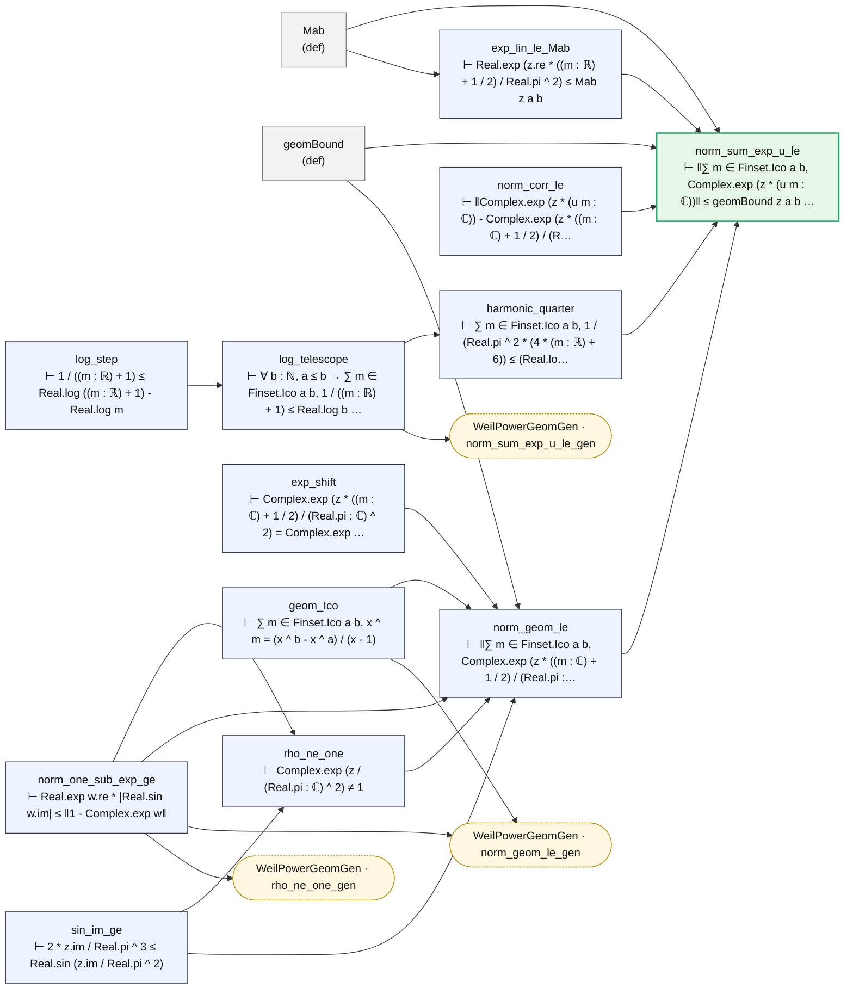

# `lean_stage3/Stage3/WeilPowerGeom.lean`

**What it does** (its own header): WeilPowerGeom — the geometric sum and the harmonic correction: the two sums the averaging route needs over a range of `h`, one bounded independently of the range length, the other by a logarithm of it. Rung 5, fourteenth slice; worksheet § 13 block 13d. 2026-09-06.

**Imports:** [`Statement`](../lean_stage3/Statement.md).
**Imported by:** [`Stage3`](../lean_stage3/Stage3.md), [`WeilPowerGeomGen`](../lean_stage3/WeilPowerGeomGen.md).

Blue: theorem. Green: a theorem nothing else uses (an end). Dashed white: connects to nothing. Grey: definition. Red: contains `sorry`. Yellow: in another file. An arrow A → B reads "A is used by B".

## Every declaration

| declaration | proves (output) | needs (input) | why (its own docstring) | uses | used by |
|---|---|---|---|---|---|
| `WeilPowerGeom.Mab` def, line 77 | ℝ | z : ℂ; a b : ℕ | The larger endpoint value of the geometric factor: `exp(z.re(m+½)/π²)` is monotone in `m`, so on `[a, b]` it is at most this. | — | `WeilPowerGeom.exp_lin_le_Mab`, `WeilPowerGeom.norm_sum_exp_u_le` |
| `WeilPowerGeom.geomBound` def, line 84 | ℝ | z : ℂ; a b : ℕ | The geometric sum's bound: the two endpoint values over the separation of `ρ = exp(z/π²)` from `1`, which Jordan's inequality makes `2 z.im/π³` times `exp(z.re/π²)`. It does not grow with `b − a`. | — | `WeilPowerGeom.norm_geom_le`, `WeilPowerGeom.norm_sum_exp_u_le` |
| `WeilPowerGeom.norm_one_sub_exp_ge` theorem, line 90 | Real.exp w.re * \|Real.sin w.im\| ≤ ‖1 - Complex.exp w‖ | w : ℂ | The separation of `exp w` from `1`, from the imaginary part alone. | — | `WeilPowerGeom.norm_geom_le`, `WeilPowerGeom.rho_ne_one`, `WeilPowerGeomGen.norm_geom_le_gen`, `WeilPowerGeomGen.rho_ne_one_gen` |
| `WeilPowerGeom.sin_im_ge` theorem, line 99 | 2 * z.im / Real.pi ^ 3 ≤ Real.sin (z.im / Real.pi ^ 2) | hz1 : 0 &lt; z.im; hz2 : z.im ≤ Real.pi ^ 3 / 2 | Jordan's inequality at the phase `z.im/π²`, linear in `z.im`. | — | `WeilPowerGeom.norm_geom_le`, `WeilPowerGeom.rho_ne_one` |
| `WeilPowerGeom.rho_ne_one` theorem, line 114 | Complex.exp (z / (Real.pi : ℂ) ^ 2) ≠ 1 | hz1 : 0 &lt; z.im; hz2 : z.im ≤ Real.pi ^ 3 / 2 | The ratio `ρ = exp(z/π²)` is not `1`: its distance to `1` is at least `exp(z.re/π²)·2 z.im/π³ &gt; 0`. | `WeilPowerGeom.norm_one_sub_exp_ge`, `WeilPowerGeom.sin_im_ge` | `WeilPowerGeom.norm_geom_le` |
| `WeilPowerGeom.exp_shift` theorem, line 135 | Complex.exp (z * ((m : ℂ) + 1 / 2) / (Real.pi : ℂ) ^ 2) = Complex.exp (z / (2 * (Real.pi : ℂ) ^ 2)) * Complex.exp (z / (Real.pi : ℂ) ^ 2) ^ m | z : ℂ; m : ℕ | The geometric factorization of the shifted exponential. | — | `WeilPowerGeom.norm_geom_le` |
| `WeilPowerGeom.geom_Ico` theorem, line 147 | ∑ m ∈ Finset.Ico a b, x ^ m = (x ^ b - x ^ a) / (x - 1) | hx : x ≠ 1; hab : a ≤ b | The geometric series over `Ico a b`; Mathlib's `geom_sum_Ico`, which this Mathlib does state (as a `lemma`, so a `theorem`-only grep misses it). | — | `WeilPowerGeom.norm_geom_le`, `WeilPowerGeomGen.norm_geom_le_gen` |
| `WeilPowerGeom.norm_geom_le` theorem, line 152 | ‖∑ m ∈ Finset.Ico a b, Complex.exp (z * ((m : ℂ) + 1 / 2) / (Real.pi : ℂ) ^ 2)‖ ≤ geomBound z a b | hz1 : 0 &lt; z.im; hz2 : z.im ≤ Real.pi ^ 3 / 2; hab : a ≤ b | The geometric sum is bounded independently of the range length. | `WeilPowerGeom.exp_shift`, `WeilPowerGeom.geomBound`, `WeilPowerGeom.geom_Ico`, `WeilPowerGeom.norm_one_sub_exp_ge`, `WeilPowerGeom.rho_ne_one`, `WeilPowerGeom.sin_im_ge` | `WeilPowerGeom.norm_sum_exp_u_le` |
| `WeilPowerGeom.exp_lin_le_Mab` theorem, line 240 | Real.exp (z.re * ((m : ℝ) + 1 / 2) / Real.pi ^ 2) ≤ Mab z a b | ham : a ≤ m; hmb : m ≤ b | The geometric factor at an interior `m` is at most its value at an endpoint: the exponent is linear in `m`, so the sign of `z.re` picks the end. | `WeilPowerGeom.Mab` | `WeilPowerGeom.norm_sum_exp_u_le` |
| `WeilPowerGeom.log_step` theorem, line 256 | 1 / ((m : ℝ) + 1) ≤ Real.log ((m : ℝ) + 1) - Real.log m | hm : 1 ≤ m | One harmonic step against the logarithm, `1/(m+1) ≤ log(m+1) − log m`. | — | `WeilPowerGeom.log_telescope` |
| `WeilPowerGeom.log_telescope` theorem, line 269 | ∀ b : ℕ, a ≤ b → ∑ m ∈ Finset.Ico a b, 1 / ((m : ℝ) + 1) ≤ Real.log b - Real.log a | ha : 1 ≤ a | The harmonic sum over `Ico a b` is at most `log b − log a`. | `WeilPowerGeom.log_step` | `WeilPowerGeom.harmonic_quarter`, `WeilPowerGeomGen.norm_sum_exp_u_le_gen` |
| `WeilPowerGeom.harmonic_quarter` theorem, line 282 | ∑ m ∈ Finset.Ico a b, 1 / (Real.pi ^ 2 * (4 * (m : ℝ) + 6)) ≤ (Real.log b - Real.log a) / (4 * Real.pi ^ 2) | ha : 1 ≤ a; hab : a ≤ b | The correction sum's majorant, `(log b − log a)/(4π²)`. | `WeilPowerGeom.log_telescope` | `WeilPowerGeom.norm_sum_exp_u_le` |
| `WeilPowerGeom.norm_corr_le` theorem, line 301 | ‖Complex.exp (z * (u m : ℂ)) - Complex.exp (z * ((m : ℂ) + 1 / 2) / (Real.pi : ℂ) ^ 2)‖ ≤ Real.exp (z.re * ((m : ℝ) + 1 / 2) / Real.pi ^ 2) * (2 * ‖z‖) * (u m - ((m : ℝ) + 1 / 2) / Real.pi ^ 2) | hz : ‖z‖ ≤ Real.pi ^ 2 * (4 * (a : ℝ) + 6); hu : ∀ k : ℕ, 0 ≤ u k - ((k : ℝ) + 1 / 2) / Real.pi ^ 2 ∧ u k - ((k : ℝ) + 1 / 2) / Real.pi ^ 2 ≤ 1 / (Real.pi ^ 2 * (4 * (k : ℝ) + 6)); ham : a ≤ m | One term's correction, `2‖z‖·r m` times the geometric factor. | — | `WeilPowerGeom.norm_sum_exp_u_le` |
| `WeilPowerGeom.norm_sum_exp_u_le` theorem, line 352 | ‖∑ m ∈ Finset.Ico a b, Complex.exp (z * (u m : ℂ))‖ ≤ geomBound z a b + 2 * ‖z‖ * Mab z a b * ((Real.log b - Real.log a) / (4 * Real.pi ^ 2)) | hz1 : 0 &lt; z.im; hz2 : z.im ≤ Real.pi ^ 3 / 2; ha : 1 ≤ a; hab : a ≤ b; hz : ‖z‖ ≤ Real.pi ^ 2 * (4 * (a : ℝ) + 6); hu : ∀ k : ℕ, 0 ≤ u k - ((k : ℝ) + 1 / 2) / Real.pi ^ 2 ∧ u k - ((k : ℝ) + 1 / 2) / Real.pi ^ 2 ≤ 1 / (Real.pi ^ 2 * (4 * (k : ℝ) + 6)) | The averaged sum: bounded by the range-free geometric bound plus a logarithm of the range. | `WeilPowerGeom.Mab`, `WeilPowerGeom.exp_lin_le_Mab`, `WeilPowerGeom.geomBound`, `WeilPowerGeom.harmonic_quarter`, `WeilPowerGeom.norm_corr_le`, `WeilPowerGeom.norm_geom_le` | — |
