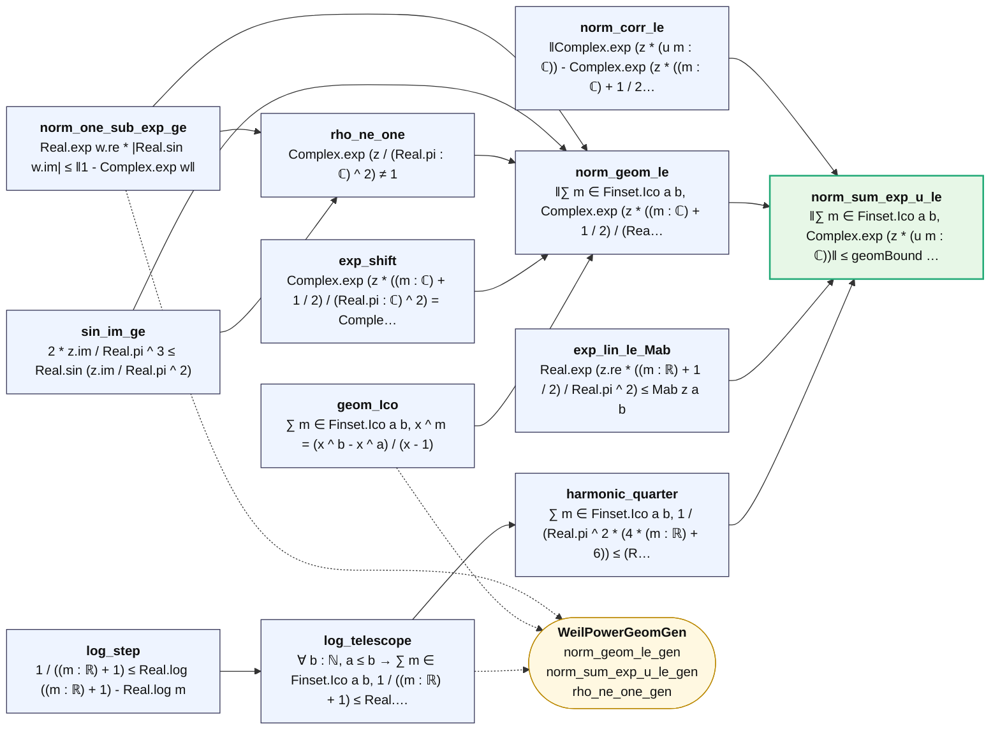

# `lean_stage3/Stage3/WeilPowerGeom.lean`

WeilPowerGeom — the geometric sum and the harmonic correction: the two sums the averaging route needs over a range of `h`, one bounded independently of the range length, the other by a logarithm of it. Rung 5, fourteenth slice; worksheet § 13 block 13d. 2026-09-06.

12 theorems, 2 definitions, 422 lines. Arrows are Lean's own record of what each proof uses.

**Imports:** [`Statement`](../lean_stage3/Statement.md)  
**Imported by:** [`Stage3`](../lean_stage3/Stage3.md), [`WeilPowerGeomGen`](../lean_stage3/WeilPowerGeomGen.md)

## The picture



An arrow A → B reads "A is used in the proof of B". Blue: theorem. Green: a theorem nothing else uses (an end). Dashed: connects to nothing. Red: contains `sorry`. Yellow: theorems in another file, counted; a dotted arrow crosses files. Definitions are not drawn; they are listed below the diagram.

## Definitions

<a name="WeilPowerGeom-Mab"></a>
### `WeilPowerGeom.Mab`

def · line 77

The larger endpoint value of the geometric factor: `exp(z.re(m+½)/π²)` is monotone in `m`, so on `[a, b]` it is at most this.

- **Is:** `` Mab (z : ℂ) (a b : ℕ) : ℝ := max (Real.exp (z.re * ((a : ℝ) + 1 / 2) / Real.pi ^ 2)) (Real.exp (z.re * ((b : ℝ) + 1 / 2) / Real.pi ^ 2)) ``
- **Used by 2:** [`WeilPowerGeom.exp_lin_le_Mab`](#WeilPowerGeom-exp_lin_le_Mab), [`WeilPowerGeom.norm_sum_exp_u_le`](#WeilPowerGeom-norm_sum_exp_u_le)

<a name="WeilPowerGeom-geomBound"></a>
### `WeilPowerGeom.geomBound`

def · line 84

The geometric sum's bound: the two endpoint values over the separation of `ρ = exp(z/π²)` from `1`, which Jordan's inequality makes `2 z.im/π³` times `exp(z.re/π²)`. It does not grow with `b − a`.

- **Is:** `` geomBound (z : ℂ) (a b : ℕ) : ℝ := (Real.exp (z.re * ((a : ℝ) + 1 / 2) / Real.pi ^ 2) + Real.exp (z.re * ((b : ℝ) + 1 / 2) / Real.pi ^ 2)) * Real.pi ^ 3 / (2 * Real.exp (z.re / Real.pi ^ 2) * z.im) ``
- **Used by 2:** [`WeilPowerGeom.norm_geom_le`](#WeilPowerGeom-norm_geom_le), [`WeilPowerGeom.norm_sum_exp_u_le`](#WeilPowerGeom-norm_sum_exp_u_le)

## Theorems

<a name="WeilPowerGeom-norm_one_sub_exp_ge"></a>
### `WeilPowerGeom.norm_one_sub_exp_ge`

line 90

**Why.** The separation of `exp w` from `1`, from the imaginary part alone.

**Proves**

```lean
Real.exp w.re * |Real.sin w.im| ≤ ‖1 - Complex.exp w‖
```

**Needs** (its hypotheses)

  - `` w : ℂ ``

**Fed by:** no theorem of this repo; it stands on Mathlib.

**Feeds** (4 that use it)

  - [`WeilPowerGeom.norm_geom_le`](#WeilPowerGeom-norm_geom_le) — `` ‖∑ m ∈ Finset.Ico a b, Complex.exp (z * ((m : ℂ) + 1 / 2) / (Real.pi : ℂ) ^ 2)‖ ≤ geomBound z a b ``
  - [`WeilPowerGeom.rho_ne_one`](#WeilPowerGeom-rho_ne_one) — `` Complex.exp (z / (Real.pi : ℂ) ^ 2) ≠ 1 ``
  - [`WeilPowerGeomGen.norm_geom_le_gen`](../lean_stage3/WeilPowerGeomGen.md#WeilPowerGeomGen-norm_geom_le_gen) (WeilPowerGeomGen) — `` ‖∑ h ∈ Finset.Ico a b, Complex.exp (z * ((α * (h : ℝ) + β₀ : ℝ) : ℂ))‖ ≤ geomBoundGen z α β₀ a b ``
  - [`WeilPowerGeomGen.rho_ne_one_gen`](../lean_stage3/WeilPowerGeomGen.md#WeilPowerGeomGen-rho_ne_one_gen) (WeilPowerGeomGen) — `` Complex.exp (z * ((α : ℝ) : ℂ)) ≠ 1 ``

<a name="WeilPowerGeom-sin_im_ge"></a>
### `WeilPowerGeom.sin_im_ge`

line 99

**Why.** Jordan's inequality at the phase `z.im/π²`, linear in `z.im`.

**Proves**

```lean
2 * z.im / Real.pi ^ 3 ≤ Real.sin (z.im / Real.pi ^ 2)
```

**Needs** (its hypotheses)

  - `` hz1 : 0 < z.im ``
  - `` hz2 : z.im ≤ Real.pi ^ 3 / 2 ``

**Fed by:** no theorem of this repo; it stands on Mathlib.

**Feeds** (2 that use it)

  - [`WeilPowerGeom.norm_geom_le`](#WeilPowerGeom-norm_geom_le) — `` ‖∑ m ∈ Finset.Ico a b, Complex.exp (z * ((m : ℂ) + 1 / 2) / (Real.pi : ℂ) ^ 2)‖ ≤ geomBound z a b ``
  - [`WeilPowerGeom.rho_ne_one`](#WeilPowerGeom-rho_ne_one) — `` Complex.exp (z / (Real.pi : ℂ) ^ 2) ≠ 1 ``

<a name="WeilPowerGeom-rho_ne_one"></a>
### `WeilPowerGeom.rho_ne_one`

line 114

**Why.** The ratio `ρ = exp(z/π²)` is not `1`: its distance to `1` is at least `exp(z.re/π²)·2 z.im/π³ > 0`.

**Proves**

```lean
Complex.exp (z / (Real.pi : ℂ) ^ 2) ≠ 1
```

**Needs** (its hypotheses)

  - `` hz1 : 0 < z.im ``
  - `` hz2 : z.im ≤ Real.pi ^ 3 / 2 ``

**Fed by** (2 theorems its proof uses)

  - [`WeilPowerGeom.norm_one_sub_exp_ge`](#WeilPowerGeom-norm_one_sub_exp_ge) — `` Real.exp w.re * |Real.sin w.im| ≤ ‖1 - Complex.exp w‖ ``
  - [`WeilPowerGeom.sin_im_ge`](#WeilPowerGeom-sin_im_ge) — `` 2 * z.im / Real.pi ^ 3 ≤ Real.sin (z.im / Real.pi ^ 2) ``

**Feeds** (1 that use it)

  - [`WeilPowerGeom.norm_geom_le`](#WeilPowerGeom-norm_geom_le) — `` ‖∑ m ∈ Finset.Ico a b, Complex.exp (z * ((m : ℂ) + 1 / 2) / (Real.pi : ℂ) ^ 2)‖ ≤ geomBound z a b ``

<a name="WeilPowerGeom-exp_shift"></a>
### `WeilPowerGeom.exp_shift`

line 135

**Why.** The geometric factorization of the shifted exponential.

**Proves**

```lean
Complex.exp (z * ((m : ℂ) + 1 / 2) / (Real.pi : ℂ) ^ 2) = Complex.exp (z / (2 * (Real.pi : ℂ) ^ 2)) * Complex.exp (z / (Real.pi : ℂ) ^ 2) ^ m
```

**Needs** (its hypotheses)

  - `` z : ℂ ``
  - `` m : ℕ ``

**Fed by:** no theorem of this repo; it stands on Mathlib.

**Feeds** (1 that use it)

  - [`WeilPowerGeom.norm_geom_le`](#WeilPowerGeom-norm_geom_le) — `` ‖∑ m ∈ Finset.Ico a b, Complex.exp (z * ((m : ℂ) + 1 / 2) / (Real.pi : ℂ) ^ 2)‖ ≤ geomBound z a b ``

<a name="WeilPowerGeom-geom_Ico"></a>
### `WeilPowerGeom.geom_Ico`

line 147

**Why.** The geometric series over `Ico a b`; Mathlib's `geom_sum_Ico`, which this Mathlib does state (as a `lemma`, so a `theorem`-only grep misses it).

**Proves**

```lean
∑ m ∈ Finset.Ico a b, x ^ m = (x ^ b - x ^ a) / (x - 1)
```

**Needs** (its hypotheses)

  - `` hx : x ≠ 1 ``
  - `` hab : a ≤ b ``

**Fed by:** no theorem of this repo; it stands on Mathlib.

**Feeds** (2 that use it)

  - [`WeilPowerGeom.norm_geom_le`](#WeilPowerGeom-norm_geom_le) — `` ‖∑ m ∈ Finset.Ico a b, Complex.exp (z * ((m : ℂ) + 1 / 2) / (Real.pi : ℂ) ^ 2)‖ ≤ geomBound z a b ``
  - [`WeilPowerGeomGen.norm_geom_le_gen`](../lean_stage3/WeilPowerGeomGen.md#WeilPowerGeomGen-norm_geom_le_gen) (WeilPowerGeomGen) — `` ‖∑ h ∈ Finset.Ico a b, Complex.exp (z * ((α * (h : ℝ) + β₀ : ℝ) : ℂ))‖ ≤ geomBoundGen z α β₀ a b ``

<a name="WeilPowerGeom-norm_geom_le"></a>
### `WeilPowerGeom.norm_geom_le`

line 152

**Why.** The geometric sum is bounded independently of the range length.

**Proves**

```lean
‖∑ m ∈ Finset.Ico a b, Complex.exp (z * ((m : ℂ) + 1 / 2) / (Real.pi : ℂ) ^ 2)‖ ≤ geomBound z a b
```

**Needs** (its hypotheses)

  - `` hz1 : 0 < z.im ``
  - `` hz2 : z.im ≤ Real.pi ^ 3 / 2 ``
  - `` hab : a ≤ b ``

**Stated with:** [`WeilPowerGeom.geomBound`](#WeilPowerGeom-geomBound)

**Fed by** (5 theorems its proof uses)

  - [`WeilPowerGeom.exp_shift`](#WeilPowerGeom-exp_shift) — `` Complex.exp (z * ((m : ℂ) + 1 / 2) / (Real.pi : ℂ) ^ 2) = Complex.exp (z / (2 * (Real.pi : ℂ) ^ 2)) * Complex.exp (z / (Real.pi : ℂ) ^ 2) ^ m ``
  - [`WeilPowerGeom.geom_Ico`](#WeilPowerGeom-geom_Ico) — `` ∑ m ∈ Finset.Ico a b, x ^ m = (x ^ b - x ^ a) / (x - 1) ``
  - [`WeilPowerGeom.norm_one_sub_exp_ge`](#WeilPowerGeom-norm_one_sub_exp_ge) — `` Real.exp w.re * |Real.sin w.im| ≤ ‖1 - Complex.exp w‖ ``
  - [`WeilPowerGeom.rho_ne_one`](#WeilPowerGeom-rho_ne_one) — `` Complex.exp (z / (Real.pi : ℂ) ^ 2) ≠ 1 ``
  - [`WeilPowerGeom.sin_im_ge`](#WeilPowerGeom-sin_im_ge) — `` 2 * z.im / Real.pi ^ 3 ≤ Real.sin (z.im / Real.pi ^ 2) ``

**Feeds** (1 that use it)

  - [`WeilPowerGeom.norm_sum_exp_u_le`](#WeilPowerGeom-norm_sum_exp_u_le) — `` ‖∑ m ∈ Finset.Ico a b, Complex.exp (z * (u m : ℂ))‖ ≤ geomBound z a b + 2 * ‖z‖ * Mab z a b * ((Real.log b - Real.log a) / (4 * Real.pi ^ 2)) ``

<a name="WeilPowerGeom-exp_lin_le_Mab"></a>
### `WeilPowerGeom.exp_lin_le_Mab`

line 240

**Why.** The geometric factor at an interior `m` is at most its value at an endpoint: the exponent is linear in `m`, so the sign of `z.re` picks the end.

**Proves**

```lean
Real.exp (z.re * ((m : ℝ) + 1 / 2) / Real.pi ^ 2) ≤ Mab z a b
```

**Needs** (its hypotheses)

  - `` ham : a ≤ m ``
  - `` hmb : m ≤ b ``

**Stated with:** [`WeilPowerGeom.Mab`](#WeilPowerGeom-Mab)

**Fed by:** no theorem of this repo; it stands on Mathlib and the definitions below.

**Feeds** (1 that use it)

  - [`WeilPowerGeom.norm_sum_exp_u_le`](#WeilPowerGeom-norm_sum_exp_u_le) — `` ‖∑ m ∈ Finset.Ico a b, Complex.exp (z * (u m : ℂ))‖ ≤ geomBound z a b + 2 * ‖z‖ * Mab z a b * ((Real.log b - Real.log a) / (4 * Real.pi ^ 2)) ``

<a name="WeilPowerGeom-log_step"></a>
### `WeilPowerGeom.log_step`

line 256

**Why.** One harmonic step against the logarithm, `1/(m+1) ≤ log(m+1) − log m`.

**Proves**

```lean
1 / ((m : ℝ) + 1) ≤ Real.log ((m : ℝ) + 1) - Real.log m
```

**Needs** (its hypotheses)

  - `` hm : 1 ≤ m ``

**Fed by:** no theorem of this repo; it stands on Mathlib.

**Feeds** (1 that use it)

  - [`WeilPowerGeom.log_telescope`](#WeilPowerGeom-log_telescope) — `` ∀ b : ℕ, a ≤ b → ∑ m ∈ Finset.Ico a b, 1 / ((m : ℝ) + 1) ≤ Real.log b - Real.log a ``

<a name="WeilPowerGeom-log_telescope"></a>
### `WeilPowerGeom.log_telescope`

line 269

**Why.** The harmonic sum over `Ico a b` is at most `log b − log a`.

**Proves**

```lean
∀ b : ℕ, a ≤ b → ∑ m ∈ Finset.Ico a b, 1 / ((m : ℝ) + 1) ≤ Real.log b - Real.log a
```

**Needs** (its hypotheses)

  - `` ha : 1 ≤ a ``

**Fed by** (1 theorem its proof uses)

  - [`WeilPowerGeom.log_step`](#WeilPowerGeom-log_step) — `` 1 / ((m : ℝ) + 1) ≤ Real.log ((m : ℝ) + 1) - Real.log m ``

**Feeds** (2 that use it)

  - [`WeilPowerGeom.harmonic_quarter`](#WeilPowerGeom-harmonic_quarter) — `` ∑ m ∈ Finset.Ico a b, 1 / (Real.pi ^ 2 * (4 * (m : ℝ) + 6)) ≤ (Real.log b - Real.log a) / (4 * Real.pi ^ 2) ``
  - [`WeilPowerGeomGen.norm_sum_exp_u_le_gen`](../lean_stage3/WeilPowerGeomGen.md#WeilPowerGeomGen-norm_sum_exp_u_le_gen) (WeilPowerGeomGen) — `` ‖∑ h ∈ Finset.Ico a b, Complex.exp (z * (u h : ℂ))‖ ≤ geomBoundGen z α β₀ a b + 2 * ‖z‖ * c * MabGen z α β₀ a b * (Real.log b - Real.log a) ``

<a name="WeilPowerGeom-harmonic_quarter"></a>
### `WeilPowerGeom.harmonic_quarter`

line 282

**Why.** The correction sum's majorant, `(log b − log a)/(4π²)`.

**Proves**

```lean
∑ m ∈ Finset.Ico a b, 1 / (Real.pi ^ 2 * (4 * (m : ℝ) + 6)) ≤ (Real.log b - Real.log a) / (4 * Real.pi ^ 2)
```

**Needs** (its hypotheses)

  - `` ha : 1 ≤ a ``
  - `` hab : a ≤ b ``

**Fed by** (1 theorem its proof uses)

  - [`WeilPowerGeom.log_telescope`](#WeilPowerGeom-log_telescope) — `` ∀ b : ℕ, a ≤ b → ∑ m ∈ Finset.Ico a b, 1 / ((m : ℝ) + 1) ≤ Real.log b - Real.log a ``

**Feeds** (1 that use it)

  - [`WeilPowerGeom.norm_sum_exp_u_le`](#WeilPowerGeom-norm_sum_exp_u_le) — `` ‖∑ m ∈ Finset.Ico a b, Complex.exp (z * (u m : ℂ))‖ ≤ geomBound z a b + 2 * ‖z‖ * Mab z a b * ((Real.log b - Real.log a) / (4 * Real.pi ^ 2)) ``

<a name="WeilPowerGeom-norm_corr_le"></a>
### `WeilPowerGeom.norm_corr_le`

line 301

**Why.** One term's correction, `2‖z‖·r m` times the geometric factor.

**Proves**

```lean
‖Complex.exp (z * (u m : ℂ)) - Complex.exp (z * ((m : ℂ) + 1 / 2) / (Real.pi : ℂ) ^ 2)‖ ≤ Real.exp (z.re * ((m : ℝ) + 1 / 2) / Real.pi ^ 2) * (2 * ‖z‖) * (u m - ((m : ℝ) + 1 / 2) / Real.pi ^ 2)
```

**Needs** (its hypotheses)

  - `` hz : ‖z‖ ≤ Real.pi ^ 2 * (4 * (a : ℝ) + 6) ``
  - `` hu : ∀ k : ℕ, 0 ≤ u k - ((k : ℝ) + 1 / 2) / Real.pi ^ 2 ∧ u k - ((k : ℝ) + 1 / 2) / Real.pi ^ 2 ≤ 1 / (Real.pi ^ 2 * (4 * (k : ℝ) + 6)) ``
  - `` ham : a ≤ m ``

**Fed by:** no theorem of this repo; it stands on Mathlib.

**Feeds** (1 that use it)

  - [`WeilPowerGeom.norm_sum_exp_u_le`](#WeilPowerGeom-norm_sum_exp_u_le) — `` ‖∑ m ∈ Finset.Ico a b, Complex.exp (z * (u m : ℂ))‖ ≤ geomBound z a b + 2 * ‖z‖ * Mab z a b * ((Real.log b - Real.log a) / (4 * Real.pi ^ 2)) ``

<a name="WeilPowerGeom-norm_sum_exp_u_le"></a>
### `WeilPowerGeom.norm_sum_exp_u_le`

line 352

**Why.** The averaged sum: bounded by the range-free geometric bound plus a logarithm of the range.

**Proves**

```lean
‖∑ m ∈ Finset.Ico a b, Complex.exp (z * (u m : ℂ))‖ ≤ geomBound z a b + 2 * ‖z‖ * Mab z a b * ((Real.log b - Real.log a) / (4 * Real.pi ^ 2))
```

**Needs** (its hypotheses)

  - `` hz1 : 0 < z.im ``
  - `` hz2 : z.im ≤ Real.pi ^ 3 / 2 ``
  - `` ha : 1 ≤ a ``
  - `` hab : a ≤ b ``
  - `` hz : ‖z‖ ≤ Real.pi ^ 2 * (4 * (a : ℝ) + 6) ``
  - `` hu : ∀ k : ℕ, 0 ≤ u k - ((k : ℝ) + 1 / 2) / Real.pi ^ 2 ∧ u k - ((k : ℝ) + 1 / 2) / Real.pi ^ 2 ≤ 1 / (Real.pi ^ 2 * (4 * (k : ℝ) + 6)) ``

**Stated with:** [`WeilPowerGeom.Mab`](#WeilPowerGeom-Mab), [`WeilPowerGeom.geomBound`](#WeilPowerGeom-geomBound)

**Fed by** (4 theorems its proof uses)

  - [`WeilPowerGeom.exp_lin_le_Mab`](#WeilPowerGeom-exp_lin_le_Mab) — `` Real.exp (z.re * ((m : ℝ) + 1 / 2) / Real.pi ^ 2) ≤ Mab z a b ``
  - [`WeilPowerGeom.harmonic_quarter`](#WeilPowerGeom-harmonic_quarter) — `` ∑ m ∈ Finset.Ico a b, 1 / (Real.pi ^ 2 * (4 * (m : ℝ) + 6)) ≤ (Real.log b - Real.log a) / (4 * Real.pi ^ 2) ``
  - [`WeilPowerGeom.norm_corr_le`](#WeilPowerGeom-norm_corr_le) — `` ‖Complex.exp (z * (u m : ℂ)) - Complex.exp (z * ((m : ℂ) + 1 / 2) / (Real.pi : ℂ) ^ 2)‖ ≤ Real.exp (z.re * ((m : ℝ) + 1 / 2) / Real.pi ^ 2) * (2 * ‖z‖… ``
  - [`WeilPowerGeom.norm_geom_le`](#WeilPowerGeom-norm_geom_le) — `` ‖∑ m ∈ Finset.Ico a b, Complex.exp (z * ((m : ℂ) + 1 / 2) / (Real.pi : ℂ) ^ 2)‖ ≤ geomBound z a b ``

**Feeds:** nothing. It is an end.

