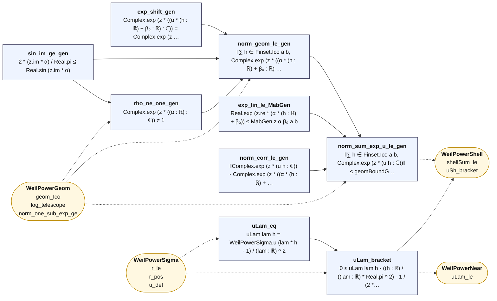

# `lean_stage3/Stage3/WeilPowerGeomGen.lean`

WeilPowerGeomGen — the geometric bound with a free slope, and `u` at general `λ`. Rung 5, fifteenth slice; worksheet § 13 block 13e. 2026-09-06.

9 theorems, 3 definitions, 431 lines. Arrows are Lean's own record of what each proof uses.

**Imports:** [`WeilPowerGeom`](../lean_stage3/WeilPowerGeom.md), [`WeilPowerSigma`](../lean_stage3/WeilPowerSigma.md)  
**Imported by:** [`Stage3`](../lean_stage3/Stage3.md), [`WeilPowerShell`](../lean_stage3/WeilPowerShell.md)

## The picture



An arrow A → B reads "A is used in the proof of B". Blue: theorem. Green: a theorem nothing else uses (an end). Dashed: connects to nothing. Red: contains `sorry`. Yellow: theorems in another file, counted; a dotted arrow crosses files. Definitions are not drawn; they are listed below the diagram.

## Definitions

<a name="WeilPowerGeomGen-MabGen"></a>
### `WeilPowerGeomGen.MabGen`

def · line 81

The larger endpoint value of the geometric factor at a free slope.

- **Is:** `` MabGen (z : ℂ) (α β₀ : ℝ) (a b : ℕ) : ℝ := max (Real.exp (z.re * (α * (a : ℝ) + β₀))) (Real.exp (z.re * (α * (b : ℝ) + β₀))) ``
- **Used by 4:** [`WeilPowerGeomGen.exp_lin_le_MabGen`](#WeilPowerGeomGen-exp_lin_le_MabGen), [`WeilPowerGeomGen.norm_sum_exp_u_le_gen`](#WeilPowerGeomGen-norm_sum_exp_u_le_gen), [`WeilPowerShell.MabGen_le`](../lean_stage3/WeilPowerShell.md#WeilPowerShell-MabGen_le), [`WeilPowerShell.shellSum_le`](../lean_stage3/WeilPowerShell.md#WeilPowerShell-shellSum_le)

<a name="WeilPowerGeomGen-geomBoundGen"></a>
### `WeilPowerGeomGen.geomBoundGen`

def · line 88

The geometric sum's bound at a free slope: the two endpoint values over the separation of `ρ = exp(zα)` from `1`, which Jordan's inequality makes `2 z.im α/π` times `exp(z.re α)`. It does not grow with `b − a`, and it grows like `1/α` as the slope falls.

- **Is:** `` geomBoundGen (z : ℂ) (α β₀ : ℝ) (a b : ℕ) : ℝ := (Real.exp (z.re * (α * (a : ℝ) + β₀)) + Real.exp (z.re * (α * (b : ℝ) + β₀))) * Real.pi / (2 * Real.exp (z.re * α) * z.im * α) ``
- **Used by 4:** [`WeilPowerGeomGen.norm_geom_le_gen`](#WeilPowerGeomGen-norm_geom_le_gen), [`WeilPowerGeomGen.norm_sum_exp_u_le_gen`](#WeilPowerGeomGen-norm_sum_exp_u_le_gen), [`WeilPowerShell.geomBound_le`](../lean_stage3/WeilPowerShell.md#WeilPowerShell-geomBound_le), [`WeilPowerShell.shellSum_le`](../lean_stage3/WeilPowerShell.md#WeilPowerShell-shellSum_le)

<a name="WeilPowerGeomGen-uLam"></a>
### `WeilPowerGeomGen.uLam`

def · line 94

The normalized tail sum at general `λ`: `uLam λ h = h²·σ(λh − 1)`, which is `u(λh − 1)/λ²` whenever `1 ≤ λh`.

- **Is:** `` uLam (lam h : ℕ) : ℝ := ((h : ℝ)) ^ 2 * WeilPowerPhase.sigma (lam * h - 1) ``
- **Built from:** [`WeilPowerPhase.sigma`](../lean_stage3/WeilPowerPhase.md#WeilPowerPhase-sigma)
- **Used by 13:** [`WeilPowerGeomGen.uLam_bracket`](#WeilPowerGeomGen-uLam_bracket), [`WeilPowerGeomGen.uLam_eq`](#WeilPowerGeomGen-uLam_eq), [`WeilPowerNear.phase_le`](../lean_stage3/WeilPowerNear.md#WeilPowerNear-phase_le), [`WeilPowerNear.shellSum_nonneg`](../lean_stage3/WeilPowerNear.md#WeilPowerNear-shellSum_nonneg), [`WeilPowerNear.term_nonneg`](../lean_stage3/WeilPowerNear.md#WeilPowerNear-term_nonneg), [`WeilPowerNear.uLam_le`](../lean_stage3/WeilPowerNear.md#WeilPowerNear-uLam_le), [`WeilPowerNear.uLam_nonneg`](../lean_stage3/WeilPowerNear.md#WeilPowerNear-uLam_nonneg), [`WeilPowerShell.shellSum`](../lean_stage3/WeilPowerShell.md#WeilPowerShell-shellSum), [`WeilPowerShell.shellSum_le`](../lean_stage3/WeilPowerShell.md#WeilPowerShell-shellSum_le), [`WeilPowerShell.shellSum_neg`](../lean_stage3/WeilPowerShell.md#WeilPowerShell-shellSum_neg), [`WeilPowerShell.sum_uSh_eq`](../lean_stage3/WeilPowerShell.md#WeilPowerShell-sum_uSh_eq), [`WeilPowerShell.uSh`](../lean_stage3/WeilPowerShell.md#WeilPowerShell-uSh), [`WeilPowerShell.uSh_bracket`](../lean_stage3/WeilPowerShell.md#WeilPowerShell-uSh_bracket)

## Theorems

<a name="WeilPowerGeomGen-exp_shift_gen"></a>
### `WeilPowerGeomGen.exp_shift_gen`

line 97

**Why.** The geometric factorization of the affine exponential.

**Proves**

```lean
Complex.exp (z * ((α * (h : ℝ) + β₀ : ℝ) : ℂ)) = Complex.exp (z * ((β₀ : ℝ) : ℂ)) * Complex.exp (z * ((α : ℝ) : ℂ)) ^ h
```

**Needs** (its hypotheses)

  - `` z : ℂ ``
  - `` α β₀ : ℝ ``
  - `` h : ℕ ``

**Fed by:** no theorem of this repo; it stands on Mathlib.

**Feeds** (1 that use it)

  - [`WeilPowerGeomGen.norm_geom_le_gen`](#WeilPowerGeomGen-norm_geom_le_gen) — `` ‖∑ h ∈ Finset.Ico a b, Complex.exp (z * ((α * (h : ℝ) + β₀ : ℝ) : ℂ))‖ ≤ geomBoundGen z α β₀ a b ``

<a name="WeilPowerGeomGen-sin_im_ge_gen"></a>
### `WeilPowerGeomGen.sin_im_ge_gen`

line 106

**Why.** Jordan's inequality at the phase `z.im·α`, linear in `z.im·α`.

**Proves**

```lean
2 * (z.im * α) / Real.pi ≤ Real.sin (z.im * α)
```

**Needs** (its hypotheses)

  - `` hα : 0 < α ``
  - `` hz1 : 0 < z.im ``
  - `` hz3 : z.im * α ≤ Real.pi / 2 ``

**Fed by:** no theorem of this repo; it stands on Mathlib.

**Feeds** (2 that use it)

  - [`WeilPowerGeomGen.norm_geom_le_gen`](#WeilPowerGeomGen-norm_geom_le_gen) — `` ‖∑ h ∈ Finset.Ico a b, Complex.exp (z * ((α * (h : ℝ) + β₀ : ℝ) : ℂ))‖ ≤ geomBoundGen z α β₀ a b ``
  - [`WeilPowerGeomGen.rho_ne_one_gen`](#WeilPowerGeomGen-rho_ne_one_gen) — `` Complex.exp (z * ((α : ℝ) : ℂ)) ≠ 1 ``

<a name="WeilPowerGeomGen-rho_ne_one_gen"></a>
### `WeilPowerGeomGen.rho_ne_one_gen`

line 118

**Why.** The ratio `ρ = exp(zα)` is not `1`: its distance to `1` is at least `exp(z.re α)·2 z.im α/π > 0`.

**Proves**

```lean
Complex.exp (z * ((α : ℝ) : ℂ)) ≠ 1
```

**Needs** (its hypotheses)

  - `` hα : 0 < α ``
  - `` hz1 : 0 < z.im ``
  - `` hz3 : z.im * α ≤ Real.pi / 2 ``

**Fed by** (2 theorems its proof uses)

  - [`WeilPowerGeom.norm_one_sub_exp_ge`](../lean_stage3/WeilPowerGeom.md#WeilPowerGeom-norm_one_sub_exp_ge) (WeilPowerGeom) — `` Real.exp w.re * |Real.sin w.im| ≤ ‖1 - Complex.exp w‖ ``
  - [`WeilPowerGeomGen.sin_im_ge_gen`](#WeilPowerGeomGen-sin_im_ge_gen) — `` 2 * (z.im * α) / Real.pi ≤ Real.sin (z.im * α) ``

**Feeds** (1 that use it)

  - [`WeilPowerGeomGen.norm_geom_le_gen`](#WeilPowerGeomGen-norm_geom_le_gen) — `` ‖∑ h ∈ Finset.Ico a b, Complex.exp (z * ((α * (h : ℝ) + β₀ : ℝ) : ℂ))‖ ≤ geomBoundGen z α β₀ a b ``

<a name="WeilPowerGeomGen-norm_geom_le_gen"></a>
### `WeilPowerGeomGen.norm_geom_le_gen`

line 139

**Why.** The geometric sum at a free slope is bounded independently of the range length.

**Proves**

```lean
‖∑ h ∈ Finset.Ico a b, Complex.exp (z * ((α * (h : ℝ) + β₀ : ℝ) : ℂ))‖ ≤ geomBoundGen z α β₀ a b
```

**Needs** (its hypotheses)

  - `` hα : 0 < α ``
  - `` hz1 : 0 < z.im ``
  - `` hz3 : z.im * α ≤ Real.pi / 2 ``
  - `` hab : a ≤ b ``

**Stated with:** [`WeilPowerGeomGen.geomBoundGen`](#WeilPowerGeomGen-geomBoundGen)

**Fed by** (5 theorems its proof uses)

  - [`WeilPowerGeom.geom_Ico`](../lean_stage3/WeilPowerGeom.md#WeilPowerGeom-geom_Ico) (WeilPowerGeom) — `` ∑ m ∈ Finset.Ico a b, x ^ m = (x ^ b - x ^ a) / (x - 1) ``
  - [`WeilPowerGeom.norm_one_sub_exp_ge`](../lean_stage3/WeilPowerGeom.md#WeilPowerGeom-norm_one_sub_exp_ge) (WeilPowerGeom) — `` Real.exp w.re * |Real.sin w.im| ≤ ‖1 - Complex.exp w‖ ``
  - [`WeilPowerGeomGen.exp_shift_gen`](#WeilPowerGeomGen-exp_shift_gen) — `` Complex.exp (z * ((α * (h : ℝ) + β₀ : ℝ) : ℂ)) = Complex.exp (z * ((β₀ : ℝ) : ℂ)) * Complex.exp (z * ((α : ℝ) : ℂ)) ^ h ``
  - [`WeilPowerGeomGen.rho_ne_one_gen`](#WeilPowerGeomGen-rho_ne_one_gen) — `` Complex.exp (z * ((α : ℝ) : ℂ)) ≠ 1 ``
  - [`WeilPowerGeomGen.sin_im_ge_gen`](#WeilPowerGeomGen-sin_im_ge_gen) — `` 2 * (z.im * α) / Real.pi ≤ Real.sin (z.im * α) ``

**Feeds** (1 that use it)

  - [`WeilPowerGeomGen.norm_sum_exp_u_le_gen`](#WeilPowerGeomGen-norm_sum_exp_u_le_gen) — `` ‖∑ h ∈ Finset.Ico a b, Complex.exp (z * (u h : ℂ))‖ ≤ geomBoundGen z α β₀ a b + 2 * ‖z‖ * c * MabGen z α β₀ a b * (Real.log b - Real.log a) ``

<a name="WeilPowerGeomGen-exp_lin_le_MabGen"></a>
### `WeilPowerGeomGen.exp_lin_le_MabGen`

line 216

**Why.** The geometric factor at an interior `h` is at most its value at an endpoint: the exponent is affine and increasing in `h`, so the sign of `z.re` picks the end.

**Proves**

```lean
Real.exp (z.re * (α * (h : ℝ) + β₀)) ≤ MabGen z α β₀ a b
```

**Needs** (its hypotheses)

  - `` hα : 0 < α ``
  - `` hah : a ≤ h ``
  - `` hhb : h ≤ b ``

**Stated with:** [`WeilPowerGeomGen.MabGen`](#WeilPowerGeomGen-MabGen)

**Fed by:** no theorem of this repo; it stands on Mathlib and the definitions below.

**Feeds** (1 that use it)

  - [`WeilPowerGeomGen.norm_sum_exp_u_le_gen`](#WeilPowerGeomGen-norm_sum_exp_u_le_gen) — `` ‖∑ h ∈ Finset.Ico a b, Complex.exp (z * (u h : ℂ))‖ ≤ geomBoundGen z α β₀ a b + 2 * ‖z‖ * c * MabGen z α β₀ a b * (Real.log b - Real.log a) ``

<a name="WeilPowerGeomGen-norm_corr_le_gen"></a>
### `WeilPowerGeomGen.norm_corr_le_gen`

line 230

**Why.** One term's correction at a free scale, `2‖z‖·c/(h+1)` times the geometric factor.

**Proves**

```lean
‖Complex.exp (z * (u h : ℂ)) - Complex.exp (z * ((α * (h : ℝ) + β₀ : ℝ) : ℂ))‖ ≤ Real.exp (z.re * (α * (h : ℝ) + β₀)) * (2 * ‖z‖) * (c / ((h : ℝ) + 1))
```

**Needs** (its hypotheses)

  - `` hzc : ‖z‖ * c ≤ (a : ℝ) + 1 ``
  - `` hu : ∀ k : ℕ, 0 ≤ u k - (α * (k : ℝ) + β₀) ∧ u k - (α * (k : ℝ) + β₀) ≤ c / ((k : ℝ) + 1) ``
  - `` hah : a ≤ h ``

**Fed by:** no theorem of this repo; it stands on Mathlib.

**Feeds** (1 that use it)

  - [`WeilPowerGeomGen.norm_sum_exp_u_le_gen`](#WeilPowerGeomGen-norm_sum_exp_u_le_gen) — `` ‖∑ h ∈ Finset.Ico a b, Complex.exp (z * (u h : ℂ))‖ ≤ geomBoundGen z α β₀ a b + 2 * ‖z‖ * c * MabGen z α β₀ a b * (Real.log b - Real.log a) ``

<a name="WeilPowerGeomGen-norm_sum_exp_u_le_gen"></a>
### `WeilPowerGeomGen.norm_sum_exp_u_le_gen`

line 278

**Why.** The averaged sum at a free slope: bounded by the range-free geometric bound plus a logarithm of the range.

**Proves**

```lean
‖∑ h ∈ Finset.Ico a b, Complex.exp (z * (u h : ℂ))‖ ≤ geomBoundGen z α β₀ a b + 2 * ‖z‖ * c * MabGen z α β₀ a b * (Real.log b - Real.log a)
```

**Needs** (its hypotheses)

  - `` hα : 0 < α ``
  - `` hz1 : 0 < z.im ``
  - `` hz3 : z.im * α ≤ Real.pi / 2 ``
  - `` ha : 1 ≤ a ``
  - `` hab : a ≤ b ``
  - `` hzc : ‖z‖ * c ≤ (a : ℝ) + 1 ``
  - `` hu : ∀ k : ℕ, 0 ≤ u k - (α * (k : ℝ) + β₀) ∧ u k - (α * (k : ℝ) + β₀) ≤ c / ((k : ℝ) + 1) ``

**Stated with:** [`WeilPowerGeomGen.MabGen`](#WeilPowerGeomGen-MabGen), [`WeilPowerGeomGen.geomBoundGen`](#WeilPowerGeomGen-geomBoundGen)

**Fed by** (4 theorems its proof uses)

  - [`WeilPowerGeom.log_telescope`](../lean_stage3/WeilPowerGeom.md#WeilPowerGeom-log_telescope) (WeilPowerGeom) — `` ∀ b : ℕ, a ≤ b → ∑ m ∈ Finset.Ico a b, 1 / ((m : ℝ) + 1) ≤ Real.log b - Real.log a ``
  - [`WeilPowerGeomGen.exp_lin_le_MabGen`](#WeilPowerGeomGen-exp_lin_le_MabGen) — `` Real.exp (z.re * (α * (h : ℝ) + β₀)) ≤ MabGen z α β₀ a b ``
  - [`WeilPowerGeomGen.norm_corr_le_gen`](#WeilPowerGeomGen-norm_corr_le_gen) — `` ‖Complex.exp (z * (u h : ℂ)) - Complex.exp (z * ((α * (h : ℝ) + β₀ : ℝ) : ℂ))‖ ≤ Real.exp (z.re * (α * (h : ℝ) + β₀)) * (2 * ‖z‖) * (c / ((h : ℝ) + 1)… ``
  - [`WeilPowerGeomGen.norm_geom_le_gen`](#WeilPowerGeomGen-norm_geom_le_gen) — `` ‖∑ h ∈ Finset.Ico a b, Complex.exp (z * ((α * (h : ℝ) + β₀ : ℝ) : ℂ))‖ ≤ geomBoundGen z α β₀ a b ``

**Feeds** (1 that use it)

  - [`WeilPowerShell.shellSum_le`](../lean_stage3/WeilPowerShell.md#WeilPowerShell-shellSum_le) (WeilPowerShell) — `` |shellSum e' D e lam a b| ≤ (e' ^ 2 + D ^ 2) / e ^ 2 * Real.exp (2 * eta * (b : ℝ) / ((lam : ℝ) * Real.pi ^ 2)) * ((lam : ℝ) * Real.pi ^ 3 * Real.exp … ``

<a name="WeilPowerGeomGen-uLam_eq"></a>
### `WeilPowerGeomGen.uLam_eq`

line 334

**Why.** `uLam` is `u` rescaled: `uLam λ h = u(λh − 1)/λ²`, the cast `((λh − 1 : ℕ) : ℝ) + 1 = λh` being the whole content.

**Proves**

```lean
uLam lam h = WeilPowerSigma.u (lam * h - 1) / (lam : ℝ) ^ 2
```

**Needs** (its hypotheses)

  - `` hl : 1 ≤ lam ``
  - `` hh : 1 ≤ h ``

**Stated with:** [`WeilPowerGeomGen.uLam`](#WeilPowerGeomGen-uLam), [`WeilPowerSigma.u`](../lean_stage3/WeilPowerSigma.md#WeilPowerSigma-u)

**Fed by** (1 theorem its proof uses)

  - [`WeilPowerSigma.u_def`](../lean_stage3/WeilPowerSigma.md#WeilPowerSigma-u_def) (WeilPowerSigma) — `` u m = ((m : ℝ) + 1) ^ 2 * sigma m ``

**Definitions its proof touches:** [`WeilPowerPhase.sigma`](../lean_stage3/WeilPowerPhase.md#WeilPowerPhase-sigma)

**Feeds** (1 that use it)

  - [`WeilPowerGeomGen.uLam_bracket`](#WeilPowerGeomGen-uLam_bracket) — `` 0 ≤ uLam lam h - ((h : ℝ) / ((lam : ℝ) * Real.pi ^ 2) - 1 / (2 * (lam : ℝ) ^ 2 * Real.pi ^ 2)) ∧ uLam lam h - ((h : ℝ) / ((lam : ℝ) * Real.pi ^ 2) - 1… ``

<a name="WeilPowerGeomGen-uLam_bracket"></a>
### `WeilPowerGeomGen.uLam_bracket`

line 348

**Why.** The bracket for `uLam` at general `λ`: slope `1/(λπ²)`, intercept `−1/(2λ²π²)`, correction scale `1/(2λ³π²)`.

**Proves**

```lean
0 ≤ uLam lam h - ((h : ℝ) / ((lam : ℝ) * Real.pi ^ 2) - 1 / (2 * (lam : ℝ) ^ 2 * Real.pi ^ 2)) ∧ uLam lam h - ((h : ℝ) / ((lam : ℝ) * Real.pi ^ 2) - 1 / (2 * (lam : ℝ) ^ 2 * Real.pi ^ 2)) ≤ 1 / (2 * (lam : ℝ) ^ 3 * Real.pi ^ 2) / ((h : ℝ) + 1)
```

**Needs** (its hypotheses)

  - `` hl : 1 ≤ lam ``
  - `` hh : 1 ≤ h ``

**Stated with:** [`WeilPowerGeomGen.uLam`](#WeilPowerGeomGen-uLam)

**Fed by** (3 theorems its proof uses)

  - [`WeilPowerGeomGen.uLam_eq`](#WeilPowerGeomGen-uLam_eq) — `` uLam lam h = WeilPowerSigma.u (lam * h - 1) / (lam : ℝ) ^ 2 ``
  - [`WeilPowerSigma.r_le`](../lean_stage3/WeilPowerSigma.md#WeilPowerSigma-r_le) (WeilPowerSigma) — `` u m - ((m : ℝ) + 1 / 2) / Real.pi ^ 2 ≤ 1 / (Real.pi ^ 2 * (4 * (m : ℝ) + 6)) ``
  - [`WeilPowerSigma.r_pos`](../lean_stage3/WeilPowerSigma.md#WeilPowerSigma-r_pos) (WeilPowerSigma) — `` 1 / (2 * Real.pi ^ 2 * ((m : ℝ) + 2) ^ 2) ≤ u m - ((m : ℝ) + 1 / 2) / Real.pi ^ 2 ``

**Definitions its proof touches:** [`WeilPowerSigma.u`](../lean_stage3/WeilPowerSigma.md#WeilPowerSigma-u)

**Feeds** (2 that use it)

  - [`WeilPowerNear.uLam_le`](../lean_stage3/WeilPowerNear.md#WeilPowerNear-uLam_le) (WeilPowerNear) — `` WeilPowerGeomGen.uLam lam h ≤ (h : ℝ) / ((lam : ℝ) * Real.pi ^ 2) ``
  - [`WeilPowerShell.uSh_bracket`](../lean_stage3/WeilPowerShell.md#WeilPowerShell-uSh_bracket) (WeilPowerShell) — `` ∀ k : ℕ, 0 ≤ uSh lam k - ((k : ℝ) / ((lam : ℝ) * Real.pi ^ 2) - 1 / (2 * (lam : ℝ) ^ 2 * Real.pi ^ 2)) ∧ uSh lam k - ((k : ℝ) / ((lam : ℝ) * Real.pi ^… ``

