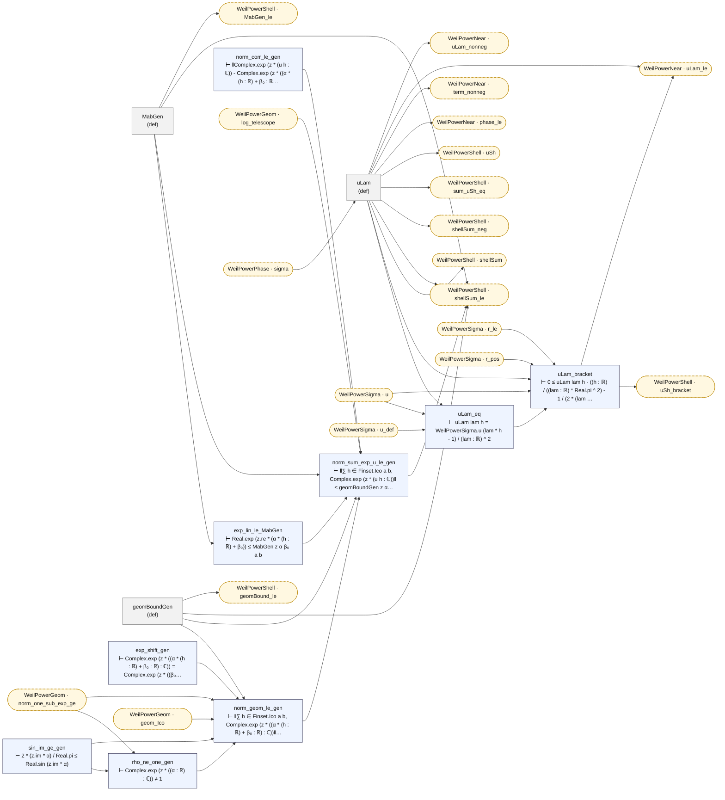

# `lean_stage3/Stage3/WeilPowerGeomGen.lean`

**What it does** (its own header): WeilPowerGeomGen — the geometric bound with a free slope, and `u` at general `λ`. Rung 5, fifteenth slice; worksheet § 13 block 13e. 2026-09-06.

**Imports:** [`WeilPowerGeom`](../lean_stage3/WeilPowerGeom.md), [`WeilPowerSigma`](../lean_stage3/WeilPowerSigma.md).
**Imported by:** [`Stage3`](../lean_stage3/Stage3.md), [`WeilPowerShell`](../lean_stage3/WeilPowerShell.md).

Blue: theorem. Green: a theorem nothing else uses (an end). Dashed white: connects to nothing. Grey: definition. Red: contains `sorry`. Yellow: in another file. An arrow A → B reads "A is used by B".

## Every declaration

| declaration | proves (output) | needs (input) | why (its own docstring) | uses | used by |
|---|---|---|---|---|---|
| `WeilPowerGeomGen.MabGen` def, line 81 | ℝ | z : ℂ; α β₀ : ℝ; a b : ℕ | The larger endpoint value of the geometric factor at a free slope. | — | `WeilPowerGeomGen.exp_lin_le_MabGen`, `WeilPowerGeomGen.norm_sum_exp_u_le_gen`, `WeilPowerShell.MabGen_le`, `WeilPowerShell.shellSum_le` |
| `WeilPowerGeomGen.geomBoundGen` def, line 88 | ℝ | z : ℂ; α β₀ : ℝ; a b : ℕ | The geometric sum's bound at a free slope: the two endpoint values over the separation of `ρ = exp(zα)` from `1`, which Jordan's inequality makes `2 z.im α/π` times `exp(z.re α)`. It does not grow with `b − a`, and it grows like `1/α` as the slope falls. | — | `WeilPowerGeomGen.norm_geom_le_gen`, `WeilPowerGeomGen.norm_sum_exp_u_le_gen`, `WeilPowerShell.geomBound_le`, `WeilPowerShell.shellSum_le` |
| `WeilPowerGeomGen.uLam` def, line 94 | ℝ | lam h : ℕ | The normalized tail sum at general `λ`: `uLam λ h = h²·σ(λh − 1)`, which is `u(λh − 1)/λ²` whenever `1 ≤ λh`. | `WeilPowerPhase.sigma` | `WeilPowerGeomGen.uLam_bracket`, `WeilPowerGeomGen.uLam_eq`, `WeilPowerNear.phase_le`, `WeilPowerNear.term_nonneg`, `WeilPowerNear.uLam_le`, `WeilPowerNear.uLam_nonneg`, `WeilPowerShell.shellSum`, `WeilPowerShell.shellSum_le`, `WeilPowerShell.shellSum_neg`, `WeilPowerShell.sum_uSh_eq`, `WeilPowerShell.uSh` |
| `WeilPowerGeomGen.exp_shift_gen` theorem, line 97 | Complex.exp (z * ((α * (h : ℝ) + β₀ : ℝ) : ℂ)) = Complex.exp (z * ((β₀ : ℝ) : ℂ)) * Complex.exp (z * ((α : ℝ) : ℂ)) ^ h | z : ℂ; α β₀ : ℝ; h : ℕ | The geometric factorization of the affine exponential. | — | `WeilPowerGeomGen.norm_geom_le_gen` |
| `WeilPowerGeomGen.sin_im_ge_gen` theorem, line 106 | 2 * (z.im * α) / Real.pi ≤ Real.sin (z.im * α) | hα : 0 &lt; α; hz1 : 0 &lt; z.im; hz3 : z.im * α ≤ Real.pi / 2 | Jordan's inequality at the phase `z.im·α`, linear in `z.im·α`. | — | `WeilPowerGeomGen.norm_geom_le_gen`, `WeilPowerGeomGen.rho_ne_one_gen` |
| `WeilPowerGeomGen.rho_ne_one_gen` theorem, line 118 | Complex.exp (z * ((α : ℝ) : ℂ)) ≠ 1 | hα : 0 &lt; α; hz1 : 0 &lt; z.im; hz3 : z.im * α ≤ Real.pi / 2 | The ratio `ρ = exp(zα)` is not `1`: its distance to `1` is at least `exp(z.re α)·2 z.im α/π &gt; 0`. | `WeilPowerGeom.norm_one_sub_exp_ge`, `WeilPowerGeomGen.sin_im_ge_gen` | `WeilPowerGeomGen.norm_geom_le_gen` |
| `WeilPowerGeomGen.norm_geom_le_gen` theorem, line 139 | ‖∑ h ∈ Finset.Ico a b, Complex.exp (z * ((α * (h : ℝ) + β₀ : ℝ) : ℂ))‖ ≤ geomBoundGen z α β₀ a b | hα : 0 &lt; α; hz1 : 0 &lt; z.im; hz3 : z.im * α ≤ Real.pi / 2; hab : a ≤ b | The geometric sum at a free slope is bounded independently of the range length. | `WeilPowerGeom.geom_Ico`, `WeilPowerGeom.norm_one_sub_exp_ge`, `WeilPowerGeomGen.exp_shift_gen`, `WeilPowerGeomGen.geomBoundGen`, `WeilPowerGeomGen.rho_ne_one_gen`, `WeilPowerGeomGen.sin_im_ge_gen` | `WeilPowerGeomGen.norm_sum_exp_u_le_gen` |
| `WeilPowerGeomGen.exp_lin_le_MabGen` theorem, line 216 | Real.exp (z.re * (α * (h : ℝ) + β₀)) ≤ MabGen z α β₀ a b | hα : 0 &lt; α; hah : a ≤ h; hhb : h ≤ b | The geometric factor at an interior `h` is at most its value at an endpoint: the exponent is affine and increasing in `h`, so the sign of `z.re` picks the end. | `WeilPowerGeomGen.MabGen` | `WeilPowerGeomGen.norm_sum_exp_u_le_gen` |
| `WeilPowerGeomGen.norm_corr_le_gen` theorem, line 230 | ‖Complex.exp (z * (u h : ℂ)) - Complex.exp (z * ((α * (h : ℝ) + β₀ : ℝ) : ℂ))‖ ≤ Real.exp (z.re * (α * (h : ℝ) + β₀)) * (2 * ‖z‖) * (c / ((h : ℝ) + 1)) | hzc : ‖z‖ * c ≤ (a : ℝ) + 1; hu : ∀ k : ℕ, 0 ≤ u k - (α * (k : ℝ) + β₀) ∧ u k - (α * (k : ℝ) + β₀) ≤ c / ((k : ℝ) + 1); hah : a ≤ h | One term's correction at a free scale, `2‖z‖·c/(h+1)` times the geometric factor. | — | `WeilPowerGeomGen.norm_sum_exp_u_le_gen` |
| `WeilPowerGeomGen.norm_sum_exp_u_le_gen` theorem, line 278 | ‖∑ h ∈ Finset.Ico a b, Complex.exp (z * (u h : ℂ))‖ ≤ geomBoundGen z α β₀ a b + 2 * ‖z‖ * c * MabGen z α β₀ a b * (Real.log b - Real.log a) | hα : 0 &lt; α; hz1 : 0 &lt; z.im; hz3 : z.im * α ≤ Real.pi / 2; ha : 1 ≤ a; hab : a ≤ b; hzc : ‖z‖ * c ≤ (a : ℝ) + 1; hu : ∀ k : ℕ, 0 ≤ u k - (α * (k : ℝ) + β₀) ∧ u k - (α * (k : ℝ) + β₀) ≤ c / ((k : ℝ) + 1) | The averaged sum at a free slope: bounded by the range-free geometric bound plus a logarithm of the range. | `WeilPowerGeom.log_telescope`, `WeilPowerGeomGen.MabGen`, `WeilPowerGeomGen.exp_lin_le_MabGen`, `WeilPowerGeomGen.geomBoundGen`, `WeilPowerGeomGen.norm_corr_le_gen`, `WeilPowerGeomGen.norm_geom_le_gen` | `WeilPowerShell.shellSum_le` |
| `WeilPowerGeomGen.uLam_eq` theorem, line 334 | uLam lam h = WeilPowerSigma.u (lam * h - 1) / (lam : ℝ) ^ 2 | hl : 1 ≤ lam; hh : 1 ≤ h | `uLam` is `u` rescaled: `uLam λ h = u(λh − 1)/λ²`, the cast `((λh − 1 : ℕ) : ℝ) + 1 = λh` being the whole content. | `WeilPowerGeomGen.uLam`, `WeilPowerSigma.u`, `WeilPowerSigma.u_def` | `WeilPowerGeomGen.uLam_bracket` |
| `WeilPowerGeomGen.uLam_bracket` theorem, line 348 | 0 ≤ uLam lam h - ((h : ℝ) / ((lam : ℝ) * Real.pi ^ 2) - 1 / (2 * (lam : ℝ) ^ 2 * Real.pi ^ 2)) ∧ uLam lam h - ((h : ℝ) / ((lam : ℝ) * Real.pi ^ 2) - 1 / (2 * (lam : ℝ) ^ 2 * Real.pi ^ 2)) ≤ 1 / (2 * (lam : ℝ) ^ 3 * Real.pi ^ 2) / ((h : ℝ) + 1) | hl : 1 ≤ lam; hh : 1 ≤ h | The bracket for `uLam` at general `λ`: slope `1/(λπ²)`, intercept `−1/(2λ²π²)`, correction scale `1/(2λ³π²)`. | `WeilPowerGeomGen.uLam`, `WeilPowerGeomGen.uLam_eq`, `WeilPowerSigma.r_le`, `WeilPowerSigma.r_pos`, `WeilPowerSigma.u` | `WeilPowerNear.uLam_le`, `WeilPowerShell.uSh_bracket` |
