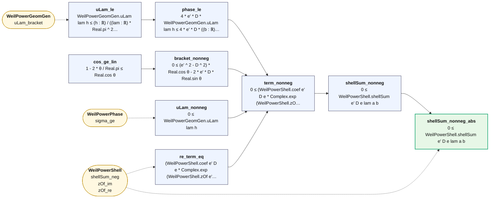

# `lean_stage3/Stage3/WeilPowerNear.lean`

WeilPowerNear — the near members' sign. Rung 5, seventeenth slice; worksheet § 13 block 13g. 2026-09-07.

9 theorems, 0 definitions, 237 lines. Arrows are Lean's own record of what each proof uses.

**Imports:** [`WeilPowerShell`](../lean_stage3/WeilPowerShell.md)  
**Imported by:** [`Stage3`](../lean_stage3/Stage3.md), [`WeilPowerAssembly`](../lean_stage3/WeilPowerAssembly.md)

## The picture



An arrow A → B reads "A is used in the proof of B". Blue: theorem. Green: a theorem nothing else uses (an end). Dashed: connects to nothing. Red: contains `sorry`. Yellow: theorems in another file, counted; a dotted arrow crosses files. Definitions are not drawn; they are listed below the diagram.

## Theorems

<a name="WeilPowerNear-uLam_nonneg"></a>
### `WeilPowerNear.uLam_nonneg`

line 61

**Why.** The window's phase argument is nonnegative at every `h`.

**Proves**

```lean
0 ≤ WeilPowerGeomGen.uLam lam h
```

**Needs** (its hypotheses)

  - `` lam h : ℕ ``

**Stated with:** [`WeilPowerGeomGen.uLam`](../lean_stage3/WeilPowerGeomGen.md#WeilPowerGeomGen-uLam)

**Fed by** (1 theorem its proof uses)

  - [`WeilPowerPhase.sigma_ge`](../lean_stage3/WeilPowerPhase.md#WeilPowerPhase-sigma_ge) (WeilPowerPhase) — `` 1 / (Real.pi ^ 2 * ((m : ℝ) + 2)) ≤ sigma m ``

**Definitions its proof touches:** [`WeilPowerPhase.sigma`](../lean_stage3/WeilPowerPhase.md#WeilPowerPhase-sigma)

**Feeds** (1 that use it)

  - [`WeilPowerNear.term_nonneg`](#WeilPowerNear-term_nonneg) — `` 0 ≤ (WeilPowerShell.coef e' D e * Complex.exp (WeilPowerShell.zOf e' D e * ((WeilPowerGeomGen.uLam lam h : ℝ) : ℂ))).re ``

<a name="WeilPowerNear-uLam_le"></a>
### `WeilPowerNear.uLam_le`

line 70

**Why.** The upper half of `uLam_bracket`, with the intercept absorbed: the correction `1/(2λ³π²(h+1))` is under `1/(2λ²π²)` exactly when `λ(h+1) ≥ 1`.

**Proves**

```lean
WeilPowerGeomGen.uLam lam h ≤ (h : ℝ) / ((lam : ℝ) * Real.pi ^ 2)
```

**Needs** (its hypotheses)

  - `` hl : 1 ≤ lam ``
  - `` hh : 1 ≤ h ``

**Stated with:** [`WeilPowerGeomGen.uLam`](../lean_stage3/WeilPowerGeomGen.md#WeilPowerGeomGen-uLam)

**Fed by** (1 theorem its proof uses)

  - [`WeilPowerGeomGen.uLam_bracket`](../lean_stage3/WeilPowerGeomGen.md#WeilPowerGeomGen-uLam_bracket) (WeilPowerGeomGen) — `` 0 ≤ uLam lam h - ((h : ℝ) / ((lam : ℝ) * Real.pi ^ 2) - 1 / (2 * (lam : ℝ) ^ 2 * Real.pi ^ 2)) ∧ uLam lam h - ((h : ℝ) / ((lam : ℝ) * Real.pi ^ 2) - 1… ``

**Feeds** (1 that use it)

  - [`WeilPowerNear.phase_le`](#WeilPowerNear-phase_le) — `` 4 * e' * D * WeilPowerGeomGen.uLam lam h ≤ 4 * e' * D * ((b : ℝ) / ((lam : ℝ) * Real.pi ^ 2)) ``

<a name="WeilPowerNear-cos_ge_lin"></a>
### `WeilPowerNear.cos_ge_lin`

line 84

**Why.** `cos` above its chord on `[0, π/2]`: `Real.mul_le_sin` at `π/2 − θ`.

**Proves**

```lean
1 - 2 * θ / Real.pi ≤ Real.cos θ
```

**Needs** (its hypotheses)

  - `` h0 : 0 ≤ θ ``
  - `` h1 : θ ≤ Real.pi / 2 ``

**Fed by:** no theorem of this repo; it stands on Mathlib.

**Feeds** (1 that use it)

  - [`WeilPowerNear.bracket_nonneg`](#WeilPowerNear-bracket_nonneg) — `` 0 ≤ (e' ^ 2 - D ^ 2) * Real.cos θ - 2 * e' * D * Real.sin θ ``

<a name="WeilPowerNear-bracket_nonneg"></a>
### `WeilPowerNear.bracket_nonneg`

line 96

**Why.** The bracket's sign under the crude condition N2.

**Proves**

```lean
0 ≤ (e' ^ 2 - D ^ 2) * Real.cos θ - 2 * e' * D * Real.sin θ
```

**Needs** (its hypotheses)

  - `` h1 : 0 < e' ``
  - `` h3 : 0 < D ``
  - `` hD : D < e' ``
  - `` h0 : 0 ≤ θ ``
  - `` hθ : θ * (2 * e' * D + 2 * (e' ^ 2 - D ^ 2) / Real.pi) ≤ e' ^ 2 - D ^ 2 ``

**Fed by** (1 theorem its proof uses)

  - [`WeilPowerNear.cos_ge_lin`](#WeilPowerNear-cos_ge_lin) — `` 1 - 2 * θ / Real.pi ≤ Real.cos θ ``

**Feeds** (1 that use it)

  - [`WeilPowerNear.term_nonneg`](#WeilPowerNear-term_nonneg) — `` 0 ≤ (WeilPowerShell.coef e' D e * Complex.exp (WeilPowerShell.zOf e' D e * ((WeilPowerGeomGen.uLam lam h : ℝ) : ℂ))).re ``

<a name="WeilPowerNear-re_term_eq"></a>
### `WeilPowerNear.re_term_eq`

line 141

**Why.** The weighted term's real part, explicit.

**Proves**

```lean
(WeilPowerShell.coef e' D e * Complex.exp (WeilPowerShell.zOf e' D e * (u : ℂ))).re = Real.exp (2 * (e' ^ 2 - D ^ 2 - e ^ 2) * u) / e ^ 2 * ((e' ^ 2 - D ^ 2) * Real.cos (4 * e' * D * u) - 2 * e' * D * Real.sin (4 * e' * D * u))
```

**Needs** (its hypotheses)

  - `` e' D e u : ℝ ``
  - `` he : e ≠ 0 ``

**Stated with:** [`WeilPowerShell.coef`](../lean_stage3/WeilPowerShell.md#WeilPowerShell-coef), [`WeilPowerShell.zOf`](../lean_stage3/WeilPowerShell.md#WeilPowerShell-zOf)

**Fed by** (2 theorems its proof uses)

  - [`WeilPowerShell.zOf_im`](../lean_stage3/WeilPowerShell.md#WeilPowerShell-zOf_im) (WeilPowerShell) — `` (zOf e' D e).im = 4 * e' * D ``
  - [`WeilPowerShell.zOf_re`](../lean_stage3/WeilPowerShell.md#WeilPowerShell-zOf_re) (WeilPowerShell) — `` (zOf e' D e).re = 2 * (e' ^ 2 - D ^ 2 - e ^ 2) ``

**Feeds** (1 that use it)

  - [`WeilPowerNear.term_nonneg`](#WeilPowerNear-term_nonneg) — `` 0 ≤ (WeilPowerShell.coef e' D e * Complex.exp (WeilPowerShell.zOf e' D e * ((WeilPowerGeomGen.uLam lam h : ℝ) : ℂ))).re ``

<a name="WeilPowerNear-phase_le"></a>
### `WeilPowerNear.phase_le`

line 166

**Why.** The phase is largest at the top of the range.

**Proves**

```lean
4 * e' * D * WeilPowerGeomGen.uLam lam h ≤ 4 * e' * D * ((b : ℝ) / ((lam : ℝ) * Real.pi ^ 2))
```

**Needs** (its hypotheses)

  - `` h1 : 0 < e' ``
  - `` h3 : 0 < D ``
  - `` hl : 1 ≤ lam ``
  - `` hh : 1 ≤ h ``
  - `` hhb : h ≤ b ``

**Stated with:** [`WeilPowerGeomGen.uLam`](../lean_stage3/WeilPowerGeomGen.md#WeilPowerGeomGen-uLam)

**Fed by** (1 theorem its proof uses)

  - [`WeilPowerNear.uLam_le`](#WeilPowerNear-uLam_le) — `` WeilPowerGeomGen.uLam lam h ≤ (h : ℝ) / ((lam : ℝ) * Real.pi ^ 2) ``

**Feeds** (1 that use it)

  - [`WeilPowerNear.term_nonneg`](#WeilPowerNear-term_nonneg) — `` 0 ≤ (WeilPowerShell.coef e' D e * Complex.exp (WeilPowerShell.zOf e' D e * ((WeilPowerGeomGen.uLam lam h : ℝ) : ℂ))).re ``

<a name="WeilPowerNear-term_nonneg"></a>
### `WeilPowerNear.term_nonneg`

line 177

**Why.** One near member's term is nonnegative at every `h` in the range.

**Proves**

```lean
0 ≤ (WeilPowerShell.coef e' D e * Complex.exp (WeilPowerShell.zOf e' D e * ((WeilPowerGeomGen.uLam lam h : ℝ) : ℂ))).re
```

**Needs** (its hypotheses)

  - `` h1 : 0 < e' ``
  - `` h3 : 0 < D ``
  - `` hD : D < e' ``
  - `` h5 : 0 < e ``
  - `` hl : 1 ≤ lam ``
  - `` hh : 1 ≤ h ``
  - `` hhb : h ≤ b ``
  - `` hN : 4 * e' * D * ((b : ℝ) / ((lam : ℝ) * Real.pi ^ 2)) * (2 * e' * D + 2 * (e' ^ 2 - D ^ 2) / Real.pi) ≤ e' ^ 2 - D ^ 2 ``

**Stated with:** [`WeilPowerGeomGen.uLam`](../lean_stage3/WeilPowerGeomGen.md#WeilPowerGeomGen-uLam), [`WeilPowerShell.coef`](../lean_stage3/WeilPowerShell.md#WeilPowerShell-coef), [`WeilPowerShell.zOf`](../lean_stage3/WeilPowerShell.md#WeilPowerShell-zOf)

**Fed by** (4 theorems its proof uses)

  - [`WeilPowerNear.bracket_nonneg`](#WeilPowerNear-bracket_nonneg) — `` 0 ≤ (e' ^ 2 - D ^ 2) * Real.cos θ - 2 * e' * D * Real.sin θ ``
  - [`WeilPowerNear.phase_le`](#WeilPowerNear-phase_le) — `` 4 * e' * D * WeilPowerGeomGen.uLam lam h ≤ 4 * e' * D * ((b : ℝ) / ((lam : ℝ) * Real.pi ^ 2)) ``
  - [`WeilPowerNear.re_term_eq`](#WeilPowerNear-re_term_eq) — `` (WeilPowerShell.coef e' D e * Complex.exp (WeilPowerShell.zOf e' D e * (u : ℂ))).re = Real.exp (2 * (e' ^ 2 - D ^ 2 - e ^ 2) * u) / e ^ 2 * ((e' ^ 2 -… ``
  - [`WeilPowerNear.uLam_nonneg`](#WeilPowerNear-uLam_nonneg) — `` 0 ≤ WeilPowerGeomGen.uLam lam h ``

**Feeds** (1 that use it)

  - [`WeilPowerNear.shellSum_nonneg`](#WeilPowerNear-shellSum_nonneg) — `` 0 ≤ WeilPowerShell.shellSum e' D e lam a b ``

<a name="WeilPowerNear-shellSum_nonneg"></a>
### `WeilPowerNear.shellSum_nonneg`

line 196

**Why.** The near member's shell sum is nonnegative: it helps the target.

**Proves**

```lean
0 ≤ WeilPowerShell.shellSum e' D e lam a b
```

**Needs** (its hypotheses)

  - `` h1 : 0 < e' ``
  - `` h3 : 0 < D ``
  - `` hD : D < e' ``
  - `` h5 : 0 < e ``
  - `` hl : 1 ≤ lam ``
  - `` ha : 1 ≤ a ``
  - `` hN : 4 * e' * D * ((b : ℝ) / ((lam : ℝ) * Real.pi ^ 2)) * (2 * e' * D + 2 * (e' ^ 2 - D ^ 2) / Real.pi) ≤ e' ^ 2 - D ^ 2 ``

**Stated with:** [`WeilPowerShell.shellSum`](../lean_stage3/WeilPowerShell.md#WeilPowerShell-shellSum)

**Fed by** (1 theorem its proof uses)

  - [`WeilPowerNear.term_nonneg`](#WeilPowerNear-term_nonneg) — `` 0 ≤ (WeilPowerShell.coef e' D e * Complex.exp (WeilPowerShell.zOf e' D e * ((WeilPowerGeomGen.uLam lam h : ℝ) : ℂ))).re ``

**Definitions its proof touches:** [`WeilPowerGeomGen.uLam`](../lean_stage3/WeilPowerGeomGen.md#WeilPowerGeomGen-uLam), [`WeilPowerShell.coef`](../lean_stage3/WeilPowerShell.md#WeilPowerShell-coef), [`WeilPowerShell.zOf`](../lean_stage3/WeilPowerShell.md#WeilPowerShell-zOf)

**Feeds** (1 that use it)

  - [`WeilPowerNear.shellSum_nonneg_abs`](#WeilPowerNear-shellSum_nonneg_abs) — `` 0 ≤ WeilPowerShell.shellSum e' D e lam a b ``

<a name="WeilPowerNear-shellSum_nonneg_abs"></a>
### `WeilPowerNear.shellSum_nonneg_abs`

line 208

**Why.** The same with `|Δ|`, the sign of `Δ` split off through `shellSum_neg`.

**Proves**

```lean
0 ≤ WeilPowerShell.shellSum e' D e lam a b
```

**Needs** (its hypotheses)

  - `` h1 : 0 < e' ``
  - `` hD0 : D ≠ 0 ``
  - `` hD : |D| < e' ``
  - `` h5 : 0 < e ``
  - `` hl : 1 ≤ lam ``
  - `` ha : 1 ≤ a ``
  - `` hN : 4 * e' * |D| * ((b : ℝ) / ((lam : ℝ) * Real.pi ^ 2)) * (2 * e' * |D| + 2 * (e' ^ 2 - |D| ^ 2) / Real.pi) ≤ e' ^ 2 - |D| ^ 2 ``

**Stated with:** [`WeilPowerShell.shellSum`](../lean_stage3/WeilPowerShell.md#WeilPowerShell-shellSum)

**Fed by** (2 theorems its proof uses)

  - [`WeilPowerNear.shellSum_nonneg`](#WeilPowerNear-shellSum_nonneg) — `` 0 ≤ WeilPowerShell.shellSum e' D e lam a b ``
  - [`WeilPowerShell.shellSum_neg`](../lean_stage3/WeilPowerShell.md#WeilPowerShell-shellSum_neg) (WeilPowerShell) — `` shellSum e' (-D) e lam a b = shellSum e' D e lam a b ``

**Feeds:** nothing. It is an end.

