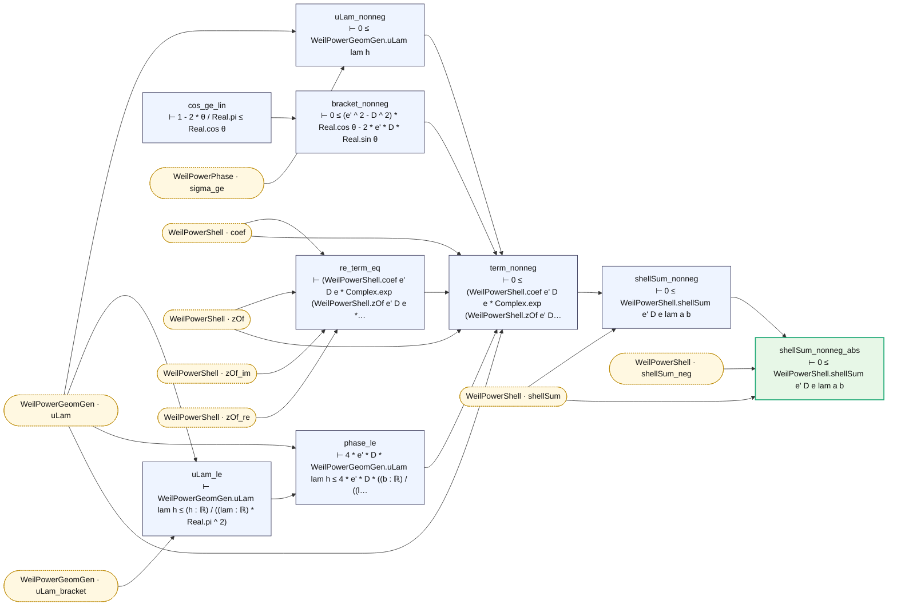

# `lean_stage3/Stage3/WeilPowerNear.lean`

**What it does** (its own header): WeilPowerNear — the near members' sign. Rung 5, seventeenth slice; worksheet § 13 block 13g. 2026-09-07.

**Imports:** [`WeilPowerShell`](../lean_stage3/WeilPowerShell.md).
**Imported by:** [`Stage3`](../lean_stage3/Stage3.md), [`WeilPowerAssembly`](../lean_stage3/WeilPowerAssembly.md).

Blue: theorem. Green: a theorem nothing else uses (an end). Dashed white: connects to nothing. Grey: definition. Red: contains `sorry`. Yellow: in another file. An arrow A → B reads "A is used by B".

## Every declaration

| declaration | proves (output) | needs (input) | why (its own docstring) | uses | used by |
|---|---|---|---|---|---|
| `WeilPowerNear.uLam_nonneg` theorem, line 61 | 0 ≤ WeilPowerGeomGen.uLam lam h | lam h : ℕ | The window's phase argument is nonnegative at every `h`. | `WeilPowerGeomGen.uLam`, `WeilPowerPhase.sigma_ge` | `WeilPowerNear.term_nonneg` |
| `WeilPowerNear.uLam_le` theorem, line 70 | WeilPowerGeomGen.uLam lam h ≤ (h : ℝ) / ((lam : ℝ) * Real.pi ^ 2) | hl : 1 ≤ lam; hh : 1 ≤ h | The upper half of `uLam_bracket`, with the intercept absorbed: the correction `1/(2λ³π²(h+1))` is under `1/(2λ²π²)` exactly when `λ(h+1) ≥ 1`. | `WeilPowerGeomGen.uLam`, `WeilPowerGeomGen.uLam_bracket` | `WeilPowerNear.phase_le` |
| `WeilPowerNear.cos_ge_lin` theorem, line 84 | 1 - 2 * θ / Real.pi ≤ Real.cos θ | h0 : 0 ≤ θ; h1 : θ ≤ Real.pi / 2 | `cos` above its chord on `[0, π/2]`: `Real.mul_le_sin` at `π/2 − θ`. | — | `WeilPowerNear.bracket_nonneg` |
| `WeilPowerNear.bracket_nonneg` theorem, line 96 | 0 ≤ (e' ^ 2 - D ^ 2) * Real.cos θ - 2 * e' * D * Real.sin θ | h1 : 0 &lt; e'; h3 : 0 &lt; D; hD : D &lt; e'; h0 : 0 ≤ θ; hθ : θ * (2 * e' * D + 2 * (e' ^ 2 - D ^ 2) / Real.pi) ≤ e' ^ 2 - D ^ 2 | The bracket's sign under the crude condition N2. | `WeilPowerNear.cos_ge_lin` | `WeilPowerNear.term_nonneg` |
| `WeilPowerNear.re_term_eq` theorem, line 141 | (WeilPowerShell.coef e' D e * Complex.exp (WeilPowerShell.zOf e' D e * (u : ℂ))).re = Real.exp (2 * (e' ^ 2 - D ^ 2 - e ^ 2) * u) / e ^ 2 * ((e' ^ 2 - D ^ 2) * Real.cos (4 * e' * D * u) - 2 * e' * D * Real.sin (4 * e' * D * u)) | e' D e u : ℝ; he : e ≠ 0 | The weighted term's real part, explicit. | `WeilPowerShell.coef`, `WeilPowerShell.zOf`, `WeilPowerShell.zOf_im`, `WeilPowerShell.zOf_re` | `WeilPowerNear.term_nonneg` |
| `WeilPowerNear.phase_le` theorem, line 166 | 4 * e' * D * WeilPowerGeomGen.uLam lam h ≤ 4 * e' * D * ((b : ℝ) / ((lam : ℝ) * Real.pi ^ 2)) | h1 : 0 &lt; e'; h3 : 0 &lt; D; hl : 1 ≤ lam; hh : 1 ≤ h; hhb : h ≤ b | The phase is largest at the top of the range. | `WeilPowerGeomGen.uLam`, `WeilPowerNear.uLam_le` | `WeilPowerNear.term_nonneg` |
| `WeilPowerNear.term_nonneg` theorem, line 177 | 0 ≤ (WeilPowerShell.coef e' D e * Complex.exp (WeilPowerShell.zOf e' D e * ((WeilPowerGeomGen.uLam lam h : ℝ) : ℂ))).re | h1 : 0 &lt; e'; h3 : 0 &lt; D; hD : D &lt; e'; h5 : 0 &lt; e; hl : 1 ≤ lam; hh : 1 ≤ h; hhb : h ≤ b; hN : 4 * e' * D * ((b : ℝ) / ((lam : ℝ) * Real.pi ^ 2)) * (2 * e' * D + 2 * (e' ^ 2 - D ^ 2) / Real.pi) ≤ e' ^ 2 - D ^ 2 | One near member's term is nonnegative at every `h` in the range. | `WeilPowerGeomGen.uLam`, `WeilPowerNear.bracket_nonneg`, `WeilPowerNear.phase_le`, `WeilPowerNear.re_term_eq`, `WeilPowerNear.uLam_nonneg`, `WeilPowerShell.coef`, `WeilPowerShell.zOf` | `WeilPowerNear.shellSum_nonneg` |
| `WeilPowerNear.shellSum_nonneg` theorem, line 196 | 0 ≤ WeilPowerShell.shellSum e' D e lam a b | h1 : 0 &lt; e'; h3 : 0 &lt; D; hD : D &lt; e'; h5 : 0 &lt; e; hl : 1 ≤ lam; ha : 1 ≤ a; hN : 4 * e' * D * ((b : ℝ) / ((lam : ℝ) * Real.pi ^ 2)) * (2 * e' * D + 2 * (e' ^ 2 - D ^ 2) / Real.pi) ≤ e' ^ 2 - D ^ 2 | The near member's shell sum is nonnegative: it helps the target. | `WeilPowerNear.term_nonneg`, `WeilPowerShell.shellSum` | `WeilPowerNear.shellSum_nonneg_abs` |
| `WeilPowerNear.shellSum_nonneg_abs` theorem, line 208 | 0 ≤ WeilPowerShell.shellSum e' D e lam a b | h1 : 0 &lt; e'; hD0 : D ≠ 0; hD : \|D\| &lt; e'; h5 : 0 &lt; e; hl : 1 ≤ lam; ha : 1 ≤ a; hN : 4 * e' * \|D\| * ((b : ℝ) / ((lam : ℝ) * Real.pi ^ 2)) * (2 * e' * \|D\| + 2 * (e' ^ 2 - \|D\| ^ 2) / Real.pi) ≤ e' ^ 2 - \|D\| ^ 2 | The same with `\|Δ\|`, the sign of `Δ` split off through `shellSum_neg`. | `WeilPowerNear.shellSum_nonneg`, `WeilPowerShell.shellSum`, `WeilPowerShell.shellSum_neg` | — |
