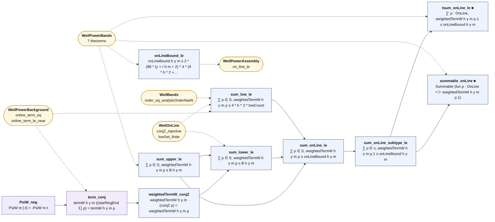

# `lean_stage3/Stage3/WeilPowerOnLine.lean`

WeilPowerOnLine — the switched window's on-line background, all heights. Rung 5, eighth slice. 2026-09-06.

11 theorems, 2 definitions, 228 lines. Arrows are Lean's own record of what each proof uses.

**Imports:** [`WeilOnLine`](../lean_stage3/WeilOnLine.md), [`WeilPowerBands`](../lean_stage3/WeilPowerBands.md)  
**Imported by:** [`Stage3`](../lean_stage3/Stage3.md), [`WeilPowerAssembly`](../lean_stage3/WeilPowerAssembly.md)

## The picture



An arrow A → B reads "A is used in the proof of B". Green: counting, integers only. Violet: shape, analysis with no ζ. Blue: reads ζ. A name ending in ■ is an end: nothing else uses it. Red: contains `sorry`. Yellow: theorems in another file, counted; a dotted arrow crosses files. Definitions are not drawn; they are listed below the diagram.

## Definitions

<a name="WeilPowerOnLine-B"></a>
### `WeilPowerOnLine.B`

def · line 67

One side's bound: `A h γ m · π²/6`.

- **Is:** `` B (h γ : ℝ) (m : ℕ) : ℝ := A h γ m * (Real.pi ^ 2 / 6) ``
- **Built from:** [`WeilPowerBands.A`](../lean_stage3/WeilPowerBands.md#WeilPowerBands-A)
- **Used by 5:** [`WeilPowerOnLine.onLineBound`](#WeilPowerOnLine-onLineBound), [`WeilPowerOnLine.onLineBound_le`](#WeilPowerOnLine-onLineBound_le), [`WeilPowerOnLine.sum_lower_le`](#WeilPowerOnLine-sum_lower_le), [`WeilPowerOnLine.sum_onLine_le`](#WeilPowerOnLine-sum_onLine_le), [`WeilPowerOnLine.sum_upper_le`](#WeilPowerOnLine-sum_upper_le)

<a name="WeilPowerOnLine-onLineBound"></a>
### `WeilPowerOnLine.onLineBound`

def · line 136

The on-line background bound: `2·B h γ m + 4h²·lowCount`.

- **Is:** `` onLineBound (h γ : ℝ) (m : ℕ) : ℝ := 2 * B h γ m + 4 * h ^ 2 * lowCount ``
- **Built from:** [`WeilOnLine.lowCount`](../lean_stage3/WeilOnLine.md#WeilOnLine-lowCount), [`WeilPowerOnLine.B`](#WeilPowerOnLine-B)
- **Used by 6:** [`WeilPowerAssembly.on_line_le`](../lean_stage3/WeilPowerAssembly.md#WeilPowerAssembly-on_line_le), [`WeilPowerOnLine.onLineBound_le`](#WeilPowerOnLine-onLineBound_le), [`WeilPowerOnLine.sum_onLine_le`](#WeilPowerOnLine-sum_onLine_le), [`WeilPowerOnLine.sum_onLine_subtype_le`](#WeilPowerOnLine-sum_onLine_subtype_le), [`WeilPowerOnLine.summable_onLine`](#WeilPowerOnLine-summable_onLine), [`WeilPowerOnLine.tsum_onLine_le`](#WeilPowerOnLine-tsum_onLine_le)

## Theorems

<a name="WeilPowerOnLine-PsiW_neg"></a>
### `WeilPowerOnLine.PsiW_neg`

line 37

**Shape.** Uses real or complex analysis; nothing in it or beneath it reads ζ.

**Why.** `PsiW` is odd.

**Proves**

```lean
PsiW m (-t) = -PsiW m t
```

**Needs** (its hypotheses)

  - `` m : ℕ ``
  - `` t : ℝ ``

**Stated with:** [`WeilPowerBackground.PsiW`](../lean_stage3/WeilPowerBackground.md#WeilPowerBackground-PsiW)

**Fed by:** no theorem of this repo; it stands on Mathlib and the definitions below.

**Definitions its proof touches:** [`WeilOddPower.q`](../lean_stage3/WeilOddPower.md#WeilOddPower-q)

**Feeds** (1 that use it)

  - [`WeilPowerOnLine.term_conj`](#WeilPowerOnLine-term_conj) — `` termW h γ m ((starRingEnd ℂ) ρ) = termW h γ m ρ ``

<a name="WeilPowerOnLine-term_conj"></a>
### `WeilPowerOnLine.term_conj`

line 45

**Shape.** Uses real or complex analysis; nothing in it or beneath it reads ζ.

**Why.** The on-line term is invariant under conjugation of the zero.

**Proves**

```lean
termW h γ m ((starRingEnd ℂ) ρ) = termW h γ m ρ
```

**Needs** (its hypotheses)

  - `` hh : 0 < h ``
  - `` γ : ℝ ``
  - `` m : ℕ ``
  - `` hρ : ρ.re = 1 / 2 ``

**Stated with:** [`WeilPowerBands.termW`](../lean_stage3/WeilPowerBands.md#WeilPowerBands-termW)

**Fed by** (2 theorems its proof uses)

  - [`WeilPowerBackground.online_term_eq`](../lean_stage3/WeilPowerBackground.md#WeilPowerBackground-online_term_eq) (WeilPowerBackground) — `` laplace (phiWC h γ m) (-ρ) * laplace (phiWC h γ m) (-(1 - ρ)) = (((h / 2) ^ 2 * (PsiW m (h * (ρ.im + γ)) + PsiW m (h * (ρ.im - γ))) ^ 2 : ℝ) : ℂ) ``
  - [`WeilPowerOnLine.PsiW_neg`](#WeilPowerOnLine-PsiW_neg) — `` PsiW m (-t) = -PsiW m t ``

**Definitions its proof touches:** [`WeilDetect.laplace`](../lean_stage3/WeilDetect.md#WeilDetect-laplace), [`WeilPowerBackground.PsiW`](../lean_stage3/WeilPowerBackground.md#WeilPowerBackground-PsiW), [`WeilPowerBackground.phiWC`](../lean_stage3/WeilPowerBackground.md#WeilPowerBackground-phiWC)

**Feeds** (1 that use it)

  - [`WeilPowerOnLine.weightedTermW_conjZ`](#WeilPowerOnLine-weightedTermW_conjZ) — `` weightedTermW h γ m (conjZ ρ) = weightedTermW h γ m ρ ``

<a name="WeilPowerOnLine-weightedTermW_conjZ"></a>
### `WeilPowerOnLine.weightedTermW_conjZ`

line 56

**Reads ζ.** It, or something it rests on, uses the zeta function, its zeros or the Riemann hypothesis.

**Proves**

```lean
weightedTermW h γ m (conjZ ρ) = weightedTermW h γ m ρ
```

**Needs** (its hypotheses)

  - `` hh : 0 < h ``
  - `` γ : ℝ ``
  - `` m : ℕ ``
  - `` ρ : Kadiri.NontrivialZeros ``
  - `` hρ : (ρ : ℂ).re = 1 / 2 ``

**Stated with:** [`WeilOnLine.conjZ`](../lean_stage3/WeilOnLine.md#WeilOnLine-conjZ), [`WeilPowerBands.weightedTermW`](../lean_stage3/WeilPowerBands.md#WeilPowerBands-weightedTermW)

**Fed by** (1 theorem its proof uses)

  - [`WeilPowerOnLine.term_conj`](#WeilPowerOnLine-term_conj) — `` termW h γ m ((starRingEnd ℂ) ρ) = termW h γ m ρ ``

**Definitions its proof touches:** [`WeilPowerBands.termW`](../lean_stage3/WeilPowerBands.md#WeilPowerBands-termW)

**Feeds** (1 that use it)

  - [`WeilPowerOnLine.sum_lower_le`](#WeilPowerOnLine-sum_lower_le) — `` ∑ ρ ∈ S, weightedTermW h γ m ρ ≤ B h γ m ``

<a name="WeilPowerOnLine-sum_upper_le"></a>
### `WeilPowerOnLine.sum_upper_le`

line 70

**Reads ζ.** It, or something it rests on, uses the zeta function, its zeros or the Riemann hypothesis.

**Why.** Finite on-line sums of height `≥ 11/10`.

**Proves**

```lean
∑ ρ ∈ S, weightedTermW h γ m ρ ≤ B h γ m
```

**Needs** (its hypotheses)

  - `` hh : 0 < h ``
  - `` hγ : 11 / 10 ≤ γ ``
  - `` m : ℕ ``
  - `` S : Finset Kadiri.NontrivialZeros ``
  - `` hS : ∀ ρ ∈ S, (ρ : ℂ).re = 1 / 2 ∧ 11 / 10 ≤ (ρ : ℂ).im ``

**Stated with:** [`WeilPowerBands.weightedTermW`](../lean_stage3/WeilPowerBands.md#WeilPowerBands-weightedTermW), [`WeilPowerOnLine.B`](#WeilPowerOnLine-B)

**Fed by** (5 theorems its proof uses)

  - [`WeilPowerBands.M_nonneg`](../lean_stage3/WeilPowerBands.md#WeilPowerBands-M_nonneg) (WeilPowerBands) — `` 0 ≤ M h γ m k ``
  - [`WeilPowerBands.bandSeries_le`](../lean_stage3/WeilPowerBands.md#WeilPowerBands-bandSeries_le) (WeilPowerBands) — `` ∑' k : ℕ, M h γ m k * (15 * Real.log (centre k) + 73) ≤ A h γ m * (Real.pi ^ 2 / 6) ``
  - [`WeilPowerBands.bandSeries_summable`](../lean_stage3/WeilPowerBands.md#WeilPowerBands-bandSeries_summable) (WeilPowerBands) — `` Summable (fun k : ℕ => M h γ m k * (15 * Real.log (centre k) + 73)) ``
  - [`WeilPowerBands.sum_le_bandSeries`](../lean_stage3/WeilPowerBands.md#WeilPowerBands-sum_le_bandSeries) (WeilPowerBands) — `` ∑ ρ ∈ S, weightedTermW h γ m ρ ≤ ∑' k : ℕ, M k * (15 * Real.log (centre k) + 73) ``
  - [`WeilPowerBands.term_le_M`](../lean_stage3/WeilPowerBands.md#WeilPowerBands-term_le_M) (WeilPowerBands) — `` termW h γ m ρ ≤ M h γ m (idx (ρ : ℂ).im) ``

**Definitions its proof touches:** [`WeilPowerBands.A`](../lean_stage3/WeilPowerBands.md#WeilPowerBands-A), [`WeilPowerBands.M`](../lean_stage3/WeilPowerBands.md#WeilPowerBands-M), [`WeilTiles.centre`](../lean_stage3/WeilTiles.md#WeilTiles-centre)

**Feeds** (2 that use it)

  - [`WeilPowerOnLine.sum_lower_le`](#WeilPowerOnLine-sum_lower_le) — `` ∑ ρ ∈ S, weightedTermW h γ m ρ ≤ B h γ m ``
  - [`WeilPowerOnLine.sum_onLine_le`](#WeilPowerOnLine-sum_onLine_le) — `` ∑ ρ ∈ S, weightedTermW h γ m ρ ≤ onLineBound h γ m ``

<a name="WeilPowerOnLine-sum_lower_le"></a>
### `WeilPowerOnLine.sum_lower_le`

line 81

**Reads ζ.** It, or something it rests on, uses the zeta function, its zeros or the Riemann hypothesis.

**Why.** Negative heights.

**Proves**

```lean
∑ ρ ∈ S, weightedTermW h γ m ρ ≤ B h γ m
```

**Needs** (its hypotheses)

  - `` hh : 0 < h ``
  - `` hγ : 11 / 10 ≤ γ ``
  - `` m : ℕ ``
  - `` S : Finset Kadiri.NontrivialZeros ``
  - `` hS : ∀ ρ ∈ S, (ρ : ℂ).re = 1 / 2 ∧ (ρ : ℂ).im ≤ -(11 / 10) ``

**Stated with:** [`WeilPowerBands.weightedTermW`](../lean_stage3/WeilPowerBands.md#WeilPowerBands-weightedTermW), [`WeilPowerOnLine.B`](#WeilPowerOnLine-B)

**Fed by** (3 theorems its proof uses)

  - [`WeilOnLine.conjZ_injective`](../lean_stage3/WeilOnLine.md#WeilOnLine-conjZ_injective) (WeilOnLine) — `` Function.Injective conjZ ``
  - [`WeilPowerOnLine.sum_upper_le`](#WeilPowerOnLine-sum_upper_le) — `` ∑ ρ ∈ S, weightedTermW h γ m ρ ≤ B h γ m ``
  - [`WeilPowerOnLine.weightedTermW_conjZ`](#WeilPowerOnLine-weightedTermW_conjZ) — `` weightedTermW h γ m (conjZ ρ) = weightedTermW h γ m ρ ``

**Definitions its proof touches:** [`WeilOnLine.conjZ`](../lean_stage3/WeilOnLine.md#WeilOnLine-conjZ)

**Feeds** (1 that use it)

  - [`WeilPowerOnLine.sum_onLine_le`](#WeilPowerOnLine-sum_onLine_le) — `` ∑ ρ ∈ S, weightedTermW h γ m ρ ≤ onLineBound h γ m ``

<a name="WeilPowerOnLine-sum_low_le"></a>
### `WeilPowerOnLine.sum_low_le`

line 104

**Reads ζ.** It, or something it rests on, uses the zeta function, its zeros or the Riemann hypothesis.

**Why.** The low band. Finite on-line sums of height `|t| ≤ 11/10`.

**Proves**

```lean
∑ ρ ∈ S, weightedTermW h γ m ρ ≤ 4 * h ^ 2 * lowCount
```

**Needs** (its hypotheses)

  - `` hh : 0 < h ``
  - `` m : ℕ ``
  - `` S : Finset Kadiri.NontrivialZeros ``
  - `` hS : ∀ ρ ∈ S, (ρ : ℂ).re = 1 / 2 ∧ |(ρ : ℂ).im| ≤ 11 / 10 ``

**Stated with:** [`WeilOnLine.lowCount`](../lean_stage3/WeilOnLine.md#WeilOnLine-lowCount), [`WeilPowerBands.weightedTermW`](../lean_stage3/WeilPowerBands.md#WeilPowerBands-weightedTermW)

**Fed by** (3 theorems its proof uses)

  - [`WeilBands.order_eq_analyticOrderNatAt`](../lean_stage3/WeilBands.md#WeilBands-order_eq_analyticOrderNatAt) (WeilBands) — `` ((riemannZeta.order (ρ : ℂ) : ℤ) : ℝ) = (analyticOrderNatAt riemannZeta (ρ : ℂ) : ℝ) ``
  - [`WeilOnLine.lowSet_finite`](../lean_stage3/WeilOnLine.md#WeilOnLine-lowSet_finite) (WeilOnLine) — `` lowSet.Finite ``
  - [`WeilPowerBackground.online_term_le_near`](../lean_stage3/WeilPowerBackground.md#WeilPowerBackground-online_term_le_near) (WeilPowerBackground) — `` (laplace (phiWC h γ m) (-ρ) * laplace (phiWC h γ m) (-(1 - ρ))).re ≤ 4 * h ^ 2 ``

**Definitions its proof touches:** [`WeilOnLine.lowSet`](../lean_stage3/WeilOnLine.md#WeilOnLine-lowSet), [`WeilPowerBands.termW`](../lean_stage3/WeilPowerBands.md#WeilPowerBands-termW)

**Feeds** (1 that use it)

  - [`WeilPowerOnLine.sum_onLine_le`](#WeilPowerOnLine-sum_onLine_le) — `` ∑ ρ ∈ S, weightedTermW h γ m ρ ≤ onLineBound h γ m ``

<a name="WeilPowerOnLine-sum_onLine_le"></a>
### `WeilPowerOnLine.sum_onLine_le`

line 139

**Reads ζ.** It, or something it rests on, uses the zeta function, its zeros or the Riemann hypothesis.

**Why.** All heights.

**Proves**

```lean
∑ ρ ∈ S, weightedTermW h γ m ρ ≤ onLineBound h γ m
```

**Needs** (its hypotheses)

  - `` hh : 0 < h ``
  - `` hγ : 11 / 10 ≤ γ ``
  - `` m : ℕ ``
  - `` S : Finset Kadiri.NontrivialZeros ``
  - `` hS : ∀ ρ ∈ S, (ρ : ℂ).re = 1 / 2 ``

**Stated with:** [`WeilPowerBands.weightedTermW`](../lean_stage3/WeilPowerBands.md#WeilPowerBands-weightedTermW), [`WeilPowerOnLine.onLineBound`](#WeilPowerOnLine-onLineBound)

**Fed by** (3 theorems its proof uses)

  - [`WeilPowerOnLine.sum_low_le`](#WeilPowerOnLine-sum_low_le) — `` ∑ ρ ∈ S, weightedTermW h γ m ρ ≤ 4 * h ^ 2 * lowCount ``
  - [`WeilPowerOnLine.sum_lower_le`](#WeilPowerOnLine-sum_lower_le) — `` ∑ ρ ∈ S, weightedTermW h γ m ρ ≤ B h γ m ``
  - [`WeilPowerOnLine.sum_upper_le`](#WeilPowerOnLine-sum_upper_le) — `` ∑ ρ ∈ S, weightedTermW h γ m ρ ≤ B h γ m ``

**Definitions its proof touches:** [`WeilOnLine.lowCount`](../lean_stage3/WeilOnLine.md#WeilOnLine-lowCount), [`WeilPowerOnLine.B`](#WeilPowerOnLine-B)

**Feeds** (1 that use it)

  - [`WeilPowerOnLine.sum_onLine_subtype_le`](#WeilPowerOnLine-sum_onLine_subtype_le) — `` ∑ ρ ∈ s, weightedTermW h γ m ρ.1 ≤ onLineBound h γ m ``

<a name="WeilPowerOnLine-sum_onLine_subtype_le"></a>
### `WeilPowerOnLine.sum_onLine_subtype_le`

line 173

**Reads ζ.** It, or something it rests on, uses the zeta function, its zeros or the Riemann hypothesis.

**Proves**

```lean
∑ ρ ∈ s, weightedTermW h γ m ρ.1 ≤ onLineBound h γ m
```

**Needs** (its hypotheses)

  - `` hh : 0 < h ``
  - `` hγ : 11 / 10 ≤ γ ``
  - `` m : ℕ ``
  - `` s : Finset OnLine ``

**Stated with:** [`WeilOnLine.OnLine`](../lean_stage3/WeilOnLine.md#WeilOnLine-OnLine), [`WeilPowerBands.weightedTermW`](../lean_stage3/WeilPowerBands.md#WeilPowerBands-weightedTermW), [`WeilPowerOnLine.onLineBound`](#WeilPowerOnLine-onLineBound)

**Fed by** (1 theorem its proof uses)

  - [`WeilPowerOnLine.sum_onLine_le`](#WeilPowerOnLine-sum_onLine_le) — `` ∑ ρ ∈ S, weightedTermW h γ m ρ ≤ onLineBound h γ m ``

**Feeds** (2 that use it)

  - [`WeilPowerOnLine.summable_onLine`](#WeilPowerOnLine-summable_onLine) — `` Summable (fun ρ : OnLine => weightedTermW h γ m ρ.1) ``
  - [`WeilPowerOnLine.tsum_onLine_le`](#WeilPowerOnLine-tsum_onLine_le) — `` ∑' ρ : OnLine, weightedTermW h γ m ρ.1 ≤ onLineBound h γ m ``

<a name="WeilPowerOnLine-tsum_onLine_le"></a>
### `WeilPowerOnLine.tsum_onLine_le`

line 186

**Reads ζ.** It, or something it rests on, uses the zeta function, its zeros or the Riemann hypothesis.

**Why.** The on-line background of the switched window.

**Proves**

```lean
∑' ρ : OnLine, weightedTermW h γ m ρ.1 ≤ onLineBound h γ m
```

**Needs** (its hypotheses)

  - `` hh : 0 < h ``
  - `` hγ : 11 / 10 ≤ γ ``
  - `` m : ℕ ``

**Stated with:** [`WeilOnLine.OnLine`](../lean_stage3/WeilOnLine.md#WeilOnLine-OnLine), [`WeilPowerBands.weightedTermW`](../lean_stage3/WeilPowerBands.md#WeilPowerBands-weightedTermW), [`WeilPowerOnLine.onLineBound`](#WeilPowerOnLine-onLineBound)

**Fed by** (2 theorems its proof uses)

  - [`WeilPowerBands.weightedTermW_nonneg`](../lean_stage3/WeilPowerBands.md#WeilPowerBands-weightedTermW_nonneg) (WeilPowerBands) — `` 0 ≤ weightedTermW h γ m ρ ``
  - [`WeilPowerOnLine.sum_onLine_subtype_le`](#WeilPowerOnLine-sum_onLine_subtype_le) — `` ∑ ρ ∈ s, weightedTermW h γ m ρ.1 ≤ onLineBound h γ m ``

**Feeds:** nothing. It is an end.

<a name="WeilPowerOnLine-summable_onLine"></a>
### `WeilPowerOnLine.summable_onLine`

line 194

**Reads ζ.** It, or something it rests on, uses the zeta function, its zeros or the Riemann hypothesis.

**Why.** The on-line series is summable.

**Proves**

```lean
Summable (fun ρ : OnLine => weightedTermW h γ m ρ.1)
```

**Needs** (its hypotheses)

  - `` hh : 0 < h ``
  - `` hγ : 11 / 10 ≤ γ ``
  - `` m : ℕ ``

**Stated with:** [`WeilOnLine.OnLine`](../lean_stage3/WeilOnLine.md#WeilOnLine-OnLine), [`WeilPowerBands.weightedTermW`](../lean_stage3/WeilPowerBands.md#WeilPowerBands-weightedTermW)

**Fed by** (2 theorems its proof uses)

  - [`WeilPowerBands.weightedTermW_nonneg`](../lean_stage3/WeilPowerBands.md#WeilPowerBands-weightedTermW_nonneg) (WeilPowerBands) — `` 0 ≤ weightedTermW h γ m ρ ``
  - [`WeilPowerOnLine.sum_onLine_subtype_le`](#WeilPowerOnLine-sum_onLine_subtype_le) — `` ∑ ρ ∈ s, weightedTermW h γ m ρ.1 ≤ onLineBound h γ m ``

**Definitions its proof touches:** [`WeilPowerOnLine.onLineBound`](#WeilPowerOnLine-onLineBound)

**Feeds:** nothing. It is an end.

<a name="WeilPowerOnLine-onLineBound_le"></a>
### `WeilPowerOnLine.onLineBound_le`

line 202

**Reads ζ.** It, or something it rests on, uses the zeta function, its zeros or the Riemann hypothesis.

**Why.** The on-line background, in `γ`, `h` and `m` alone.

**Proves**

```lean
onLineBound h γ m ≤ 2 * (88 * (γ + r h m + 2) ^ 4 * (4 * h ^ 2 + cFarM m / h ^ 2) * (Real.pi ^ 2 / 6)) + 4 * h ^ 2 * lowCount
```

**Needs** (its hypotheses)

  - `` hγ : 11 / 10 ≤ γ ``
  - `` m : ℕ ``

**Stated with:** [`WeilOnLine.lowCount`](../lean_stage3/WeilOnLine.md#WeilOnLine-lowCount), [`WeilPowerBands.cFarM`](../lean_stage3/WeilPowerBands.md#WeilPowerBands-cFarM), [`WeilPowerBands.r`](../lean_stage3/WeilPowerBands.md#WeilPowerBands-r), [`WeilPowerOnLine.onLineBound`](#WeilPowerOnLine-onLineBound)

**Fed by** (1 theorem its proof uses)

  - [`WeilPowerBands.A_le`](../lean_stage3/WeilPowerBands.md#WeilPowerBands-A_le) (WeilPowerBands) — `` A h γ m ≤ 88 * (γ + r h m + 2) ^ 4 * (4 * h ^ 2 + cFarM m / h ^ 2) ``

**Definitions its proof touches:** [`WeilPowerBands.A`](../lean_stage3/WeilPowerBands.md#WeilPowerBands-A), [`WeilPowerOnLine.B`](#WeilPowerOnLine-B)

**Feeds** (1 that use it)

  - [`WeilPowerAssembly.on_line_le`](../lean_stage3/WeilPowerAssembly.md#WeilPowerAssembly-on_line_le) (WeilPowerAssembly) — `` WeilPowerOnLine.onLineBound h γ m ≤ 2 * (88 * (γ + WeilPowerBands.r h m + 2) ^ 4 * (4 * h ^ 2 + WeilPowerBands.cFarM m / h ^ 2) * (Real.pi ^ 2 / 6)) +… ``

