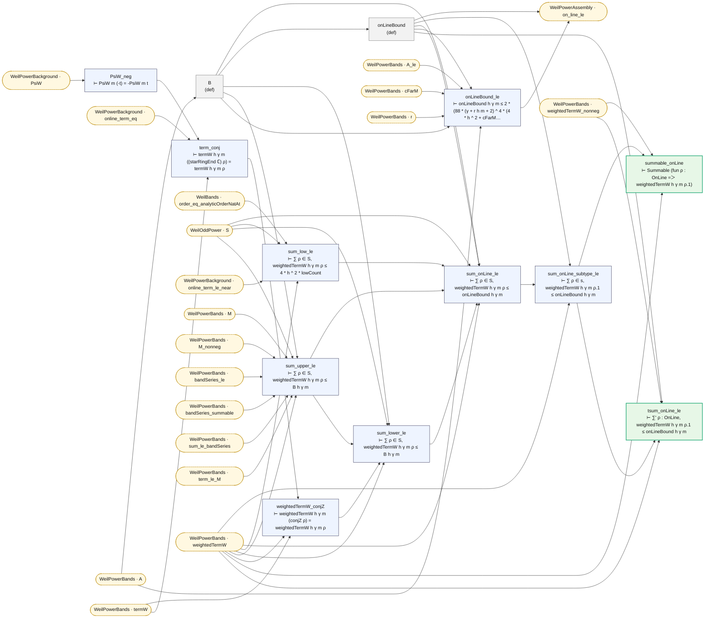

# `lean_stage3/Stage3/WeilPowerOnLine.lean`

**What it does** (its own header): WeilPowerOnLine — the switched window's on-line background, all heights. Rung 5, eighth slice. 2026-09-06.

**Imports:** [`WeilOnLine`](../lean_stage3/WeilOnLine.md), [`WeilPowerBands`](../lean_stage3/WeilPowerBands.md).
**Imported by:** [`Stage3`](../lean_stage3/Stage3.md), [`WeilPowerAssembly`](../lean_stage3/WeilPowerAssembly.md).

Blue: theorem. Green: a theorem nothing else uses (an end). Dashed white: connects to nothing. Grey: definition. Red: contains `sorry`. Yellow: in another file. An arrow A → B reads "A is used by B".

## Every declaration

| declaration | proves (output) | needs (input) | why (its own docstring) | uses | used by |
|---|---|---|---|---|---|
| `WeilPowerOnLine.PsiW_neg` theorem, line 37 | PsiW m (-t) = -PsiW m t | m : ℕ; t : ℝ | `PsiW` is odd. | `WeilPowerBackground.PsiW` | `WeilPowerOnLine.term_conj` |
| `WeilPowerOnLine.term_conj` theorem, line 45 | termW h γ m ((starRingEnd ℂ) ρ) = termW h γ m ρ | hh : 0 &lt; h; γ : ℝ; m : ℕ; hρ : ρ.re = 1 / 2 | The on-line term is invariant under conjugation of the zero. | `WeilPowerBackground.online_term_eq`, `WeilPowerBands.termW`, `WeilPowerOnLine.PsiW_neg` | `WeilPowerOnLine.weightedTermW_conjZ` |
| `WeilPowerOnLine.weightedTermW_conjZ` theorem, line 56 | weightedTermW h γ m (conjZ ρ) = weightedTermW h γ m ρ | hh : 0 &lt; h; γ : ℝ; m : ℕ; ρ : Kadiri.NontrivialZeros; hρ : (ρ : ℂ).re = 1 / 2 | — | `WeilPowerBands.termW`, `WeilPowerBands.weightedTermW`, `WeilPowerOnLine.term_conj` | `WeilPowerOnLine.sum_lower_le` |
| `WeilPowerOnLine.B` def, line 67 | ℝ | h γ : ℝ; m : ℕ | One side's bound: `A h γ m · π²/6`. | `WeilPowerBands.A` | `WeilPowerOnLine.onLineBound`, `WeilPowerOnLine.onLineBound_le`, `WeilPowerOnLine.sum_lower_le`, `WeilPowerOnLine.sum_onLine_le`, `WeilPowerOnLine.sum_upper_le` |
| `WeilPowerOnLine.sum_upper_le` theorem, line 70 | ∑ ρ ∈ S, weightedTermW h γ m ρ ≤ B h γ m | hh : 0 &lt; h; hγ : 11 / 10 ≤ γ; m : ℕ; S : Finset Kadiri.NontrivialZeros; hS : ∀ ρ ∈ S, (ρ : ℂ).re = 1 / 2 ∧ 11 / 10 ≤ (ρ : ℂ).im | Finite on-line sums of height `≥ 11/10`. | `WeilOddPower.S`, `WeilPowerBands.M`, `WeilPowerBands.M_nonneg`, `WeilPowerBands.bandSeries_le`, `WeilPowerBands.bandSeries_summable`, `WeilPowerBands.sum_le_bandSeries`, `WeilPowerBands.term_le_M`, `WeilPowerBands.weightedTermW`, `WeilPowerOnLine.B` | `WeilPowerOnLine.sum_lower_le`, `WeilPowerOnLine.sum_onLine_le` |
| `WeilPowerOnLine.sum_lower_le` theorem, line 81 | ∑ ρ ∈ S, weightedTermW h γ m ρ ≤ B h γ m | hh : 0 &lt; h; hγ : 11 / 10 ≤ γ; m : ℕ; S : Finset Kadiri.NontrivialZeros; hS : ∀ ρ ∈ S, (ρ : ℂ).re = 1 / 2 ∧ (ρ : ℂ).im ≤ -(11 / 10) | Negative heights. | `WeilOddPower.S`, `WeilPowerBands.weightedTermW`, `WeilPowerOnLine.B`, `WeilPowerOnLine.sum_upper_le`, `WeilPowerOnLine.weightedTermW_conjZ` | `WeilPowerOnLine.sum_onLine_le` |
| `WeilPowerOnLine.sum_low_le` theorem, line 104 | ∑ ρ ∈ S, weightedTermW h γ m ρ ≤ 4 * h ^ 2 * lowCount | hh : 0 &lt; h; m : ℕ; S : Finset Kadiri.NontrivialZeros; hS : ∀ ρ ∈ S, (ρ : ℂ).re = 1 / 2 ∧ \|(ρ : ℂ).im\| ≤ 11 / 10 | The low band. Finite on-line sums of height `\|t\| ≤ 11/10`. | `WeilBands.order_eq_analyticOrderNatAt`, `WeilOddPower.S`, `WeilPowerBackground.online_term_le_near`, `WeilPowerBands.weightedTermW` | `WeilPowerOnLine.sum_onLine_le` |
| `WeilPowerOnLine.onLineBound` def, line 136 | ℝ | h γ : ℝ; m : ℕ | The on-line background bound: `2·B h γ m + 4h²·lowCount`. | `WeilPowerOnLine.B` | `WeilPowerAssembly.on_line_le`, `WeilPowerOnLine.onLineBound_le`, `WeilPowerOnLine.sum_onLine_le`, `WeilPowerOnLine.sum_onLine_subtype_le`, `WeilPowerOnLine.tsum_onLine_le` |
| `WeilPowerOnLine.sum_onLine_le` theorem, line 139 | ∑ ρ ∈ S, weightedTermW h γ m ρ ≤ onLineBound h γ m | hh : 0 &lt; h; hγ : 11 / 10 ≤ γ; m : ℕ; S : Finset Kadiri.NontrivialZeros; hS : ∀ ρ ∈ S, (ρ : ℂ).re = 1 / 2 | All heights. | `WeilOddPower.S`, `WeilPowerBands.weightedTermW`, `WeilPowerOnLine.B`, `WeilPowerOnLine.onLineBound`, `WeilPowerOnLine.sum_low_le`, `WeilPowerOnLine.sum_lower_le`, `WeilPowerOnLine.sum_upper_le` | `WeilPowerOnLine.sum_onLine_subtype_le` |
| `WeilPowerOnLine.sum_onLine_subtype_le` theorem, line 173 | ∑ ρ ∈ s, weightedTermW h γ m ρ.1 ≤ onLineBound h γ m | hh : 0 &lt; h; hγ : 11 / 10 ≤ γ; m : ℕ; s : Finset OnLine | — | `WeilPowerBands.weightedTermW`, `WeilPowerOnLine.onLineBound`, `WeilPowerOnLine.sum_onLine_le` | `WeilPowerOnLine.summable_onLine`, `WeilPowerOnLine.tsum_onLine_le` |
| `WeilPowerOnLine.tsum_onLine_le` theorem, line 186 | ∑' ρ : OnLine, weightedTermW h γ m ρ.1 ≤ onLineBound h γ m | hh : 0 &lt; h; hγ : 11 / 10 ≤ γ; m : ℕ | The on-line background of the switched window. | `WeilPowerBands.weightedTermW`, `WeilPowerBands.weightedTermW_nonneg`, `WeilPowerOnLine.onLineBound`, `WeilPowerOnLine.sum_onLine_subtype_le` | — |
| `WeilPowerOnLine.summable_onLine` theorem, line 194 | Summable (fun ρ : OnLine =&gt; weightedTermW h γ m ρ.1) | hh : 0 &lt; h; hγ : 11 / 10 ≤ γ; m : ℕ | The on-line series is summable. | `WeilPowerBands.weightedTermW`, `WeilPowerBands.weightedTermW_nonneg`, `WeilPowerOnLine.sum_onLine_subtype_le` | — |
| `WeilPowerOnLine.onLineBound_le` theorem, line 202 | onLineBound h γ m ≤ 2 * (88 * (γ + r h m + 2) ^ 4 * (4 * h ^ 2 + cFarM m / h ^ 2) * (Real.pi ^ 2 / 6)) + 4 * h ^ 2 * lowCount | hγ : 11 / 10 ≤ γ; m : ℕ | The on-line background, in `γ`, `h` and `m` alone. | `WeilPowerBands.A`, `WeilPowerBands.A_le`, `WeilPowerBands.cFarM`, `WeilPowerBands.r`, `WeilPowerOnLine.B`, `WeilPowerOnLine.onLineBound` | `WeilPowerAssembly.on_line_le` |
