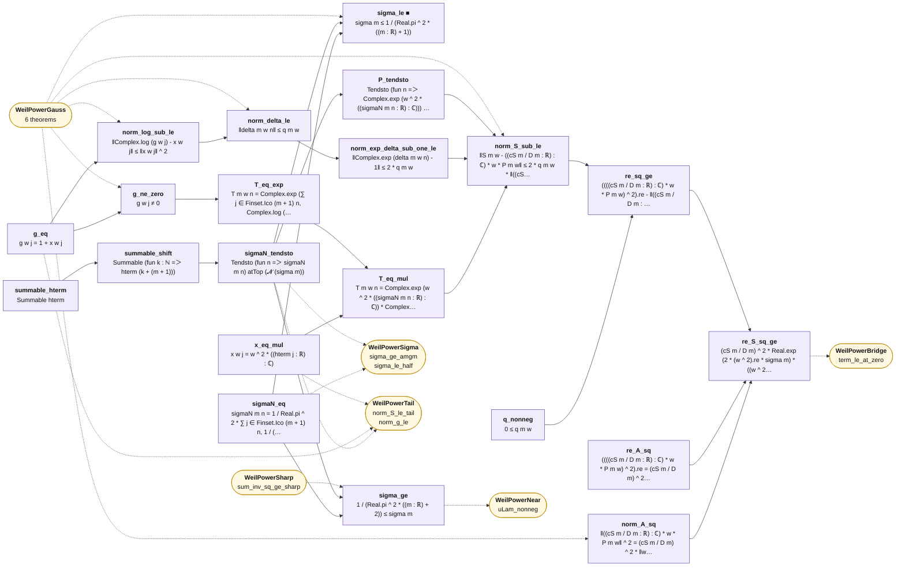

# `lean_stage3/Stage3/WeilPowerPhase.lean`

WeilPowerPhase — the phase of the tail product: `S m w` is its principal part `c·w·exp(w²σ)` up to a relative error `2q`, and `Re (S m w)²` has an explicit lower bound. Rung 5, twelfth slice; worksheet § 13 requirement (b). 2026-09-06. Unit 0347.

21 theorems, 7 definitions, 343 lines. Arrows are Lean's own record of what each proof uses.

**Imports:** [`WeilPowerSharp`](../lean_stage3/WeilPowerSharp.md)  
**Imported by:** [`Stage3`](../lean_stage3/Stage3.md), [`WeilPowerBridge`](../lean_stage3/WeilPowerBridge.md), [`WeilPowerSigma`](../lean_stage3/WeilPowerSigma.md), [`WeilPowerTail`](../lean_stage3/WeilPowerTail.md)

## The picture



An arrow A → B reads "A is used in the proof of B". Green: counting, integers only. Violet: shape, analysis with no ζ. Blue: reads ζ. A name ending in ■ is an end: nothing else uses it. Red: contains `sorry`. Yellow: theorems in another file, counted; a dotted arrow crosses files. Definitions are not drawn; they are listed below the diagram.

## Definitions

<a name="WeilPowerPhase-hterm"></a>
### `WeilPowerPhase.hterm`

def · line 50

The summand of the tail sum, `1/(π²(j+1)²)`.

- **Is:** `` hterm (j : ℕ) : ℝ := 1 / (Real.pi ^ 2 * ((j : ℝ) + 1) ^ 2) ``
- **Used by 11:** [`WeilPowerPhase.T_eq_mul`](#WeilPowerPhase-T_eq_mul), [`WeilPowerPhase.sigma`](#WeilPowerPhase-sigma), [`WeilPowerPhase.sigmaN`](#WeilPowerPhase-sigmaN), [`WeilPowerPhase.sigmaN_eq`](#WeilPowerPhase-sigmaN_eq), [`WeilPowerPhase.sigmaN_tendsto`](#WeilPowerPhase-sigmaN_tendsto), [`WeilPowerPhase.summable_hterm`](#WeilPowerPhase-summable_hterm), [`WeilPowerPhase.summable_shift`](#WeilPowerPhase-summable_shift), [`WeilPowerPhase.x_eq_mul`](#WeilPowerPhase-x_eq_mul), [`WeilPowerTail.norm_T_le_tail`](../lean_stage3/WeilPowerTail.md#WeilPowerTail-norm_T_le_tail), [`WeilPowerTail.norm_g_le`](../lean_stage3/WeilPowerTail.md#WeilPowerTail-norm_g_le), [`WeilPowerTail.sum_hterm_sq_le`](../lean_stage3/WeilPowerTail.md#WeilPowerTail-sum_hterm_sq_le)

<a name="WeilPowerPhase-sigmaN"></a>
### `WeilPowerPhase.sigmaN`

def · line 53

The partial tail sum `σ_n`.

- **Is:** `` sigmaN (m n : ℕ) : ℝ := ∑ j ∈ Finset.Ico (m + 1) n, hterm j ``
- **Built from:** [`WeilPowerPhase.hterm`](#WeilPowerPhase-hterm)
- **Used by 11:** [`WeilPowerPhase.P_tendsto`](#WeilPowerPhase-P_tendsto), [`WeilPowerPhase.T_eq_mul`](#WeilPowerPhase-T_eq_mul), [`WeilPowerPhase.norm_S_sub_le`](#WeilPowerPhase-norm_S_sub_le), [`WeilPowerPhase.sigmaN_eq`](#WeilPowerPhase-sigmaN_eq), [`WeilPowerPhase.sigmaN_tendsto`](#WeilPowerPhase-sigmaN_tendsto), [`WeilPowerPhase.sigma_ge`](#WeilPowerPhase-sigma_ge), [`WeilPowerPhase.sigma_le`](#WeilPowerPhase-sigma_le), [`WeilPowerSigma.sigma_ge_amgm`](../lean_stage3/WeilPowerSigma.md#WeilPowerSigma-sigma_ge_amgm), [`WeilPowerSigma.sigma_le_half`](../lean_stage3/WeilPowerSigma.md#WeilPowerSigma-sigma_le_half), [`WeilPowerTail.norm_S_le_tail`](../lean_stage3/WeilPowerTail.md#WeilPowerTail-norm_S_le_tail), [`WeilPowerTail.norm_T_le_tail`](../lean_stage3/WeilPowerTail.md#WeilPowerTail-norm_T_le_tail)

<a name="WeilPowerPhase-sigma"></a>
### `WeilPowerPhase.sigma`

def · line 56

The full tail sum `σ = Σ_{j ≥ m+1} 1/(π²(j+1)²)`.

- **Is:** `` sigma (m : ℕ) : ℝ := ∑' k : ℕ, hterm (k + (m + 1)) ``
- **Built from:** [`WeilPowerPhase.hterm`](#WeilPowerPhase-hterm)
- **Used by 20:** [`WeilPowerAssembly.target_lower`](../lean_stage3/WeilPowerAssembly.md#WeilPowerAssembly-target_lower), [`WeilPowerBridge.term_le_at_zero`](../lean_stage3/WeilPowerBridge.md#WeilPowerBridge-term_le_at_zero), [`WeilPowerGeomGen.uLam`](../lean_stage3/WeilPowerGeomGen.md#WeilPowerGeomGen-uLam), [`WeilPowerGeomGen.uLam_eq`](../lean_stage3/WeilPowerGeomGen.md#WeilPowerGeomGen-uLam_eq), [`WeilPowerNear.uLam_nonneg`](../lean_stage3/WeilPowerNear.md#WeilPowerNear-uLam_nonneg), [`WeilPowerPhase.P`](#WeilPowerPhase-P), [`WeilPowerPhase.P_tendsto`](#WeilPowerPhase-P_tendsto), [`WeilPowerPhase.norm_A_sq`](#WeilPowerPhase-norm_A_sq), [`WeilPowerPhase.re_A_sq`](#WeilPowerPhase-re_A_sq), [`WeilPowerPhase.re_S_sq_ge`](#WeilPowerPhase-re_S_sq_ge), [`WeilPowerPhase.sigmaN_tendsto`](#WeilPowerPhase-sigmaN_tendsto), [`WeilPowerPhase.sigma_ge`](#WeilPowerPhase-sigma_ge), [`WeilPowerPhase.sigma_le`](#WeilPowerPhase-sigma_le), [`WeilPowerSigma.r_le`](../lean_stage3/WeilPowerSigma.md#WeilPowerSigma-r_le), [`WeilPowerSigma.r_pos`](../lean_stage3/WeilPowerSigma.md#WeilPowerSigma-r_pos), [`WeilPowerSigma.sigma_ge_amgm`](../lean_stage3/WeilPowerSigma.md#WeilPowerSigma-sigma_ge_amgm), [`WeilPowerSigma.sigma_le_half`](../lean_stage3/WeilPowerSigma.md#WeilPowerSigma-sigma_le_half), [`WeilPowerSigma.u`](../lean_stage3/WeilPowerSigma.md#WeilPowerSigma-u), [`WeilPowerSigma.u_def`](../lean_stage3/WeilPowerSigma.md#WeilPowerSigma-u_def), [`WeilPowerTail.norm_S_le_tail`](../lean_stage3/WeilPowerTail.md#WeilPowerTail-norm_S_le_tail)

<a name="WeilPowerPhase-x"></a>
### `WeilPowerPhase.x`

def · line 114

`x_j = w²/(π²(j+1)²)`, so that `g w j = 1 + x w j`.

- **Is:** `` x (w : ℂ) (j : ℕ) : ℂ := w ^ 2 / ((Real.pi : ℂ) ^ 2 * ((j : ℂ) + 1) ^ 2) ``
- **Used by 8:** [`WeilPowerPhase.T_eq_mul`](#WeilPowerPhase-T_eq_mul), [`WeilPowerPhase.delta`](#WeilPowerPhase-delta), [`WeilPowerPhase.g_eq`](#WeilPowerPhase-g_eq), [`WeilPowerPhase.g_ne_zero`](#WeilPowerPhase-g_ne_zero), [`WeilPowerPhase.norm_delta_le`](#WeilPowerPhase-norm_delta_le), [`WeilPowerPhase.norm_log_sub_le`](#WeilPowerPhase-norm_log_sub_le), [`WeilPowerPhase.x_eq_mul`](#WeilPowerPhase-x_eq_mul), [`WeilPowerTail.norm_g_le`](../lean_stage3/WeilPowerTail.md#WeilPowerTail-norm_g_le)

<a name="WeilPowerPhase-delta"></a>
### `WeilPowerPhase.delta`

def · line 141

`δ_n = Σ (log(1 + x_j) − x_j)`.

- **Is:** `` delta (m : ℕ) (w : ℂ) (n : ℕ) : ℂ := ∑ j ∈ Finset.Ico (m + 1) n, (Complex.log (g w j) - x w j) ``
- **Built from:** [`WeilPowerGauss.g`](../lean_stage3/WeilPowerGauss.md#WeilPowerGauss-g), [`WeilPowerPhase.x`](#WeilPowerPhase-x)
- **Used by 4:** [`WeilPowerPhase.T_eq_mul`](#WeilPowerPhase-T_eq_mul), [`WeilPowerPhase.norm_S_sub_le`](#WeilPowerPhase-norm_S_sub_le), [`WeilPowerPhase.norm_delta_le`](#WeilPowerPhase-norm_delta_le), [`WeilPowerPhase.norm_exp_delta_sub_one_le`](#WeilPowerPhase-norm_exp_delta_sub_one_le)

<a name="WeilPowerPhase-q"></a>
### `WeilPowerPhase.q`

def · line 161

The quartic error `q = ‖w‖⁴/(π⁴(m+1)³)`.

- **Is:** `` q (m : ℕ) (w : ℂ) : ℝ := ‖w‖ ^ 4 / (Real.pi ^ 4 * ((m : ℝ) + 1) ^ 3) ``
- **Used by 8:** [`WeilPowerAssembly.target_lower`](../lean_stage3/WeilPowerAssembly.md#WeilPowerAssembly-target_lower), [`WeilPowerBridge.term_le_at_zero`](../lean_stage3/WeilPowerBridge.md#WeilPowerBridge-term_le_at_zero), [`WeilPowerPhase.norm_S_sub_le`](#WeilPowerPhase-norm_S_sub_le), [`WeilPowerPhase.norm_delta_le`](#WeilPowerPhase-norm_delta_le), [`WeilPowerPhase.norm_exp_delta_sub_one_le`](#WeilPowerPhase-norm_exp_delta_sub_one_le), [`WeilPowerPhase.q_nonneg`](#WeilPowerPhase-q_nonneg), [`WeilPowerPhase.re_S_sq_ge`](#WeilPowerPhase-re_S_sq_ge), [`WeilPowerPhase.re_sq_ge`](#WeilPowerPhase-re_sq_ge)

<a name="WeilPowerPhase-P"></a>
### `WeilPowerPhase.P`

def · line 215

The principal part `P = exp(w² σ)`.

- **Is:** `` P (m : ℕ) (w : ℂ) : ℂ := Complex.exp (w ^ 2 * ((sigma m : ℝ) : ℂ)) ``
- **Built from:** [`WeilPowerPhase.sigma`](#WeilPowerPhase-sigma)
- **Used by 6:** [`WeilPowerPhase.P_tendsto`](#WeilPowerPhase-P_tendsto), [`WeilPowerPhase.norm_A_sq`](#WeilPowerPhase-norm_A_sq), [`WeilPowerPhase.norm_S_sub_le`](#WeilPowerPhase-norm_S_sub_le), [`WeilPowerPhase.re_A_sq`](#WeilPowerPhase-re_A_sq), [`WeilPowerPhase.re_S_sq_ge`](#WeilPowerPhase-re_S_sq_ge), [`WeilPowerPhase.re_sq_ge`](#WeilPowerPhase-re_sq_ge)

## Theorems

<a name="WeilPowerPhase-summable_hterm"></a>
### `WeilPowerPhase.summable_hterm`

line 58

**Shape.** Uses real or complex analysis; nothing in it or beneath it reads ζ.

**Proves**

```lean
Summable hterm
```

**Stated with:** [`WeilPowerPhase.hterm`](#WeilPowerPhase-hterm)

**Fed by:** no theorem of this repo; it stands on Mathlib and the definitions below.

**Feeds** (1 that use it)

  - [`WeilPowerPhase.summable_shift`](#WeilPowerPhase-summable_shift) — `` Summable (fun k : ℕ => hterm (k + (m + 1))) ``

<a name="WeilPowerPhase-summable_shift"></a>
### `WeilPowerPhase.summable_shift`

line 68

**Shape.** Uses real or complex analysis; nothing in it or beneath it reads ζ.

**Proves**

```lean
Summable (fun k : ℕ => hterm (k + (m + 1)))
```

**Needs** (its hypotheses)

  - `` m : ℕ ``

**Stated with:** [`WeilPowerPhase.hterm`](#WeilPowerPhase-hterm)

**Fed by** (1 theorem its proof uses)

  - [`WeilPowerPhase.summable_hterm`](#WeilPowerPhase-summable_hterm) — `` Summable hterm ``

**Feeds** (1 that use it)

  - [`WeilPowerPhase.sigmaN_tendsto`](#WeilPowerPhase-sigmaN_tendsto) — `` Tendsto (fun n => sigmaN m n) atTop (𝓝 (sigma m)) ``

<a name="WeilPowerPhase-sigmaN_eq"></a>
### `WeilPowerPhase.sigmaN_eq`

line 71

**Shape.** Uses real or complex analysis; nothing in it or beneath it reads ζ.

**Proves**

```lean
sigmaN m n = 1 / Real.pi ^ 2 * ∑ j ∈ Finset.Ico (m + 1) n, 1 / ((j : ℝ) + 1) ^ 2
```

**Needs** (its hypotheses)

  - `` m n : ℕ ``

**Stated with:** [`WeilPowerPhase.sigmaN`](#WeilPowerPhase-sigmaN)

**Fed by:** no theorem of this repo; it stands on Mathlib and the definitions below.

**Definitions its proof touches:** [`WeilPowerPhase.hterm`](#WeilPowerPhase-hterm)

**Feeds** (4 that use it)

  - [`WeilPowerPhase.sigma_ge`](#WeilPowerPhase-sigma_ge) — `` 1 / (Real.pi ^ 2 * ((m : ℝ) + 2)) ≤ sigma m ``
  - [`WeilPowerPhase.sigma_le`](#WeilPowerPhase-sigma_le) — `` sigma m ≤ 1 / (Real.pi ^ 2 * ((m : ℝ) + 1)) ``
  - [`WeilPowerSigma.sigma_ge_amgm`](../lean_stage3/WeilPowerSigma.md#WeilPowerSigma-sigma_ge_amgm) (WeilPowerSigma) — `` 1 / (Real.pi ^ 2 * ((m : ℝ) + 2)) + 1 / (2 * Real.pi ^ 2 * ((m : ℝ) + 2) ^ 2) ≤ sigma m ``
  - [`WeilPowerSigma.sigma_le_half`](../lean_stage3/WeilPowerSigma.md#WeilPowerSigma-sigma_le_half) (WeilPowerSigma) — `` sigma m ≤ 2 / (Real.pi ^ 2 * (2 * (m : ℝ) + 3)) ``

<a name="WeilPowerPhase-sigmaN_tendsto"></a>
### `WeilPowerPhase.sigmaN_tendsto`

line 79

**Shape.** Uses real or complex analysis; nothing in it or beneath it reads ζ.

**Proves**

```lean
Tendsto (fun n => sigmaN m n) atTop (𝓝 (sigma m))
```

**Needs** (its hypotheses)

  - `` m : ℕ ``

**Stated with:** [`WeilPowerPhase.sigma`](#WeilPowerPhase-sigma), [`WeilPowerPhase.sigmaN`](#WeilPowerPhase-sigmaN)

**Fed by** (1 theorem its proof uses)

  - [`WeilPowerPhase.summable_shift`](#WeilPowerPhase-summable_shift) — `` Summable (fun k : ℕ => hterm (k + (m + 1))) ``

**Definitions its proof touches:** [`WeilPowerPhase.hterm`](#WeilPowerPhase-hterm)

**Feeds** (6 that use it)

  - [`WeilPowerPhase.P_tendsto`](#WeilPowerPhase-P_tendsto) — `` Tendsto (fun n => Complex.exp (w ^ 2 * ((sigmaN m n : ℝ) : ℂ))) atTop (𝓝 (P m w)) ``
  - [`WeilPowerPhase.sigma_ge`](#WeilPowerPhase-sigma_ge) — `` 1 / (Real.pi ^ 2 * ((m : ℝ) + 2)) ≤ sigma m ``
  - [`WeilPowerPhase.sigma_le`](#WeilPowerPhase-sigma_le) — `` sigma m ≤ 1 / (Real.pi ^ 2 * ((m : ℝ) + 1)) ``
  - [`WeilPowerSigma.sigma_ge_amgm`](../lean_stage3/WeilPowerSigma.md#WeilPowerSigma-sigma_ge_amgm) (WeilPowerSigma) — `` 1 / (Real.pi ^ 2 * ((m : ℝ) + 2)) + 1 / (2 * Real.pi ^ 2 * ((m : ℝ) + 2) ^ 2) ≤ sigma m ``
  - [`WeilPowerSigma.sigma_le_half`](../lean_stage3/WeilPowerSigma.md#WeilPowerSigma-sigma_le_half) (WeilPowerSigma) — `` sigma m ≤ 2 / (Real.pi ^ 2 * (2 * (m : ℝ) + 3)) ``
  - [`WeilPowerTail.norm_S_le_tail`](../lean_stage3/WeilPowerTail.md#WeilPowerTail-norm_S_le_tail) (WeilPowerTail) — `` ‖S m w‖ ≤ cS m / D m * ‖w‖ * Real.exp ((w ^ 2).re * sigma m + ‖w‖ ^ 4 / (6 * Real.pi ^ 4 * ((m : ℝ) + 1) ^ 3)) ``

<a name="WeilPowerPhase-sigma_le"></a>
### `WeilPowerPhase.sigma_le`

line 89

**Shape.** Uses real or complex analysis; nothing in it or beneath it reads ζ.

**Proves**

```lean
sigma m ≤ 1 / (Real.pi ^ 2 * ((m : ℝ) + 1))
```

**Needs** (its hypotheses)

  - `` m : ℕ ``

**Stated with:** [`WeilPowerPhase.sigma`](#WeilPowerPhase-sigma)

**Fed by** (3 theorems its proof uses)

  - [`WeilPowerGauss.sum_inv_sq_le`](../lean_stage3/WeilPowerGauss.md#WeilPowerGauss-sum_inv_sq_le) (WeilPowerGauss) — `` ∑ j ∈ Finset.Ico (m + 1) n, 1 / ((j : ℝ) + 1) ^ 2 ≤ 1 / ((m : ℝ) + 1) ``
  - [`WeilPowerPhase.sigmaN_eq`](#WeilPowerPhase-sigmaN_eq) — `` sigmaN m n = 1 / Real.pi ^ 2 * ∑ j ∈ Finset.Ico (m + 1) n, 1 / ((j : ℝ) + 1) ^ 2 ``
  - [`WeilPowerPhase.sigmaN_tendsto`](#WeilPowerPhase-sigmaN_tendsto) — `` Tendsto (fun n => sigmaN m n) atTop (𝓝 (sigma m)) ``

**Definitions its proof touches:** [`WeilPowerPhase.sigmaN`](#WeilPowerPhase-sigmaN)

**Feeds:** nothing. It is an end.

<a name="WeilPowerPhase-sigma_ge"></a>
### `WeilPowerPhase.sigma_ge`

line 99

**Shape.** Uses real or complex analysis; nothing in it or beneath it reads ζ.

**Proves**

```lean
1 / (Real.pi ^ 2 * ((m : ℝ) + 2)) ≤ sigma m
```

**Needs** (its hypotheses)

  - `` m : ℕ ``

**Stated with:** [`WeilPowerPhase.sigma`](#WeilPowerPhase-sigma)

**Fed by** (3 theorems its proof uses)

  - [`WeilPowerPhase.sigmaN_eq`](#WeilPowerPhase-sigmaN_eq) — `` sigmaN m n = 1 / Real.pi ^ 2 * ∑ j ∈ Finset.Ico (m + 1) n, 1 / ((j : ℝ) + 1) ^ 2 ``
  - [`WeilPowerPhase.sigmaN_tendsto`](#WeilPowerPhase-sigmaN_tendsto) — `` Tendsto (fun n => sigmaN m n) atTop (𝓝 (sigma m)) ``
  - [`WeilPowerSharp.sum_inv_sq_ge_sharp`](../lean_stage3/WeilPowerSharp.md#WeilPowerSharp-sum_inv_sq_ge_sharp) (WeilPowerSharp) — `` 1 / ((m : ℝ) + 2) - 1 / ((n : ℝ) + 1) ≤ ∑ j ∈ Finset.Ico (m + 1) n, 1 / ((j : ℝ) + 1) ^ 2 ``

**Definitions its proof touches:** [`WeilPowerPhase.sigmaN`](#WeilPowerPhase-sigmaN)

**Feeds** (1 that use it)

  - [`WeilPowerNear.uLam_nonneg`](../lean_stage3/WeilPowerNear.md#WeilPowerNear-uLam_nonneg) (WeilPowerNear) — `` 0 ≤ WeilPowerGeomGen.uLam lam h ``

<a name="WeilPowerPhase-g_eq"></a>
### `WeilPowerPhase.g_eq`

line 116

**Shape.** Uses real or complex analysis; nothing in it or beneath it reads ζ.

**Proves**

```lean
g w j = 1 + x w j
```

**Needs** (its hypotheses)

  - `` w : ℂ ``
  - `` j : ℕ ``

**Stated with:** [`WeilPowerGauss.g`](../lean_stage3/WeilPowerGauss.md#WeilPowerGauss-g), [`WeilPowerPhase.x`](#WeilPowerPhase-x)

**Fed by:** no theorem of this repo; it stands on Mathlib and the definitions below.

**Feeds** (3 that use it)

  - [`WeilPowerPhase.g_ne_zero`](#WeilPowerPhase-g_ne_zero) — `` g w j ≠ 0 ``
  - [`WeilPowerPhase.norm_log_sub_le`](#WeilPowerPhase-norm_log_sub_le) — `` ‖Complex.log (g w j) - x w j‖ ≤ ‖x w j‖ ^ 2 ``
  - [`WeilPowerTail.norm_g_le`](../lean_stage3/WeilPowerTail.md#WeilPowerTail-norm_g_le) (WeilPowerTail) — `` ‖g w j‖ ≤ Real.exp ((w ^ 2).re * hterm j + ‖w‖ ^ 4 * hterm j ^ 2 / 2) ``

<a name="WeilPowerPhase-x_eq_mul"></a>
### `WeilPowerPhase.x_eq_mul`

line 118

**Shape.** Uses real or complex analysis; nothing in it or beneath it reads ζ.

**Proves**

```lean
x w j = w ^ 2 * ((hterm j : ℝ) : ℂ)
```

**Needs** (its hypotheses)

  - `` w : ℂ ``
  - `` j : ℕ ``

**Stated with:** [`WeilPowerPhase.hterm`](#WeilPowerPhase-hterm), [`WeilPowerPhase.x`](#WeilPowerPhase-x)

**Fed by:** no theorem of this repo; it stands on Mathlib and the definitions below.

**Feeds** (2 that use it)

  - [`WeilPowerPhase.T_eq_mul`](#WeilPowerPhase-T_eq_mul) — `` T m w n = Complex.exp (w ^ 2 * ((sigmaN m n : ℝ) : ℂ)) * Complex.exp (delta m w n) ``
  - [`WeilPowerTail.norm_g_le`](../lean_stage3/WeilPowerTail.md#WeilPowerTail-norm_g_le) (WeilPowerTail) — `` ‖g w j‖ ≤ Real.exp ((w ^ 2).re * hterm j + ‖w‖ ^ 4 * hterm j ^ 2 / 2) ``

<a name="WeilPowerPhase-g_ne_zero"></a>
### `WeilPowerPhase.g_ne_zero`

line 123

**Shape.** Uses real or complex analysis; nothing in it or beneath it reads ζ.

**Proves**

```lean
g w j ≠ 0
```

**Needs** (its hypotheses)

  - `` hsmall : ‖w‖ ^ 2 ≤ Real.pi ^ 2 * ((m : ℝ) + 2) ^ 2 / 2 ``
  - `` hj : m + 1 ≤ j ``

**Stated with:** [`WeilPowerGauss.g`](../lean_stage3/WeilPowerGauss.md#WeilPowerGauss-g)

**Fed by** (2 theorems its proof uses)

  - [`WeilPowerGauss.norm_x_le`](../lean_stage3/WeilPowerGauss.md#WeilPowerGauss-norm_x_le) (WeilPowerGauss) — `` ‖w ^ 2 / ((Real.pi : ℂ) ^ 2 * ((j : ℂ) + 1) ^ 2)‖ ≤ 1 / 2 ``
  - [`WeilPowerPhase.g_eq`](#WeilPowerPhase-g_eq) — `` g w j = 1 + x w j ``

**Definitions its proof touches:** [`WeilPowerPhase.x`](#WeilPowerPhase-x)

**Feeds** (1 that use it)

  - [`WeilPowerPhase.T_eq_exp`](#WeilPowerPhase-T_eq_exp) — `` T m w n = Complex.exp (∑ j ∈ Finset.Ico (m + 1) n, Complex.log (g w j)) ``

<a name="WeilPowerPhase-T_eq_exp"></a>
### `WeilPowerPhase.T_eq_exp`

line 132

**Shape.** Uses real or complex analysis; nothing in it or beneath it reads ζ.

**Proves**

```lean
T m w n = Complex.exp (∑ j ∈ Finset.Ico (m + 1) n, Complex.log (g w j))
```

**Needs** (its hypotheses)

  - `` hsmall : ‖w‖ ^ 2 ≤ Real.pi ^ 2 * ((m : ℝ) + 2) ^ 2 / 2 ``
  - `` n : ℕ ``

**Stated with:** [`WeilPowerGauss.T`](../lean_stage3/WeilPowerGauss.md#WeilPowerGauss-T), [`WeilPowerGauss.g`](../lean_stage3/WeilPowerGauss.md#WeilPowerGauss-g)

**Fed by** (1 theorem its proof uses)

  - [`WeilPowerPhase.g_ne_zero`](#WeilPowerPhase-g_ne_zero) — `` g w j ≠ 0 ``

**Feeds** (1 that use it)

  - [`WeilPowerPhase.T_eq_mul`](#WeilPowerPhase-T_eq_mul) — `` T m w n = Complex.exp (w ^ 2 * ((sigmaN m n : ℝ) : ℂ)) * Complex.exp (delta m w n) ``

<a name="WeilPowerPhase-norm_log_sub_le"></a>
### `WeilPowerPhase.norm_log_sub_le`

line 144

**Shape.** Uses real or complex analysis; nothing in it or beneath it reads ζ.

**Proves**

```lean
‖Complex.log (g w j) - x w j‖ ≤ ‖x w j‖ ^ 2
```

**Needs** (its hypotheses)

  - `` hsmall : ‖w‖ ^ 2 ≤ Real.pi ^ 2 * ((m : ℝ) + 2) ^ 2 / 2 ``
  - `` hj : m + 1 ≤ j ``

**Stated with:** [`WeilPowerGauss.g`](../lean_stage3/WeilPowerGauss.md#WeilPowerGauss-g), [`WeilPowerPhase.x`](#WeilPowerPhase-x)

**Fed by** (2 theorems its proof uses)

  - [`WeilPowerGauss.norm_x_le`](../lean_stage3/WeilPowerGauss.md#WeilPowerGauss-norm_x_le) (WeilPowerGauss) — `` ‖w ^ 2 / ((Real.pi : ℂ) ^ 2 * ((j : ℂ) + 1) ^ 2)‖ ≤ 1 / 2 ``
  - [`WeilPowerPhase.g_eq`](#WeilPowerPhase-g_eq) — `` g w j = 1 + x w j ``

**Feeds** (1 that use it)

  - [`WeilPowerPhase.norm_delta_le`](#WeilPowerPhase-norm_delta_le) — `` ‖delta m w n‖ ≤ q m w ``

<a name="WeilPowerPhase-q_nonneg"></a>
### `WeilPowerPhase.q_nonneg`

line 163

**Shape.** Uses real or complex analysis; nothing in it or beneath it reads ζ.

**Proves**

```lean
0 ≤ q m w
```

**Needs** (its hypotheses)

  - `` m : ℕ ``
  - `` w : ℂ ``

**Stated with:** [`WeilPowerPhase.q`](#WeilPowerPhase-q)

**Fed by:** no theorem of this repo; it stands on Mathlib and the definitions below.

**Feeds** (1 that use it)

  - [`WeilPowerPhase.re_sq_ge`](#WeilPowerPhase-re_sq_ge) — `` ((((cS m / D m : ℝ) : ℂ) * w * P m w) ^ 2).re - ‖((cS m / D m : ℝ) : ℂ) * w * P m w‖ ^ 2 * (4 * q m w + 4 * q m w ^ 2) ≤ ((S m w) ^ 2).re ``

<a name="WeilPowerPhase-norm_delta_le"></a>
### `WeilPowerPhase.norm_delta_le`

line 167

**Shape.** Uses real or complex analysis; nothing in it or beneath it reads ζ.

**Proves**

```lean
‖delta m w n‖ ≤ q m w
```

**Needs** (its hypotheses)

  - `` hsmall : ‖w‖ ^ 2 ≤ Real.pi ^ 2 * ((m : ℝ) + 2) ^ 2 / 2 ``
  - `` n : ℕ ``

**Stated with:** [`WeilPowerPhase.delta`](#WeilPowerPhase-delta), [`WeilPowerPhase.q`](#WeilPowerPhase-q)

**Fed by** (3 theorems its proof uses)

  - [`WeilPowerGauss.sum_inv_pow4_le`](../lean_stage3/WeilPowerGauss.md#WeilPowerGauss-sum_inv_pow4_le) (WeilPowerGauss) — `` ∑ j ∈ Finset.Ico (m + 1) n, 1 / ((j : ℝ) + 1) ^ 4 ≤ 1 / ((m : ℝ) + 1) ^ 3 ``
  - [`WeilPowerGauss.x_norm`](../lean_stage3/WeilPowerGauss.md#WeilPowerGauss-x_norm) (WeilPowerGauss) — `` ‖w ^ 2 / ((Real.pi : ℂ) ^ 2 * ((j : ℂ) + 1) ^ 2)‖ = ‖w‖ ^ 2 / (Real.pi ^ 2 * ((j : ℝ) + 1) ^ 2) ``
  - [`WeilPowerPhase.norm_log_sub_le`](#WeilPowerPhase-norm_log_sub_le) — `` ‖Complex.log (g w j) - x w j‖ ≤ ‖x w j‖ ^ 2 ``

**Definitions its proof touches:** [`WeilPowerGauss.g`](../lean_stage3/WeilPowerGauss.md#WeilPowerGauss-g), [`WeilPowerPhase.x`](#WeilPowerPhase-x)

**Feeds** (1 that use it)

  - [`WeilPowerPhase.norm_exp_delta_sub_one_le`](#WeilPowerPhase-norm_exp_delta_sub_one_le) — `` ‖Complex.exp (delta m w n) - 1‖ ≤ 2 * q m w ``

<a name="WeilPowerPhase-T_eq_mul"></a>
### `WeilPowerPhase.T_eq_mul`

line 193

**Shape.** Uses real or complex analysis; nothing in it or beneath it reads ζ.

**Why.** The split. `T m w n = exp(w² σ_n) · exp(δ_n)`.

**Proves**

```lean
T m w n = Complex.exp (w ^ 2 * ((sigmaN m n : ℝ) : ℂ)) * Complex.exp (delta m w n)
```

**Needs** (its hypotheses)

  - `` hsmall : ‖w‖ ^ 2 ≤ Real.pi ^ 2 * ((m : ℝ) + 2) ^ 2 / 2 ``
  - `` n : ℕ ``

**Stated with:** [`WeilPowerGauss.T`](../lean_stage3/WeilPowerGauss.md#WeilPowerGauss-T), [`WeilPowerPhase.delta`](#WeilPowerPhase-delta), [`WeilPowerPhase.sigmaN`](#WeilPowerPhase-sigmaN)

**Fed by** (2 theorems its proof uses)

  - [`WeilPowerPhase.T_eq_exp`](#WeilPowerPhase-T_eq_exp) — `` T m w n = Complex.exp (∑ j ∈ Finset.Ico (m + 1) n, Complex.log (g w j)) ``
  - [`WeilPowerPhase.x_eq_mul`](#WeilPowerPhase-x_eq_mul) — `` x w j = w ^ 2 * ((hterm j : ℝ) : ℂ) ``

**Definitions its proof touches:** [`WeilPowerGauss.g`](../lean_stage3/WeilPowerGauss.md#WeilPowerGauss-g), [`WeilPowerPhase.hterm`](#WeilPowerPhase-hterm), [`WeilPowerPhase.x`](#WeilPowerPhase-x)

**Feeds** (1 that use it)

  - [`WeilPowerPhase.norm_S_sub_le`](#WeilPowerPhase-norm_S_sub_le) — `` ‖S m w - ((cS m / D m : ℝ) : ℂ) * w * P m w‖ ≤ 2 * q m w * ‖((cS m / D m : ℝ) : ℂ) * w * P m w‖ ``

<a name="WeilPowerPhase-norm_exp_delta_sub_one_le"></a>
### `WeilPowerPhase.norm_exp_delta_sub_one_le`

line 207

**Shape.** Uses real or complex analysis; nothing in it or beneath it reads ζ.

**Proves**

```lean
‖Complex.exp (delta m w n) - 1‖ ≤ 2 * q m w
```

**Needs** (its hypotheses)

  - `` hsmall : ‖w‖ ^ 2 ≤ Real.pi ^ 2 * ((m : ℝ) + 2) ^ 2 / 2 ``
  - `` hq : q m w ≤ 1 ``
  - `` n : ℕ ``

**Stated with:** [`WeilPowerPhase.delta`](#WeilPowerPhase-delta), [`WeilPowerPhase.q`](#WeilPowerPhase-q)

**Fed by** (1 theorem its proof uses)

  - [`WeilPowerPhase.norm_delta_le`](#WeilPowerPhase-norm_delta_le) — `` ‖delta m w n‖ ≤ q m w ``

**Feeds** (1 that use it)

  - [`WeilPowerPhase.norm_S_sub_le`](#WeilPowerPhase-norm_S_sub_le) — `` ‖S m w - ((cS m / D m : ℝ) : ℂ) * w * P m w‖ ≤ 2 * q m w * ‖((cS m / D m : ℝ) : ℂ) * w * P m w‖ ``

<a name="WeilPowerPhase-P_tendsto"></a>
### `WeilPowerPhase.P_tendsto`

line 217

**Shape.** Uses real or complex analysis; nothing in it or beneath it reads ζ.

**Proves**

```lean
Tendsto (fun n => Complex.exp (w ^ 2 * ((sigmaN m n : ℝ) : ℂ))) atTop (𝓝 (P m w))
```

**Needs** (its hypotheses)

  - `` m : ℕ ``
  - `` w : ℂ ``

**Stated with:** [`WeilPowerPhase.P`](#WeilPowerPhase-P), [`WeilPowerPhase.sigmaN`](#WeilPowerPhase-sigmaN)

**Fed by** (1 theorem its proof uses)

  - [`WeilPowerPhase.sigmaN_tendsto`](#WeilPowerPhase-sigmaN_tendsto) — `` Tendsto (fun n => sigmaN m n) atTop (𝓝 (sigma m)) ``

**Definitions its proof touches:** [`WeilPowerPhase.sigma`](#WeilPowerPhase-sigma)

**Feeds** (1 that use it)

  - [`WeilPowerPhase.norm_S_sub_le`](#WeilPowerPhase-norm_S_sub_le) — `` ‖S m w - ((cS m / D m : ℝ) : ℂ) * w * P m w‖ ≤ 2 * q m w * ‖((cS m / D m : ℝ) : ℂ) * w * P m w‖ ``

<a name="WeilPowerPhase-norm_S_sub_le"></a>
### `WeilPowerPhase.norm_S_sub_le`

line 225

**Shape.** Uses real or complex analysis; nothing in it or beneath it reads ζ.

**Why.** The principal part carries `S` up to `2q`.

**Proves**

```lean
‖S m w - ((cS m / D m : ℝ) : ℂ) * w * P m w‖ ≤ 2 * q m w * ‖((cS m / D m : ℝ) : ℂ) * w * P m w‖
```

**Needs** (its hypotheses)

  - `` hne : QS m w ≠ 0 ``
  - `` hsmall : ‖w‖ ^ 2 ≤ Real.pi ^ 2 * ((m : ℝ) + 2) ^ 2 / 2 ``
  - `` hq : q m w ≤ 1 ``

**Stated with:** [`WeilOddPower.QS`](../lean_stage3/WeilOddPower.md#WeilOddPower-QS), [`WeilOddPower.S`](../lean_stage3/WeilOddPower.md#WeilOddPower-S), [`WeilOddPower.cS`](../lean_stage3/WeilOddPower.md#WeilOddPower-cS), [`WeilPowerGauss.D`](../lean_stage3/WeilPowerGauss.md#WeilPowerGauss-D), [`WeilPowerPhase.P`](#WeilPowerPhase-P), [`WeilPowerPhase.q`](#WeilPowerPhase-q)

**Fed by** (4 theorems its proof uses)

  - [`WeilPowerGauss.tendsto_S`](../lean_stage3/WeilPowerGauss.md#WeilPowerGauss-tendsto_S) (WeilPowerGauss) — `` Tendsto (fun n : ℕ => ((cS m / D m : ℝ) : ℂ) * w * T m w n) atTop (𝓝 (S m w)) ``
  - [`WeilPowerPhase.P_tendsto`](#WeilPowerPhase-P_tendsto) — `` Tendsto (fun n => Complex.exp (w ^ 2 * ((sigmaN m n : ℝ) : ℂ))) atTop (𝓝 (P m w)) ``
  - [`WeilPowerPhase.T_eq_mul`](#WeilPowerPhase-T_eq_mul) — `` T m w n = Complex.exp (w ^ 2 * ((sigmaN m n : ℝ) : ℂ)) * Complex.exp (delta m w n) ``
  - [`WeilPowerPhase.norm_exp_delta_sub_one_le`](#WeilPowerPhase-norm_exp_delta_sub_one_le) — `` ‖Complex.exp (delta m w n) - 1‖ ≤ 2 * q m w ``

**Definitions its proof touches:** [`WeilPowerGauss.T`](../lean_stage3/WeilPowerGauss.md#WeilPowerGauss-T), [`WeilPowerPhase.delta`](#WeilPowerPhase-delta), [`WeilPowerPhase.sigmaN`](#WeilPowerPhase-sigmaN)

**Feeds** (1 that use it)

  - [`WeilPowerPhase.re_sq_ge`](#WeilPowerPhase-re_sq_ge) — `` ((((cS m / D m : ℝ) : ℂ) * w * P m w) ^ 2).re - ‖((cS m / D m : ℝ) : ℂ) * w * P m w‖ ^ 2 * (4 * q m w + 4 * q m w ^ 2) ≤ ((S m w) ^ 2).re ``

<a name="WeilPowerPhase-norm_A_sq"></a>
### `WeilPowerPhase.norm_A_sq`

line 245

**Shape.** Uses real or complex analysis; nothing in it or beneath it reads ζ.

**Proves**

```lean
‖((cS m / D m : ℝ) : ℂ) * w * P m w‖ ^ 2 = (cS m / D m) ^ 2 * ‖w‖ ^ 2 * Real.exp (2 * (w ^ 2).re * sigma m)
```

**Needs** (its hypotheses)

  - `` m : ℕ ``
  - `` w : ℂ ``

**Stated with:** [`WeilOddPower.cS`](../lean_stage3/WeilOddPower.md#WeilOddPower-cS), [`WeilPowerGauss.D`](../lean_stage3/WeilPowerGauss.md#WeilPowerGauss-D), [`WeilPowerPhase.P`](#WeilPowerPhase-P), [`WeilPowerPhase.sigma`](#WeilPowerPhase-sigma)

**Fed by** (1 theorem its proof uses)

  - [`WeilPowerGauss.cprime_pos`](../lean_stage3/WeilPowerGauss.md#WeilPowerGauss-cprime_pos) (WeilPowerGauss) — `` 0 < cS m / D m ``

**Feeds** (1 that use it)

  - [`WeilPowerPhase.re_S_sq_ge`](#WeilPowerPhase-re_S_sq_ge) — `` (cS m / D m) ^ 2 * Real.exp (2 * (w ^ 2).re * sigma m) * ((w ^ 2).re * Real.cos (2 * (w ^ 2).im * sigma m) - (w ^ 2).im * Real.sin (2 * (w ^ 2).im * s… ``

<a name="WeilPowerPhase-re_A_sq"></a>
### `WeilPowerPhase.re_A_sq`

line 258

**Shape.** Uses real or complex analysis; nothing in it or beneath it reads ζ.

**Why.** The real part of the principal part squared, explicitly.

**Proves**

```lean
((((cS m / D m : ℝ) : ℂ) * w * P m w) ^ 2).re = (cS m / D m) ^ 2 * Real.exp (2 * (w ^ 2).re * sigma m) * ((w ^ 2).re * Real.cos (2 * (w ^ 2).im * sigma m) - (w ^ 2).im * Real.sin (2 * (w ^ 2).im * sigma m))
```

**Needs** (its hypotheses)

  - `` m : ℕ ``
  - `` w : ℂ ``

**Stated with:** [`WeilOddPower.cS`](../lean_stage3/WeilOddPower.md#WeilOddPower-cS), [`WeilPowerGauss.D`](../lean_stage3/WeilPowerGauss.md#WeilPowerGauss-D), [`WeilPowerPhase.P`](#WeilPowerPhase-P), [`WeilPowerPhase.sigma`](#WeilPowerPhase-sigma)

**Fed by:** no theorem of this repo; it stands on Mathlib and the definitions below.

**Feeds** (1 that use it)

  - [`WeilPowerPhase.re_S_sq_ge`](#WeilPowerPhase-re_S_sq_ge) — `` (cS m / D m) ^ 2 * Real.exp (2 * (w ^ 2).re * sigma m) * ((w ^ 2).re * Real.cos (2 * (w ^ 2).im * sigma m) - (w ^ 2).im * Real.sin (2 * (w ^ 2).im * s… ``

<a name="WeilPowerPhase-re_sq_ge"></a>
### `WeilPowerPhase.re_sq_ge`

line 285

**Shape.** Uses real or complex analysis; nothing in it or beneath it reads ζ.

**Why.** The lower bound on `Re (S m w)²`.

**Proves**

```lean
((((cS m / D m : ℝ) : ℂ) * w * P m w) ^ 2).re - ‖((cS m / D m : ℝ) : ℂ) * w * P m w‖ ^ 2 * (4 * q m w + 4 * q m w ^ 2) ≤ ((S m w) ^ 2).re
```

**Needs** (its hypotheses)

  - `` hne : QS m w ≠ 0 ``
  - `` hsmall : ‖w‖ ^ 2 ≤ Real.pi ^ 2 * ((m : ℝ) + 2) ^ 2 / 2 ``
  - `` hq : q m w ≤ 1 ``

**Stated with:** [`WeilOddPower.QS`](../lean_stage3/WeilOddPower.md#WeilOddPower-QS), [`WeilOddPower.S`](../lean_stage3/WeilOddPower.md#WeilOddPower-S), [`WeilOddPower.cS`](../lean_stage3/WeilOddPower.md#WeilOddPower-cS), [`WeilPowerGauss.D`](../lean_stage3/WeilPowerGauss.md#WeilPowerGauss-D), [`WeilPowerPhase.P`](#WeilPowerPhase-P), [`WeilPowerPhase.q`](#WeilPowerPhase-q)

**Fed by** (2 theorems its proof uses)

  - [`WeilPowerPhase.norm_S_sub_le`](#WeilPowerPhase-norm_S_sub_le) — `` ‖S m w - ((cS m / D m : ℝ) : ℂ) * w * P m w‖ ≤ 2 * q m w * ‖((cS m / D m : ℝ) : ℂ) * w * P m w‖ ``
  - [`WeilPowerPhase.q_nonneg`](#WeilPowerPhase-q_nonneg) — `` 0 ≤ q m w ``

**Feeds** (1 that use it)

  - [`WeilPowerPhase.re_S_sq_ge`](#WeilPowerPhase-re_S_sq_ge) — `` (cS m / D m) ^ 2 * Real.exp (2 * (w ^ 2).re * sigma m) * ((w ^ 2).re * Real.cos (2 * (w ^ 2).im * sigma m) - (w ^ 2).im * Real.sin (2 * (w ^ 2).im * s… ``

<a name="WeilPowerPhase-re_S_sq_ge"></a>
### `WeilPowerPhase.re_S_sq_ge`

line 312

**Shape.** Uses real or complex analysis; nothing in it or beneath it reads ζ.

**Why.** The deliverable.

**Proves**

```lean
(cS m / D m) ^ 2 * Real.exp (2 * (w ^ 2).re * sigma m) * ((w ^ 2).re * Real.cos (2 * (w ^ 2).im * sigma m) - (w ^ 2).im * Real.sin (2 * (w ^ 2).im * sigma m)) - (cS m / D m) ^ 2 * ‖w‖ ^ 2 * Real.exp (2 * (w ^ 2).re * sigma m) * (4 * q m w + 4 * q m w ^ 2) ≤ ((S m w) ^ 2).re
```

**Needs** (its hypotheses)

  - `` hne : QS m w ≠ 0 ``
  - `` hsmall : ‖w‖ ^ 2 ≤ Real.pi ^ 2 * ((m : ℝ) + 2) ^ 2 / 2 ``
  - `` hq : q m w ≤ 1 ``

**Stated with:** [`WeilOddPower.QS`](../lean_stage3/WeilOddPower.md#WeilOddPower-QS), [`WeilOddPower.S`](../lean_stage3/WeilOddPower.md#WeilOddPower-S), [`WeilOddPower.cS`](../lean_stage3/WeilOddPower.md#WeilOddPower-cS), [`WeilPowerGauss.D`](../lean_stage3/WeilPowerGauss.md#WeilPowerGauss-D), [`WeilPowerPhase.q`](#WeilPowerPhase-q), [`WeilPowerPhase.sigma`](#WeilPowerPhase-sigma)

**Fed by** (3 theorems its proof uses)

  - [`WeilPowerPhase.norm_A_sq`](#WeilPowerPhase-norm_A_sq) — `` ‖((cS m / D m : ℝ) : ℂ) * w * P m w‖ ^ 2 = (cS m / D m) ^ 2 * ‖w‖ ^ 2 * Real.exp (2 * (w ^ 2).re * sigma m) ``
  - [`WeilPowerPhase.re_A_sq`](#WeilPowerPhase-re_A_sq) — `` ((((cS m / D m : ℝ) : ℂ) * w * P m w) ^ 2).re = (cS m / D m) ^ 2 * Real.exp (2 * (w ^ 2).re * sigma m) * ((w ^ 2).re * Real.cos (2 * (w ^ 2).im * sigm… ``
  - [`WeilPowerPhase.re_sq_ge`](#WeilPowerPhase-re_sq_ge) — `` ((((cS m / D m : ℝ) : ℂ) * w * P m w) ^ 2).re - ‖((cS m / D m : ℝ) : ℂ) * w * P m w‖ ^ 2 * (4 * q m w + 4 * q m w ^ 2) ≤ ((S m w) ^ 2).re ``

**Definitions its proof touches:** [`WeilPowerPhase.P`](#WeilPowerPhase-P)

**Feeds** (1 that use it)

  - [`WeilPowerBridge.term_le_at_zero`](../lean_stage3/WeilPowerBridge.md#WeilPowerBridge-term_le_at_zero) (WeilPowerBridge) — `` WeilPowerBands.termW h γ m (ρ : ℂ) ≤ -((h / 2) ^ 2 * ((cS m / D m) ^ 2 * Real.exp (2 * ((wm h γ (ρ : ℂ)) ^ 2).re * sigma m) * (((wm h γ (ρ : ℂ)) ^ 2).… ``

