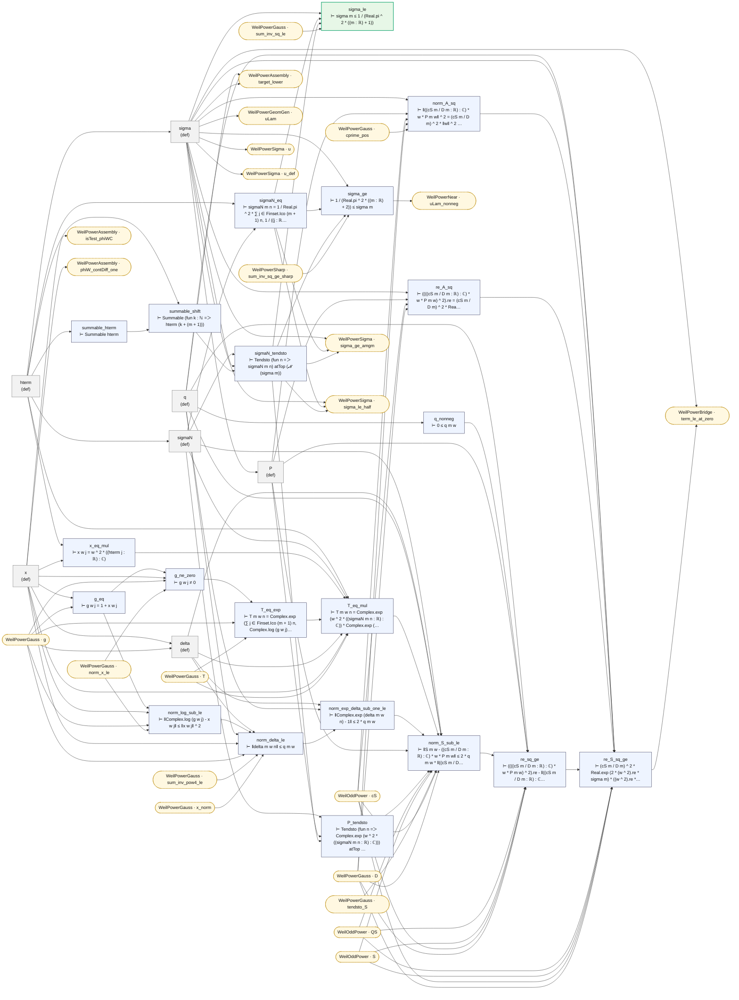

# `lean_stage3/Stage3/WeilPowerPhase.lean`

**What it does** (its own header): WeilPowerPhase — the phase of the tail product: `S m w` is its principal part `c·w·exp(w²σ)` up to a relative error `2q`, and `Re (S m w)²` has an explicit lower bound. Rung 5, twelfth slice; worksheet § 13 requirement (b). 2026-09-06. Unit 0347.

**Imports:** [`WeilPowerSharp`](../lean_stage3/WeilPowerSharp.md).
**Imported by:** [`Stage3`](../lean_stage3/Stage3.md), [`WeilPowerBridge`](../lean_stage3/WeilPowerBridge.md), [`WeilPowerSigma`](../lean_stage3/WeilPowerSigma.md), [`WeilPowerTail`](../lean_stage3/WeilPowerTail.md).

Blue: theorem. Green: a theorem nothing else uses (an end). Dashed white: connects to nothing. Grey: definition. Red: contains `sorry`. Yellow: in another file. An arrow A → B reads "A is used by B".

## Every declaration

| declaration | proves (output) | needs (input) | why (its own docstring) | uses | used by |
|---|---|---|---|---|---|
| `WeilPowerPhase.hterm` def, line 50 | ℝ | j : ℕ | The summand of the tail sum, `1/(π²(j+1)²)`. | — | `WeilPowerPhase.T_eq_mul`, `WeilPowerPhase.sigma`, `WeilPowerPhase.sigmaN`, `WeilPowerPhase.sigmaN_eq`, `WeilPowerPhase.summable_hterm`, `WeilPowerPhase.summable_shift`, `WeilPowerPhase.x_eq_mul` |
| `WeilPowerPhase.sigmaN` def, line 53 | ℝ | m n : ℕ | The partial tail sum `σ_n`. | `WeilPowerPhase.hterm` | `WeilPowerPhase.P_tendsto`, `WeilPowerPhase.T_eq_mul`, `WeilPowerPhase.norm_S_sub_le`, `WeilPowerPhase.sigmaN_eq`, `WeilPowerPhase.sigmaN_tendsto` |
| `WeilPowerPhase.sigma` def, line 56 | ℝ | m : ℕ | The full tail sum `σ = Σ_{j ≥ m+1} 1/(π²(j+1)²)`. | `WeilPowerPhase.hterm` | `WeilPowerAssembly.target_lower`, `WeilPowerBridge.term_le_at_zero`, `WeilPowerGeomGen.uLam`, `WeilPowerPhase.P`, `WeilPowerPhase.norm_A_sq`, `WeilPowerPhase.re_A_sq`, `WeilPowerPhase.re_S_sq_ge`, `WeilPowerPhase.sigmaN_tendsto`, `WeilPowerPhase.sigma_ge`, `WeilPowerPhase.sigma_le`, `WeilPowerSigma.sigma_ge_amgm`, `WeilPowerSigma.sigma_le_half`, `WeilPowerSigma.u`, `WeilPowerSigma.u_def` |
| `WeilPowerPhase.summable_hterm` theorem, line 58 | Summable hterm | — | — | `WeilPowerPhase.hterm` | `WeilPowerPhase.summable_shift` |
| `WeilPowerPhase.summable_shift` theorem, line 68 | Summable (fun k : ℕ =&gt; hterm (k + (m + 1))) | m : ℕ | — | `WeilPowerPhase.hterm`, `WeilPowerPhase.summable_hterm` | `WeilPowerPhase.sigmaN_tendsto` |
| `WeilPowerPhase.sigmaN_eq` theorem, line 71 | sigmaN m n = 1 / Real.pi ^ 2 * ∑ j ∈ Finset.Ico (m + 1) n, 1 / ((j : ℝ) + 1) ^ 2 | m n : ℕ | — | `WeilPowerPhase.hterm`, `WeilPowerPhase.sigmaN` | `WeilPowerPhase.sigma_ge`, `WeilPowerPhase.sigma_le`, `WeilPowerSigma.sigma_ge_amgm`, `WeilPowerSigma.sigma_le_half` |
| `WeilPowerPhase.sigmaN_tendsto` theorem, line 79 | Tendsto (fun n =&gt; sigmaN m n) atTop (𝓝 (sigma m)) | m : ℕ | — | `WeilPowerPhase.sigma`, `WeilPowerPhase.sigmaN`, `WeilPowerPhase.summable_shift` | `WeilPowerPhase.P_tendsto`, `WeilPowerPhase.sigma_ge`, `WeilPowerPhase.sigma_le`, `WeilPowerSigma.sigma_ge_amgm`, `WeilPowerSigma.sigma_le_half` |
| `WeilPowerPhase.sigma_le` theorem, line 89 | sigma m ≤ 1 / (Real.pi ^ 2 * ((m : ℝ) + 1)) | m : ℕ | — | `WeilPowerGauss.sum_inv_sq_le`, `WeilPowerPhase.sigma`, `WeilPowerPhase.sigmaN_eq`, `WeilPowerPhase.sigmaN_tendsto` | — |
| `WeilPowerPhase.sigma_ge` theorem, line 99 | 1 / (Real.pi ^ 2 * ((m : ℝ) + 2)) ≤ sigma m | m : ℕ | — | `WeilPowerPhase.sigma`, `WeilPowerPhase.sigmaN_eq`, `WeilPowerPhase.sigmaN_tendsto`, `WeilPowerSharp.sum_inv_sq_ge_sharp` | `WeilPowerNear.uLam_nonneg` |
| `WeilPowerPhase.x` def, line 114 | ℂ | w : ℂ; j : ℕ | `x_j = w²/(π²(j+1)²)`, so that `g w j = 1 + x w j`. | — | `WeilPowerAssembly.isTest_phiWC`, `WeilPowerAssembly.phiW_contDiff_one`, `WeilPowerPhase.T_eq_mul`, `WeilPowerPhase.delta`, `WeilPowerPhase.g_eq`, `WeilPowerPhase.g_ne_zero`, `WeilPowerPhase.norm_delta_le`, `WeilPowerPhase.norm_log_sub_le`, `WeilPowerPhase.x_eq_mul` |
| `WeilPowerPhase.g_eq` theorem, line 116 | g w j = 1 + x w j | w : ℂ; j : ℕ | — | `WeilPowerGauss.g`, `WeilPowerPhase.x` | `WeilPowerPhase.g_ne_zero`, `WeilPowerPhase.norm_log_sub_le` |
| `WeilPowerPhase.x_eq_mul` theorem, line 118 | x w j = w ^ 2 * ((hterm j : ℝ) : ℂ) | w : ℂ; j : ℕ | — | `WeilPowerPhase.hterm`, `WeilPowerPhase.x` | `WeilPowerPhase.T_eq_mul` |
| `WeilPowerPhase.g_ne_zero` theorem, line 123 | g w j ≠ 0 | hsmall : ‖w‖ ^ 2 ≤ Real.pi ^ 2 * ((m : ℝ) + 2) ^ 2 / 2; hj : m + 1 ≤ j | — | `WeilPowerGauss.g`, `WeilPowerGauss.norm_x_le`, `WeilPowerPhase.g_eq`, `WeilPowerPhase.x` | `WeilPowerPhase.T_eq_exp` |
| `WeilPowerPhase.T_eq_exp` theorem, line 132 | T m w n = Complex.exp (∑ j ∈ Finset.Ico (m + 1) n, Complex.log (g w j)) | hsmall : ‖w‖ ^ 2 ≤ Real.pi ^ 2 * ((m : ℝ) + 2) ^ 2 / 2; n : ℕ | — | `WeilPowerGauss.T`, `WeilPowerGauss.g`, `WeilPowerPhase.g_ne_zero` | `WeilPowerPhase.T_eq_mul` |
| `WeilPowerPhase.delta` def, line 141 | ℂ | m : ℕ; w : ℂ; n : ℕ | `δ_n = Σ (log(1 + x_j) − x_j)`. | `WeilPowerGauss.g`, `WeilPowerPhase.x` | `WeilPowerPhase.T_eq_mul`, `WeilPowerPhase.norm_S_sub_le`, `WeilPowerPhase.norm_delta_le`, `WeilPowerPhase.norm_exp_delta_sub_one_le` |
| `WeilPowerPhase.norm_log_sub_le` theorem, line 144 | ‖Complex.log (g w j) - x w j‖ ≤ ‖x w j‖ ^ 2 | hsmall : ‖w‖ ^ 2 ≤ Real.pi ^ 2 * ((m : ℝ) + 2) ^ 2 / 2; hj : m + 1 ≤ j | — | `WeilPowerGauss.g`, `WeilPowerGauss.norm_x_le`, `WeilPowerPhase.g_eq`, `WeilPowerPhase.x` | `WeilPowerPhase.norm_delta_le` |
| `WeilPowerPhase.q` def, line 161 | ℝ | m : ℕ; w : ℂ | The quartic error `q = ‖w‖⁴/(π⁴(m+1)³)`. | — | `WeilPowerAssembly.target_lower`, `WeilPowerPhase.norm_S_sub_le`, `WeilPowerPhase.norm_delta_le`, `WeilPowerPhase.norm_exp_delta_sub_one_le`, `WeilPowerPhase.q_nonneg`, `WeilPowerPhase.re_S_sq_ge`, `WeilPowerPhase.re_sq_ge` |
| `WeilPowerPhase.q_nonneg` theorem, line 163 | 0 ≤ q m w | m : ℕ; w : ℂ | — | `WeilPowerPhase.q` | `WeilPowerPhase.re_sq_ge` |
| `WeilPowerPhase.norm_delta_le` theorem, line 167 | ‖delta m w n‖ ≤ q m w | hsmall : ‖w‖ ^ 2 ≤ Real.pi ^ 2 * ((m : ℝ) + 2) ^ 2 / 2; n : ℕ | — | `WeilPowerGauss.g`, `WeilPowerGauss.sum_inv_pow4_le`, `WeilPowerGauss.x_norm`, `WeilPowerPhase.delta`, `WeilPowerPhase.norm_log_sub_le`, `WeilPowerPhase.q`, `WeilPowerPhase.x` | `WeilPowerPhase.norm_exp_delta_sub_one_le` |
| `WeilPowerPhase.T_eq_mul` theorem, line 193 | T m w n = Complex.exp (w ^ 2 * ((sigmaN m n : ℝ) : ℂ)) * Complex.exp (delta m w n) | hsmall : ‖w‖ ^ 2 ≤ Real.pi ^ 2 * ((m : ℝ) + 2) ^ 2 / 2; n : ℕ | The split. `T m w n = exp(w² σ_n) · exp(δ_n)`. | `WeilPowerGauss.T`, `WeilPowerPhase.T_eq_exp`, `WeilPowerPhase.delta`, `WeilPowerPhase.hterm`, `WeilPowerPhase.sigmaN`, `WeilPowerPhase.x`, `WeilPowerPhase.x_eq_mul` | `WeilPowerPhase.norm_S_sub_le` |
| `WeilPowerPhase.norm_exp_delta_sub_one_le` theorem, line 207 | ‖Complex.exp (delta m w n) - 1‖ ≤ 2 * q m w | hsmall : ‖w‖ ^ 2 ≤ Real.pi ^ 2 * ((m : ℝ) + 2) ^ 2 / 2; hq : q m w ≤ 1; n : ℕ | — | `WeilPowerPhase.delta`, `WeilPowerPhase.norm_delta_le`, `WeilPowerPhase.q` | `WeilPowerPhase.norm_S_sub_le` |
| `WeilPowerPhase.P` def, line 215 | ℂ | m : ℕ; w : ℂ | The principal part `P = exp(w² σ)`. | `WeilPowerPhase.sigma` | `WeilPowerPhase.P_tendsto`, `WeilPowerPhase.norm_A_sq`, `WeilPowerPhase.norm_S_sub_le`, `WeilPowerPhase.re_A_sq`, `WeilPowerPhase.re_sq_ge` |
| `WeilPowerPhase.P_tendsto` theorem, line 217 | Tendsto (fun n =&gt; Complex.exp (w ^ 2 * ((sigmaN m n : ℝ) : ℂ))) atTop (𝓝 (P m w)) | m : ℕ; w : ℂ | — | `WeilPowerPhase.P`, `WeilPowerPhase.sigmaN`, `WeilPowerPhase.sigmaN_tendsto` | `WeilPowerPhase.norm_S_sub_le` |
| `WeilPowerPhase.norm_S_sub_le` theorem, line 225 | ‖S m w - ((cS m / D m : ℝ) : ℂ) * w * P m w‖ ≤ 2 * q m w * ‖((cS m / D m : ℝ) : ℂ) * w * P m w‖ | hne : QS m w ≠ 0; hsmall : ‖w‖ ^ 2 ≤ Real.pi ^ 2 * ((m : ℝ) + 2) ^ 2 / 2; hq : q m w ≤ 1 | The principal part carries `S` up to `2q`. | `WeilOddPower.QS`, `WeilOddPower.S`, `WeilOddPower.cS`, `WeilPowerGauss.D`, `WeilPowerGauss.tendsto_S`, `WeilPowerPhase.P`, `WeilPowerPhase.P_tendsto`, `WeilPowerPhase.T_eq_mul`, `WeilPowerPhase.delta`, `WeilPowerPhase.norm_exp_delta_sub_one_le`, `WeilPowerPhase.q`, `WeilPowerPhase.sigmaN` | `WeilPowerPhase.re_sq_ge` |
| `WeilPowerPhase.norm_A_sq` theorem, line 245 | ‖((cS m / D m : ℝ) : ℂ) * w * P m w‖ ^ 2 = (cS m / D m) ^ 2 * ‖w‖ ^ 2 * Real.exp (2 * (w ^ 2).re * sigma m) | m : ℕ; w : ℂ | — | `WeilOddPower.cS`, `WeilPowerGauss.D`, `WeilPowerGauss.cprime_pos`, `WeilPowerPhase.P`, `WeilPowerPhase.sigma` | `WeilPowerPhase.re_S_sq_ge` |
| `WeilPowerPhase.re_A_sq` theorem, line 258 | ((((cS m / D m : ℝ) : ℂ) * w * P m w) ^ 2).re = (cS m / D m) ^ 2 * Real.exp (2 * (w ^ 2).re * sigma m) * ((w ^ 2).re * Real.cos (2 * (w ^ 2).im * sigma m) - (w ^ 2).im * Real.sin (2 * (w ^ 2).im * sigma m)) | m : ℕ; w : ℂ | The real part of the principal part squared, explicitly. | `WeilOddPower.cS`, `WeilPowerGauss.D`, `WeilPowerPhase.P`, `WeilPowerPhase.sigma` | `WeilPowerPhase.re_S_sq_ge` |
| `WeilPowerPhase.re_sq_ge` theorem, line 285 | ((((cS m / D m : ℝ) : ℂ) * w * P m w) ^ 2).re - ‖((cS m / D m : ℝ) : ℂ) * w * P m w‖ ^ 2 * (4 * q m w + 4 * q m w ^ 2) ≤ ((S m w) ^ 2).re | hne : QS m w ≠ 0; hsmall : ‖w‖ ^ 2 ≤ Real.pi ^ 2 * ((m : ℝ) + 2) ^ 2 / 2; hq : q m w ≤ 1 | The lower bound on `Re (S m w)²`. | `WeilOddPower.QS`, `WeilOddPower.S`, `WeilOddPower.cS`, `WeilPowerGauss.D`, `WeilPowerPhase.P`, `WeilPowerPhase.norm_S_sub_le`, `WeilPowerPhase.q`, `WeilPowerPhase.q_nonneg` | `WeilPowerPhase.re_S_sq_ge` |
| `WeilPowerPhase.re_S_sq_ge` theorem, line 312 | (cS m / D m) ^ 2 * Real.exp (2 * (w ^ 2).re * sigma m) * ((w ^ 2).re * Real.cos (2 * (w ^ 2).im * sigma m) - (w ^ 2).im * Real.sin (2 * (w ^ 2).im * sigma m)) - (cS m / D m) ^ 2 * ‖w‖ ^ 2 * Real.exp (2 * (w ^ 2).re * sigma m) * (4 * q m w + 4 * q m w ^ 2) ≤ ((S m w) ^ 2).re | hne : QS m w ≠ 0; hsmall : ‖w‖ ^ 2 ≤ Real.pi ^ 2 * ((m : ℝ) + 2) ^ 2 / 2; hq : q m w ≤ 1 | The deliverable. | `WeilOddPower.QS`, `WeilOddPower.S`, `WeilOddPower.cS`, `WeilPowerGauss.D`, `WeilPowerPhase.norm_A_sq`, `WeilPowerPhase.q`, `WeilPowerPhase.re_A_sq`, `WeilPowerPhase.re_sq_ge`, `WeilPowerPhase.sigma` | `WeilPowerBridge.term_le_at_zero` |
