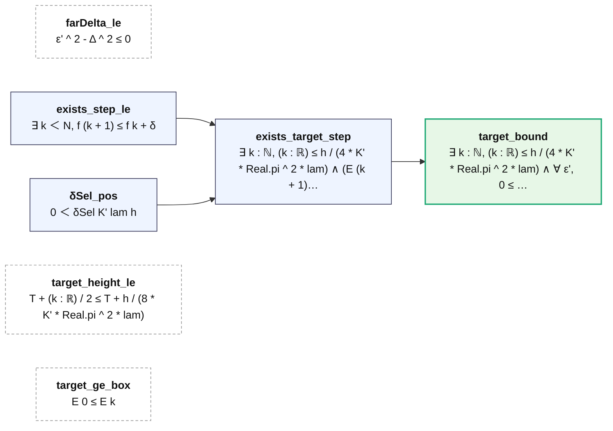

# `lean_stage3/Stage3/WeilPowerSelect.lean`

WeilPowerSelect — selection of the target. Rung 5, tenth slice, worksheet section 8. 2026-09-06.

7 theorems, 1 definition, 191 lines. Arrows are Lean's own record of what each proof uses.

**Imports:** [`WeilPowerCompare`](../lean_stage3/WeilPowerCompare.md)  
**Imported by:** [`Stage3`](../lean_stage3/Stage3.md)

## The picture



An arrow A → B reads "A is used in the proof of B". Blue: theorem. Green: a theorem nothing else uses (an end). Dashed: connects to nothing. Red: contains `sorry`. Yellow: theorems in another file, counted; a dotted arrow crosses files. Definitions are not drawn; they are listed below the diagram.

## Definitions

<a name="WeilPowerSelect--Sel"></a>
### `WeilPowerSelect.δSel`

def · line 102

The step size, `K'π²λ/h`.

- **Is:** `` δSel (K' lam h : ℝ) : ℝ := K' * Real.pi ^ 2 * lam / h ``
- **Used by 3:** [`WeilPowerSelect.exists_target_step`](#WeilPowerSelect-exists_target_step), [`WeilPowerSelect.target_bound`](#WeilPowerSelect-target_bound), [`WeilPowerSelect.δSel_pos`](#WeilPowerSelect--Sel_pos)

## Theorems

<a name="WeilPowerSelect-farDelta_le"></a>
### `WeilPowerSelect.farDelta_le`

line 68

**Why.** Far heights need no selection. A zero with real part offset in `[0, 1/2]` and height offset at least `1/2` already has `ε'² ≤ Δ²`, with no choice of target at all.

**Proves**

```lean
ε' ^ 2 - Δ ^ 2 ≤ 0
```

**Needs** (its hypotheses)

  - `` hε'0 : 0 ≤ ε' ``
  - `` hε'half : ε' ≤ 1 / 2 ``
  - `` hΔ : 1 / 2 ≤ |Δ| ``

**Fed by:** no theorem of this repo; it stands on Mathlib.

**Feeds:** nothing. It connects to nothing.

<a name="WeilPowerSelect-exists_step_le"></a>
### `WeilPowerSelect.exists_step_le`

line 80

**Why.** The pigeonhole lemma. A sequence, nonnegative at `0` and bounded above by `B` at every step, cannot climb by more than `δ` at every one of `N` steps once `N·δ > B`. Monotonicity of `f` is not needed: boundedness at each step is already enough to stop the climb.

**Proves**

```lean
∃ k < N, f (k + 1) ≤ f k + δ
```

**Needs** (its hypotheses)

  - `` hbound : ∀ k, f k ≤ B ``
  - `` hnonneg : 0 ≤ f 0 ``
  - `` hN : B < (N : ℝ) * δ ``

**Fed by:** no theorem of this repo; it stands on Mathlib.

**Feeds** (1 that use it)

  - [`WeilPowerSelect.exists_target_step`](#WeilPowerSelect-exists_target_step) — `` ∃ k : ℕ, (k : ℝ) ≤ h / (4 * K' * Real.pi ^ 2 * lam) ∧ (E (k + 1)) ^ 2 ≤ (E k) ^ 2 + δSel K' lam h ``

<a name="WeilPowerSelect--Sel_pos"></a>
### `WeilPowerSelect.δSel_pos`

line 104

**Proves**

```lean
0 < δSel K' lam h
```

**Needs** (its hypotheses)

  - `` hK' : 0 < K' ``
  - `` hlam : 0 < lam ``
  - `` hh : 0 < h ``

**Stated with:** [`WeilPowerSelect.δSel`](#WeilPowerSelect--Sel)

**Fed by:** no theorem of this repo; it stands on Mathlib and the definitions below.

**Feeds** (1 that use it)

  - [`WeilPowerSelect.exists_target_step`](#WeilPowerSelect-exists_target_step) — `` ∃ k : ℕ, (k : ℝ) ≤ h / (4 * K' * Real.pi ^ 2 * lam) ∧ (E (k + 1)) ^ 2 ≤ (E k) ^ 2 + δSel K' lam h ``

<a name="WeilPowerSelect-exists_target_step"></a>
### `WeilPowerSelect.exists_target_step`

line 112

**Why.** The step exists, with its height explicit. `E`'s square cannot climb by more than `δSel K' λ h` at every step past `h/(4K'π²λ)`.

**Proves**

```lean
∃ k : ℕ, (k : ℝ) ≤ h / (4 * K' * Real.pi ^ 2 * lam) ∧ (E (k + 1)) ^ 2 ≤ (E k) ^ 2 + δSel K' lam h
```

**Needs** (its hypotheses)

  - `` hbound : ∀ k, 0 ≤ E k ∧ E k ≤ 1 / 2 ``
  - `` hK' : 0 < K' ``
  - `` hlam : 0 < lam ``
  - `` hh : 0 < h ``

**Stated with:** [`WeilPowerSelect.δSel`](#WeilPowerSelect--Sel)

**Fed by** (2 theorems its proof uses)

  - [`WeilPowerSelect.exists_step_le`](#WeilPowerSelect-exists_step_le) — `` ∃ k < N, f (k + 1) ≤ f k + δ ``
  - [`WeilPowerSelect.δSel_pos`](#WeilPowerSelect--Sel_pos) — `` 0 < δSel K' lam h ``

**Feeds** (1 that use it)

  - [`WeilPowerSelect.target_bound`](#WeilPowerSelect-target_bound) — `` ∃ k : ℕ, (k : ℝ) ≤ h / (4 * K' * Real.pi ^ 2 * lam) ∧ ∀ ε', 0 ≤ ε' → ε' ≤ E (k + 1) → ε' ^ 2 ≤ (E k) ^ 2 + δSel K' lam h ``

<a name="WeilPowerSelect-target_bound"></a>
### `WeilPowerSelect.target_bound`

line 148

**Why.** Selection of the target. There is a step `k`, at height at most `h/(4K'π²λ)` above the box's own step, whose `(k+1)`-neighbours all meet the cluster's criterion against `E k`.

**Proves**

```lean
∃ k : ℕ, (k : ℝ) ≤ h / (4 * K' * Real.pi ^ 2 * lam) ∧ ∀ ε', 0 ≤ ε' → ε' ≤ E (k + 1) → ε' ^ 2 ≤ (E k) ^ 2 + δSel K' lam h
```

**Needs** (its hypotheses)

  - `` hbound : ∀ k, 0 ≤ E k ∧ E k ≤ 1 / 2 ``
  - `` hK' : 0 < K' ``
  - `` hlam : 0 < lam ``
  - `` hh : 0 < h ``

**Stated with:** [`WeilPowerSelect.δSel`](#WeilPowerSelect--Sel)

**Fed by** (1 theorem its proof uses)

  - [`WeilPowerSelect.exists_target_step`](#WeilPowerSelect-exists_target_step) — `` ∃ k : ℕ, (k : ℝ) ≤ h / (4 * K' * Real.pi ^ 2 * lam) ∧ (E (k + 1)) ^ 2 ≤ (E k) ^ 2 + δSel K' lam h ``

**Feeds:** nothing. It is an end.

<a name="WeilPowerSelect-target_height_le"></a>
### `WeilPowerSelect.target_height_le`

line 159

**Why.** The step's height above the box: `T + k/2 ≤ T + h/(8K'π²λ)`.

**Proves**

```lean
T + (k : ℝ) / 2 ≤ T + h / (8 * K' * Real.pi ^ 2 * lam)
```

**Needs** (its hypotheses)

  - `` hk : (k : ℝ) ≤ h / (4 * K' * Real.pi ^ 2 * lam) ``

**Fed by:** no theorem of this repo; it stands on Mathlib.

**Feeds:** nothing. It connects to nothing.

<a name="WeilPowerSelect-target_ge_box"></a>
### `WeilPowerSelect.target_ge_box`

line 169

**Why.** The target's own real-part offset is at least the box zero's.

**Proves**

```lean
E 0 ≤ E k
```

**Needs** (its hypotheses)

  - `` hmono : Monotone E ``
  - `` k : ℕ ``

**Fed by:** no theorem of this repo; it stands on Mathlib.

**Feeds:** nothing. It connects to nothing.

