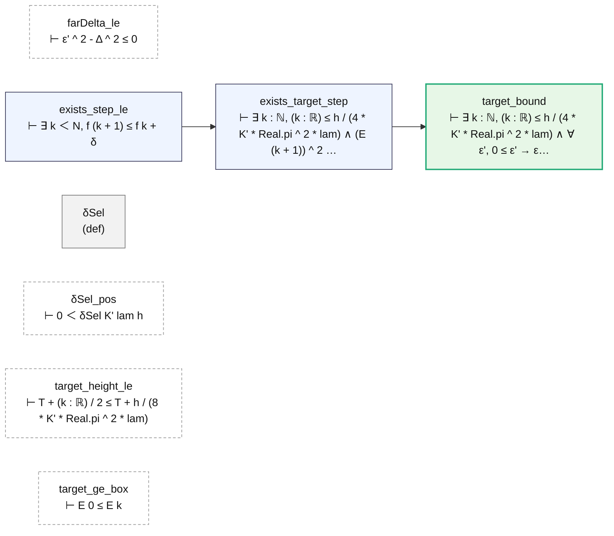

# `lean_stage3/Stage3/WeilPowerSelect.lean`

**What it does** (its own header): WeilPowerSelect — selection of the target. Rung 5, tenth slice, worksheet section 8. 2026-09-06.

**Imports:** [`WeilPowerCompare`](../lean_stage3/WeilPowerCompare.md).
**Imported by:** [`Stage3`](../lean_stage3/Stage3.md).

Blue: theorem. Green: a theorem nothing else uses (an end). Dashed white: connects to nothing. Grey: definition. Red: contains `sorry`. Yellow: in another file. An arrow A → B reads "A is used by B".

## Every declaration

| declaration | proves (output) | needs (input) | why (its own docstring) | uses | used by |
|---|---|---|---|---|---|
| `WeilPowerSelect.farDelta_le` theorem, line 68 | ε' ^ 2 - Δ ^ 2 ≤ 0 | hε'0 : 0 ≤ ε'; hε'half : ε' ≤ 1 / 2; hΔ : 1 / 2 ≤ \|Δ\| | Far heights need no selection. A zero with real part offset in `[0, 1/2]` and height offset at least `1/2` already has `ε'² ≤ Δ²`, with no choice of target at all. | — | — |
| `WeilPowerSelect.exists_step_le` theorem, line 80 | ∃ k &lt; N, f (k + 1) ≤ f k + δ | hbound : ∀ k, f k ≤ B; hnonneg : 0 ≤ f 0; hN : B &lt; (N : ℝ) * δ | The pigeonhole lemma. A sequence, nonnegative at `0` and bounded above by `B` at every step, cannot climb by more than `δ` at every one of `N` steps once `N·δ &gt; B`. Monotonicity of `f` is not needed: boundedness at each step is already enough to stop the climb. | — | `WeilPowerSelect.exists_target_step` |
| `WeilPowerSelect.δSel` def, line 102 | ℝ | K' lam h : ℝ | The step size, `K'π²λ/h`. | — | — |
| `WeilPowerSelect.δSel_pos` theorem, line 104 | 0 &lt; δSel K' lam h | hK' : 0 &lt; K'; hlam : 0 &lt; lam; hh : 0 &lt; h | — | — | — |
| `WeilPowerSelect.exists_target_step` theorem, line 112 | ∃ k : ℕ, (k : ℝ) ≤ h / (4 * K' * Real.pi ^ 2 * lam) ∧ (E (k + 1)) ^ 2 ≤ (E k) ^ 2 + δSel K' lam h | hbound : ∀ k, 0 ≤ E k ∧ E k ≤ 1 / 2; hK' : 0 &lt; K'; hlam : 0 &lt; lam; hh : 0 &lt; h | The step exists, with its height explicit. `E`'s square cannot climb by more than `δSel K' λ h` at every step past `h/(4K'π²λ)`. | `WeilPowerSelect.exists_step_le` | `WeilPowerSelect.target_bound` |
| `WeilPowerSelect.target_bound` theorem, line 148 | ∃ k : ℕ, (k : ℝ) ≤ h / (4 * K' * Real.pi ^ 2 * lam) ∧ ∀ ε', 0 ≤ ε' → ε' ≤ E (k + 1) → ε' ^ 2 ≤ (E k) ^ 2 + δSel K' lam h | hbound : ∀ k, 0 ≤ E k ∧ E k ≤ 1 / 2; hK' : 0 &lt; K'; hlam : 0 &lt; lam; hh : 0 &lt; h | Selection of the target. There is a step `k`, at height at most `h/(4K'π²λ)` above the box's own step, whose `(k+1)`-neighbours all meet the cluster's criterion against `E k`. | `WeilPowerSelect.exists_target_step` | — |
| `WeilPowerSelect.target_height_le` theorem, line 159 | T + (k : ℝ) / 2 ≤ T + h / (8 * K' * Real.pi ^ 2 * lam) | hk : (k : ℝ) ≤ h / (4 * K' * Real.pi ^ 2 * lam) | The step's height above the box: `T + k/2 ≤ T + h/(8K'π²λ)`. | — | — |
| `WeilPowerSelect.target_ge_box` theorem, line 169 | E 0 ≤ E k | hmono : Monotone E; k : ℕ | The target's own real-part offset is at least the box zero's. | — | — |
