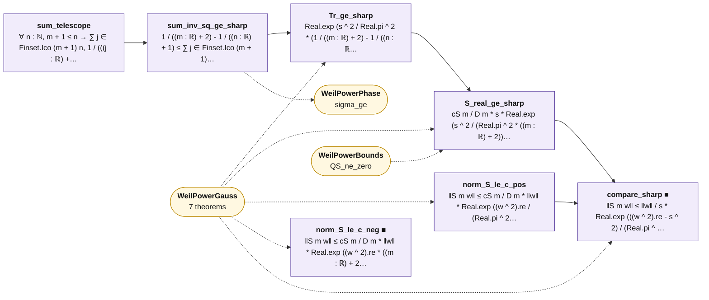

# `lean_stage3/Stage3/WeilPowerSharp.lean`

WeilPowerSharp — the Gaussian bounds with the constant kept exact and the tail sum sharp: the two lost factors of WeilPowerGauss removed. Rung 5, eleventh slice. 2026-09-06. Unit 0346; the decision is unit 0345.

7 theorems, 0 definitions, 245 lines. Arrows are Lean's own record of what each proof uses.

**Imports:** [`WeilPowerGauss`](../lean_stage3/WeilPowerGauss.md)  
**Imported by:** [`Stage3`](../lean_stage3/Stage3.md), [`WeilPowerAssembly`](../lean_stage3/WeilPowerAssembly.md), [`WeilPowerPhase`](../lean_stage3/WeilPowerPhase.md)

## The picture



An arrow A → B reads "A is used in the proof of B". Green: counting, integers only. Violet: shape, analysis with no ζ. Blue: reads ζ. A name ending in ■ is an end: nothing else uses it. Red: contains `sorry`. Yellow: theorems in another file, counted; a dotted arrow crosses files. Definitions are not drawn; they are listed below the diagram.

## Theorems

<a name="WeilPowerSharp-sum_telescope"></a>
### `WeilPowerSharp.sum_telescope`

line 53

**Shape.** Uses real or complex analysis; nothing in it or beneath it reads ζ.

**Why.** Telescoping sum over the tail.

**Proves**

```lean
∀ n : ℕ, m + 1 ≤ n → ∑ j ∈ Finset.Ico (m + 1) n, 1 / (((j : ℝ) + 1) * ((j : ℝ) + 2)) = 1 / ((m : ℝ) + 2) - 1 / ((n : ℝ) + 1)
```

**Needs** (its hypotheses)

  - `` m : ℕ ``

**Fed by:** no theorem of this repo; it stands on Mathlib.

**Feeds** (1 that use it)

  - [`WeilPowerSharp.sum_inv_sq_ge_sharp`](#WeilPowerSharp-sum_inv_sq_ge_sharp) — `` 1 / ((m : ℝ) + 2) - 1 / ((n : ℝ) + 1) ≤ ∑ j ∈ Finset.Ico (m + 1) n, 1 / ((j : ℝ) + 1) ^ 2 ``

<a name="WeilPowerSharp-sum_inv_sq_ge_sharp"></a>
### `WeilPowerSharp.sum_inv_sq_ge_sharp`

line 69

**Shape.** Uses real or complex analysis; nothing in it or beneath it reads ζ.

**Why.** The sharp lower bound for the tail sum: `1/(m+2) − 1/(n+1)`.

**Proves**

```lean
1 / ((m : ℝ) + 2) - 1 / ((n : ℝ) + 1) ≤ ∑ j ∈ Finset.Ico (m + 1) n, 1 / ((j : ℝ) + 1) ^ 2
```

**Needs** (its hypotheses)

  - `` m : ℕ ``
  - `` hn : m + 1 ≤ n ``

**Fed by** (1 theorem its proof uses)

  - [`WeilPowerSharp.sum_telescope`](#WeilPowerSharp-sum_telescope) — `` ∀ n : ℕ, m + 1 ≤ n → ∑ j ∈ Finset.Ico (m + 1) n, 1 / (((j : ℝ) + 1) * ((j : ℝ) + 2)) = 1 / ((m : ℝ) + 2) - 1 / ((n : ℝ) + 1) ``

**Feeds** (2 that use it)

  - [`WeilPowerPhase.sigma_ge`](../lean_stage3/WeilPowerPhase.md#WeilPowerPhase-sigma_ge) (WeilPowerPhase) — `` 1 / (Real.pi ^ 2 * ((m : ℝ) + 2)) ≤ sigma m ``
  - [`WeilPowerSharp.Tr_ge_sharp`](#WeilPowerSharp-Tr_ge_sharp) — `` Real.exp (s ^ 2 / Real.pi ^ 2 * (1 / ((m : ℝ) + 2) - 1 / ((n : ℝ) + 1)) - s ^ 4 / (Real.pi ^ 4 * ((m : ℝ) + 1) ^ 3)) ≤ Tr m s n ``

<a name="WeilPowerSharp-Tr_ge_sharp"></a>
### `WeilPowerSharp.Tr_ge_sharp`

line 80

**Shape.** Uses real or complex analysis; nothing in it or beneath it reads ζ.

**Why.** Tail product lower bound with the sharp sum.

**Proves**

```lean
Real.exp (s ^ 2 / Real.pi ^ 2 * (1 / ((m : ℝ) + 2) - 1 / ((n : ℝ) + 1)) - s ^ 4 / (Real.pi ^ 4 * ((m : ℝ) + 1) ^ 3)) ≤ Tr m s n
```

**Needs** (its hypotheses)

  - `` hsmall : s ^ 2 ≤ Real.pi ^ 2 * ((m : ℝ) + 2) ^ 2 / 2 ``
  - `` hn : m + 1 ≤ n ``

**Stated with:** [`WeilPowerGauss.Tr`](../lean_stage3/WeilPowerGauss.md#WeilPowerGauss-Tr)

**Fed by** (3 theorems its proof uses)

  - [`WeilPowerGauss.exp_le_one_add`](../lean_stage3/WeilPowerGauss.md#WeilPowerGauss-exp_le_one_add) (WeilPowerGauss) — `` Real.exp (x - x ^ 2) ≤ 1 + x ``
  - [`WeilPowerGauss.sum_inv_pow4_le`](../lean_stage3/WeilPowerGauss.md#WeilPowerGauss-sum_inv_pow4_le) (WeilPowerGauss) — `` ∑ j ∈ Finset.Ico (m + 1) n, 1 / ((j : ℝ) + 1) ^ 4 ≤ 1 / ((m : ℝ) + 1) ^ 3 ``
  - [`WeilPowerSharp.sum_inv_sq_ge_sharp`](#WeilPowerSharp-sum_inv_sq_ge_sharp) — `` 1 / ((m : ℝ) + 2) - 1 / ((n : ℝ) + 1) ≤ ∑ j ∈ Finset.Ico (m + 1) n, 1 / ((j : ℝ) + 1) ^ 2 ``

**Feeds** (1 that use it)

  - [`WeilPowerSharp.S_real_ge_sharp`](#WeilPowerSharp-S_real_ge_sharp) — `` cS m / D m * s * Real.exp (s ^ 2 / (Real.pi ^ 2 * ((m : ℝ) + 2)) - s ^ 4 / (Real.pi ^ 4 * ((m : ℝ) + 1) ^ 3)) ≤ (S m (s : ℂ)).re ``

<a name="WeilPowerSharp-S_real_ge_sharp"></a>
### `WeilPowerSharp.S_real_ge_sharp`

line 133

**Shape.** Uses real or complex analysis; nothing in it or beneath it reads ζ.

**Why.** Lower bound at the target, sharp. The constant is `cS m / D m` itself and the rate is `s²/(π²(m+2))`.

**Proves**

```lean
cS m / D m * s * Real.exp (s ^ 2 / (Real.pi ^ 2 * ((m : ℝ) + 2)) - s ^ 4 / (Real.pi ^ 4 * ((m : ℝ) + 1) ^ 3)) ≤ (S m (s : ℂ)).re
```

**Needs** (its hypotheses)

  - `` hs : 0 < s ``
  - `` hsmall : s ^ 2 ≤ Real.pi ^ 2 * ((m : ℝ) + 2) ^ 2 / 2 ``

**Stated with:** [`WeilOddPower.S`](../lean_stage3/WeilOddPower.md#WeilOddPower-S), [`WeilOddPower.cS`](../lean_stage3/WeilOddPower.md#WeilOddPower-cS), [`WeilPowerGauss.D`](../lean_stage3/WeilPowerGauss.md#WeilPowerGauss-D)

**Fed by** (5 theorems its proof uses)

  - [`WeilPowerBounds.QS_ne_zero`](../lean_stage3/WeilPowerBounds.md#WeilPowerBounds-QS_ne_zero) (WeilPowerBounds) — `` QS m w ≠ 0 ``
  - [`WeilPowerGauss.T_ofReal`](../lean_stage3/WeilPowerGauss.md#WeilPowerGauss-T_ofReal) (WeilPowerGauss) — `` T m (s : ℂ) n = ((Tr m s n : ℝ) : ℂ) ``
  - [`WeilPowerGauss.cprime_pos`](../lean_stage3/WeilPowerGauss.md#WeilPowerGauss-cprime_pos) (WeilPowerGauss) — `` 0 < cS m / D m ``
  - [`WeilPowerGauss.tendsto_S`](../lean_stage3/WeilPowerGauss.md#WeilPowerGauss-tendsto_S) (WeilPowerGauss) — `` Tendsto (fun n : ℕ => ((cS m / D m : ℝ) : ℂ) * w * T m w n) atTop (𝓝 (S m w)) ``
  - [`WeilPowerSharp.Tr_ge_sharp`](#WeilPowerSharp-Tr_ge_sharp) — `` Real.exp (s ^ 2 / Real.pi ^ 2 * (1 / ((m : ℝ) + 2) - 1 / ((n : ℝ) + 1)) - s ^ 4 / (Real.pi ^ 4 * ((m : ℝ) + 1) ^ 3)) ≤ Tr m s n ``

**Definitions its proof touches:** [`WeilOddPower.QS`](../lean_stage3/WeilOddPower.md#WeilOddPower-QS), [`WeilPowerGauss.T`](../lean_stage3/WeilPowerGauss.md#WeilPowerGauss-T), [`WeilPowerGauss.Tr`](../lean_stage3/WeilPowerGauss.md#WeilPowerGauss-Tr)

**Feeds** (1 that use it)

  - [`WeilPowerSharp.compare_sharp`](#WeilPowerSharp-compare_sharp) — `` ‖S m w‖ ≤ ‖w‖ / s * Real.exp (((w ^ 2).re - s ^ 2) / (Real.pi ^ 2 * ((m : ℝ) + 1)) + s ^ 2 / (Real.pi ^ 2 * ((m : ℝ) + 1) * ((m : ℝ) + 2)) + (‖w‖ ^ 4 … ``

<a name="WeilPowerSharp-norm_S_le_c_pos"></a>
### `WeilPowerSharp.norm_S_le_c_pos`

line 163

**Shape.** Uses real or complex analysis; nothing in it or beneath it reads ζ.

**Why.** Upper bound, `Re(w²) ≥ 0`, constant kept.

**Proves**

```lean
‖S m w‖ ≤ cS m / D m * ‖w‖ * Real.exp ((w ^ 2).re / (Real.pi ^ 2 * ((m : ℝ) + 1)) + ‖w‖ ^ 4 / (Real.pi ^ 4 * ((m : ℝ) + 1) ^ 3))
```

**Needs** (its hypotheses)

  - `` hne : QS m w ≠ 0 ``
  - `` hsmall : ‖w‖ ^ 2 ≤ Real.pi ^ 2 * ((m : ℝ) + 2) ^ 2 / 2 ``
  - `` hre : 0 ≤ (w ^ 2).re ``

**Stated with:** [`WeilOddPower.QS`](../lean_stage3/WeilOddPower.md#WeilOddPower-QS), [`WeilOddPower.S`](../lean_stage3/WeilOddPower.md#WeilOddPower-S), [`WeilOddPower.cS`](../lean_stage3/WeilOddPower.md#WeilOddPower-cS), [`WeilPowerGauss.D`](../lean_stage3/WeilPowerGauss.md#WeilPowerGauss-D)

**Fed by** (3 theorems its proof uses)

  - [`WeilPowerGauss.cprime_pos`](../lean_stage3/WeilPowerGauss.md#WeilPowerGauss-cprime_pos) (WeilPowerGauss) — `` 0 < cS m / D m ``
  - [`WeilPowerGauss.norm_T_le_pos`](../lean_stage3/WeilPowerGauss.md#WeilPowerGauss-norm_T_le_pos) (WeilPowerGauss) — `` ‖T m w n‖ ≤ Real.exp ((w ^ 2).re / (Real.pi ^ 2 * ((m : ℝ) + 1)) + ‖w‖ ^ 4 / (Real.pi ^ 4 * ((m : ℝ) + 1) ^ 3)) ``
  - [`WeilPowerGauss.tendsto_S`](../lean_stage3/WeilPowerGauss.md#WeilPowerGauss-tendsto_S) (WeilPowerGauss) — `` Tendsto (fun n : ℕ => ((cS m / D m : ℝ) : ℂ) * w * T m w n) atTop (𝓝 (S m w)) ``

**Definitions its proof touches:** [`WeilPowerGauss.T`](../lean_stage3/WeilPowerGauss.md#WeilPowerGauss-T)

**Feeds** (1 that use it)

  - [`WeilPowerSharp.compare_sharp`](#WeilPowerSharp-compare_sharp) — `` ‖S m w‖ ≤ ‖w‖ / s * Real.exp (((w ^ 2).re - s ^ 2) / (Real.pi ^ 2 * ((m : ℝ) + 1)) + s ^ 2 / (Real.pi ^ 2 * ((m : ℝ) + 1) * ((m : ℝ) + 2)) + (‖w‖ ^ 4 … ``

<a name="WeilPowerSharp-norm_S_le_c_neg"></a>
### `WeilPowerSharp.norm_S_le_c_neg`

line 175

**Shape.** Uses real or complex analysis; nothing in it or beneath it reads ζ.

**Why.** Upper bound, `Re(w²) ≤ 0`, constant kept. The exponent is unit 0333's.

**Proves**

```lean
‖S m w‖ ≤ cS m / D m * ‖w‖ * Real.exp ((w ^ 2).re * ((m : ℝ) + 2) / (Real.pi ^ 2 * (2 * (m : ℝ) + 3) ^ 2) + ‖w‖ ^ 4 / (Real.pi ^ 4 * ((m : ℝ) + 1) ^ 3))
```

**Needs** (its hypotheses)

  - `` hne : QS m w ≠ 0 ``
  - `` hsmall : ‖w‖ ^ 2 ≤ Real.pi ^ 2 * ((m : ℝ) + 2) ^ 2 / 2 ``
  - `` hre : (w ^ 2).re ≤ 0 ``

**Stated with:** [`WeilOddPower.QS`](../lean_stage3/WeilOddPower.md#WeilOddPower-QS), [`WeilOddPower.S`](../lean_stage3/WeilOddPower.md#WeilOddPower-S), [`WeilOddPower.cS`](../lean_stage3/WeilOddPower.md#WeilOddPower-cS), [`WeilPowerGauss.D`](../lean_stage3/WeilPowerGauss.md#WeilPowerGauss-D)

**Fed by** (3 theorems its proof uses)

  - [`WeilPowerGauss.cprime_pos`](../lean_stage3/WeilPowerGauss.md#WeilPowerGauss-cprime_pos) (WeilPowerGauss) — `` 0 < cS m / D m ``
  - [`WeilPowerGauss.norm_T_le_neg`](../lean_stage3/WeilPowerGauss.md#WeilPowerGauss-norm_T_le_neg) (WeilPowerGauss) — `` ‖T m w n‖ ≤ Real.exp ((w ^ 2).re * ((m : ℝ) + 2) / (Real.pi ^ 2 * (2 * (m : ℝ) + 3) ^ 2) + ‖w‖ ^ 4 / (Real.pi ^ 4 * ((m : ℝ) + 1) ^ 3)) ``
  - [`WeilPowerGauss.tendsto_S`](../lean_stage3/WeilPowerGauss.md#WeilPowerGauss-tendsto_S) (WeilPowerGauss) — `` Tendsto (fun n : ℕ => ((cS m / D m : ℝ) : ℂ) * w * T m w n) atTop (𝓝 (S m w)) ``

**Definitions its proof touches:** [`WeilPowerGauss.T`](../lean_stage3/WeilPowerGauss.md#WeilPowerGauss-T)

**Feeds:** nothing. It is an end.

<a name="WeilPowerSharp-compare_sharp"></a>
### `WeilPowerSharp.compare_sharp`

line 190

**Shape.** Uses real or complex analysis; nothing in it or beneath it reads ζ.

**Why.** The comparison with no lost factor. For `0 ≤ Re(w²)`, `0 < s`, both in the regime, `‖S m w‖ ≤ (‖w‖/s) · exp(E) · Re (S m s)` with `E = (Re(w²) − s²)/(π²(m+1)) + s²/(π²(m+1)(m+2)) + (‖w‖⁴ + s⁴)/(π⁴(m+1)³)`.

**Proves**

```lean
‖S m w‖ ≤ ‖w‖ / s * Real.exp (((w ^ 2).re - s ^ 2) / (Real.pi ^ 2 * ((m : ℝ) + 1)) + s ^ 2 / (Real.pi ^ 2 * ((m : ℝ) + 1) * ((m : ℝ) + 2)) + (‖w‖ ^ 4 + s ^ 4) / (Real.pi ^ 4 * ((m : ℝ) + 1) ^ 3)) * (S m (s : ℂ)).re
```

**Needs** (its hypotheses)

  - `` hne : QS m w ≠ 0 ``
  - `` hs : 0 < s ``
  - `` hw : ‖w‖ ^ 2 ≤ Real.pi ^ 2 * ((m : ℝ) + 2) ^ 2 / 2 ``
  - `` hsm : s ^ 2 ≤ Real.pi ^ 2 * ((m : ℝ) + 2) ^ 2 / 2 ``
  - `` hre : 0 ≤ (w ^ 2).re ``

**Stated with:** [`WeilOddPower.QS`](../lean_stage3/WeilOddPower.md#WeilOddPower-QS), [`WeilOddPower.S`](../lean_stage3/WeilOddPower.md#WeilOddPower-S)

**Fed by** (3 theorems its proof uses)

  - [`WeilPowerGauss.cprime_pos`](../lean_stage3/WeilPowerGauss.md#WeilPowerGauss-cprime_pos) (WeilPowerGauss) — `` 0 < cS m / D m ``
  - [`WeilPowerSharp.S_real_ge_sharp`](#WeilPowerSharp-S_real_ge_sharp) — `` cS m / D m * s * Real.exp (s ^ 2 / (Real.pi ^ 2 * ((m : ℝ) + 2)) - s ^ 4 / (Real.pi ^ 4 * ((m : ℝ) + 1) ^ 3)) ≤ (S m (s : ℂ)).re ``
  - [`WeilPowerSharp.norm_S_le_c_pos`](#WeilPowerSharp-norm_S_le_c_pos) — `` ‖S m w‖ ≤ cS m / D m * ‖w‖ * Real.exp ((w ^ 2).re / (Real.pi ^ 2 * ((m : ℝ) + 1)) + ‖w‖ ^ 4 / (Real.pi ^ 4 * ((m : ℝ) + 1) ^ 3)) ``

**Definitions its proof touches:** [`WeilOddPower.cS`](../lean_stage3/WeilOddPower.md#WeilOddPower-cS), [`WeilPowerGauss.D`](../lean_stage3/WeilPowerGauss.md#WeilPowerGauss-D)

**Feeds:** nothing. It is an end.

